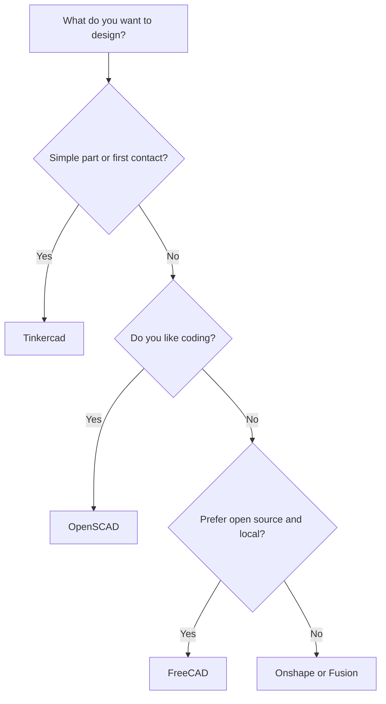
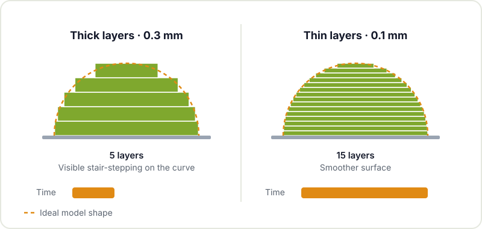

A 3D printer on its own doesn't do much. What turns an idea into a useful part is the chain of tools around it: the program you design in, the slicer that translates that design into instructions, the repositories where you find (and share) models and the small physical kit you use to clean up, finish and maintain the machine.

This guide goes through each link in the chain with the options most widely used in the maker community, written for people who are just starting and want to know which way to go without getting lost among dozens of alternatives. If you haven't printed anything yet, start with [how to get started with 3D printing](/en/blog/getting-started-3d-printing/) and come back here afterwards.

## Design software (CAD)

There are two families of design programs worth telling apart:

- **Parametric modelling**: you draw a sketch with dimensions and constraints and turn it into a solid. If you later change a measurement, the whole model is recalculated. It's ideal for functional parts: enclosures, brackets, adapters.
- **Block-based or code-based modelling**: you combine basic shapes (cubes, cylinders) by adding and subtracting them, with the mouse or by writing code. More limited, but very quick to learn.

| Program | Type | Licence and platform | Who it's for |
|---|---|---|---|
| Tinkercad | Blocks, in the browser | Free, web | First contact, kids, simple parts |
| [OpenSCAD](https://openscad.org) | Code | Open source, Windows/macOS/Linux | People who code and want parts parameterised in text |
| [FreeCAD](https://www.freecad.org) | Parametric | Open source, Windows/macOS/Linux | Functional parts without depending on licences |
| Onshape | Parametric, in the browser | Free plan with public documents | Working from any computer and collaborating |
| Fusion (Autodesk) | Parametric + CAM | Personal licence with limitations | People who already know it or want built-in CAM |

If in doubt, this chart sums up how to choose:



Our recommendation to get started: an afternoon with Tinkercad to get a feel for 3D space and, as soon as it falls short, move on to a parametric program. FreeCAD has a steeper learning curve, but it's open source and your files are yours forever. The terms of the free plans of commercial tools change over time, so check them before investing hours in one.

OpenSCAD deserves a special mention for people coming from programming. A parameterised box fits in a few lines:

```openscad
width = 60; depth = 40; height = 25; wall = 2;

difference() {
    cube([width, depth, height]);
    translate([wall, wall, wall])
        cube([width - 2*wall, depth - 2*wall, height]);
}
```

Change `width` and you have another box. Ideal for enclosures for boards like an ESP32 or an Arduino, where often only the dimensions change.

## Slicers: from part to G-code

The slicer cuts the model into layers and generates the G-code the printer runs. It's where you have the most influence on the final result, so it's worth getting to know one well.

| Slicer | Licence | Strengths |
|---|---|---|
| [PrusaSlicer](https://www.prusa3d.com/page/prusaslicer_424/) | Open source | Carefully tuned profiles, clear interface, organic supports |
| [OrcaSlicer](https://github.com/SoftFever/OrcaSlicer) | Open source | Lots of printer profiles, built-in calibrations |
| [UltiMaker Cura](https://github.com/Ultimaker/Cura) | Open source | A huge number of settings and plugins |

All three are good. The practical thing is to use the one with a well-tuned profile for your printer and not switch slicers every week: understanding what each setting does matters more than the program itself.

### The setting you notice most: layer height

If you're only going to understand one parameter, make it this one. Layer height is the thickness of each pass of plastic. Thin layers give smoother surfaces on curves and slopes, but they multiply the number of layers and, with it, the print time.



With a 0.4 mm nozzle, 0.2 mm is the usual starting point: a good balance for almost everything. Go down to 0.1-0.15 mm for detailed figures and up to 0.28-0.3 mm for large parts where the finish doesn't matter. A general rule is not to exceed roughly 75-80 % of the nozzle diameter.

Other settings worth knowing from the start:

- **Infill**: percentage and pattern of the interior. For test parts, 10-15 % is enough; strength depends more on the number of perimeters than on the infill.
- **Perimeters or walls**: the outline lines. Going from two to three or four makes the part much sturdier.
- **Supports**: temporary structures for overhangs. Orienting the part well usually saves you most of them.
- **Brim**: a thin skirt around the first layer that helps small or tall parts stay stuck down.

## Model repositories

| Repository | The good | Things to watch |
|---|---|---|
| **Printables** | Active community, good photos of real prints, clear licences | Tied to a printer maker, but accepts models for any printer |
| **Thingiverse** | The oldest, a huge archive | Very uneven quality; many old, unmaintained models |
| **MakerWorld** | Lots of recent models, print profiles included | Designed mainly for its own printers, although the models work on any |

Before downloading, check the model's **licence** (many use Creative Commons, and some variants forbid commercial use or modifications) and the photos from other people who have printed it. If you modify a model, upload it as a remix crediting the original: that's how open culture works. If you're after editable files, favour those that include STEP or the FreeCAD or OpenSCAD source rather than just STL, because an STL is a triangle mesh that is hard to modify accurately.

## Physical tools: post-processing and maintenance

The least glamorous part, but the one that makes the difference between a part "fresh off the bed" and a finished part.

| Tool | What for |
|---|---|
| Thin spatula or scraper | Removing parts from the bed without damaging the surface |
| Flush cutters | Removing supports and burrs |
| Craft knife or deburring tool | Cleaning up edges and holes |
| Files and sandpaper in several grits | Adjusting fits and improving the finish |
| Calipers | Measuring real parts for design and checking tolerances |
| Isopropyl alcohol and a cloth | Cleaning the bed before printing |
| Allen key set | Adjusting screws, belts and pulleys |
| Nozzle cleaning needle and spare nozzles | Clearing a clog or swapping the nozzle |
| Airtight box with desiccant | Keeping filament dry |
| Heat-set inserts and a soldering iron | Adding metal threads to printed parts |



Calipers are the tool that most changes the way you design: you measure the real hole in the board, the screw diameter, the cable thickness, and you design with those numbers instead of by eye. And heat-set inserts, pressed in with the tip of a soldering iron, turn a printed enclosure into something you can open and close hundreds of times.

As for basic maintenance: clean the bed often, check belt tension every now and then, keep the axes clean and follow your machine maker's lubrication instructions. Most "mystery faults" come down to a dirty surface, wet filament or a worn nozzle.

## To keep learning

- The [Prusa knowledge base](https://help.prusa3d.com/) is one of the best general references, even if you don't use their printers.
- The FreeCAD and OpenSCAD documentation includes step-by-step tutorials.
- In [maker resources](/en/blog/maker-resources/) you'll find communities and websites for everything else.

If you're interested in digital fabrication beyond plastic, also check out our guides to [laser cutting](/en/blog/laser-cutting-tools-and-resources/) and the [CNC mill](/en/blog/getting-started-cnc/), which share much of this design workflow.

## Come and design and print

Learning CAD on your own is possible, but with someone next to you showing you a couple of shortcuts you'll progress three times as fast. Come to [Hackerspace Valencia](/en/blog/what-is-a-hackerspace/) with the part you want to make, ask at the space which machines and tools are available and have a look at the scheduled [workshops](/en/workshops/). If you want to see what has already been done, there are quite a few [projects](/en/proyectos/) with printed parts.

## Image credits

The photos come from [Wikimedia Commons](https://commons.wikimedia.org) and are used under their respective licences. The diagrams are our own.

- **Cover** - *3D printer farm at Hackerspace Wrocław* - Majabojarska - CC BY 4.0 - [source](https://commons.wikimedia.org/wiki/File:3D_printer_farm_at_Hackerspace_Wroc%C5%82aw.jpg)
- **Digital calipers** - *2020 Suwmiarka cyfrowa* - Jacek Halicki - CC BY-SA 4.0 - [source](https://commons.wikimedia.org/wiki/File:2020_Suwmiarka_cyfrowa.jpg)
