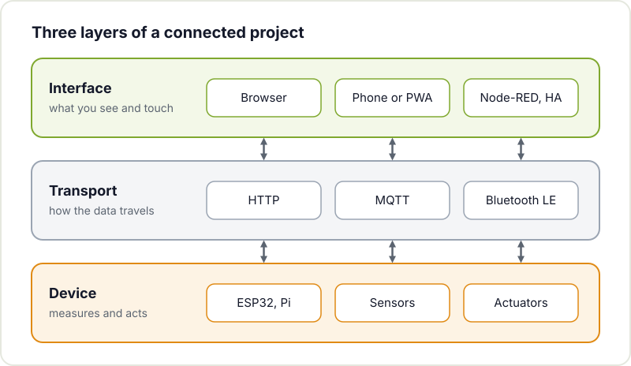
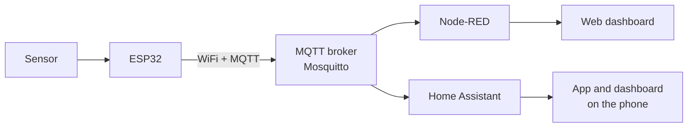

Your project already measures temperature, counts steps or moves a servo. Now you want to see it from your phone, switch it on from the sofa or show a chart of the last week. It is time to give it an interface, and this is where many makers stall: it looks like you need to learn web development, databases and native apps all at once.

You do not. There are options for every level, from a four-button page served by the ESP32 itself to a full dashboard in Home Assistant with hardly any code. This guide goes through the most useful ones and helps you choose.

## Think in three layers

Before choosing a tool, split the problem into three parts. Almost any connected project can be described like this:



- **Device**: the ESP32, Arduino or Raspberry Pi that reads sensors and drives actuators.
- **Transport**: how the data travels. Usually HTTP, MQTT or Bluetooth.
- **Interface**: what you see and touch. A website, a dashboard, an app on your phone.

The advantage of thinking this way is that you can start with the simplest thing and change one layer later. If today the ESP32 serves its own web page and tomorrow you want Home Assistant, the sensor and its reading code stay the same.

## The options, from simplest to most involved

| Option | Complexity | What you need | Ideal for |
|---|---|---|---|
| Web page served by the ESP32 | Low | Just the ESP32 | Controlling one device from the local network |
| Web Bluetooth | Low-medium | ESP32 with BLE, Chrome or Edge | Configuring something up close, without WiFi |
| MQTT + Node-RED | Medium | A Raspberry Pi or server | Several devices, automations, quick dashboards |
| Home Assistant | Medium | A Raspberry Pi or server | Home automation, integrating with other devices at home |
| Flask or FastAPI dashboard | Medium-high | Python on a server | Custom interfaces, storing history |
| Static website with Hugo | Low-medium | Static hosting | Documenting and showing off the project |
| PWA | Medium-high | Knowing HTML, CSS and JavaScript | An installable "app" without going through app stores |

## A web page served by the ESP32 itself

The ESP32 can run a small web server: you browse to its IP address and see a page with buttons and values. You need nothing but the board, and it is the most direct way to control a relay or an LED strip, or read a sensor, from your phone.

In the Arduino environment you use the `WebServer` library included in the [Arduino core for ESP32](https://docs.espressif.com/projects/arduino-esp32/en/latest/); in ESP-IDF you have the [HTTP server](https://docs.espressif.com/projects/esp-idf/en/stable/esp32/api-reference/protocols/esp_http_server.html) component. The ESP32 can even create its own WiFi network (access point mode) for when there is no router.

Its limits: the page lives inside the firmware, every design change means reflashing, and if you have several devices you end up with several separate websites. For a single device it is perfect. If you want to see a real example, a hackerspace member added a web interface to the [ESP32 internet radio](/en/blog/esp32-internet-radio/).

## MQTT and Node-RED

Once you have more than one device, it is better for them not to talk directly to the interface but to a broker in between. That is [MQTT](https://mqtt.org/): a lightweight publish and subscribe protocol. Devices publish messages to "topics" (for example `workshop/sensor1/temperature`) on a server called a broker, and anyone interested subscribes to them. The most common broker is [Mosquitto](https://mosquitto.org/), which runs happily on a Raspberry Pi.



This is the minimal code for an ESP32 to publish a reading every ten seconds with the PubSubClient library:

```cpp
#include <WiFi.h>
#include <PubSubClient.h>

const char* WIFI_SSID = "your-network";
const char* WIFI_PASS = "your-password";
const char* MQTT_HOST = "192.168.1.50";  // IP of the Raspberry Pi running Mosquitto

WiFiClient wifi;
PubSubClient mqtt(wifi);
unsigned long lastSend = 0;

void setup() {
  WiFi.begin(WIFI_SSID, WIFI_PASS);
  while (WiFi.status() != WL_CONNECTED) delay(500);
  mqtt.setServer(MQTT_HOST, 1883);
}

void loop() {
  if (!mqtt.connected()) {
    if (!mqtt.connect("esp32-workshop")) { delay(2000); return; }
  }
  mqtt.loop();

  if (millis() - lastSend > 10000) {
    lastSend = millis();
    int light = analogRead(34);  // for example, an LDR on GPIO34
    mqtt.publish("workshop/sensor1/light", String(light).c_str());
  }
}
```

You can check that it arrives from any computer with `mosquitto_sub -h 192.168.1.50 -t 'workshop/#' -v`.

With the data in the broker, [Node-RED](https://nodered.org/docs/) lets you build the logic by wiring blocks together in the browser: receive the message, transform it, store it, send an alert if it crosses a threshold. With the dashboard package you add charts, gauges and buttons in minutes. It is a great way to get a dashboard without writing any HTML.

## Home Assistant

If your project lives at home, [Home Assistant](https://www.home-assistant.io/docs/) is probably the best interface you will never have to program. It installs on a Raspberry Pi or a server, has a phone app and integrates with MQTT, with commercial bulbs and plugs and with a huge number of other devices.

For ESP32 devices there is also ESPHome, which generates the firmware from a YAML configuration file: you describe which sensor is on which pin and the device shows up in Home Assistant by itself. For standard home automation projects it saves a lot of work; for something very bespoke, your own firmware with MQTT gives you more control.

## Your own dashboard with Python

When you want something tailored to you, such as storing history in a database or a page with your own design, a small Python server is the next step. [Flask](https://flask.palletsprojects.com/) is minimal and easy to understand; [FastAPI](https://fastapi.tiangolo.com/) is designed for APIs and generates documentation automatically.

A Flask example that receives readings over HTTP and displays them:

```python
from flask import Flask, request, jsonify

app = Flask(__name__)
readings = []

@app.post("/api/reading")
def new_reading():
    readings.append(request.get_json())  # e.g. {"sensor": "light", "value": 512}
    del readings[:-100]                   # keep only the last 100
    return {"ok": True}

@app.get("/api/readings")
def list_readings():
    return jsonify(readings)

@app.get("/")
def home():
    rows = "".join(f"<li>{r['sensor']}: {r['value']}</li>" for r in reversed(readings))
    return f"<h1>Workshop</h1><ul>{rows}</ul>"

if __name__ == "__main__":
    app.run(host="0.0.0.0", port=5000)
```

The ESP32 only has to make a `POST` with `HTTPClient`, and you see the data at `http://server-ip:5000`. From there you can add SQLite for history or a chart with JavaScript. To keep it running permanently on a Raspberry Pi, turn it into a systemd service as we explain in [getting started with Linux](/en/blog/getting-started-linux/).

## A static website to show off the project

Not everything is about real-time control. Sometimes what you need is documentation: photos, schematics, the code and how it was built. For that, a static website generated with [Hugo](https://gohugo.io/documentation/) is fast, free to host and needs no server of your own. This very website is built with Hugo, and at the hackerspace we ran a workshop on [building your portfolio with Hugo and deploying it](/en/workshops/portfolio/). If you are looking for inspiration, have a look at how we document the [hackerspace projects](/en/proyectos/).

## A phone app without an app store

Building a native Android or iOS app is a project in itself. For most maker projects there are two better shortcuts:

- **Web Bluetooth**: a web page that connects directly to your ESP32 over Bluetooth Low Energy, with no WiFi or server. It works in Chrome and Edge (on desktop and Android), but not in Safari or Firefox. The [MDN Web Bluetooth documentation](https://developer.mozilla.org/en-US/docs/Web/API/Web_Bluetooth_API) explains the API and its compatibility. It is ideal for configuring a device or controlling it up close.
- **PWA (progressive web app)**: a website with a manifest and a service worker that your phone can install on the home screen and open full screen, as if it were an app. MDN has a good [introduction to PWAs](https://developer.mozilla.org/en-US/docs/Web/Progressive_web_apps). It works very well as the interface to your Flask server or your API.

## How to choose

A rule of thumb: start with the simplest option that solves your problem today.

- One device, used at home or in the workshop: a web page on the ESP32.
- Several devices or automations: MQTT with Node-RED or Home Assistant.
- Something very bespoke or with history: Flask or FastAPI.
- Showing the project to the world: a static website.

If you are just starting with the board, first look at our guides to [getting started with the ESP32](/en/blog/getting-started-esp32/) and the [introduction to embedded systems](/en/blog/intro-to-embedded-programming/). And if code is still a struggle, start with [how to get started programming as a maker](/en/blog/getting-started-programming/).

## Bring it to the hackerspace

The best way to decide is to see a few options working. Bring your project to [Hackerspace Valencia](/en/blog/what-is-a-hackerspace/): someone is bound to have a broker running already, a half-finished Node-RED dashboard or an idea for your interface. Check out the [upcoming workshops](/en/workshops/) and, if you want to be part of it, [become a member](/en/pages/alta/).

## Image credits

The photograph comes from [Wikimedia Commons](https://commons.wikimedia.org) and is used under its licence:

- **Cover** - *ESP32 Dev Board* - Edwiyanto - CC BY-SA 4.0 - [source](https://commons.wikimedia.org/wiki/File:ESP32_Dev_Board.jpg)
