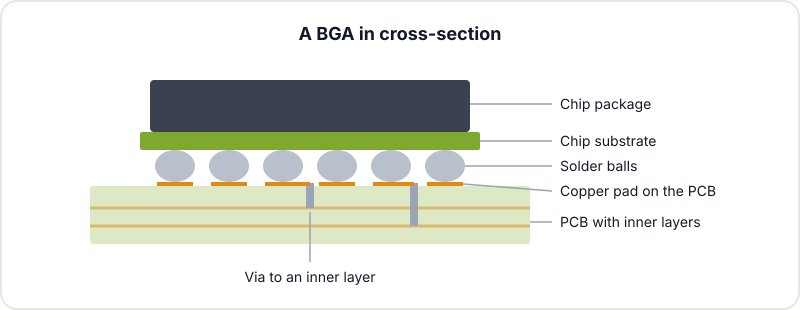
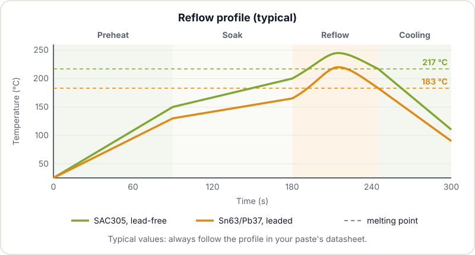
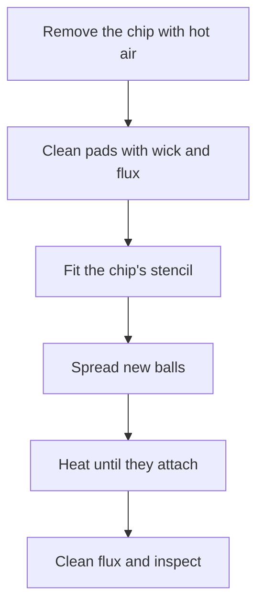
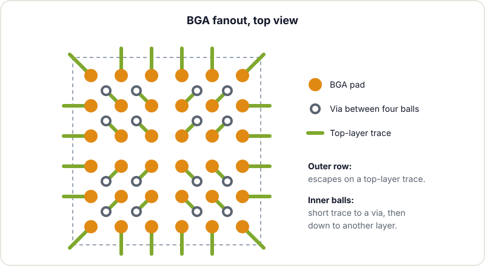

Some chips have no visible pins. Flip them over and you find a grid of tiny solder balls: that is a BGA (Ball Grid Array). Memories, application processors, FPGAs and many modern SoCs are only made this way. For a maker, BGA is usually the frontier: beyond it, things are no longer soldered with an iron. That does not mean it is impossible, but it does mean you should know what it involves before putting one in your design.

## What a BGA is

In a BGA, the chip's contacts are on the underside, arranged in a matrix of rows and columns. Each contact carries a solder ball that, when it melts, joins the chip to its pad on the PCB. Compared with a QFP, which spreads its leads around the perimeter, a BGA uses the whole surface of the package:

- **Many more connections in less space.** A 10 x 10 mm chip can have hundreds of balls.
- **Better electrical and thermal behaviour.** Paths are short and heat flows into the board.
- **Self-alignment.** On reflow, the surface tension of the balls centres the chip over its pads.

The drawback is obvious: the joints are under the chip, where the iron tip cannot reach and you cannot see anything. The Wikipedia article on [Ball Grid Array](https://en.wikipedia.org/wiki/Ball_grid_array) has more detail on the history and the variants.

## Why you can't solder it with an iron

With a soldering iron you can only heat what you touch. In a BGA, the inner balls are several millimetres from the edge and there is no way to reach them. You need to heat the whole chip and that area of the board evenly until all the balls melt at once, and then let them cool without anything moving. That can only be done with:

- **A reflow oven**, the most controlled option.
- **A hot air rework station with a bottom preheater.** The preheater warms the board from below so the hot air from above does not have to do all the work, which reduces the risk of warping the PCB or cooking the chip.
- **A hot plate** for small boards, with more difficulty controlling the profile.

## The reflow thermal profile

Reflow soldering is not "heat it until it melts". The paste and the balls follow a temperature-over-time profile with four phases. The profile for each paste is given by the manufacturer in its datasheet, and that is what you must follow. The general shape is this:

1. **Preheat.** A gradual ramp, in the order of 1 to 3 °C per second, so the board and components warm up without thermal shock.
2. **Soak.** A plateau, in the order of 150 to 200 °C for lead-free pastes, so the whole board evens out in temperature and the flux activates and cleans off oxides.
3. **Reflow.** A peak above the melting point. As a guide, for SAC305 (melts at around 217 to 220 °C) the peak is usually around 235 to 250 °C, and for Sn63/Pb37 (melts at 183 °C) around 205 to 225 °C. Time above liquidus is usually a few tens of seconds.
4. **Cooling.** Controlled, without forcing it, so the joints solidify with a good grain structure.

The Wikipedia page on [reflow soldering](https://en.wikipedia.org/wiki/Reflow_soldering) explains each zone in more detail. The important thing is that with a BGA the margin for error is small: if you do not reach the peak, some ball does not melt; if you overshoot, you damage the chip or the board warps.

## Reballing with a stencil

When you remove a BGA (to reuse it or because it was badly soldered), it is left with uneven solder remnants instead of balls. To solder it again you have to reball it:

1. Clean the chip's pads with flux and desoldering wick until they are flat.
2. Apply a thin layer of tacky flux.
3. Fit a stencil made for that specific package: a sheet with one hole per ball.
4. Spread new balls of the correct diameter over the stencil so that each hole ends up with one.
5. Heat with hot air until the balls melt and bond to their pads.
6. Remove the stencil, clean off the flux and check that every ball is there and they are all the same size.

Some people reball with paste instead of loose balls. It works, but the balls usually come out less uniform. The Wikipedia entry on [reballing](https://en.wikipedia.org/wiki/Reballing) summarises the process and its uses in repair.

## Inspection: how to tell whether it worked

In industry, BGAs are inspected with X-rays: you can see the balls through the chip and spot bridges, missing balls or voids inside the solder.



In a maker workshop there is no X-ray, so you have to combine other clues:

- **Look along the edge.** With a magnifier or microscope and low-angle light you can see the outer rows. They should look like squashed barrels, all identical, and the chip should sit parallel to the board.
- **Electrical checks.** Measure continuity or resistance to ground at test points, and look for shorts between supply rails before you plug anything in.
- **Boundary scan (JTAG)**, if the chip supports it and you have the tooling: it tests connections without needing X-rays.
- **Functional test.** Ultimately, what settles it is the circuit booting and passing its tests.

## Designing for BGA in KiCad

If you are going to use a BGA, much of the success is decided at design time. Some guidelines that apply in [KiCad](https://docs.kicad.org/) and in any other tool:

- **Use the footprint recommended by the chip manufacturer**, with the pad size given in its datasheet. KiCad ships many in its libraries, but always check them against that document.
- **Plan the fanout.** The outer rows can escape with traces on the top layer; for the inner ones you need vias. The typical pattern is the "dog bone": a short trace from the pad to a via placed between four balls.
- **Watch the pitch.** With 1 mm or 0.8 mm pitch you can fan out with standard vias and four layers. Finer pitches usually call for filled and capped via-in-pad, which makes the board more expensive.
- **Don't leave open vias next to the pads**, because they can wick solder away during reflow. Cover them with solder mask (tenting).
- **Check the fab's capabilities**: minimum trace, clearance and via size. Also go through the [PCB fabrication checklist](/en/blog/pcb-fabrication-checklist/) before sending it off.
- **Add fiducials** if the board will be assembled by a machine.

## When it's better to order assembly

For almost any maker, the honest answer is: if your design includes a BGA, order at least that component assembled. The usual PCB fabs offer assembly (PCBA) for small runs, with reflow ovens and, in many cases, X-ray inspection. Check their [assembly capabilities](https://jlcpcb.com/capabilities/pcb-assembly-capabilities) before finalising the design, because they constrain pitches and sizes.

It makes sense to do it yourself when:

- It is a repair, or an already assembled board where a chip needs replacing.
- You want to learn the technique and have practice boards you can afford to lose.
- The BGA is large (1 mm pitch or more) and you have access to a rework station with a preheater.

For everything else, the efficient path is to design well, order the board assembled and spend your time on the rest of the project. If you are coming from kits and through-hole builds, in [from dev kit to custom PCB](/en/blog/from-dev-kit-to-custom-pcb/) we explain how to make that jump, and if you want to brush up on the earlier techniques, there is [getting started with soldering](/en/blog/getting-started-soldering/) and [hand-soldering SMD components](/en/blog/smd-hand-soldering/). More material in [electronics resources for makers](/en/blog/electronics-resources/).

Thinking about putting a BGA on your next board, or have one that needs repairing? Drop by Hackerspace Valencia and we will talk it through with the design in front of us: the best decision is often made before you even open KiCad.

## Image credits

- **Cover** - *BGA package cross section* - TubeTimeUS - CC BY-SA 4.0 - [source](https://commons.wikimedia.org/wiki/File:BGA_package_cross_section.jpg)
- **BGA X-ray** - *BGA joint xray* - DJGB - Public domain - [source](https://commons.wikimedia.org/wiki/File:BGA_joint_xray.jpg)
