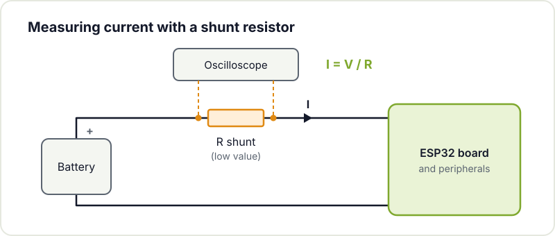
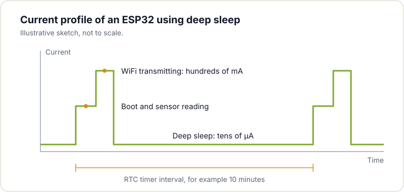
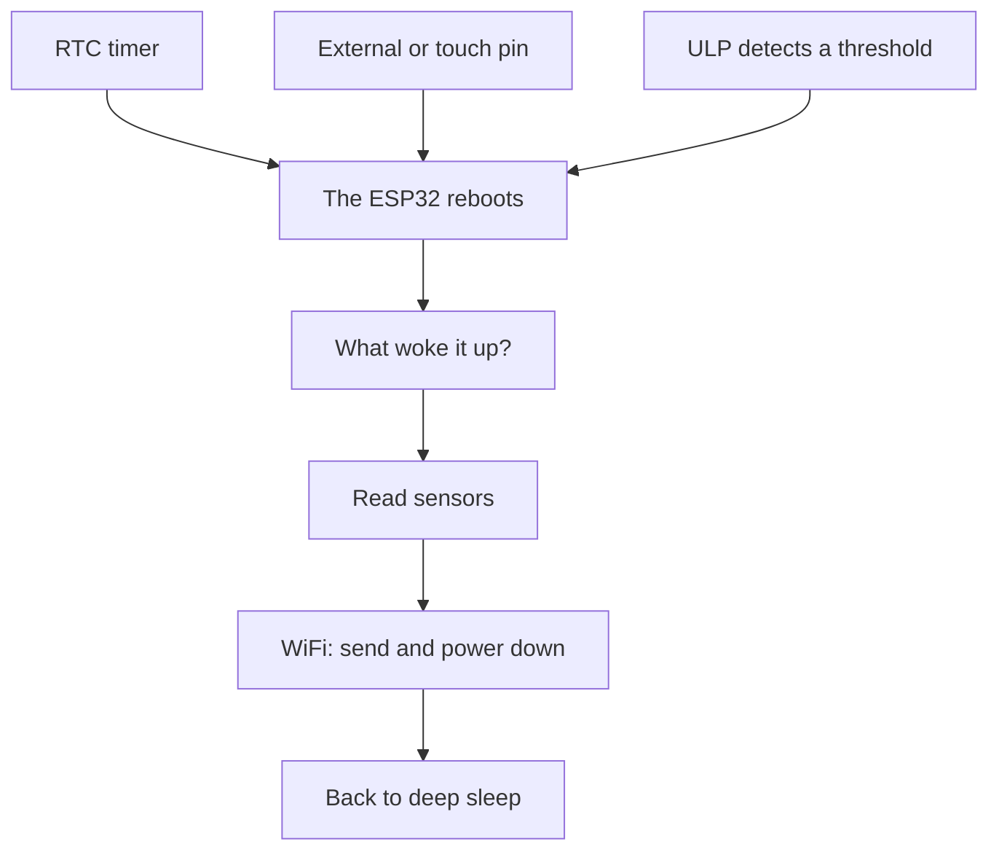

In many projects a constant power supply simply is not available: a sensor in the vegetable garden, a weather station on the balcony or an IoT node far from any socket all depend on batteries or a solar panel. In those cases, optimising consumption stops being a detail and decides how long the device runs without anyone touching it. The [ESP32](/en/blog/getting-started-esp32/) is a good example: with WiFi transmitting it can draw several hundred milliamps, which on a battery [cuts autonomy](/en/blog/real-battery-life-iot/) to a few days. But it also has low power modes that bring it down to microamps when it has nothing to do. In this article we look at how to improve its energy efficiency, from measuring the real consumption to deep sleep and the ULP coprocessor.

## Measure the real consumption

Before changing anything, measure how much your setup actually draws. You need a low current meter or, preferably, a low value [sense resistor](https://en.wikipedia.org/wiki/Shunt_%28electrical%29) in series with the supply, reading the voltage drop across it with an oscilloscope or a sensitive multimeter. Without measurement there is no diagnosis: a board assumed to sit at microamps can have a power LED permanently drawing twenty milliamps.





## How much the ESP32 draws in each mode

The ESP32 has several operating modes, and the difference between them is huge. These are the figures for the chip itself according to the [Espressif datasheet](https://documentation.espressif.com/esp32_datasheet_en.pdf) (tables 4-2 and 5-4):

| Mode | What keeps running | Typical consumption |
|---|---|---|
| Active, WiFi transmitting | Everything, with the radio transmitting | 180 to 240 mA |
| Active, WiFi receiving | Everything, with the radio listening | 95 to 100 mA |
| Modem sleep | CPU running, radio off | 20 to 68 mA (depending on clock) |
| Light sleep | CPU paused, RAM and RTC peripherals on | 0.8 mA |
| Deep sleep | Only the RTC and its memory | 10 µA (150 µA with the ULP running) |
| Hibernation | Only one RTC timer | 5 µA |

Careful: these are **chip** figures. A development board adds its regulator, the USB-serial converter and the power LED, and it is common for a DevKit in deep sleep to draw several milliamps instead of microamps. That is why the real first step is the next one.

## Disable unused peripherals

Low consumption starts with controlling what remains powered. The power LED on many development boards draws more than an ESP32 in low power mode: remove it or cut its trace if possible. Apply the same criterion to [auxiliary regulators](/en/blog/ldo-vs-dcdc/) (look for one with low quiescent current), the USB to UART converter and any circuit that stays active while the ESP32 sleeps.

Sensors count too. If a sensor has no sleep mode of its own, power it from an ESP32 pin or through a small MOSFET, so it only gets voltage while you read it. The same goes for voltage dividers that measure the battery: with 100 kΩ resistors instead of 10 kΩ, the leak is ten times smaller. If you are designing your own board, go over the [common mistakes in ESP32 PCBs](/en/blog/esp32-pcb-common-mistakes/): several of them are about consumption.

## Deep sleep mode

In deep sleep the ESP32 turns off its cores, main RAM and radio, and keeps only the RTC (the low power clock), its small memory and, if you ask for it, the ULP coprocessor. The chip's consumption drops to about 10 µA.

There is an important difference from a `delay()`: **on waking, the ESP32 reboots**. The program starts again from `setup()` and all normal variables are lost. Those that must survive between cycles are declared with `RTC_DATA_ATTR`, which stores them in RTC memory.



This example, for the [Arduino core for ESP32](https://docs.espressif.com/projects/arduino-esp32/en/latest/), measures every 10 minutes, stores the readings in RTC memory and only turns WiFi on once an hour to send them all together. That way the radio, which is the biggest consumer, is used six times less:

```cpp
#include <WiFi.h>

const uint64_t SLEEP_SECONDS = 10 * 60;  // measure every 10 minutes
const int READINGS_PER_SEND = 6;         // send once an hour

// Variables marked RTC_DATA_ATTR survive deep sleep (not a reset)
RTC_DATA_ATTR float readings[READINGS_PER_SEND];
RTC_DATA_ATTR int n = 0;

float readSensor() {
  return analogReadMilliVolts(34) / 1000.0;  // replace with your sensor
}

void send() {
  WiFi.begin("my-network", "my-password");
  unsigned long t0 = millis();
  // 10 s limit: if the network does not answer, do not drain the battery waiting
  while (WiFi.status() != WL_CONNECTED && millis() - t0 < 10000) delay(100);
  if (WiFi.status() == WL_CONNECTED) {
    // ... send the readings over HTTP or MQTT ...
  }
  WiFi.disconnect(true);  // disconnect and turn the radio off
  WiFi.mode(WIFI_OFF);
}

void setup() {
  readings[n++] = readSensor();
  if (n == READINGS_PER_SEND) {
    send();
    n = 0;
  }
  esp_sleep_enable_timer_wakeup(SLEEP_SECONDS * 1000000ULL);  // in microseconds
  esp_deep_sleep_start();  // nothing runs after this
}

void loop() {}  // never reached
```

Notice that everything happens in `setup()`: the cycle is wake, measure, send if it is time and sleep again. The sensor is read on pin 34, on ADC1; ADC2 cannot be used while WiFi is active. If you want reliable readings, see how to [improve ADC accuracy](/en/blog/microcontroller-adc-accuracy/).

In ESP-IDF the functions are the same (`esp_sleep_enable_timer_wakeup()`, `esp_deep_sleep_start()`) and they are documented in the [sleep modes API](https://docs.espressif.com/projects/esp-idf/en/stable/esp32/api-reference/system/sleep_modes.html). Espressif publishes complete examples for [Arduino](https://github.com/espressif/arduino-esp32/tree/master/libraries/ESP32/examples/DeepSleep) and for [ESP-IDF](https://github.com/espressif/esp-idf/tree/master/examples/system/deep_sleep).

## How to wake up from deep sleep

Before sleeping, the program has to tell the ESP32 which event will wake it. Espressif calls these [wakeup sources](https://docs.espressif.com/projects/esp-idf/en/stable/esp32/api-reference/system/sleep_modes.html#wakeup-sources).

It may look the same as an interrupt, but it is not. With a normal interrupt (`attachInterrupt()`), the processor is awake: when the pin changes, it stops what it is doing, runs a function and carries on where it was. In deep sleep there is no running processor to handle anything. The event is watched by the RTC, which on very little power can do just one thing: switch the chip on, and it **boots from scratch**. That is why only certain pins and certain events work, the ones the RTC is able to watch.

### RTC timer

This is the most common source, the one in the previous example: the ESP32 sleeps for a fixed time and wakes by itself. It is the basis of any sensor that measures periodically, like a weather station that reports every ten minutes and spends more than 99% of its time asleep.

### An external pin: ext0 and ext1

These wake the chip when something happens outside: someone presses a button, a presence sensor (PIR) detects movement or a reed switch detects a door opening. There are two variants:

- **ext0**: a single pin. Wakes when that pin goes high or low, as you configure it.
- **ext1**: several pins at once. On the classic ESP32 it wakes when *any* of them is high or when *all* of them are low.

Only pins connected to the RTC work, which on the ESP32 are 0, 2, 4, 12-15, 25-27 and 32-39. Check your board's pinout before soldering the button. And make sure the pin has a defined level while asleep, with a pull-up or pull-down resistor. If it is left floating, noise can wake the chip.

### Touch pins

The ESP32 has capacitive sensors on several pins (T0 to T9) that can wake it when touched. They let you make a button with no moving parts, for example a copper area behind the lid of a [3D printed](/en/blog/getting-started-3d-printing/) enclosure. In Arduino it is set up with `touchSleepWakeUpEnable(T3, threshold)`.

### The ULP coprocessor

The ULP can keep reading a sensor while everything else sleeps and wake the system only when the reading meets a condition. We cover it further down.

### Knowing what woke it up

You can enable several sources at once and, on boot, ask which one fired with `esp_sleep_get_wakeup_cause()`. This example wakes every 10 minutes to measure, or immediately if someone presses a button wired between pin 33 and GND:

```cpp
#include "driver/rtc_io.h"

#define BUTTON GPIO_NUM_33  // must be an RTC pin

void setup() {
  Serial.begin(115200);

  switch (esp_sleep_get_wakeup_cause()) {
    case ESP_SLEEP_WAKEUP_TIMER: Serial.println("Timer: time to measure"); break;
    case ESP_SLEEP_WAKEUP_EXT0:  Serial.println("Button: send now"); break;
    default:                     Serial.println("Normal boot (power-on or reset)"); break;
  }

  esp_sleep_enable_timer_wakeup(10 * 60 * 1000000ULL);
  esp_sleep_enable_ext0_wakeup(BUTTON, 0);  // wake when the pin goes low
  rtc_gpio_pullup_en(BUTTON);               // internal pull-up: the button closes to GND
  rtc_gpio_pulldown_dis(BUTTON);
  esp_deep_sleep_start();
}

void loop() {}
```



## Light sleep mode

Light sleep pauses the CPU but keeps the RAM, so **the program carries on exactly where it stopped**, with all variables intact, and it wakes much faster. In exchange it draws more (about 0.8 mA versus 10 µA). Besides the deep sleep sources, it can wake on any GPIO or on the UART.

```cpp
esp_sleep_enable_timer_wakeup(500 * 1000);  // 500 ms
esp_light_sleep_start();
// the program continues here, without rebooting
```

It is the right choice when the device must react within milliseconds or sleep for short intervals, where rebooting and reconnecting every time would cost more energy than it saves. ESP-IDF can also enter light sleep automatically when no tasks are pending, through [power management](https://docs.espressif.com/projects/esp-idf/en/stable/esp32/api-reference/system/power_management.html). For most battery projects that measure every few minutes, deep sleep is still the most efficient option.

## Clock reduction and radio management

Even while awake, consumption can be reduced. Lowering the CPU clock from 240 to 80 MHz cuts core consumption when you do not need full computing power. With WiFi active, do not go below 80 MHz:

```cpp
setCpuFrequencyMhz(80);  // 240 MHz by default
```

But the radio is what weighs most. It should only be on while transmitting: turn it on, send the data and turn it off before sleeping again. Keeping it scanning for networks continuously is the main cause of premature battery drain. Some tricks to shorten that time:

- **Batch your transmissions**, as in the first example: measuring is cheap, transmitting is expensive.
- **Put a time limit** on the connection. If the router does not answer, go back to sleep and retry on the next cycle.
- **Use a static IP** instead of DHCP, because negotiating the address lengthens every connection.
- **Consider alternatives to WiFi.** If you have several nodes close together, [ESP-NOW](https://docs.espressif.com/projects/esp-idf/en/stable/esp32/api-reference/network/esp_now.html) sends packets between ESP32s without connecting to any router, and the transmission is much shorter.

## The ULP coprocessor

The ESP32 includes an [ultra low power (ULP) coprocessor](https://docs.espressif.com/projects/esp-idf/en/stable/esp32/api-reference/system/ulp.html) that can keep running while the main cores sleep. It is a very simple processor with access to the ADC, the RTC pins and RTC memory. It can, for example, read a moisture sensor every few seconds and wake the ESP32 only if the value crosses a threshold, instead of waking the whole system for every reading.

With the ULP running, deep sleep consumption rises to about 150 µA, although if it only works in short bursts it stays close to 100 µA. On the classic ESP32 it is programmed in assembly, which makes it the most advanced technique in this article. The ESP32-S2 and ESP32-S3 add a RISC-V ULP that is programmed in C. In autonomous monitoring projects it is the most effective tool to extend battery life.

## Summary

The road to minimum consumption has five steps:

1. **Measure** the real consumption, both awake and asleep.
2. **Remove leaks** from the board: LED, regulator, USB-serial and always-on sensors.
3. **Deep sleep** as much as possible and wake with the timer or a pin.
4. **Use the radio as little as possible**: batch transmissions, limit connection time and turn it off.
5. **Hand off to the ULP** if you need to watch a sensor without waking the system.

With these techniques, a project with days of autonomy can reach months. To run the numbers for your battery, see how to [calculate the real battery life of an IoT node](/en/blog/real-battery-life-iot/).

## Documentation and libraries

- [Sleep modes in ESP-IDF](https://docs.espressif.com/projects/esp-idf/en/stable/esp32/api-reference/system/sleep_modes.html): every deep sleep, light sleep and wakeup source function.
- [Deep sleep examples for Arduino](https://github.com/espressif/arduino-esp32/tree/master/libraries/ESP32/examples/DeepSleep): timer, external pin and touch, ready to upload.
- [ESP-IDF deep sleep example](https://github.com/espressif/esp-idf/tree/master/examples/system/deep_sleep).
- [Power management in ESP-IDF](https://docs.espressif.com/projects/esp-idf/en/stable/esp32/api-reference/system/power_management.html): frequency scaling and automatic light sleep.
- [ULP coprocessor](https://docs.espressif.com/projects/esp-idf/en/stable/esp32/api-reference/system/ulp.html).
- [ESP32 datasheet](https://documentation.espressif.com/esp32_datasheet_en.pdf): consumption by mode.

If you are building a battery powered project and the numbers do not add up, bring it to Hackerspace Valencia: we analyse consumption with a multimeter and an oscilloscope and help you track down the leaks. If you plan to come often, [become a member](/en/pages/alta/) and use the workshop whenever you want.

## Image credits

- **Cover** - *ESP32 Espressif ESP-WROOM-32 Dev Board (2)* - Ubahnverleih - CC0 - [source](https://commons.wikimedia.org/wiki/File:ESP32_Espressif_ESP-WROOM-32_Dev_Board_%282%29.jpg)
- **USB meter** - *ESP32 SH1106 Power-Meter 01* - King of Pwnt - CC0 - [source](https://commons.wikimedia.org/wiki/File:ESP32_SH1106_Power-Meter_01.jpg)
