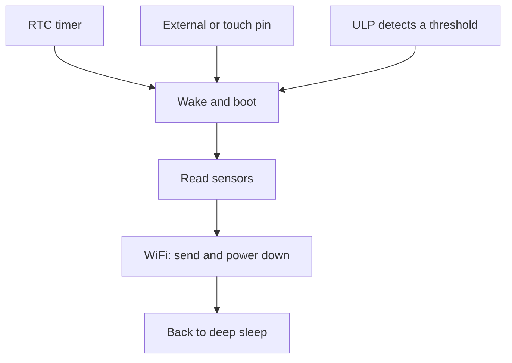

The ESP32 offers remarkable performance for [connected projects](/en/proyectos/), but that performance has an energy cost: with WiFi transmitting it can draw several hundred milliamps. Powered from the mains this figure is irrelevant; on batteries or a solar panel it reduces autonomy to a few days. The chip does however provide low power modes that bring consumption down to microamps whenever there are no tasks to run.

## Measure the real consumption

Before changing anything, measure how much your setup actually draws. You need a low current meter or, preferably, a low value [sense resistor](https://en.wikipedia.org/wiki/Shunt_%28electrical%29) in series with the supply, reading the voltage drop across it with an oscilloscope or a sensitive multimeter. Without measurement there is no diagnosis: a board assumed to sit at microamps can have a power LED permanently drawing twenty milliamps.



## Disable unused peripherals

Low consumption starts with controlling what remains powered. The power LED on many development boards draws more than an ESP32 in low power mode: remove it or cut its trace if possible. Apply the same criterion to [auxiliary regulators](/en/blog/ldo-vs-dcdc/), the USB to UART converter and any circuit that stays active while the ESP32 sleeps. In low power mode the chip drops to a few microamps; the problem is usually the surrounding peripherals.

## Deep sleep mode

In deep sleep the ESP32 halts its cores and keeps only the RTC and the memory that retains state. Consumption drops to tens of microamps under ideal conditions. Entry is [a single call from your program](https://docs.espressif.com/projects/esp-idf/en/stable/esp32/api-reference/system/sleep_modes.html#entering-sleep) specifying the sleep duration or the wake event. On wake the chip boots from the beginning, so any data that must survive across cycles has to be stored in RTC memory.

## Wake sources

The ESP32 supports several [wake sources](https://docs.espressif.com/projects/esp-idf/en/stable/esp32/api-reference/system/sleep_modes.html#wakeup-sources):

- **RTC timer**: the most common. The device sleeps for a fixed interval, say ten minutes, wakes, measures, transmits and sleeps again. With this scheme a weather station reporting every few minutes is active only a minimal fraction of the time.
- **External pins**: useful for presence sensors or buttons.
- **Touch pins**.
- **External interrupts**.

Several sources can be combined in one design.

## Light sleep mode

Light sleep keeps more of the chip alive and wakes faster, at the cost of higher consumption than deep sleep. It is appropriate when the device must react within milliseconds and cannot afford the reboot that deep sleep implies. For most battery powered projects, deep sleep is the more efficient option.

## Clock reduction and radio management

Even while awake, consumption can be reduced. Lowering the clock frequency cuts core consumption whenever full computing power is not required. The radio, WiFi or Bluetooth, should only be active while transmitting: power it up, send your data and power it down before sleeping again. Keeping it scanning for networks continuously is the main cause of premature battery drain.

## The ULP coprocessor

The ESP32 includes an [ultra low power coprocessor (ULP)](https://docs.espressif.com/projects/esp-idf/en/stable/esp32/api-reference/system/ulp.html) that can keep running while the main cores sleep. Programming it is more advanced, but it can read a sensor periodically and wake the main system only when the data meets a condition. For autonomous monitoring projects it is the most effective tool to extend battery life.

## Summary

The path to minimal consumption has four steps: measure real consumption, eliminate peripheral leaks, use deep sleep and power the radio only to transmit. With these techniques a project that lasted days can last months.

If you are building a battery powered project and the numbers do not add up, bring it to Hackerspace Valencia: we analyse consumption with the multimeter and the oscilloscope and help you locate the leaks. If you plan to come often, [become a member](/en/pages/alta/) and use the workshop whenever you like.

## Image credits

- **Cover** - *ESP32 Espressif ESP-WROOM-32 Dev Board (2)* - Ubahnverleih - CC0 - [source](https://commons.wikimedia.org/wiki/File:ESP32_Espressif_ESP-WROOM-32_Dev_Board_%282%29.jpg)
- **USB meter** - *ESP32 SH1106 Power-Meter 01* - King of Pwnt - CC0 - [source](https://commons.wikimedia.org/wiki/File:ESP32_SH1106_Power-Meter_01.jpg)
