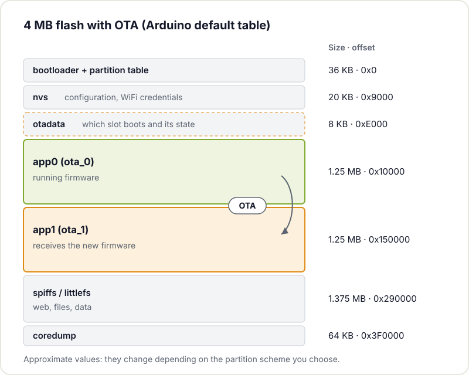
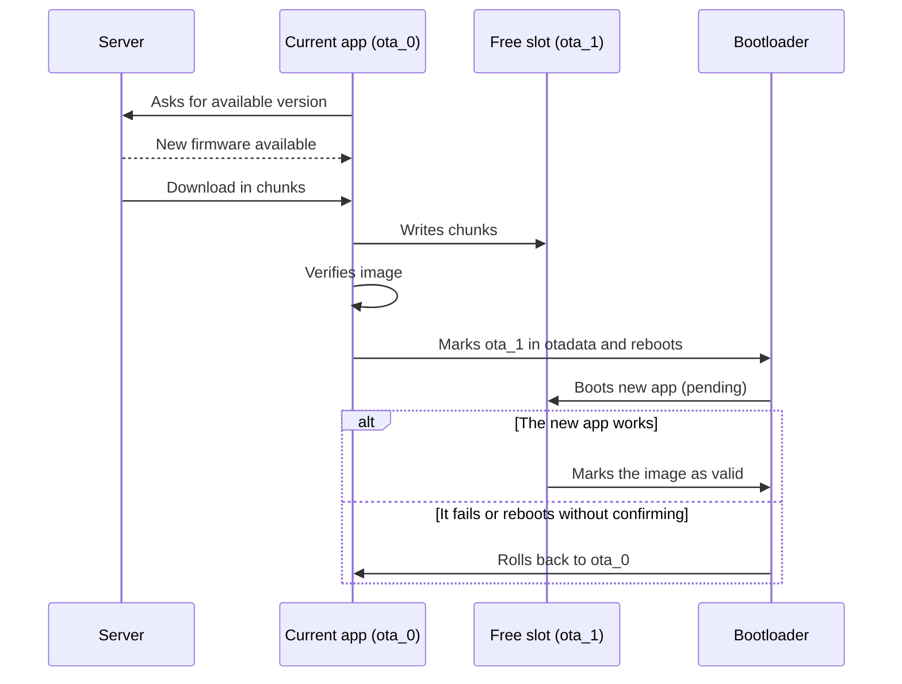

In every ESP32 project there comes a point where the USB cable stops being convenient. The board is already inside its enclosure, screwed behind a piece of furniture or hanging from the workshop ceiling, and every firmware change means taking things apart. That is where OTA (*Over-The-Air*) updates come in: loading new firmware over the network without touching the hardware.

It looks like just another software feature, but it is not. Whether a device can be updated safely depends on how you split up the flash memory, how you power it, which network it connects to and what it does if something goes wrong halfway through. In this article we go over those pieces with the ESP32 in the starring role.

## Why OTA is a design decision, not an add-on

The key idea is simple: to update without risk, the device has to be able to store the new firmware **without erasing the one that is running**. Only when the new one is complete and verified does it switch from one to the other. That means reserving space for at least two copies of the application.



If you used a partition table without OTA in your first prototype to make the most of the flash, adding it later forces you to reflash over a cable and reorganise everything. That is why it pays to decide at the start, even if the first version does not use OTA yet. The same goes for size: firmware tends to grow (more libraries, a web interface, TLS) and each application slot needs headroom for those future versions.

## The ESP32 A/B partition scheme

The ESP32's flash is divided into partitions described in a table. For OTA, the important pieces are:

- **nvs**: key-value storage for configuration (WiFi credentials, calibration data).
- **otadata**: a small area that says which application slot should boot and what state each one is in.
- **ota_0 and ota_1** (called `app0` and `app1` in Arduino): the two application slots. One runs the current firmware; the other receives the new one.
- **spiffs** or **littlefs**: a file system for web pages, configuration files or data.



In the Arduino core's default table for 4 MB modules, each application slot is around 1.25 MB and a little over 1.3 MB is left for the file system. If your firmware does not fit, the IDE lets you choose other schemes (for example, more application space at the expense of the file system), or you can define your own `partitions.csv` in PlatformIO or ESP-IDF. The [ESP-IDF partition tables guide](https://docs.espressif.com/projects/esp-idf/en/stable/esp32/api-guides/partition-tables.html) explains the format.

A quick sizing calculation: current firmware + new firmware (of the same maximum size) + bootloader and partition table + configuration + data that must survive the update. There is no universal figure; leave headroom without overdoing it, because every kilobyte you give to the slots is taken away from the file system.

## Three ways to do OTA with an ESP32

### ArduinoOTA: the quick route on the local network

`ArduinoOTA` opens a service on the ESP32 and lets you upload firmware from the Arduino IDE or PlatformIO as if it were just another port. It is the most convenient way to iterate on the workbench, but it depends on mDNS, on the port being reachable and on calling `ArduinoOTA.handle()` frequently in `loop()`.

It does not always work first time. In the [ESP32 internet radio](/en/blog/esp32-internet-radio/) we have at the hackerspace, the ESP32 answered pings and mDNS resolved fine, but the ArduinoOTA port refused connections. The fix was to switch methods.

### Updating over HTTP with the Update class

The Arduino core includes the `Update` class, which writes any byte stream you pass it into the free slot. With it you can set up an `/update` endpoint on the ESP32's own web server and upload the `.bin` from the browser, or do the opposite: have the ESP32 periodically download firmware from a server of your own. It is easier to debug than ArduinoOTA because everything goes over HTTP. Espressif documents it in the [OTA web update guide for Arduino-ESP32](https://docs.espressif.com/projects/arduino-esp32/en/latest/ota_web_update.html).

A minimal skeleton for downloading from a server:

```cpp
#include <HTTPClient.h>
#include <Update.h>

bool actualizarDesde(const char* url) {
  HTTPClient http;
  http.begin(url);
  if (http.GET() != HTTP_CODE_OK) return false;

  int total = http.getSize();
  if (total <= 0 || !Update.begin(total)) return false;

  size_t escritos = Update.writeStream(*http.getStreamPtr());
  if (escritos != (size_t)total || !Update.end()) return false;

  ESP.restart();  // boots from the new slot
  return true;
}
```

`Update.end()` checks that the image is consistent and marks the new slot in `otadata`. If the transfer is cut off halfway, the active slot stays intact.

### esp_https_ota in ESP-IDF

If you work with ESP-IDF, the [esp_https_ota](https://docs.espressif.com/projects/esp-idf/en/stable/esp32/api-reference/system/esp_https_ota.html) component handles the whole cycle over HTTPS: it connects, validates the server certificate, downloads in chunks, writes to the free slot and activates it. It is the most robust option for devices that will live far from your bench.

## The complete process, with rollback

Downloading and writing is half the job. The other half is what happens on the first boot of the new firmware. ESP-IDF has a *rollback* mechanism (enabled with `CONFIG_BOOTLOADER_APP_ROLLBACK_ENABLE`): the new application boots in a "pending verification" state and has to confirm by itself that it works. If it reboots before confirming, the bootloader discards it and goes back to the previous one.



What "works" means is up to you: that it connects to WiFi, reaches the server, reads its sensor. When that is met, you call `esp_ota_mark_app_valid_cancel_rollback()`. If you detect a serious problem, `esp_ota_mark_app_invalid_rollback_and_reboot()` forces the rollback. All of this is described in the [official Espressif OTA documentation](https://docs.espressif.com/projects/esp-idf/en/stable/esp32/api-reference/system/ota.html).

## Power: the forgotten risk

Writing flash with WiFi active is one of the most power-hungry things an ESP32 does. If the project runs on batteries or a solar panel, an update with an almost empty battery can cause voltage drops and resets halfway through writing. The A/B scheme keeps the device from being bricked, but the sensible thing is not to start the OTA if the battery voltage is below a threshold. If you are interested in the topic, in [how to reduce ESP32 power consumption](/en/blog/esp32-low-power/) we go over how to measure and manage energy.

## Network and connectivity

At home or in the workshop WiFi is the norm, but in a vegetable garden or a weather station coverage can be patchy. Some recommendations:

- Download in chunks and check the total size before activating the image.
- Retry with increasing backoff instead of hammering away without a pause.
- Check the version before downloading so you do not fetch the same firmware over and over.
- If the network is very limited, consider whether you really need OTA or whether an occasional visit with the laptop is enough.

## Security: who can update your device

An open `/update` endpoint on your network is convenient, but anyone on that network could load whatever firmware they like. For a personal project on your LAN that may be acceptable; for something exposed, it is not. Reasonable steps, from least to most:

1. Protect the endpoint with a username and password, or disable it except when you need it.
2. Download only over HTTPS and validate the server certificate.
3. Sign the images and verify the signature before booting them (*secure boot*).
4. Enable *anti-rollback* (`CONFIG_BOOTLOADER_APP_ANTI_ROLLBACK`) to stop anyone from loading an old version with known bugs.

Secure boot and flash encryption burn eFuses and are irreversible: try them on a sacrificial board before applying them to the real one.

## Is it worth it in a maker project?

Not always. If the board is on your bench and you reflash it every day, USB is faster. OTA pays off when the device is hard to reach, when you have several units spread around (the sensors all over the house, for example) or when you are going to maintain it for years. In those cases, spending an afternoon setting up partitions, rollback and a minimum of security saves you a lot of ladder climbing.

## Come and try it at the hackerspace

If you have an ESP32 tucked inside a box and want to stop opening it for every change, bring it to [Hackerspace Valencia](/en/blog/what-is-a-hackerspace/). Together we can review the partition table, set up the update endpoint and deliberately force a failure to check that rollback works before you really need it. And if you feel like sticking around, you can [become a member](/en/pages/alta/).

## Image credits

The diagrams are original work by Hackerspace Valencia. The photographs come from [Wikimedia Commons](https://commons.wikimedia.org):

- **Cover** - *ESP32-C3 with Traffic Light Module* - DavesCodeMusings - CC0 - [source](https://commons.wikimedia.org/wiki/File:ESP32-C3_with_Traffic_Light_Module.jpg)
- **ESP32-WROOM-32 module** - *ESP32 Espressif ESP-WROOM-32 Shielded* - Ubahnverleih - CC0 - [source](https://commons.wikimedia.org/wiki/File:ESP32_Espressif_ESP-WROOM-32_Shielded.jpg)
