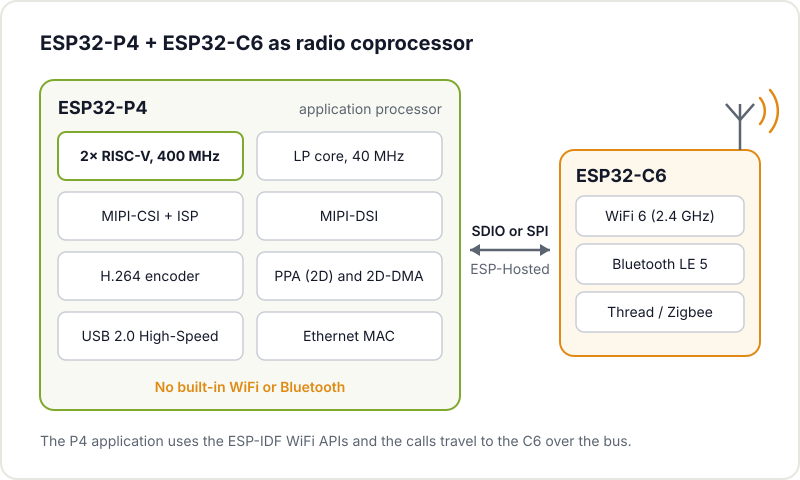
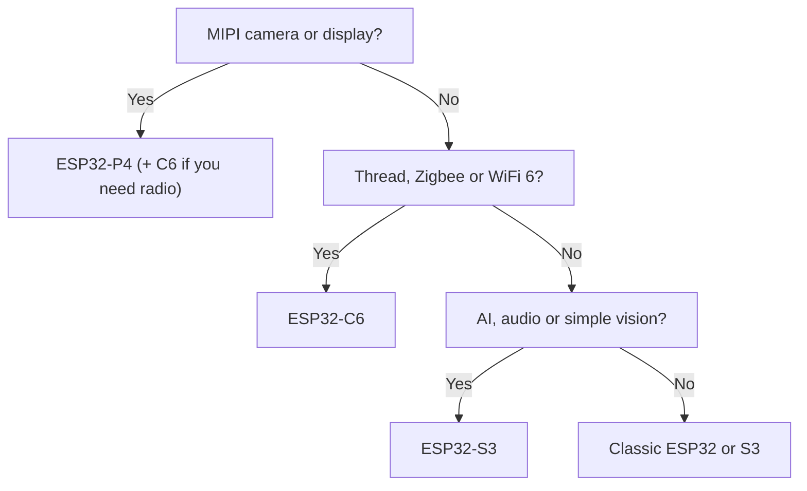

The ESP32 family won over the maker community with a hard-to-beat combination: built-in WiFi and Bluetooth, a low price and a huge ecosystem. But projects have grown. Now we want smooth touchscreens, cameras, local audio or image processing and small AI models. For that, Espressif has released the **ESP32-P4**, a chip that breaks with the company's tradition: it is much more powerful than its siblings and, surprisingly, **it has no radio**.

In this article we look at what it offers, how it differs from the rest of the family and how to add connectivity when you need it.

## What the ESP32-P4 is

According to the [official ESP32-P4 page](https://www.espressif.com/en/products/socs/esp32-p4), its key features are:

- **Two high-performance RISC-V cores at up to 400 MHz**, with a floating point unit and AI extensions, plus a low-power (LP) core at up to 40 MHz.
- **768 KB of internal SRAM**, expandable with external PSRAM.
- **MIPI-CSI** with a built-in ISP for cameras and **MIPI-DSI** for displays, as well as parallel interfaces.
- **Hardware H.264 encoding** up to 1080p at 30 fps.
- **PPA** (pixel processing accelerator) and 2D-DMA to move and transform images without loading the CPU.
- **USB 2.0 High-Speed**, Ethernet, SDIO 3.0 and **55 programmable GPIOs**, the highest count in the family.
- Full security: secure boot, flash encryption, cryptographic accelerators and key management.

A practical detail: the first chip revisions (v1.x) run at 360 MHz and Espressif now recommends the 3.x revisions, which reach 400 MHz. If you buy a dev board, check which revision it carries.

## How it compares with the rest of the family

Data taken from Espressif's product pages and datasheets:

| | ESP32 | ESP32-S3 | ESP32-C6 | ESP32-P4 |
|---|---|---|---|---|
| Cores | 2× Xtensa LX6 (single-core variants exist) | 2× Xtensa LX7 | 1× RISC-V + 1× RISC-V LP | 2× RISC-V + 1× RISC-V LP |
| Max. clock | 240 MHz | 240 MHz | 160 MHz (LP: 20 MHz) | 400 MHz (LP: 40 MHz) |
| Internal SRAM | 520 KB | 512 KB | 512 KB | 768 KB |
| WiFi | 802.11 b/g/n, 2.4 GHz | 802.11 b/g/n, 2.4 GHz | WiFi 6 (802.11ax), 2.4 GHz | No |
| Bluetooth | Classic and LE (v4.2) | LE 5 | LE 5 | No |
| 802.15.4 (Thread, Zigbee) | No | No | Yes | No |
| Extras | DAC, Ethernet MAC, touch | Vector instructions for AI, USB OTG, touch | LP core, a good candidate for Matter | MIPI-CSI/DSI, H.264, PPA, USB 2.0 HS, Ethernet |

The quick take: the classic ESP32 is still the all-rounder with the most examples online; the S3 is the workhorse for lightweight AI, audio and small displays; the C6 is the modern connectivity specialist; and the P4 is the one for images and large displays.

## Why it has no WiFi (and how to add it)

Dropping the radio may look like a step backwards, but it makes sense: it frees up silicon and power for what the P4 does well, and lets each project pick the connectivity it needs. Many designs are fine with Ethernet or USB, or don't need a network at all.

When you do need it, Espressif's answer is to pair it with another chip from the family as a radio coprocessor, usually an **ESP32-C6**. The two connect over SDIO or SPI and talk through [ESP-Hosted](https://github.com/espressif/esp-hosted-mcu): the P4 firmware calls the usual WiFi APIs in ESP-IDF and those calls are executed on the C6. The ESP-Hosted documentation itself uses the ESP32-P4 + ESP32-C6 pair as its example. Several P4 dev boards already come with the C6 fitted, so in practice you don't have to design anything.



## What to use it for in maker projects

Where the P4 really makes a difference is anything to do with images and displays:

- **Touchscreen control panels**: a dashboard for your home automation, the workshop or a machine, with a smooth interface on a MIPI display.
- **Smart cameras**: a camera that watches a 3D printer or the workshop door, processes locally and only sends alerts or H.264-encoded clips.
- **Lightweight computer vision**: detecting whether someone is in front of it, counting objects or reading a gauge. The techniques from [TinyML on microcontrollers](/en/blog/tinyml-microcontrollers/) fit here, with ESP-DL as Espressif's library.
- **Gateways**: a P4 with Ethernet towards the network and a C6 speaking Thread or Zigbee with the sensors.
- **Audio and multimedia**: players, mixers or digital instruments that make use of the extra power.

## Which chip should I pick?

If it's your first project with the family, don't start with the P4: the classic ESP32 or the S3 have many more examples and proven libraries, and what you learn carries over just the same. [Getting started with the ESP32](/en/blog/getting-started-esp32/) is the way in.

## How to program it

The P4 is programmed with [ESP-IDF](https://docs.espressif.com/projects/esp-idf/en/stable/esp32p4/index.html), like the rest of the family, and it is also listed as a supported chip in the Arduino-ESP32 core. To get started, the easiest route is a dev board with the display and camera already sorted, such as the [ESP32-P4-Function-EV-Board](https://docs.espressif.com/projects/esp-dev-kits/en/latest/esp32p4/esp32-p4-function-ev-board/index.html) or third-party boards. Designing your own PCB around the P4 is another level: high-speed MIPI lines, PSRAM and several supply rails. If you're up for it, first go through the [common mistakes when designing a PCB with an ESP32](/en/blog/esp32-pcb-common-mistakes/).

## Conclusion

The ESP32-P4 doesn't replace the ESP32 or the S3: it extends the family upwards. When a project calls for a large display, a camera or image processing, it offers capabilities that used to force you to jump to a Linux single-board computer, with the power draw and boot time of a microcontroller. And if it needs radio, a C6 alongside sorts it out.

## Bring it to the hackerspace

If you have a P4 sitting in a drawer waiting for a project, or you're unsure which chip in the family to choose, drop by [Hackerspace Valencia](/en/blog/what-is-a-hackerspace/). Comparing boards on the table and seeing what other people have done with them helps far more than reading datasheets on your own. And if you stick around, [become a member](/en/pages/alta/).

## Image credits

The diagram is an original by Hackerspace Valencia. The photographs come from [Wikimedia Commons](https://commons.wikimedia.org):

- **Cover** - *Espressif ESP32-P4* - Pathfinbird - CC BY-SA 4.0 - [source](https://commons.wikimedia.org/wiki/File:Espressif_ESP32-P4.jpg)
- **ESP32-C6 board** - *RISC-V ESP32-C6-WROOM-1.devboard* - Popolon - CC BY-SA 4.0 - [source](https://commons.wikimedia.org/wiki/File:RISC-V_ESP32-C6-WROOM-1.devboard.jpg)
