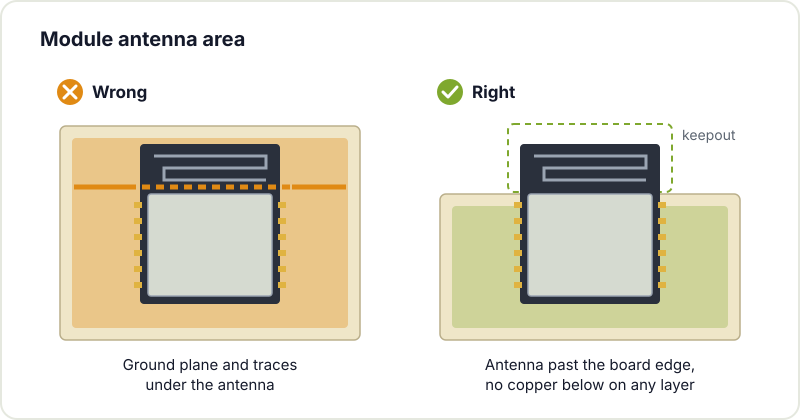
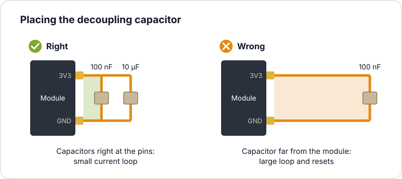
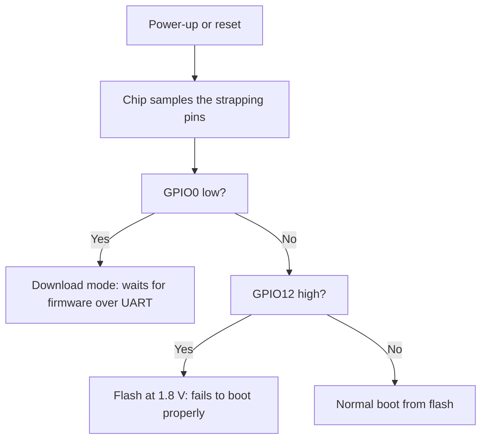

The ESP32 is a common choice for maker projects: low cost, built in WiFi and Bluetooth and abundant documentation. There is however a significant difference between a breadboard prototype and a custom printed circuit board. That jump is where mistakes appear which only show up once the fabricated board does not boot. This guide reviews the most frequent ones so your next PCB works on the first try.

## The antenna area

The WROOM or WROVER module carries a printed antenna on one of its edges. That antenna requires clear space, free of copper and metal on every layer; otherwise WiFi range degrades significantly. Respect the [keepout area documented by the manufacturer](https://docs.espressif.com/projects/esp-hardware-design-guidelines/en/latest/esp32/pcb-layout-design.html#general-principles-of-pcb-layout-for-modules-positioning-a-module-on-a-base-board) and keep traces, ground planes and components away from that zone. Also avoid installing the module inside a closed metal enclosure. This is the most frequent mistake and the hardest to diagnose, because the board works, albeit with reduced coverage.



## Decoupling capacitors

During WiFi transmit bursts the ESP32 can draw hundreds of milliamps in microseconds. If the supply does not arrive clean, the chip resets without warning. Every VCC/GND pair on the module needs its decoupling capacitor next to the pin: typically a 100 nF capacitor plus a larger 10 µF one nearby. The correct distance is measured in millimetres, not centimetres: poorly placed decoupling translates into random resets.

## The 3.3 V supply

The ESP32 runs at 3.3 V, not 5 V. Applying 5 V to the power pin permanently damages the chip. Beyond the correct voltage, the regulator must deliver the burst current: a 100 mA LDO is insufficient. Expect demands on the order of 500 mA in spikes and size the regulator accordingly. On battery power or where efficiency is critical, a [switching regulator](/en/blog/ldo-vs-dcdc/) reduces heat and extends battery life.

## Boot strapping pins

During power-up several pins must sit at a defined level so the chip boots normally and reads its flash: GPIO0, GPIO2, GPIO5, GPIO12 and GPIO15. If your design uses one of them as an input tied to a button or a sensor that pulls it to the opposite level, the board will not boot or will come up in the wrong mode. GPIO12 (MTDI) deserves particular attention: if held high at boot, the internal flash is powered at 1.8 V instead of 3.3 V and the module fails to start correctly. Check the [manufacturer's strapping table](https://docs.espressif.com/projects/esp-hardware-design-guidelines/en/latest/esp32/schematic-checklist.html#strapping-pins) before assigning these pins to any critical function.

## The reset and programming circuit

To flash over USB without manual intervention, the EN and BOOT lines must be driven automatically from the USB to UART converter. This is implemented with two transistors and a pair of resistors: the auto-reset circuit. If you omit it, you will press physical buttons on every upload. Include a pull-up on EN as well, plus a small capacitor to prevent noise induced resets.

## Thermal management

The ESP32 dissipates heat, especially with WiFi active. A continuous ground plane under the module helps spread that temperature. Split ground planes or planes full of cuts aggravate both thermal and signal integrity problems. Design with a [solid ground plane](/en/blog/pcb-fabrication-checklist/) and keep return currents on short paths.

## Practical summary

Most incidents on ESP32 boards come down to four points: respect the antenna area, place the decoupling capacitors correctly, supply the right voltage and current, and verify the strapping pins. With those points under control the rest of the design usually works as intended.

If you are starting out in [board design](/en/workshops/kicad/) and have doubts, come to Hackerspace Valencia on any open doors Tuesday: several of us will review your schematic and help you avoid paying for a board that will not boot. And if you want to use the workshop regularly, [become a member](/en/pages/alta/).

## Image credits

- **Cover** - *ESP32 Espressif ESP-WROOM-32 Shielded* - Ubahnverleih - CC0 - [source](https://commons.wikimedia.org/wiki/File:ESP32_Espressif_ESP-WROOM-32_Shielded.jpg)
- **Module without shield** - *Espressif ESP-WROOM-32 Wi-Fi & Bluetooth Module* - Brian Krent - CC BY-SA 4.0 - [source](https://commons.wikimedia.org/wiki/File:Espressif_ESP-WROOM-32_Wi-Fi_%26_Bluetooth_Module.jpg)
