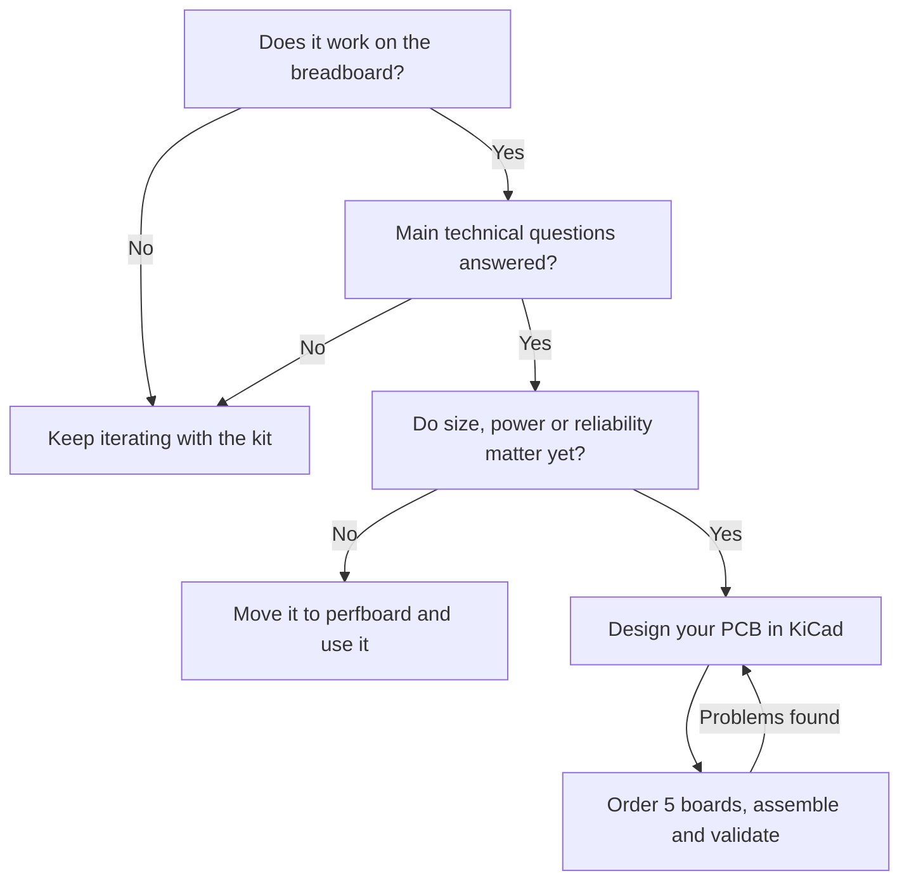

Your project works. The ESP32 DevKit is plugged into the breadboard, the sensor responds, the display shows data and the relay clicks when it should. Now you want to put it in an enclosure, leave it running or build a few for friends, and the rat's nest of jumper wires no longer cuts it. The natural next step is to design your own board.

The temptation is to copy exactly what you have on the breadboard into KiCad: the whole DevKit, every wire turned into a trace. Sometimes that is fine, but it is almost always a missed opportunity. The development board and your PCB have different goals, and understanding that difference is what makes the second version work better than the prototype.

## Two different goals

A development board is made for trying things out quickly. It comes with everything just in case: USB, a serial converter, a generous regulator, buttons, LEDs and every pin broken out. Its job is to remove uncertainty: does this sensor talk to this micro? Does the idea work at all?

Your PCB has a different job: to do **one** specific thing, reliably, in the place where it is going to live. The fact that the DevKit works on your bench does not mean its architecture is right for your device. It is big, it draws more than it needs to (the power LED and the USB-serial converter never switch off) and it depends on a USB cable that may not exist in the final product.



## What stays, what goes and what arrives

### What stays

Whatever you validated: the microcontroller (or its module, such as the ESP32-WROOM), the sensors and peripherals that work, the firmware logic and the communication buses (I2C, SPI, UART). Using the same module as on the DevKit is a good call for a first board: it comes pre-certified, with a tuned antenna and on-board flash.

### What goes

Everything that was only there for development:

- **USB-serial converter and USB connector**, if your device does not need them in normal use. For programming you can leave a header with a few pins and use an external adapter.
- **LEDs and buttons** that add nothing for the end user.
- **Expansion headers** you do not use.
- **Oversized regulators**, which in a battery-powered device waste more than they should. We cover this in [LDO vs DC/DC](/en/blog/ldo-vs-dcdc/).

A word of caution: "goes" does not always mean removing it. If you want to reflash comfortably over USB, you may want to keep the converter. Or pick an ESP32-S3 or C3, which have native USB and can be programmed without a converter. The key is that every component is there because you decided so, not because it came on the DevKit.

### What arrives

Things the DevKit solved for you, or that you did not need with a single unit on the bench:

- **A power supply designed for your use case**: battery, 12 V from a car, USB-C, a solar panel. With protection against reverse polarity and spikes.
- **A programming header** with access to TX, RX, EN and IO0. The [boot mode selection page in the esptool documentation](https://docs.espressif.com/projects/esptool/en/latest/esp32/advanced-topics/boot-mode-selection.html) explains which pins are involved and how to wire the auto-reset.
- **Test points** on the supply rails and key signals. When something fails, you will be glad you have them.
- **Mechanics**: mounting holes, connectors where the enclosure needs them and the module antenna kept clear of copper.
- **A way to recover** from a failed update, especially if you plan to update over WiFi. We look at this in [OTA updates on the ESP32](/en/blog/esp32-ota-updates/).

## What changes when everything shares one board

On the breadboard, each block lived on its own: the DevKit on one side, the sensor on its breakout, power over USB from the laptop. That separation hides interactions. Once everything is packed into a few square centimetres, new problems appear:

- The switching regulator injects noise into the analogue measurement (we cover this in [how to improve ADC accuracy](/en/blog/microcontroller-adc-accuracy/)).
- WiFi current spikes make the voltage sag if the decoupling is not right.
- A trace running under the antenna degrades the range.
- A split ground plane creates long, noisy return paths.

Espressif's [ESP32 hardware design guidelines](https://docs.espressif.com/projects/esp-hardware-design-guidelines/en/latest/esp32/) include a schematic checklist and a layout checklist that are worth reading before you start. And on our blog we collected the [most common mistakes in ESP32 PCBs](/en/blog/esp32-pcb-common-mistakes/).

## What each one validates

| The DevKit validates | Your PCB has to validate |
|---|---|
| The microcontroller does what you need | Your power supply copes with the spikes |
| The sensors and peripherals respond | The layout does not add noise or interference |
| The firmware logic is correct | The antenna has good range |
| The protocols work | It works in the real location: heat, cold, humidity |
| The overall architecture makes sense | It can be assembled, programmed and repaired |

Put another way: the prototype proves that the idea works; your board has to prove that it always works, not just for one afternoon on the bench.

## The firmware changes too

Prototype code is usually tied to the DevKit: pin numbers scattered all over the program, `Serial.println()` everywhere, assumptions about the on-board LED. Before your own board it pays to tidy it up:

- Define all the pins in one place, so that changing boards means changing one file.
- Separate the application logic from hardware access.
- Think about how you will update it (cable, OTA) and how you will know what is going on (a status LED, logs, a diagnostic mode).

## Manufacturing is another story

Some decisions that did not matter on the prototype do matter on the board:

- **Packages**: are you going to hand solder? Then avoid tiny QFNs and 0402 parts. If the fab house will assemble it, choose parts from their catalogue.
- **Availability**: check that the components can be bought and are not about to go end of life.
- **Fab house rules**: trace width, clearances, vias. [JLCPCB's manufacturing capabilities](https://jlcpcb.com/capabilities/pcb-capabilities) are a good reference for what you can order in a cheap run.
- **Repeatability**: if you build five, all five should come out the same and be quick to test.

Before you send the Gerbers, go through our [PCB fabrication checklist](/en/blog/pcb-fabrication-checklist/).

## When to make the jump

Neither too early nor too late. If you design the board with major open questions, you will end up redoing it. If you wait until everything is settled, you will have made decisions on the breadboard that are costly to change later.

The right moment is usually when the idea already works, the big questions are answered and size, power draw or having more than one unit start to matter. With runs of five boards for the price of a coffee at JLCPCB or PCBWay, iterating two or three revisions is perfectly affordable. For the design itself, the [official KiCad documentation](https://docs.kicad.org/) covers everything from schematic to Gerbers, and if you want to catch up with the latest version, read about [what's new in KiCad 10](/en/blog/kicad-10-whats-new/).

## Design your first board with us

If you have a breadboard prototype that is crying out for its own PCB, sign up for the Hackerspace Valencia [KiCad workshop](/en/workshops/kicad/) or drop by one evening with your half-finished schematic. Together we review the design before you order it and, when the boards arrive, we assemble the first one together.

## Image credits

- **Cover** - *ESP32 SH1106 Power-Meter 01* - King of Pwnt - CC0 - [source](https://commons.wikimedia.org/wiki/File:ESP32_SH1106_Power-Meter_01.jpg)
- **ESP32 DevKit** - *ESP32 Dev Board* (cropped) - Edwiyanto - CC BY-SA 4.0 - [source](https://commons.wikimedia.org/wiki/File:ESP32_Dev_Board.jpg)
- Diagrams: created by Hackerspace Valencia.
