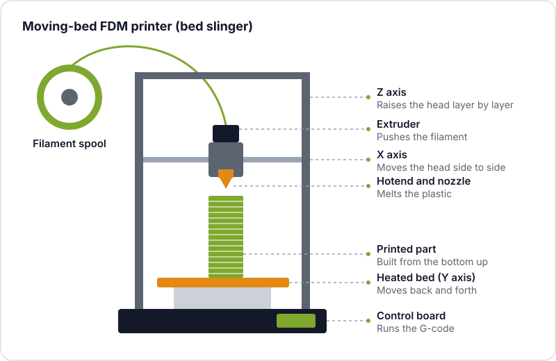
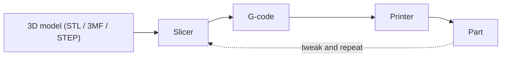

For many people, 3D printing is the gateway to digital fabrication. An enclosure for your ESP32, a camera mount, a broken part from an appliance that is no longer sold: in a few hours you go from an idea to an object you can hold. The barrier to entry is low, but there are a few concepts worth understanding properly so you don't spend your first weeks fighting parts that come unstuck or strings everywhere.

This guide is aimed at people who have never printed anything. It explains which technology to choose, what the workflow looks like, which settings matter at the start, which materials to begin with and how to diagnose the most common faults.

## FDM or resin: two ways to print

There are many 3D printing technologies, but two dominate the maker world:

- **FDM ([fused deposition modelling](https://en.wikipedia.org/wiki/Fused_filament_fabrication))**: the printer melts a plastic strand, the filament, and lays it down layer by layer through a nozzle that moves in X, Y and Z. It is the most common, the cheapest to maintain and the most versatile for functional parts.
- **Resin (SLA, MSLA, DLP)**: a screen or a laser hardens a photosensitive liquid resin layer by layer. It achieves far finer detail, ideal for miniatures, jewellery or small precision parts.

| | FDM | Resin |
|---|---|---|
| Detail | Medium, layers are visible | Very high |
| Functional parts | Very good | More brittle, depending on the resin |
| Post-processing | Remove supports and not much else | Wash in alcohol, UV cure, gloves |
| Handling | Simple and clean | Resin is toxic before curing, needs ventilation |
| Part size | Medium and large | Small and medium |



To get started, FDM is almost always the most sensible option: the material is easy to handle, mistakes are cheap and most of what a maker needs (enclosures, brackets, gears, adapters) prints very well this way. The rest of this guide focuses on FDM.

## The parts of an FDM printer

Before touching any setting, it's worth knowing what each part is. Although there are many designs (Cartesian bed slingers, CoreXY, delta), they all share the same basic parts.



- **Extruder**: a set of gears that push the filament into the hotend.
- **Hotend and nozzle**: the hot zone where the plastic melts. The most common nozzle is 0.4 mm.
- **Heated bed**: the surface the part is built on. Heating it helps the first layer stick.
- **Axes and stepper motors**: move the print head and the bed precisely.
- **Control board**: interprets the G-code and drives the motors, temperatures and fans.

## From model to part: the workflow

Printing something always follows the same chain. Understanding it helps you know where to look when something goes wrong.



1. **Model**: you design it yourself in a CAD program or download it from a repository. It usually comes as STL or 3MF.
2. **Slicer**: cuts the model into layers and calculates the nozzle paths. This is where you choose the material, layer height, infill, supports and speed.
3. **G-code**: the slicer's output, a text file in the numerical control language known as [G-code](https://en.wikipedia.org/wiki/G-code), with movement and temperature instructions the printer understands.
4. **Printer**: runs the G-code line by line.

A snippet of G-code looks like this. You don't need to write it by hand, but recognising it helps you understand what the machine is doing:

```gcode
M104 S210      ; set hotend temperature to 210 °C
M140 S60       ; set bed temperature to 60 °C
G28            ; home all axes
G1 Z0.2 F3000  ; drop to first layer height
G1 X50 Y20 E5 F1500  ; move while extruding filament
```

In [3D printing tools and resources](/en/blog/3d-printing-tools-and-resources/) we go over the most popular design programs and slicers.

## First settings: what really matters

### Bed levelling

The nozzle has to be the same distance from the bed across its whole surface. Many current printers have a probe that maps the bed and compensates for irregularities automatically; others are levelled by hand with knobs under the bed and a sheet of paper as a feeler gauge. Whatever your case, a badly levelled bed means the part sticks well in one corner and not at all in the opposite one.

### The first layer

If the first layer comes out right, the print almost always comes out right. What you're after is a strand slightly squashed against the bed, with the lines fused together and no gaps. If the nozzle is too high, the plastic goes down round and peels off; if it's too low, the nozzle scrapes the surface or plastic can't come out. This setting is usually called *Z offset* or *Live Z*, and the Prusa knowledge base has a good guide to [first layer issues](https://help.prusa3d.com/article/first-layer-issues_1804) with photos of each case.

The surface also has to be clean. A single fingerprint is enough to stop PLA from sticking: clean the bed with isopropyl alcohol or soapy water, as the surface manufacturer recommends.

### Temperature

Each filament has a temperature range that is usually printed on the spool. Start in the middle of the range and adjust: if layers separate easily, go up a little; if lots of strings appear between parts of the model, go down a little. A *temperature tower* (a model that prints sections at different temperatures) shows you in a single print which one works best with your spool.

## Materials to start with: PLA, PETG and TPU

There are dozens of filaments, but these three cover the vast majority of beginner projects.

| Material | Ease | What it's for | Things to watch |
|---|---|---|---|
| **PLA** | Very easy | Prototypes, enclosures, decorative parts | Softens with moderate heat; don't leave it in a car in the sun |
| **PETG** | Easy-medium | Functional parts, outdoor use, some flexibility | More prone to stringing; sticks very hard to some beds |
| **TPU** | Medium-hard | Flexible parts: gaskets, bumpers, cases | Prints slowly; Bowden extruders struggle with it |

The exact temperatures depend on the filament maker and the printer, so check the spool or a reference such as the [Prusa material guide](https://help.prusa3d.com/filament-material-guide). A practical tip: store your filaments in a box or bag with desiccant. PETG and especially TPU absorb moisture from the air, and wet filament crackles, bubbles and leaves weak parts.

## Common faults and how to spot them

- **The part comes off the bed (or the corners curl up, *warping*)**: first layer too high, dirty bed or bed temperature too low. Check in that order.
- **Fine strings between parts (*stringing*)**: temperature too high, not enough retraction or wet filament.
- **Gaps and layers missing material (under-extrusion)**: partially clogged nozzle, filament tangled on the spool or temperature too low.
- **Layer shifts**: a loose belt, the head hitting a lifted section of the part, or speed too high.
- **"Spaghetti"**: the part came loose mid-print and the printer keeps extruding into thin air. It's almost always an adhesion problem or unsupported overhangs.

The golden rule: change one parameter at a time and write down what you changed. If you tweak three things at once and it gets better, you won't know which one did it.

## Where to find models

You don't need to design everything from scratch. Repositories such as Printables, Thingiverse or MakerWorld host hundreds of thousands of models, many under open licences that let you modify them and share your versions. Before printing, look at the photos other people have uploaded (the *makes*): they tell you whether the model prints well and with which settings. When you want to go a step further, learning to design your own parts is what really multiplies what you can do; [our tools guide](/en/blog/3d-printing-tools-and-resources/) shows you where to start, and [maker resources](/en/blog/maker-resources/) lists more communities and useful websites.

If you're interested in digital fabrication in general, also take a look at how to get started with [laser cutting](/en/blog/laser-cutting-tools-and-resources/) and the [CNC mill](/en/blog/getting-started-cnc/): the path from design to machine is surprisingly similar.

## Come and print with us

The quickest way to learn is to print next to someone who has already made every mistake. If you want to get started, drop by [Hackerspace Valencia](/en/blog/what-is-a-hackerspace/) or check the [workshops](/en/workshops/) calendar: ask at the space which printers are available and how to use them, bring a model you want to print and we'll prepare it together. And if you stick around, [become a member](/en/pages/alta/).

## Image credits

The photos come from [Wikimedia Commons](https://commons.wikimedia.org) and are used under their respective licences. The diagrams are our own.

- **Cover** - *Machine product design printer 3D* - unknown author (pxhere) - CC0 - [source](https://commons.wikimedia.org/wiki/File:Machine-product-design-printer-3d-pressure-605267-pxhere.jpg)
- **Resin printer** - *Formlabs Form2 Bild05* - Creative Tools - CC BY 2.0 - [source](https://commons.wikimedia.org/wiki/File:Formlabs_Form2_Bild05_5184x2912_(24472439496).jpg)
