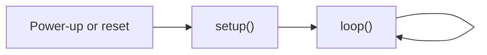
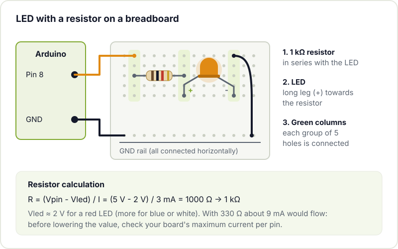
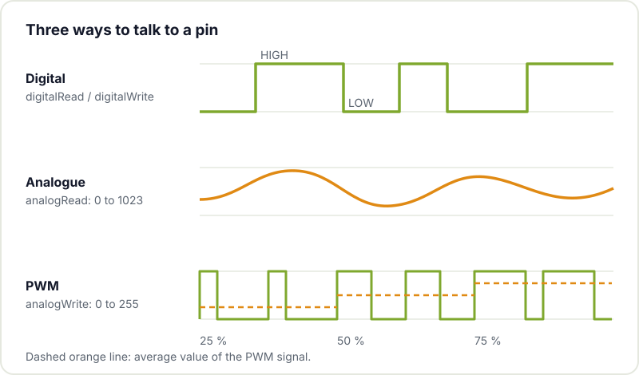

Arduino is still the most direct way to go from "I have never programmed a board" to "I have an LED doing exactly what I want" in a single afternoon. At the hackerspace it is, by far, the platform through which most people get into electronics, and for good reason: it is cheap, it forgives mistakes and it has a huge community behind it that has already run into almost any problem you will hit.

This post is not a list of resources (for that you have our [guide to resources for learning electronics](/en/blog/electronics-resources/)), but the practical path: what to buy, what to install and which two first circuits are worth building with your own hands.

## What Arduino actually is

When someone says "Arduino" they can mean three different things, and it helps to keep them apart:

- **The board**: a microcontroller mounted on a PCB with a USB connector, a voltage regulator and accessible pins. The classic one is the Arduino Uno.
- **The IDE**: the program you use to write the code, compile it and upload it to the board over USB.
- **The ecosystem**: the language (C++ with a layer of simple functions such as `digitalWrite()`), thousands of libraries for sensors and displays, and an amount of examples and tutorials that is hard to match.

The interesting part is that the IDE and the libraries are not limited to the official boards. With the same environment you can program an ESP32 or a Raspberry Pi Pico, so what you learn here carries over later.

## Which board to buy

Keep it simple to start with. These are the sensible options:

| Board | Who it is for | Things to keep in mind |
|---|---|---|
| **Arduino Uno R4 Minima** | Anyone who wants the reference board | USB-C, Renesas RA4M1 microcontroller (Arm Cortex-M4 at 48 MHz), 5 V logic |
| **Arduino Uno R4 WiFi** | Anyone planning to connect things to the network | Same as the Minima, plus an ESP32-S3 module for WiFi and Bluetooth and an LED matrix |
| **Arduino Nano** (and family) | Small builds or ones that go on a breadboard | There are several versions (classic Nano, Nano Every, Nano ESP32...); check which one you are buying |
| **Uno or Nano clones** | Minimal budget or wanting several boards | They generally work well; some use a different USB to serial chip (such as the CH340) that may need a driver |

The Uno R4 specifications are in the [official Arduino Uno R4 Minima documentation](https://docs.arduino.cc/hardware/uno-r4-minima/). 

If in doubt, an Uno (original or clone) is the safe bet: almost every tutorial in the world uses it as the reference, and its size makes it hard to get the wiring wrong.

Clones are legal (Arduino is open hardware) and very handy for projects that stay built. Buying an original also funds the development of the IDE and the libraries you use for free.

## The minimal kit

You do not need a 200 piece kit. With this you can do your first twenty experiments:

- A 400 or 830 point **breadboard**.
- Male to male **jumper wires** (and some male to female ones for modules).
- 5 mm **LEDs** in several colours.
- Assorted **resistors**: at least 220 Ω, 330 Ω, 1 kΩ and 10 kΩ.
- A couple of 4 leg **push buttons** for breadboards.
- A **simple sensor**: a potentiometer, an LDR or a temperature sensor.
- A **USB cable** that carries data, not just power. This detail wastes more afternoons than you would think.

If you can also get a cheap multimeter, even better: measuring voltages is the fastest way to understand what is going on.

## Installing Arduino IDE 2

Download Arduino IDE 2 for your operating system by following the [official Arduino IDE 2 installation guide](https://docs.arduino.cc/software/ide-v2/tutorials/getting-started/ide-v2-downloading-and-installing/). Then:

1. Connect the board over USB.
2. In the selector at the top, choose the board and the port. If it is an Uno R4, the IDE will ask you to install its support package from the boards manager: accept.
3. On Linux, if the port does not appear or gives a permissions error, add your user to the `dialout` group and log in again.
4. If you are using a clone with a CH340 chip and your system does not recognise it, install the corresponding driver.

## First program: Blink

Every Arduino program (a *sketch*) has two mandatory functions:

- `setup()` runs **once** when the board powers up or resets. This is where you configure pins and communications.
- `loop()` runs **over and over** for as long as there is power. This is where your project's logic lives.



The first sketch is the classic [Blink example](https://docs.arduino.cc/built-in-examples/basics/Blink/), which blinks the LED built into the board:

```cpp
// Blink: turns the built-in LED on and off every half second

void setup() {
  // LED_BUILTIN is the pin of the LED that comes on the board itself
  pinMode(LED_BUILTIN, OUTPUT);   // configure it as an output
}

void loop() {
  digitalWrite(LED_BUILTIN, HIGH);  // HIGH = high voltage = LED on
  delay(500);                       // wait 500 milliseconds
  digitalWrite(LED_BUILTIN, LOW);   // LOW = 0 V = LED off
  delay(500);
}
```

Press the upload button (the arrow). If the LED blinks, you have the whole chain working: editor, compiler, USB and board. Change the `500` values to something else and upload again to check that you understand what each line does.

## Second circuit: push button and external LED

Now we move the LED onto the breadboard. An LED is **never** connected straight to a pin: it needs a series resistor to limit the current, or you will end up damaging the LED, the pin or both.



The calculation is Ohm's law applied to the voltage that is "left over": the board supplies 5 V, a red LED takes about 2 V and we want a few milliamps. Modern LEDs are plenty bright at 2-5 mA, and being conservative protects the pin. Before going down to values like 220 Ω, check your board's datasheet for how much current each pin can handle.

Add a push button between **pin 2** and **GND**. The button does not need an external resistor because we will enable the microcontroller's internal *pull-up* resistor:

```cpp
const int PIN_LED = 8;
const int PIN_BOTON = 2;   // button pin

void setup() {
  pinMode(PIN_LED, OUTPUT);
  // INPUT_PULLUP: the pin reads HIGH at rest and LOW when you press
  pinMode(PIN_BOTON, INPUT_PULLUP);
}

void loop() {
  bool pulsado = (digitalRead(PIN_BOTON) == LOW);   // pressed?
  digitalWrite(PIN_LED, pulsado ? HIGH : LOW);
}
```

Notice the inverted logic: with a *pull-up*, pressing pulls the pin to 0 V, so "pressed" is `LOW`. It is one of the first "why is it doing the opposite?" moments for any beginner.

## Digital and analogue

Arduino pins work in two ways:

- **Digital**: only two states, `HIGH` or `LOW`. Used for LEDs, relays, push buttons and limit switches.
- **Analogue input** (pins `A0`, `A1`...): `analogRead()` converts a voltage between 0 V and the reference into a number. On the Uno it ranges from 0 to 1023 by default. This is what you use with a potentiometer, an LDR or many sensors.
- **"Analogue" output** (`analogWrite()`): it is actually PWM, a signal that switches very fast and whose average value varies. It is used to dim an LED or set the speed of a motor (through its driver). It only works on the pins marked with `~`.



If you want to go further with analogue readings, in [how to improve the accuracy of a microcontroller's ADC](/en/blog/microcontroller-adc-accuracy/) we explain where noise and errors come from.

## The serial monitor: your best friend

The board has no screen, but it can send you text over the same USB cable. It is the number one debugging tool:

```cpp
void setup() {
  Serial.begin(115200);  // the speed must match the monitor's
}

void loop() {
  int valor = analogRead(A0);
  Serial.print("A0 = ");
  Serial.println(valor);
  delay(200);
}
```

Open the serial monitor (magnifying glass icon at the top right) and choose 115200 baud. If you see garbage characters, the speed almost always does not match. IDE 2 also includes a *serial plotter* that draws the values in real time, perfect for seeing how a sensor responds.

## Next steps

Once you can do Blink and the push button without looking, there are three natural paths:

1. **Stop using `delay()`**. It blocks the board and prevents you from doing two things at once. In [what embedded programming is and how to get started](/en/blog/intro-to-embedded-programming/) we explain how to replace it with `millis()` and a state machine.
2. **Connect something to the network** with an [ESP32](/en/blog/getting-started-esp32/): it is programmed with the same IDE and costs less than many Arduino boards.
3. **Move from the breadboard to your own board**. When a circuit works and you want it to last, the next step is designing your PCB; we have a [checklist before sending a PCB to fabrication](/en/blog/pcb-fabrication-checklist/).

And if you get stuck (a wire that is not making contact, a port that does not show up, an LED the wrong way round), the fastest fix is having someone look at it with you. Bring your board and your breadboard to Hackerspace Valencia: there is always someone who has already made the same mistake. Check out our [workshops](/en/workshops/) and, if you get hooked, [become a member](/en/pages/alta/).

## Image credits

- **Cover** - *Arduino Uno board* - JrawX - CC0 - [source](https://commons.wikimedia.org/wiki/File:Arduino_Uno_board.jpg)
- **Arduino Uno R4 WiFi** - *Arduino UNO R4 WiFi* - Lomrjyo - CC BY-SA 4.0 - [source](https://commons.wikimedia.org/wiki/File:Arduino_UNO_R4_WiFi.jpg)
- Diagrams: Hackerspace Valencia.
