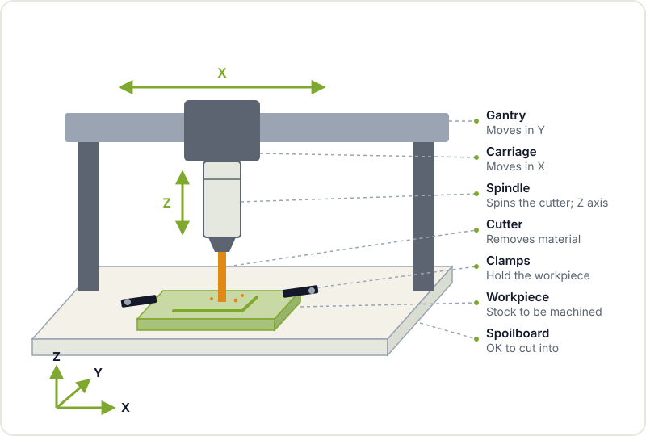

If a 3D printer builds parts by adding material and a laser cutter cuts sheets, a CNC router does the opposite of the printer: it starts from a block and removes material with a tool spinning at thousands of revolutions per minute. That lets it work solid wood, engineering plastics, aluminium or copper-clad board for circuits, with a precision and part strength the other machines cannot match.

It is also the machine with the most variables: tool, spindle speed, feed rate, depth of cut, workholding. This guide gives you the map to understand each of them before you switch on the spindle for the first time.

## How a CNC router works

A CNC ([computer numerical control](https://en.wikipedia.org/wiki/Numerical_control)) router moves a cutting tool, the **cutter** or bit, along three axes:

- **X**: left and right.
- **Y**: forwards and backwards.
- **Z**: up and down, which controls the depth.

The cutter is held in the **spindle** (or in an adapted trim router), a motor that spins it at high speed. The workpiece is fastened to the **bed** or the spoilboard, and stepper motors or servos move the gantry following the G-code instructions.



If you want to see the principle at a small scale, the hackerspace's [recycled plotter](/en/proyectos/plotter/) uses the same idea of axes driven by stepper motors, built from CD-ROM drive parts. Swap the pen for a spindle, add rigidity and you have a CNC.

## From design to machining: CAD, CAM and G-code


1. **CAD**: you draw the part in 2D or 3D. FreeCAD, Fusion, Onshape or even Inkscape for flat work will all do.
2. **CAM**: this is the new step compared with 3D printing. Here you choose which cutter to use, which operations to run (profile, pocket, drilling, facing), the depth per pass, the speed and the order. FreeCAD includes a [CAM workbench](https://wiki.freecad.org/CAM_Workbench) and Fusion has integrated CAM.
3. **Post-processor**: translates the toolpaths into the dialect of [G-code](https://en.wikipedia.org/wiki/G-code) your controller understands (GRBL, LinuxCNC, Mach3 and others).
4. **Machine**: you clamp the workpiece, fit the cutter, set the **work zero** (where the X, Y and Z origin sits on the material) and run the program.

One important detail: simulate before you cut. Most CAM programs show the toolpath and the material that will be removed. That is where the big mistakes show up, such as a pass that goes straight through the vice.

## Types of cutters

| Cutter | Shape | What for |
|---|---|---|
| **Flat end mill** | Flat tip | Profiles, pockets, outlines: the most common one |
| **Ball nose** | Hemispherical tip | 3D surfaces, reliefs, smooth finishes |
| **V-bit** | Conical tip | Engraving, lettering, chamfers and trace isolation on PCBs |
| **Upcut spiral** | Pulls chips upwards | Good chip evacuation; can splinter the top face |
| **Downcut spiral** | Pushes chips downwards | Clean top face in wood and plywood |
| **Compression** | Half upcut, half downcut | Plywood and laminated boards with both faces clean |
| **Surfacing bit** | Large diameter, short height | Flattening the spoilboard or the surface of the workpiece |



Besides the shape, the **number of flutes** matters. Few flutes (one or two) leave more room to clear chips, which is key in plastics and aluminium, as they tend to melt or gum up. More flutes give a better finish in hard materials, but need a stiffer machine.

## Speeds, feeds and chip load

This is the part that scares people most and the one that matters most. Three concepts:

- **Spindle speed (RPM)**: how many revolutions the cutter makes per minute.
- **Feed rate (mm/min)**: how fast the cutter moves through the material.
- **Chip load (mm per flute)**: the thickness of material each flute removes on each revolution.

They are related by a simple formula:

```text
feed rate (mm/min) = RPM × number of flutes × chip load (mm/flute)
```

For example, at 18,000 RPM, with a 2-flute cutter and a chip load of 0.05 mm, the feed rate would be 18,000 × 2 × 0.05 = 1800 mm/min. Chip load values depend on the material, the cutter diameter and the machine's rigidity, so take them from the cutter manufacturer's tables or from reference guides on [speeds and feeds](https://en.wikipedia.org/wiki/Speeds_and_feeds), and always start on the conservative side.

The sign that you are doing it right is the chips themselves: proper **chips**, not dust. If fine dust comes out, the cutter is rubbing instead of cutting: it heats up, goes blunt and, in wood, can even burn. The opposite, too much feed, shows up as a strained sound, vibration and broken cutters. With hobby machines, less rigid than industrial ones, the usual approach is shallow passes at a reasonable feed rate.

## Workholding: the part must not move

A badly held workpiece is the number one cause of ruined parts, broken cutters and nasty surprises. Common options:

- **Clamps and bolts** on a T-slot table or a spoilboard with threaded inserts.
- **Vice**, for small and metal parts.
- **Good-quality double-sided tape** with cyanoacrylate, widely used for thin stock and PCBs.
- **Screws straight into the spoilboard** in areas of the workpiece that will be discarded afterwards.
- **Tabs**: small bridges the CAM leaves uncut so the part does not come loose at the end of the profile.

Before running the program, check that no toolpath passes over a clamp or a screw. A dry run with the Z axis raised is a good way to verify it.

## Materials to start with

- **Wood and plywood**: very forgiving and ideal for learning. Watch out for the dust, especially from MDF.
- **Tooling foam and machinable wax**: soft, perfect for testing toolpaths.
- **Plastics (cast acrylic, POM/Delrin, HDPE)**: excellent results with single-flute cutters. Extruded acrylic tends to melt more than cast.
- **Aluminium**: doable on many hobby machines with light passes, suitable cutters and lubrication or air, but not on day one.
- **FR-1 or FR-4 copper-clad board** for PCBs: see the next section.

## Maker use case: milling your own PCBs

For a hackerspace with electronics people, one of the most useful jobs for a small CNC is making PCB prototypes in an afternoon, without waiting for the fab's shipping.


1. You design the board in [KiCad](https://www.kicad.org) with generous traces and clearances (hobby CNCs are not an industrial fab).
2. You export Gerbers and the drill file.
3. With [FlatCAM](https://www.flatcam.org) you generate the **isolation** toolpaths: the V-bit follows the outline of each trace, removing the copper around it.
4. You mill with a fine-tipped V-bit, drill with PCB drill bits and cut out the board outline.



The key is **flatness**: the copper layer is extremely thin, so a height difference of a few tenths of a millimetre means the copper is not cut in one area and the cutter goes too deep in another. Many control programs can probe the surface (*autolevelling*) and compensate. For final boards or fine-pitch parts, ordering from a fab is still the better option: go through our [checklist before sending a PCB to fabrication](/en/blog/pcb-fabrication-checklist/) and, if you are just getting into design, the [KiCad workshop](/en/workshops/kicad/).

The glass fibre in FR-4 produces harmful dust when machined: use extraction, never blow the dust away and wear a suitable mask. That is why many people prefer FR-1 (phenolic paper) for milled prototypes.

## Safety

- **Safety glasses, always.** Cutters break and chips fly.
- **Hearing protection**: many spindles and trim routers are very loud.
- **Dust extraction**: wood, MDF and fibreglass dust is bad for your lungs.
- **Nothing loose near the spindle**: hair tied back, no gloves, no loose sleeves or necklaces. A spinning cutter grabs fabric in an instant.
- **Hand on the emergency stop** during the first pass of every new program.
- **Do not leave the machine unattended** while it is running.
- **Never touch the cutter or the workpiece** until the spindle has come to a complete stop.

## Keep exploring

A CNC fits in with the rest of digital fabrication: you can start with [3D printing](/en/blog/getting-started-3d-printing/) for plastic parts, use [laser cutting](/en/blog/laser-cutting-tools-and-resources/) for thin sheets and save the router for jobs that need rigidity or materials the others cannot handle. For design, in [3D printing tools](/en/blog/3d-printing-tools-and-resources/) we compare CAD programs that will serve you here too.

## Come and mill at the hackerspace

A CNC is much easier to learn with someone next to you who has already broken a few cutters. Drop by [Hackerspace Valencia](/en/blog/what-is-a-hackerspace/), ask at the space which machines are available and what training you need to use them, and check the scheduled [workshops](/en/workshops/). If you have a board or a part in mind, bring it along: it is the best starting point.

## Image credits

Photos come from [Wikimedia Commons](https://commons.wikimedia.org) and are used under their respective licences. Diagrams are our own.

- **Cover** - *CNC router in workshop* - Matthew Venn - CC BY-SA 2.0 - [source](https://commons.wikimedia.org/wiki/File:CNC_router_in_workshop.jpg)
- **Types of cutters** - *MillingCutterSlotEndMillBallnose* - Glenn McKechnie - CC BY-SA 2.0 - [source](https://commons.wikimedia.org/wiki/File:MillingCutterSlotEndMillBallnose.jpg)
- **Milled PCB** - *Milled PCB* - Stephen Pithouse - CC BY-SA 3.0 - [source](https://commons.wikimedia.org/wiki/File:Milled_PCB.JPG)
