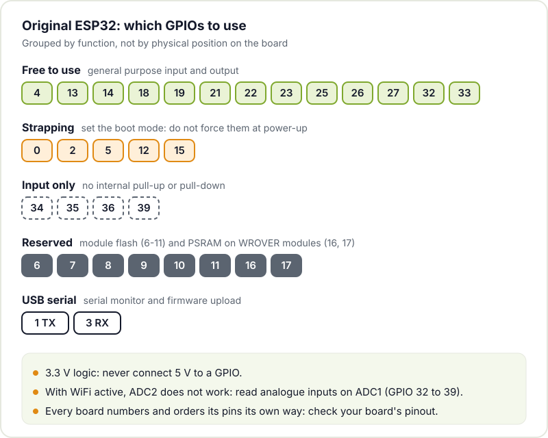
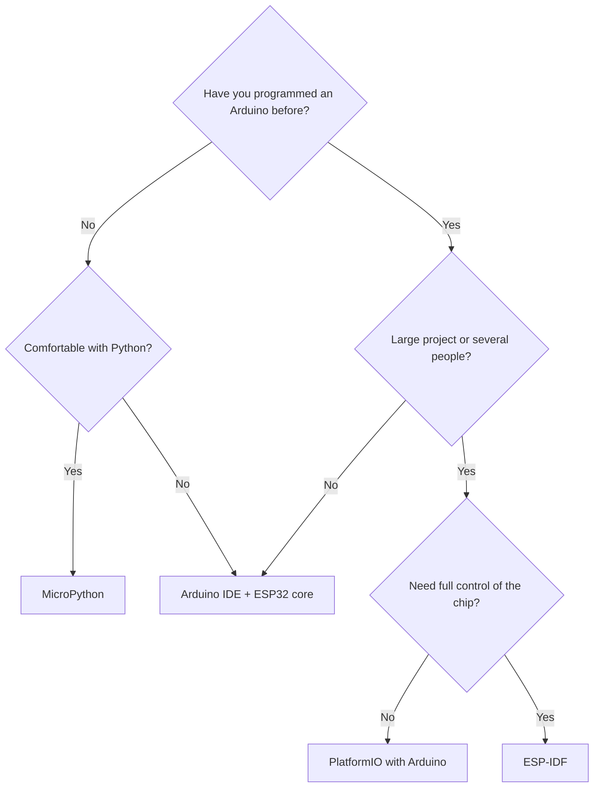
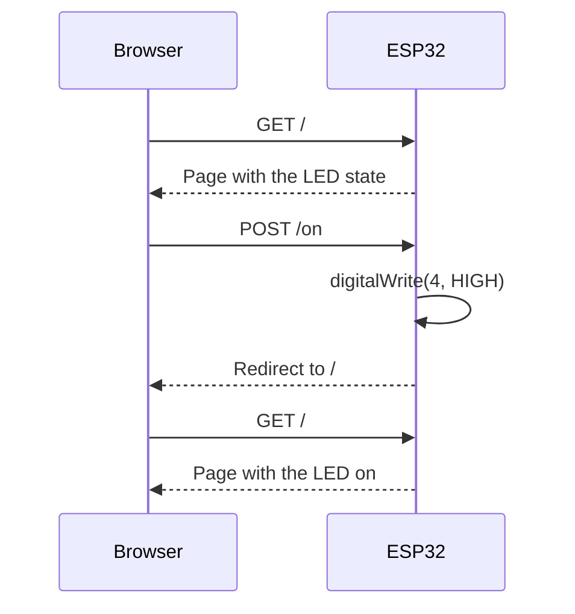

If Arduino is the classic way in, the ESP32 is the board most makers end up using for real projects: sensors that send data home, lamps controlled from your phone, internet radios, weather stations. It has built-in WiFi and Bluetooth, far more power than a classic Arduino Uno, and a development board costs a few euros.

This post is the practical kick-off: which chip to choose, which board to buy, what to watch out for with the pins and how to write a first program that connects to your WiFi and serves a web page. If you have never programmed a microcontroller, you may want to start with [getting started with Arduino](/en/blog/getting-started-arduino/): almost everything you learn there applies here.

## Why the ESP32

- **Built-in connectivity**: WiFi and Bluetooth Low Energy on the chip itself, with no extra modules.
- **Price**: a generic development board costs less than many of the sensors you will connect to it.
- **Power**: cores running at up to 240 MHz and hundreds of KB of RAM, compared with the 2 KB of the ATmega328P on the classic Uno.
- **Ecosystem**: you can program it from the Arduino IDE, with ESP-IDF (Espressif's official framework), with MicroPython or with PlatformIO.
- **Documentation**: Espressif publishes very thorough datasheets, technical reference manuals and programming guides.

## Variants: there is no single ESP32

"ESP32" is now the name of a family. These are the variants you will come across most often, with data from [Espressif's SoC page](https://www.espressif.com/en/products/socs):

| Chip | CPU | SRAM | Radio | Useful details |
|---|---|---|---|---|
| **ESP32** (the original) | 2 Xtensa cores, up to 240 MHz | 520 KB | WiFi 4 (802.11 b/g/n), Bluetooth Classic + BLE | The best documented; 34 GPIOs |
| **ESP32-S3** | 2 Xtensa LX7 cores, up to 240 MHz | 512 KB | WiFi 4, Bluetooth 5 (LE) | Native USB OTG, vector instructions for AI, 45 GPIOs |
| **ESP32-C3** | 1 RISC-V core, up to 160 MHz | 400 KB | WiFi 4, Bluetooth 5 (LE) | Very cheap, built-in USB serial/JTAG, 22 GPIOs |
| **ESP32-C6** | RISC-V at 160 MHz + low power core at 20 MHz | 512 KB | WiFi 6 (2.4 GHz), Bluetooth 5 (LE), 802.15.4 | Thread and Zigbee; 30 GPIOs (QFN40 package) |

To get started, the **original ESP32** or the **ESP32-S3** are the most comfortable options: there are plenty of tutorials and most libraries are tested on them first. The C3 is ideal for small, cheap things, and the C6 if you are interested in home automation with Thread or Zigbee. For projects with a display, a camera or heavy processing there are bigger chips; we cover the [ESP32-P4](/en/blog/esp32-p4/) in another post.

## Development boards (DevKit)

You cannot plug the bare chip into a breadboard. What you buy is a **development board** (DevKit): the module with the ESP32 and its flash memory, a 3.3 V regulator, a USB to serial converter (or the chip's native USB), two buttons (**EN** to reset and **BOOT** to enter download mode) and the pins in two rows.



There are dozens of models (Espressif's DevKitC, 30 and 38 pin clones, boards with a display or battery). They work the same way, but **each one has its own pinout**: the number printed next to a pin does not always match between manufacturers. Save the diagram for your specific board before wiring anything.

## The golden rule: 3.3 V

The ESP32 runs at **3.3 V**. Its GPIOs are not 5 V tolerant: if you connect the output of a 5 V sensor or module directly to a pin, you can damage it. With 5 V modules use a resistor divider (for slow inputs) or a logic level shifter.

The pin marked **5V** or **VIN** on the board is connected to USB and is there to power the board or supply 5 V to other modules, not to feed into a GPIO.

## Pins to avoid (or use with care)

Not all GPIOs are equal. On the original ESP32, according to the [ESP-IDF GPIO documentation](https://docs.espressif.com/projects/esp-idf/en/stable/esp32/api-reference/peripherals/gpio.html):

- **Strapping pins (0, 2, 5, 12 and 15)**: the chip reads their state at boot to decide how to start. If your circuit forces them to a particular level, the board may not boot or may not accept code. GPIO12 is especially treacherous because it sets the flash voltage.
- **GPIO 6 to 11**: connected to the module's flash. Do not touch them.
- **GPIO 16 and 17**: also taken on modules with PSRAM (for example, the WROVER ones).
- **GPIO 34 to 39**: **input only** and with no internal pull-up or pull-down resistors.
- **GPIO 1 and 3**: these are the USB serial port. If you use them, you lose the serial monitor.
- **ADC2 with WiFi**: the ADC2 analogue inputs do not work while WiFi is active. To read analogue sensors in a connected project, use the ADC1 pins (32 to 39).



## Which development environment to use

You have four serious options, and all of them are free:

- **Arduino IDE + ESP32 core**: the same IDE as with Arduino, adding the [Arduino core for ESP32](https://docs.espressif.com/projects/arduino-esp32/en/latest/). The quickest route if you already know Arduino, and the one we use in the example below.
- **ESP-IDF**: Espressif's official framework, in C, based on FreeRTOS. Full access to the whole chip and the best option for serious products. Start with the [ESP-IDF getting started guide](https://docs.espressif.com/projects/esp-idf/en/stable/esp32/get-started/index.html).
- **MicroPython**: Python on the microcontroller, with an interactive console over USB. Perfect for quick experiments; see the [MicroPython quick reference for the ESP32](https://docs.micropython.org/en/latest/esp32/quickref.html).
- **PlatformIO**: a VS Code extension that manages boards, libraries and versions per project. It can use either the Arduino core or ESP-IDF under the hood.



It is not a decision for life: many people start with Arduino, move to PlatformIO when the project grows and end up using ESP-IDF when they need to fine-tune power consumption or timing.

## Setting up the Arduino IDE

1. In the Arduino IDE 2 boards manager, search for **esp32** and install the package from **Espressif Systems**. If it does not show up, follow the installation steps in the core's documentation.
2. Select your board (for most DevKits with the original ESP32, **ESP32 Dev Module** works) and the port.
3. If you see `Connecting...` when uploading and it ends up failing, hold down **BOOT** until writing starts.
4. If the port does not show up, check the USB cable (it must carry data) and the driver for your board's USB to serial converter (CP210x or CH340 are the usual ones).

## First program: an LED controlled from the browser

We are going to get the ESP32 to connect to your WiFi and serve a web page that shows the state of an LED and lets you switch it on or off. Connect an LED with its resistor (1 kΩ works well) between **GPIO 4** and GND. We use 4 because it is neither a strapping pin nor reserved; many DevKits have an LED on GPIO 2, but that is a strapping pin and it is worth getting used to avoiding it.



```cpp
#include <WiFi.h>
#include <WebServer.h>

const char* WIFI_SSID = "YOUR_NETWORK";
const char* WIFI_PASS = "YOUR_PASSWORD";
const int LED_PIN = 4;

WebServer server(80);
bool ledOn = false;

void setLed(bool on) {
  ledOn = on;
  digitalWrite(LED_PIN, on ? HIGH : LOW);
}

String page() {
  String html =
    "<!DOCTYPE html><html><head><meta charset='utf-8'>"
    "<meta name='viewport' content='width=device-width,initial-scale=1'>"
    "<title>ESP32</title></head><body style='font-family:sans-serif'>";
  html += "<h1>LED ";
  html += ledOn ? "on" : "off";
  html += "</h1>";
  html += "<form method='post' action='/on'><button>Turn on</button></form>";
  html += "<form method='post' action='/off'><button>Turn off</button></form>";
  html += "</body></html>";
  return html;
}

void redirectHome() {
  server.sendHeader("Location", "/");
  server.send(303);
}

void setup() {
  Serial.begin(115200);
  pinMode(LED_PIN, OUTPUT);
  setLed(false);

  WiFi.mode(WIFI_STA);
  WiFi.begin(WIFI_SSID, WIFI_PASS);
  Serial.print("Connecting to WiFi");
  while (WiFi.status() != WL_CONNECTED) {
    delay(500);
    Serial.print(".");
  }
  Serial.println();
  Serial.print("Open in your browser: http://");
  Serial.println(WiFi.localIP());

  server.on("/", HTTP_GET, []() { server.send(200, "text/html", page()); });
  server.on("/on", HTTP_POST, []() { setLed(true); redirectHome(); });
  server.on("/off", HTTP_POST, []() { setLed(false); redirectHome(); });
  server.begin();
}

void loop() {
  server.handleClient();  // handle pending requests
}
```

Upload the program, open the serial monitor at 115200 baud and paste the IP address it prints into the browser of a phone or computer on the same network. A few details:

- The ESP32 only connects to **2.4 GHz** networks (the C6 included). If your router splits the bands, use the 2.4 GHz one.
- The buttons use **POST** rather than normal links: that way a browser that prefetches pages will not switch the LED on by itself.
- The `loop()` function must return quickly so that `handleClient()` can handle requests. If you add long `delay()` calls, the web page becomes sluggish.
- Do not leave your WiFi password in a public repository. When the project grows, store it separately.

The [WiFi API documentation for the Arduino core](https://docs.espressif.com/projects/arduino-esp32/en/latest/api/wifi.html) explains the other modes (its own access point, network scanning, reconnection).

## Next steps

- **Low power**: with WiFi active the ESP32 draws quite a lot. If you are going to use batteries, read [how to reduce ESP32 power consumption](/en/blog/esp32-low-power/).
- **A complete project**: the [internet radio with an ESP32 and a MAX98357 DAC](/en/blog/esp32-internet-radio/) built by a hackerspace member is a good example of all of this together.
- **Updating without a cable**: as soon as the ESP32 is inside an enclosure you will want [OTA updates](/en/blog/esp32-ota-updates/).

If you have an ESP32 sitting in a drawer waiting for a project, bring it to Hackerspace Valencia. Building that first web server with a few other people takes an afternoon and is a lot more fun. Have a look at the workshops on the website and, if you want to come regularly, [become a member](/en/pages/alta/).

## Image credits

- **Cover** - *ESP32 on Lolin32 Lite clone board cropped* - Ubahnverleih - CC0 - [source](https://commons.wikimedia.org/wiki/File:ESP32_on_Lolin32_Lite_clone_board_cropped.jpg)
- **ESP32 development board** - *ESP32 Espressif ESP-WROOM-32 Dev Board (2)* - Ubahnverleih - CC0 - [source](https://commons.wikimedia.org/wiki/File:ESP32_Espressif_ESP-WROOM-32_Dev_Board_(2).jpg)
- Diagrams: Hackerspace Valencia.
