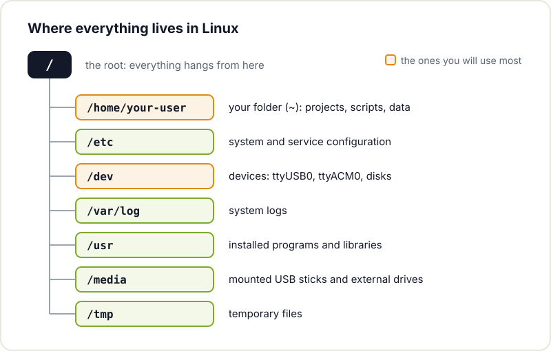
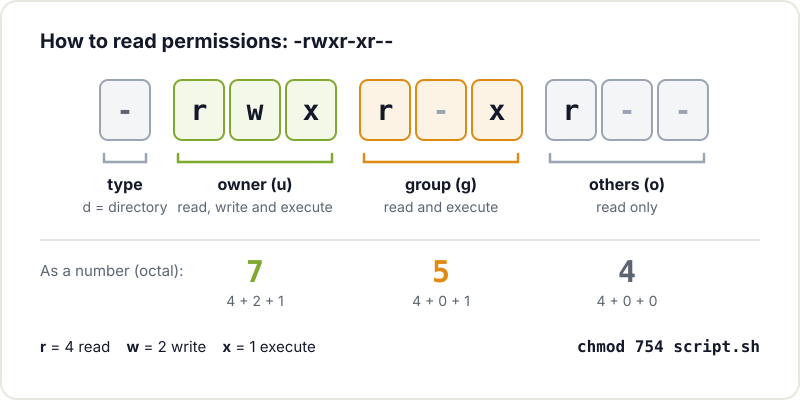

Sooner or later, almost every maker project ends up touching Linux. Sometimes it is obvious, like setting up a Raspberry Pi that controls a 3D printer or collects sensor data. Other times it is hidden: the server running your MQTT broker, the container that builds the firmware or the router you have repurposed as a gateway. You do not need to become a sysadmin, but you do need to handle the basics without fear.

This guide brings together what we actually use in the workshop: choosing a distribution, finding your way around the terminal, understanding permissions, installing packages, connecting over SSH, talking to a serial port and getting a script to start on its own.

## Why Linux for a maker

- **Raspberry Pi and similar boards** run Linux natively. Raspberry Pi OS is a Debian-based distribution.
- **Home servers and services**: Home Assistant, Node-RED, an MQTT broker or a file server work especially well on Linux, and most tutorials take it for granted.
- **Microcontroller toolchains**: compilers, flashing tools and environments such as ESP-IDF or PlatformIO are used from the terminal and tend to run more smoothly on Linux.
- **Reusing hardware**: an old laptop with a lightweight distribution becomes useful again as a workstation or server.

And it is free software: you can see how it works, modify it and share it.

## Which distribution to choose

A "distro" is Linux plus a set of programs, a package manager and a few default decisions. To start with, pick something popular: you will find more documentation and more answers to your questions.

- **Ubuntu or Linux Mint** on a laptop or PC: easy to install and a huge community. Mint feels familiar if you are coming from Windows.
- **Debian** if you want something stable and no-frills, especially for servers.
- **Raspberry Pi OS** on a Raspberry Pi. Its Lite version, with no desktop, is ideal for projects that run headless.

All three share the `apt` package manager, so what you learn on one applies to the others. If you do not want to touch your disk, try a bootable USB stick or a virtual machine first.

## The terminal without fear

The terminal is the most direct way to talk to the system. You type a command, press Enter and it answers. These are the ones you will use every day:

| Command | What it does | Example |
|---|---|---|
| `pwd` | Shows which folder you are in | `pwd` |
| `ls` | Lists the contents of a folder | `ls -l /dev` |
| `cd` | Changes folder | `cd ~/projects` |
| `mkdir` | Creates a folder | `mkdir temp-sensor` |
| `cp` / `mv` | Copies or moves (and renames) | `mv data.csv old-data.csv` |
| `rm` | Deletes files (no recycle bin) | `rm test.txt` |
| `cat` / `less` | Shows a file | `less /var/log/syslog` |
| `nano` | Edits a text file | `nano config.yaml` |
| `grep` | Searches for text | `grep -r "WIFI_SSID" .` |
| `sudo` | Runs as administrator | `sudo apt update` |
| `man` | Opens a command's manual | `man ls` |

Two tricks that save a lot of time: the **Tab** key autocompletes file names and commands, and the **up arrow** brings back previous commands. If you want to practise step by step, Ubuntu's [The Linux command line for beginners](https://ubuntu.com/tutorials/command-line-for-beginners) tutorial is a good starting point.

## Where everything lives

In Linux everything hangs from a single root, `/`. There are no drive letters like `C:`: disks, USB sticks and even hardware devices appear as folders and files inside that tree.



Your work lives in `/home/your-user` (shortened to `~`). System configuration is in `/etc`, logs are in `/var/log` and devices, such as an Arduino's serial port, are in `/dev`.

## Permissions: why something says "Permission denied"

Every file has an owner, a group and read (`r`), write (`w`) and execute (`x`) permissions for three classes: the owner, the group and everyone else. You can see them with `ls -l`:

```bash
$ ls -l reading.py
-rw-r--r-- 1 maker maker 812 Aug 11 10:02 reading.py
```

Anyone can read that file, but only `maker` can modify it, and nobody can execute it directly. The first ten characters are always read the same way:



To make it executable:

```bash
chmod +x reading.py
./reading.py
```

For system tasks (installing programs, editing `/etc`) you use `sudo`. Use it when needed, not out of habit: if a command asks you for `sudo` to touch files in your own folder, something is misconfigured.

## Installing software with apt

On Debian-based distros, `apt` installs programs from the official repositories, along with their dependencies and updates:

```bash
sudo apt update              # refresh the package list
sudo apt upgrade             # install the updates
sudo apt install git python3-venv mosquitto-clients
apt search minicom           # search for a package
sudo apt remove minicom      # uninstall it
```

For Python projects, create a virtual environment per project (`python3 -m venv .venv`) and install the libraries there with `pip`, instead of mixing them with the system ones. If you want to understand in depth how a Debian distro works, [The Debian Administrator's Handbook](https://www.debian.org/doc/manuals/debian-handbook/) is free.

## SSH: controlling a Raspberry Pi without a screen

Most project Raspberry Pis have no screen or keyboard. You connect to them over SSH from your computer. You can enable the SSH server when preparing the card with Raspberry Pi Imager or from the Pi itself. The official Raspberry Pi [remote access documentation](https://www.raspberrypi.com/documentation/computers/remote-access.html) explains all the options.

```bash
ssh maker@raspberrypi.local       # log in to the Pi
scp reading.py maker@raspberrypi.local:~/   # copy a file
ssh-keygen -t ed25519             # create your key pair
ssh-copy-id maker@raspberrypi.local         # log in without a password
```

Using keys instead of a password is more convenient and more secure. If your Pi is going to be on for months, also read how to keep a [Raspberry Pi running 24/7](/en/blog/raspberry-pi-24-7/) without nasty surprises.

## Serial ports: talking to Arduino and ESP32

When you connect an Arduino or an ESP32 over USB, it appears as a device in `/dev`. It will usually be `/dev/ttyUSB0` (boards with a USB to serial converter such as the CH340 or CP2102) or `/dev/ttyACM0` (boards with native USB). To find out which one, unplug and replug the board and look at the kernel messages:

```bash
ls /dev/ttyUSB* /dev/ttyACM*
sudo dmesg | tail
```



The typical error is the IDE not being able to open the port. It is almost always a permissions problem: on Debian, Ubuntu and Raspberry Pi OS those devices belong to the `dialout` group. Add your user once and log out for it to take effect:

```bash
sudo usermod -aG dialout $USER
```

To read the port from the terminal, `screen /dev/ttyUSB0 115200` or `minicom` work well (with `screen`, you exit with Ctrl+A and then K). If you are just starting with these boards, we have guides to [getting started with Arduino](/en/blog/getting-started-arduino/) and [getting started with the ESP32](/en/blog/getting-started-esp32/).

## systemd: making your script start on its own

You have written a script that reads a sensor and publishes it to MQTT. It works, but it stops when you close the SSH session and does not come back after a power cut. The solution is to turn it into a systemd service, the system that manages startup on most current distros.

Create the file `/etc/systemd/system/sensor.service`:

```ini
[Unit]
Description=Sensor reading and publishing to MQTT
After=network-online.target
Wants=network-online.target

[Service]
User=maker
WorkingDirectory=/home/maker/sensor
ExecStart=/home/maker/sensor/.venv/bin/python reading.py
Restart=on-failure
RestartSec=5

[Install]
WantedBy=multi-user.target
```

And enable it:

```bash
sudo systemctl daemon-reload
sudo systemctl enable --now sensor.service
systemctl status sensor.service
journalctl -u sensor.service -f    # follow its logs live
```

`Restart=on-failure` makes systemd restart it if it crashes, and `enable` sets it up to start on every boot. All the options for a service are in the [systemd.service](https://manpages.debian.org/bookworm/systemd/systemd.service.5.en.html) man page, and the [Arch wiki page on systemd](https://wiki.archlinux.org/title/Systemd) is a very thorough practical reference even if you use another distro.

## Next steps

With this you can build almost any project with a Raspberry Pi or a home server. From here, it is worth learning Git to version your scripts (we run a [Git workshop](/en/workshops/git/)), a bit of programming with our guide to [getting started programming](/en/blog/getting-started-programming/) and, when you want to give your project a face, how to build [simple apps and websites for your maker projects](/en/blog/apps-and-websites-for-maker-projects/).

And if you get stuck on a permission, a serial port that does not show up or a service that will not start, bring your laptop or Raspberry Pi to [Hackerspace Valencia](/en/blog/what-is-a-hackerspace/). There is always someone who has already wrestled with the same thing. Check out the [upcoming workshops](/en/workshops/) or [become a member](/en/pages/alta/).

## Image credits

The photographs come from [Wikimedia Commons](https://commons.wikimedia.org) and are used under their respective licences:

- **Cover** - *Raspberry Pi 4 on a network switch* - RAIL P (RAIL.PHOTOGRAPHY) - CC0 - [source](https://commons.wikimedia.org/wiki/File:Raspberry_Pi_4_on_a_network_switch.jpg)
- **USB to serial cable** - *FTDI Cable* - oomlout - CC BY-SA 2.0 - [source](https://commons.wikimedia.org/wiki/File:FTDI_Cable.jpg)
