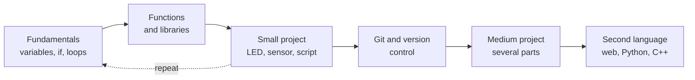
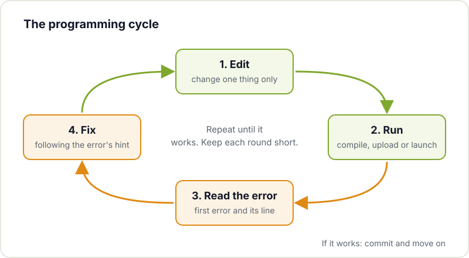
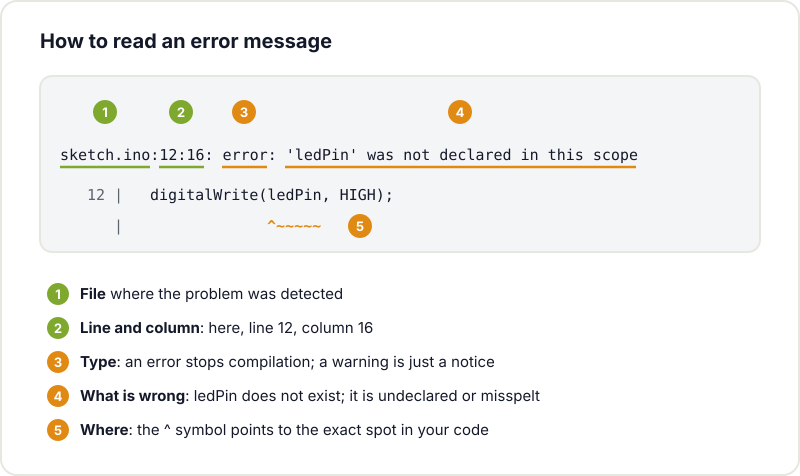

Many makers come to programming through the back door: they want an LED strip to do something pretty, a sensor to send data to their phone or the 3D printer to let them know when it has finished. The code is not the goal, it is the missing tool that makes the project work. And that is a good way to start, because you have a concrete reason to learn and you see the result in something physical.

This guide collects what we wish we had known at the beginning: which language to choose, which concepts really matter, which tools to install and how to learn without getting stuck.

## Which language to learn first

There is no "right" language to start with. What matters is that it fits what you want to build, because then you will practise with enthusiasm. For a maker, the choice is almost always between three:

| If you want to... | Start with | Why |
|---|---|---|
| Program an Arduino or an ESP32 from day one | Arduino C/C++ | It is what almost all microcontroller documentation and examples use |
| Automate tasks, process data, use a Raspberry Pi | Python | Clean syntax, a huge number of libraries and quick results |
| Program microcontrollers with something friendlier than C | MicroPython | A trimmed-down Python that runs on the ESP32, RP2040 and other boards |
| Build a web interface or a dashboard for your project | JavaScript | It is the language of the browser; essential for interactive websites |

If in doubt, Python is the gentlest option for learning the fundamentals, and [MicroPython](https://docs.micropython.org/en/latest/) lets you apply them directly on boards. If your project already has an Arduino on the table, learn Arduino C/C++ with the [language reference](https://docs.arduino.cc/language-reference/) to hand. The good news is that concepts carry over: your second language is much easier than your first.

If you are interested in the hardware side, we have guides to [getting started with Arduino](/en/blog/getting-started-arduino/) and [getting started with the ESP32](/en/blog/getting-started-esp32/), plus an [introduction to embedded systems](/en/blog/intro-to-embedded-programming/) that explains what changes when you program for a microcontroller.

## The concepts you actually need

Whatever the language, they all rely on the same building blocks. If you understand these, you will be able to read almost any simple program:

- **Variables and types**: storing a value (a temperature, a counter, some text) under a name. In C/C++ you declare the type (`int`, `float`); in Python it is inferred.
- **Conditionals**: `if` / `else`. "If the temperature goes above 30, turn on the fan".
- **Loops**: repeating something. In Arduino, `loop()` is already an infinite loop; inside it you will use `for` and `while`.
- **Functions**: wrapping a piece of code under a name so you can reuse it. It is the main tool for keeping a program from turning into a wall of lines.
- **Data structures**: lists, arrays and dictionaries for handling many values together.
- **Input and output**: reading a pin, writing to the serial port, reading a file, making an HTTP request.

Once you are comfortable with these, libraries, object-oriented programming and asynchronous code will follow. But you do not need to master everything to build useful projects.

## Basic tools

You do not need much, but these three are worth installing from the start:

1. **A code editor.** [Visual Studio Code](https://code.visualstudio.com/docs) is free, runs on Windows, macOS and Linux and has extensions for Python, C/C++, MicroPython or PlatformIO (a more complete microcontroller environment than the Arduino IDE). The Arduino IDE is still perfect for your first sketches.
2. **The terminal.** It is intimidating at first, but many tools are used from there: installing Python libraries with `pip`, compiling, uploading firmware or connecting to a Raspberry Pi. If you want to get comfortable with it, read our guide to [getting started with Linux](/en/blog/getting-started-linux/).
3. **Git.** It keeps the history of your code so you can go back when something stops working, and it lets you share and collaborate. The [Pro Git book](https://git-scm.com/book/en/v2) is free, and at the hackerspace we run a [Git fundamentals workshop](/en/workshops/git/) focused on branches.



## Learn with small projects

The most common mistake is choosing something huge as a first project: an autonomous robot with vision, a weather station with an app and a database. You end up stuck on ten problems at once without knowing which one is to blame.

Chaining together small projects that you actually finish works much better:

- An LED that blinks, then one that changes rhythm with a potentiometer.
- A Python script that renames the photos in a folder.
- A temperature sensor that prints readings over the serial port.
- Those same readings saved to a CSV file and plotted on a chart.

Each one adds a single new piece. And when the big project comes along, you will be able to break it down into pieces you already know how to make. If you then want to give it an interface, see how to build [simple apps and websites for your maker projects](/en/blog/apps-and-websites-for-maker-projects/).

## Read errors (instead of fearing them)

Programming is, above all, fixing things. Code almost never works first time, and that does not mean you are doing it wrong. What makes the difference is reading the error message calmly instead of changing things at random.

An error message always has the same parts. This is a typical one from the Arduino compiler when you use a variable you have not declared:

A few guidelines that save hours:

- **Read the first error, not the last.** A mistake early on usually triggers a cascade of errors afterwards.
- **Look at the file and the line.** The compiler or interpreter almost always tells you where it detected the problem. Sometimes the cause is on the line before (a missing semicolon or bracket).
- **Tell the error types apart.** A compile or syntax error stops the program from starting; a runtime error appears while it is running; and a logic error gives no message, the program simply does something other than what you expected.
- **Print what is happening.** A `print()` or a `Serial.println()` with the value of a variable solves many mysteries.
- **Change one thing at a time.** If you change five things and it works, you will not know which one was the right one.

## Asking for help properly

Asking is part of the craft. But a good question gets much better answers. Before asking for help on a forum, in the community chat or from someone at the workshop, prepare:

- What you are trying to achieve, in one sentence.
- What you have done: the minimal code that reproduces the problem, not the whole project.
- What you expected to happen and what actually happens.
- The full error message, copied as text (not a photo of the screen).
- Which board, operating system and library versions you are using.

Often, while preparing this list, you find the bug yourself.

## AI as support, not autopilot

AI assistants are very useful for learning: they explain an error, suggest how to approach a problem or show you an example of a library you do not know. The risk is ending up with a program that works but that you do not understand, and that you will not know how to fix when it breaks.

A few simple rules:

- Ask for explanations, not just code. "Why does this fail?" teaches more than "fix it".
- Do not paste anything into your project that you cannot explain line by line.
- Check what it tells you: AI is confidently wrong, especially about pins, libraries and specific versions. Cross-check with the official documentation.
- Try to solve it yourself for a few minutes first. The effort is what makes you learn.

If you want to go deeper, we have posts on [what generative AI is](/en/blog/what-is-generative-ai/) and [what an AI agent is](/en/blog/what-is-an-ai-agent/), and a workshop on [AI from zero to programming with agentic AI](/en/workshops/taller-ia-agentica/).

## Resources to keep going

- The [official Python tutorial](https://docs.python.org/3/tutorial/) is clear and thorough.
- For the web side, MDN's [Learn web development](https://developer.mozilla.org/en-US/docs/Learn_web_development) section covers HTML, CSS and JavaScript from scratch.
- We gather more material in [resources for makers](/en/blog/maker-resources/).

## Come and code with us

Learning on your own is possible, but with people around it is much faster: someone who has already fought the same error saves you an afternoon. Bring your laptop and your project to [Hackerspace Valencia](/en/blog/what-is-a-hackerspace/), drop in at [Merendojo](/en/workshops/merendojo/) to practise katas in pairs or have a look at the [upcoming workshops](/en/workshops/). And if you stay, [become a member](/en/pages/alta/).

## Image credits

The photographs come from [Wikimedia Commons](https://commons.wikimedia.org) and are used under their respective licences:

- **Cover** - *Arduino LCD hacking* - Matt Biddulph - CC BY-SA 2.0 - [source](https://commons.wikimedia.org/wiki/File:Arduino_LCD_hacking_-_Flickr_-_Matt_Biddulph.jpg)
- **Code editor** - *Macro laptop coding (Unsplash)* - Marc Mueller - CC0 - [source](https://commons.wikimedia.org/wiki/File:Macro_laptop_coding_(Unsplash).jpg)
