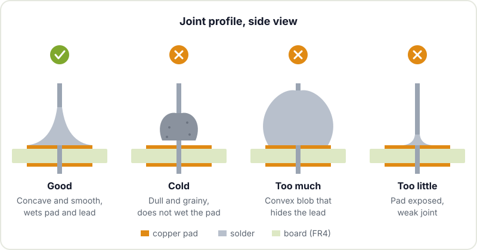

Soldering is the skill that separates a breadboard prototype from a device you can put in an enclosure and use every day. The good news is that it is quick to learn: with the right kit and an afternoon of practice, most people turn out decent joints. This guide focuses on through-hole components (the ones with leads that go through the board), which is where it makes sense to start before moving on to [hand-soldering SMD components](/en/blog/smd-hand-soldering/).

## Minimum kit

You do not need an expensive station, but you do want to avoid the unregulated pencil iron sold for a few euros: it either runs too cold or burns the pads, and neither helps you learn.

- **Temperature-controlled soldering iron.** A mid-range station or adjustable iron. What matters is being able to set the temperature and having it recover quickly when you touch the board.
- **Tips.** A 2 to 3 mm chisel or screwdriver tip handles almost all through-hole work. Fine conical tips look more precise, but they transfer heat worse.
- **Solder.** 0.6 to 0.8 mm wire with a flux core. Leaded solder (63/37 or 60/40 alloy) melts at a lower temperature and flows better, which makes it more forgiving to learn with. Lead-free (for example SAC305) is the industry standard because of the [RoHS](https://en.wikipedia.org/wiki/Restriction_of_Hazardous_Substances_Directive) rules, but it needs more heat and leaves duller joints.
- **Flux.** Even though the wire already has some, a "no clean" flux pen or syringe helps a lot when reworking and desoldering. [Flux](https://en.wikipedia.org/wiki/Flux_(metallurgy)) cleans off oxides and lets the solder wet the metal.
- **Tip cleaner.** Brass wool rather than a damp sponge: it cleans without suddenly cooling the tip.
- **Tools for undoing.** A desoldering pump and desoldering wick (copper braid). You are going to make mistakes, and knowing how to undo them is part of the craft.
- **Tweezers and flush cutters.** Tweezers to hold components and flush cutters for the excess leads.
- **Something to hold the board.** A "helping hands" or a PCB holder. Soldering with the board wobbling around is a recipe for a cold joint.
- **Fume extraction.** An extractor with a carbon filter or, at the very least, good ventilation and keeping your face out of the smoke.
- **Safety glasses.** Clipped leads fly off and solder occasionally spatters.

## Typical temperatures

There is no magic number: it depends on the tip, the size of the pad and how much copper mass is around it. As a starting point:

| Solder | Melts at | Typical tip temperature |
|---|---|---|
| Sn63/Pb37 (leaded) | 183 °C | 300 to 340 °C |
| SAC305 (lead-free) | around 217 to 220 °C | 340 to 370 °C |

If the solder takes more than 3 or 4 seconds to flow, do not just crank up the temperature: first try a wider tip and a little solder on the tip to improve thermal contact. Turning the heat way up burns off the flux before it does its job, oxidises the tip and can lift the pads off the board. Pads connected to a large ground plane do need more heat or more time.

## Step-by-step technique

The key idea is that **solder flows to the heat**. You do not carry solder on the iron tip to "paint" the joint: you heat both parts and the solder flows onto them by itself.

1. **Prepare the tip.** Clean it in the brass wool and give it a touch of solder so it shines. A tinned tip transfers heat far better than a dry one.
2. **Place the component.** Insert the leads, bend the ones underneath slightly so it does not fall out and rest the board in the holder.
3. **Heat pad and pin together.** Place the tip so it touches the copper pad and the lead at the same time. One or two seconds is enough for most small pads.
4. **Feed the solder.** Bring the wire to the joint, on the side opposite the tip, not onto the tip. You will see the solder melt, spread over the pad and climb up the lead.
5. **Remove the solder, then the iron.** In that order. If you take the iron away first, the wire gets stuck.
6. **Don't move anything** until the joint solidifies, barely a second. If the lead moves while it cools, the joint ends up grainy and weak.
7. **Clip the excess lead** just above the joint, holding it with a finger so it doesn't go flying.

The whole process takes between 2 and 5 seconds per joint. If you go well beyond that, something is wrong: the tip is dirty, the temperature is too low or the tip is too fine.

## Good joints and cold joints

A good through-hole joint is volcano-shaped: concave, smooth, shiny (duller if lead-free) and covering the whole pad, climbing slightly up the lead. Seen from the side, the solder "wets" both surfaces at a gentle angle.

The most common faults:

- **Cold joint.** Grey, grainy or wrinkled look, and often the solder sits on the lead without spreading over the pad. It happens when the pad never gets hot enough or something moves while it cools. It may work for a while and then fail with vibration or temperature changes. Fix: add a little flux and reheat until it flows.
- **Too much solder.** A convex blob that hides the lead. You cannot tell whether there is a real joint inside or just a drop on top, and it can bridge to the neighbouring pad. Remove the excess with desoldering wick.
- **Too little solder.** You can see the pad's copper and there is barely any material around the lead. Mechanically it is weak. Add solder.
- **Bridges.** Solder joining two pads that should not be connected. Use the wick, or drag the excess away with a clean tip and a little flux.

The [Adafruit Guide to Excellent Soldering](https://learn.adafruit.com/adafruit-guide-excellent-soldering) has very good photos of each case, and the Wikipedia article on [soldering](https://en.wikipedia.org/wiki/Soldering) explains the metallurgy if you are curious.

## Your first kit

For practice, the best option is a simple through-hole kit with plenty of joints and something that lights up or makes a sound when you finish: a 555 blinker, an electronic die, a small amplifier or a clock with displays. Look for kits with:

- Resistors, capacitors, LEDs and an IC in a socket. That way you practise components of different sizes and get polarity right.
- Generous pads and clear silkscreen.
- A result you can check. Knowing whether it worked is much more motivating than a practice board with no circuit.

Before the kit, if you have an old board from a broken device, use it to practise desoldering and resoldering. And once you are comfortable, the natural next step is going from the kit to designing your own board: we cover that in [from dev kit to custom PCB](/en/blog/from-dev-kit-to-custom-pcb/).

## Safety

Soldering is safe if you follow a few rules:

- **The iron burns.** Always leave it in its stand, never on the bench. Assume everything you have just soldered is still hot.
- **Lead.** If you use leaded solder, the risk is not in the smoke (at these temperatures lead barely evaporates) but on your hands. Wash your hands when you finish, do not eat or drink while soldering and do not leave bits of solder lying around the bench. Keep it away from small children.
- **Flux fumes.** The white smoke comes from the rosin in the flux and irritates the airways. Use an extractor or ventilation, and do not lean over it.
- **Eyes.** Glasses when clipping leads and desoldering, which is when things spatter most.
- **Waste.** Used wick and solder scraps do not go in the regular bin: take them to a recycling centre that accepts hazardous waste.

## Next steps

Once through-hole joints come out on autopilot, the natural path is surface mount. We cover it in [hand-soldering SMD components](/en/blog/smd-hand-soldering/), and if one day you run into a chip with no visible pins, in [BGA soldering](/en/blog/bga-soldering/). To keep learning electronics, there is a curated selection of material in [electronics resources for makers](/en/blog/electronics-resources/).

If you want to practise with someone beside you who can tell you why that joint came out grey, drop by Hackerspace Valencia with your kit or with that board you have been meaning to fix for ages. Soldering is learned much faster in company.

## Image credits

- **Cover** - *Pinecil USB C soldering iron* - 4300streetcar - CC BY 4.0 - [source](https://commons.wikimedia.org/wiki/File:Pinecil_USB_C_soldering_iron.jpg)
