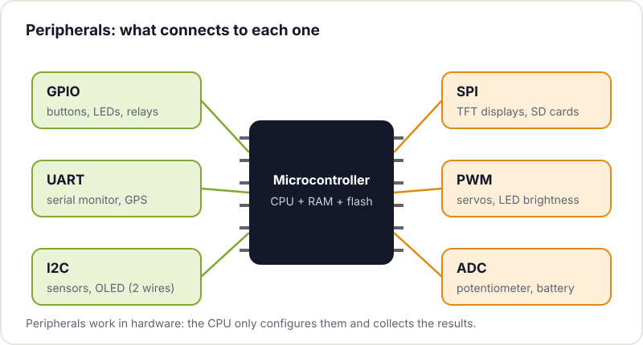
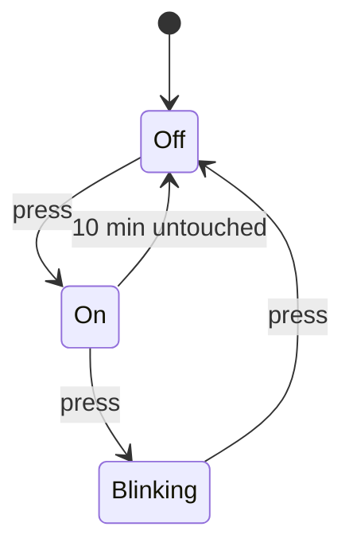

An embedded system is a computer tucked inside something else and dedicated to one specific job: your home thermostat, the control board of a 3D printer, the garage door remote or that ESP32 measuring the moisture in your plant pots. Programming them is just similar enough to programming a PC to make you overconfident, and then you get surprises.

This post is a map for anyone who has already made an LED blink (if not, start with [getting started with Arduino](/en/blog/getting-started-arduino/)) and wants to understand what lies behind it: why `delay()` is a problem, what an interrupt is, when you need an operating system and how you debug something that has no screen.

## What changes compared with programming a PC

**Very limited resources.** A classic Arduino Uno has 2 KB of RAM. An ESP32, a few hundred KB. There is no virtual memory and no disk: if you run out of RAM, the program does not warn you with a friendly error, it simply hangs or resets. That is why embedded code avoids uncontrolled dynamic memory allocation and keeps an eye on the size of every buffer.

**Time matters.** On a PC it does not matter whether a task takes 10 or 50 ms. In a system that drives a motor, reads an encoder or generates a signal, being late is a failure, even if the result is correct. This is called **real time**: it does not mean "fast", it means "with deadlines that are always met".

**There is no operating system (or a minimal one).** No processes, no files, no terminal. Your program is the only thing running, it starts when power is applied and it never ends: that is why every embedded program ends up in an infinite loop.

**You talk directly to the hardware.** Writing a `1` to a register turns on a pin. Reading another one tells you whether a byte has arrived on the serial port. The microcontroller's datasheets become your main documentation.

## Bare metal, RTOS or embedded Linux

There are three ways to organise the software, from least to most complex:

| | Bare metal | RTOS (for example, FreeRTOS) | Embedded Linux |
|---|---|---|---|
| **What it is** | Your code running directly on the hardware, with a main loop | A small kernel that shares the processor between tasks with priorities | A full operating system on a more powerful processor |
| **Typical hardware** | Arduino Uno, ATtiny, small STM32s | ESP32, STM32, RP2040 | Raspberry Pi, boards with application processors |
| **Real time** | Yes, if you program it well | Yes, with priorities and predictable deadlines | Not guaranteed out of the box |
| **Boot** | Instant | Instant | Seconds |
| **Advantage** | Simple, full control, minimal power consumption | Several tasks at once without losing control of timing | Networking, files, Python, any language |
| **When** | Small, single-function projects | Projects with WiFi, several tasks or communications | Vision, complex interfaces, servers |

The funny thing is that if you program an ESP32 with the Arduino environment you are already using an RTOS without knowing it: the Arduino core for the ESP32 runs on top of [FreeRTOS](https://www.freertos.org/), and your `loop()` is just another task. When the project needs Linux (a Raspberry Pi acting as a server, for example), other problems appear; we cover them in [how to keep a Raspberry Pi running 24/7](/en/blog/raspberry-pi-24-7/).

## Peripherals: the microcontroller's language

The processor is only one part of the chip. Around it there are peripherals, hardware blocks that do work on their own while your code does something else. These are the ones you will be using from the first month:



- **GPIO**: digital input and output pins. Push buttons, LEDs, relays.
- **UART**: asynchronous serial port, two wires (TX and RX). The serial monitor, GPS modules, other microcontrollers.
- **I2C**: two-wire bus (SDA and SCL) shared by several devices, each with its own address. Temperature sensors, small OLED displays.
- **SPI**: four-wire bus, faster than I2C. TFT displays, SD cards, memory chips.
- **PWM**: generates pulses of variable width. LED brightness, servos, motor speed (through its driver).
- **ADC**: converts an analogue voltage into a number. Potentiometers, analogue sensors, measuring a battery. It has more pitfalls than it seems; we explain them in [how to improve the accuracy of a microcontroller's ADC](/en/blog/microcontroller-adc-accuracy/).

## Interrupts

Imagine you have to react to a 1 ms pulse on a pin. If you check it in the main loop every so often (*polling*), you can miss it while doing something else. An **interrupt** asks the hardware to stop whatever the processor is doing, run a short function (the interrupt service routine, ISR) and return to where it was.

```cpp
const int PIN_SENSOR = 2;
volatile unsigned long pulses = 0;   // volatile: modified by the ISR

void countPulse() {                  // ISR: short, no delay or Serial
  pulses++;
}

void setup() {
  Serial.begin(115200);
  pinMode(PIN_SENSOR, INPUT_PULLUP);
  attachInterrupt(digitalPinToInterrupt(PIN_SENSOR), countPulse, FALLING);
}

void loop() {
  noInterrupts();                    // safe copy of the shared variable
  unsigned long snapshot = pulses;
  interrupts();
  Serial.println(snapshot);
  delay(1000);
}
```

Three rules that will save you hours: the ISR must be **very short** (note what happened and get out), variables shared with it are marked as **`volatile`** and you never use `delay()` or `Serial` inside an ISR.

## Stop using delay(): millis()

`delay(1000)` stops the program for a whole second. During that second the board does not read buttons, does not service the WiFi and does nothing else. With a single LED it does not matter; with two things running at different rates, it does.

 the CPU waits doing nothing. With millis() it spins through the loop quickly and acts only when it is time.")

The alternative is to look at the clock: `millis()` returns the milliseconds since boot, and on each pass through the loop we check whether the time we were waiting for has elapsed. It is the same pattern as the official [Blink Without Delay](https://docs.arduino.cc/built-in-examples/digital/BlinkWithoutDelay/) example:

```cpp
const int LED_A = 8, LED_B = 9;
unsigned long lastA = 0, lastB = 0;
bool stateA = false, stateB = false;

void setup() {
  pinMode(LED_A, OUTPUT);
  pinMode(LED_B, OUTPUT);
}

void loop() {
  unsigned long now = millis();

  if (now - lastA >= 500) {          // LED A every 500 ms
    lastA = now;
    stateA = !stateA;
    digitalWrite(LED_A, stateA);
  }

  if (now - lastB >= 130) {          // LED B every 130 ms, without blocking A
    lastB = now;
    stateB = !stateB;
    digitalWrite(LED_B, stateB);
  }
}
```

Note the subtraction `now - lastA`: written like this it works correctly even when the `millis()` counter overflows and wraps around to zero (on an Arduino, after about 49 days).

## State machines

When behaviour depends on what happened before ("if it is on and I press, blink; if it is blinking and I press, turn off"), nested `if` statements quickly become unreadable. The classic solution is a **state machine**: the system is always in one specific state and only changes state in response to defined events.

For example, a lamp with a single push button that also switches itself off if nobody touches it for 10 minutes:



In code this becomes an `enum` and a `switch`, combined with `millis()` for the timer:

```cpp
enum State { LAMP_OFF, LAMP_ON, BLINKING };
State state = LAMP_OFF;
unsigned long since = 0;             // when we entered the current state

void changeTo(State next) {
  state = next;
  since = millis();
}

void loop() {
  bool pressed = readPress();        // debounced, returns true once per press
  unsigned long now = millis();

  switch (state) {
    case LAMP_OFF:
      digitalWrite(LED, LOW);
      if (pressed) changeTo(LAMP_ON);
      break;
    case LAMP_ON:
      digitalWrite(LED, HIGH);
      if (pressed) changeTo(BLINKING);
      else if (now - since >= 10UL * 60 * 1000) changeTo(LAMP_OFF);
      break;
    case BLINKING:
      digitalWrite(LED, ((now - since) / 250) % 2);
      if (pressed) changeTo(LAMP_OFF);
      break;
  }
}
```

Adding a new state means adding a `case`, without touching the rest. And the diagram doubles as documentation: if you draw it before you start coding, half the bugs show up on paper. The [finite-state machine article on Wikipedia](https://en.wikipedia.org/wiki/Finite-state_machine) has the full theory if you are curious.

## How to debug something without a screen

1. **The serial port.** `Serial.println()` at key points is still the most used tool. Print values, states and timestamps; that solves most problems.
2. **A diagnostic LED.** When serial is not available (inside an ISR, before USB has started), toggling a pin is instantaneous and can be seen on an oscilloscope.
3. **The logic analyser.** It captures several digital signals at once and decodes protocols such as I2C, SPI or UART. When a sensor "does not respond", seeing which bytes go back and forth on the bus settles the question in minutes. Cheap USB analysers work with free software such as [PulseView, from sigrok](https://sigrok.org/wiki/PulseView).
4. **JTAG or SWD.** A hardware debugger lets you halt the program, step line by line and inspect variables, just like on a PC. Some ESP32 variants (C3, C6, S3) have built-in USB-JTAG; for STM32 people use probes such as the ST-Link.



## Where to go next

- Rewrite your sketches without `delay()`. It is the best exercise for learning to think in embedded terms.
- Draw the state machine for your next project before writing a single line.
- Connect a sensor over I2C and look at the bus with a logic analyser, even if it works first time.
- When you need WiFi or several tasks, make the jump to the [ESP32](/en/blog/getting-started-esp32/) and have a look at its FreeRTOS tasks.

Debugging with others is much faster than doing it alone: at Hackerspace Valencia there is always someone keen to look at an I2C bus trace with you. Come along with your project and, if you stay, [become a member](/en/pages/alta/).

## Image credits

- **Cover** - *Core Learning Board module Arduino STM32 F103 C8T6* - Popolon - CC BY-SA 4.0 - [source](https://commons.wikimedia.org/wiki/File:Core_Learning_Board_module_Arduino_STM32_F103_C8T6.jpg)
- **Logic analyser** - *Saleae Logic8 IMG 2876* - Myself248 - CC BY-SA 2.0 - [source](https://commons.wikimedia.org/wiki/File:Saleae_Logic8_IMG_2876.jpg)
- Diagrams: Hackerspace Valencia.
