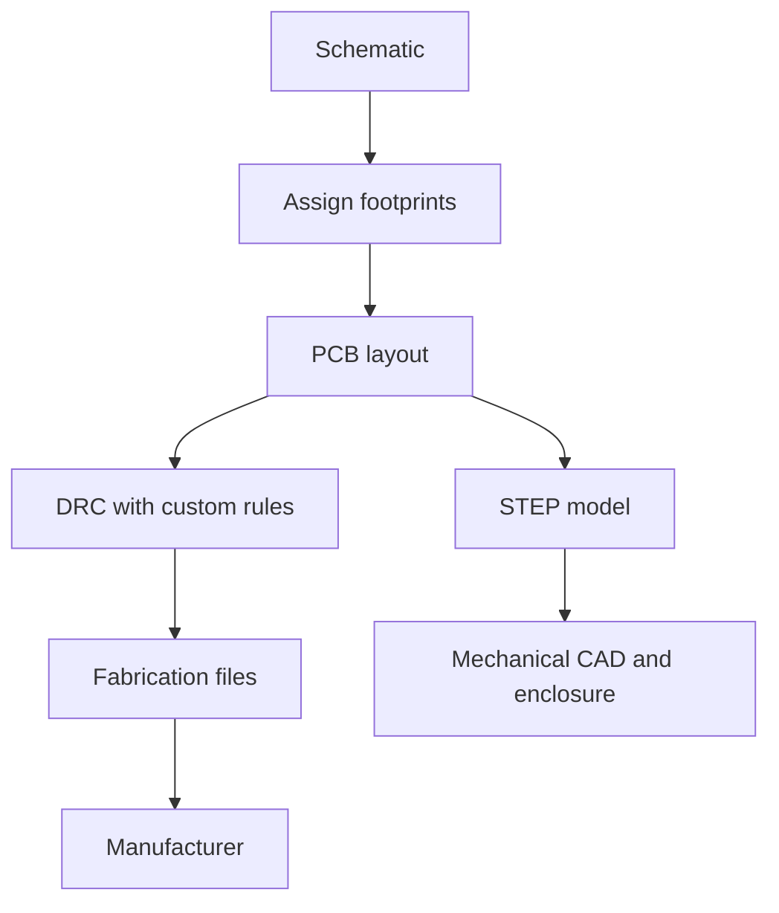
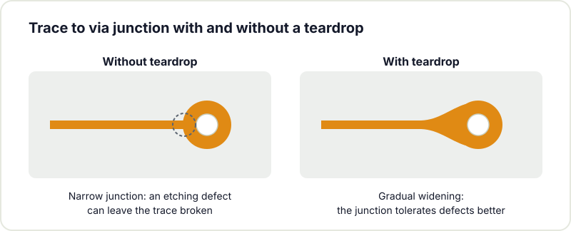

A few years ago, designing a printed circuit board in free software was an uncertain bet: KiCad existed, but it still lacked maturity. Today the situation is different: KiCad is a tool capable of taking a project from the first schematic to the [fabrication files](/en/blog/pcb-fabrication-checklist/), with no licence cost and open formats. Version 10 continues that evolution. This guide reviews its most relevant improvements for those of us who design boards in a makerspace.

## The interactive router

Routing, the task of laying traces between components, takes up a large share of design time. Recent versions have improved the interactive router considerably: it shoves neighbouring traces aside, respects widths and clearances and performs better in tight spaces. On dense boards the improvement shows in fewer manual interventions to redo a trace. Length matching control has also gained options, which matters for fast memory or signals that must match their propagation time.



## Custom design rules

For a long time design rules were a fixed list of values. You can now write [your own rules in a simple language](https://docs.kicad.org/10.0/en/pcbnew/pcbnew.html#custom_design_rules), close to programming the conditions your board must meet. For example: double the spacing between two specific nets for noise reasons, or a fixed solder ring on a particular connector. You define the rule once and the checker warns you whenever it is violated. For learners it instils good practice; for experienced users it cuts review iterations.

## Integrated teardrops

Teardrops, the small thickenings where a trace meets a via or a pad, are now [handled in an integrated way](https://docs.kicad.org/10.0/en/pcbnew/pcbnew.html#editing-teardrops). They strengthen the board against manufacturing and etching defects that can leave a trace broken at a weak junction.

## More complete fabrication outputs

Gerbers remain the standard for fabrication, but a growing number of manufacturers accept modern formats such as ODB++ or IPC-2581, which pack the whole board into a single coherent file. KiCad has improved [these exports](https://docs.kicad.org/10.0/en/pcbnew/pcbnew.html#gerber-and-fabrication-output), which reduces the chance of the manufacturer misreading the design intent. The bill of materials and the assembly guide have also gained options, useful whenever a board goes to automated assembly.

## The 3D viewer and mechanical integration

The 3D viewer lets you inspect the board before manufacturing: collisions between parts, connector positions and fit within the enclosure. STEP export brings the model into your mechanical CAD to verify the complete assembly. For 3D printing enclosures in the makerspace, this bridge between electronics and mechanics is especially valuable.



## Hierarchical and multi-sheet schematics

When a project grows, a single sheet becomes unreadable. Hierarchical and multi-sheet schematics let you organise blocks, reuse subsystems and keep order. Bus and cross-sheet label handling keeps improving, a decisive aspect when a project moves from prototype to product.

## Why it matters in a makerspace

KiCad's value in a hackerspace is not only that it is free: anyone can open the files, understand the board and improve it. That is the open hardware culture we stand for. If you have always wanted to design your first board, KiCad 10 is a good opportunity to start.

Hackerspace Valencia runs [KiCad workshops](/en/workshops/kicad/) regularly. Come to an open doors session and we will work through a simple example so you leave with your first board designed. And if you want to come and design whenever it suits you, [become a member](/en/pages/alta/).

## Image credits

- **Cover** - *Multi-Monitor KiCad* - AKK - CC BY 4.0 - [source](https://commons.wikimedia.org/wiki/File:Multi-Monitor_KiCad.jpg)
- **PCB editor** - *KiCad V6 PCB* - Jon Neal - CC BY-SA 4.0 - [source](https://commons.wikimedia.org/wiki/File:KiCad_V6_PCB.png)
- **3D viewer** - *KiCad 3D Viewer Render Screenshot RP2350 Expansion Card* - VectorVoyager - CC BY-SA 4.0 - [source](https://commons.wikimedia.org/wiki/File:KiCad_3D_Viewer_Render_Screenshot_RP2350_Expansion_Card.png)
