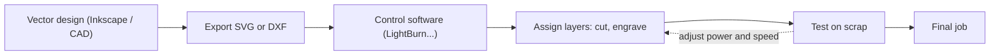
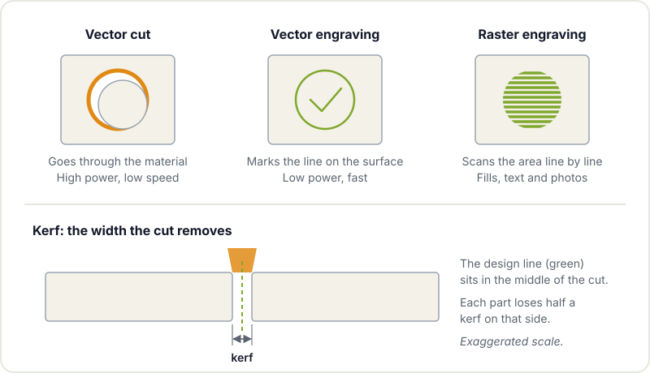

A laser cutter is probably the most rewarding machine in a maker workshop: you draw on the computer, press a button and a few minutes later you have a plywood box that actually fits together, an engraved sign or the front panel of your next project with every hole in the right place. It is also the machine where a moment of carelessness has the most serious consequences, because it literally works by burning material.

This guide covers the types of laser you will come across, which materials you can cut and which you must **never** cut, the software people use, the difference between vector and raster jobs, what kerf is and the basic safety rules.

## Laser types: CO2, diode and fibre

Not every laser is good for the same jobs. The wavelength determines which materials absorb the energy well and, therefore, what each machine can cut or engrave.

| Type | Wavelength | Great for | Limitations |
|---|---|---|---|
| **CO2** | Far infrared (~10.6 µm) | Cutting and engraving wood, plywood, acrylic, cardboard, leather, fabric | Does not mark bare metal; the tube has a limited lifespan |
| **Diode** | Visible or near infrared (usually blue) | Engraving wood and leather, cutting thin wood | Cuts slowly and only thin stock; cannot cut clear acrylic |
| **Fibre** | Near infrared (~1 µm) | Marking and engraving metals and some plastics | Does not cut wood or acrylic like a CO2; more expensive machines |



For a community workshop, CO2 is the most versatile. Diode lasers have become popular at home because they are cheap and compact, and they are great for engraving, but they have clear limits when it comes to cutting. Fibre lasers are a different world, aimed at marking metal.

## Materials: what you can cut and what you must NOT

This is the most important section of the article. Cutting the wrong material can release toxic or corrosive gases, ruin the machine or start a fire.

| Material | OK to cut? | Notes |
|---|---|---|
| Plywood and MDF | Yes | MDF produces a lot of smoke; some plywoods use glues that cut poorly |
| Thin solid wood | Yes | Best at moderate thicknesses |
| Acrylic (PMMA, Perspex, Plexiglas) | Yes | Flame-polished edge on a CO2; make sure it is PMMA and not some other plastic |
| Cardboard and paper | Yes | Watch it closely: it catches fire easily |
| Natural leather | Yes | Only vegetable-tanned; synthetic leather is usually PVC |
| Cotton fabric, wool felt | Yes | |
| **PVC, vinyl, synthetic leather** | **NO** | Releases chlorine and hydrochloric acid: toxic, and corrosive for the machine |
| **Polycarbonate (Lexan, Makrolon)** | **NO** | Melts, discolours and burns badly instead of cutting |
| **ABS** | **NO** | Melts and gives off harmful fumes |
| **Fibreglass, carbon fibre** | **NO** | Dangerous fumes and harmful dust |
| **Polystyrene foam, polypropylene** | **NO** | Melt, burn and can catch fire |
| **Anything you cannot identify** | **NO** | If you do not know what the material is, it does not get cut |

> **Never cut or engrave PVC or vinyl.** [Polyvinyl chloride](https://en.wikipedia.org/wiki/Polyvinyl_chloride) contains chlorine: when it burns it releases chlorine gas and hydrochloric acid, which damage your lungs and corrode the machine's optics and mechanics. Plenty of innocent-looking plastics (faux leather sheets, some flexible magnets, folders, synthetic leather) are PVC. When in doubt, don't cut it.

A common trick for identifying questionable plastics is to look up the manufacturer's part number or the material data sheet. If there is no way to find out, the answer is no.

## Software: from drawing to machine

| Program | What for | Licence |
|---|---|---|
| [Inkscape](https://inkscape.org) | Vector drawing (SVG), preparing designs | Free and open source |
| [LightBurn](https://lightburnsoftware.com) | Machine control, layers, power and speed settings | Paid, with a trial |
| [LaserGRBL](https://lasergrbl.com) | Controlling GRBL-based diode lasers | Free, Windows |
| FreeCAD, Fusion, Onshape | Designing mechanical parts and exporting their outline | Various |

The usual workflow is to design in Inkscape (or export from your CAD) and send the job to the machine with whatever control software that laser uses. Some CO2 machines use the manufacturer's own software. Ask beforehand how the machine you are going to use works. If you want boxes with finger joints, there are online generators that produce a ready-to-cut SVG from your dimensions.

## Vector and raster: two ways of working

In the control software, each part of the design is assigned an operation type:

- **Vector cut**: the laser follows the line at high power and low speed until it goes through the material.
- **Vector engraving (line scoring)**: it follows the same line at low power, leaving a mark on the surface without cutting through.
- **Raster engraving**: the head sweeps the area line by line, like an inkjet printer, switching the laser on and off to fill areas, bold text or photos.



A widespread convention is to use a different colour for each operation (for example, red for cutting and black for engraving) and assign parameters per layer. Raster is much slower than vector because it covers the whole surface: if all you need is an outline, use vector engraving.

## Kerf: the width of the cut

The laser beam has a width and also vaporises material around it, so every cut "eats" a strip. That strip is called the [kerf](https://en.wikipedia.org/wiki/Kerf). It is usually a few tenths of a millimetre and depends on the laser, the lens, the material and its thickness.

Why does it matter? If you design a finger-jointed box to exact dimensions, after cutting each finger will have lost half the kerf on each side and the joint will be loose. The fix is to measure it: cut a square of known size, measure the part and the hole with calipers, and compensate in the design or with the software's offset option. Repeat this test with every new material.

## Safety: non-negotiable

- **Never leave the machine unattended while it is running.** Not even for a minute. A small flame on the material can be blown out or smothered by closing the lid if you catch it in time; if you are not there, it can destroy the machine and the space. Know where the right fire extinguisher is.
- **Fume extraction always on**, plus air assist if the machine has it. The smoke does not just smell bad: it contains particles and compounds you do not want to breathe.
- **Goggles rated for the wavelength.** On enclosed CO2 machines the lid is your protection; on open-frame diode lasers, reflections of the blue beam can damage your eyes and you need goggles certified for that specific wavelength. Sunglasses are no good. The [laser safety](https://en.wikipedia.org/wiki/Laser_safety) page explains the classes and the risks.
- **Do not bypass the lid safety interlocks.**
- **Focus and test** on scrap before the final job. Dialling in settings on cheap material saves a lot of grief.
- **Clear the offcuts** from the bed: accumulated scraps are fuel.

## Ideas for first projects

- A finger-jointed enclosure for your [ESP32](/en/blog/esp32-low-power/) or Arduino project.
- An acrylic front panel with cut-outs for a display, buttons and potentiometers.
- Drilling or assembly jigs for PCBs.
- Keyrings, coasters and engraved signs to practise raster.

If you combine laser cutting with [3D printing](/en/blog/getting-started-3d-printing/), you have most of a prototype's mechanics covered. And if you need to machine materials the laser cannot handle, the next step is the [CNC router](/en/blog/getting-started-cnc/). For design, our [3D printing tools](/en/blog/3d-printing-tools-and-resources/) post reviews CAD programs that work here too.

## Learn to cut in good company

Laser cutting is best learned with someone who shows you the specific machine, its settings and its quirks. Drop by [Hackerspace Valencia](/en/blog/what-is-a-hackerspace/), ask at the space which machines are available and what you need to use them, and check the [workshops](/en/workshops/) calendar. Bring your design as an SVG and an offcut of the material: we will test it together.

## Image credits

Photos come from [Wikimedia Commons](https://commons.wikimedia.org) and are used under their respective licences. Diagrams are our own.

- **Cover** - *Laser cutting snowflakes* - Andy Dingley - CC BY-SA 3.0 - [source](https://commons.wikimedia.org/wiki/File:Laser_cutting_snowflakes.jpg)
- **CO2 laser cutter** - *Library laser cutter* - Mbrickn - CC BY-SA 4.0 - [source](https://commons.wikimedia.org/wiki/File:Library_laser_cutter.jpg)
- **Raster engraving** - *Cherry wood with binary computer engraving* - Jared Tarbell - CC BY 2.0 - [source](https://commons.wikimedia.org/wiki/File:Cherry_wood_with_binary_computer_engraving.jpg)
