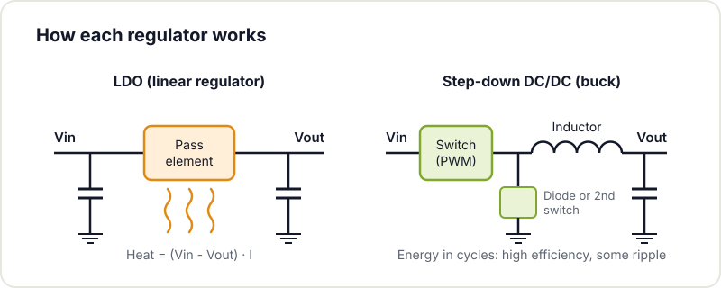
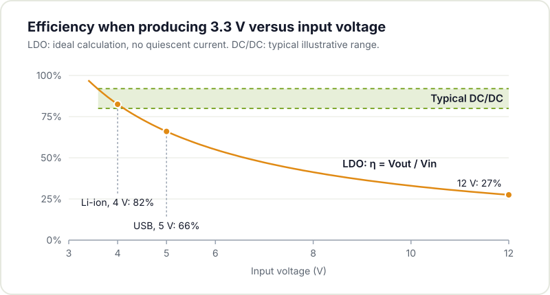
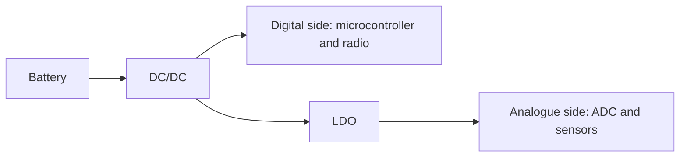

Every electronic circuit needs to be powered at its operating voltage, and you rarely have it directly: the battery delivers a higher voltage than required, USB provides 5 V and many microcontrollers run at 3.3 V. Something must bring that voltage down, and there are two families of regulators worth knowing: linear regulators (LDOs) and switching converters (DC/DC). A wrong choice results in a circuit that overheats, reduced battery life or noise on the supply.

## Operating principle

An [LDO](https://en.wikipedia.org/wiki/Low-dropout_regulator) is a linear regulator: it takes the input voltage and dissipates the surplus as heat to deliver the desired output voltage. It is simple, cheap, small and very clean: the output voltage is essentially stable and ripple free. Its main limitation is efficiency: the entire input to output difference converts to heat, so the larger that difference and the load current, the more energy is wasted.

A DC/DC is a [switching converter](https://en.wikipedia.org/wiki/Buck_converter): it stores energy in an inductor and transfers it in cycles, which allows it to step down, step up or invert voltages with high efficiency, often above 80 or 90 percent. In exchange it is more complex: it needs the inductor, an output capacitor and a careful layout, and it adds ripple and noise to the output.



## Efficiency and heat

If input and output are close and the current is low, an LDO wastes almost nothing and its simplicity is sufficient. But when stepping down from a lithium battery, around 4 V, to the 3.3 V of a microcontroller while drawing several hundred milliamps, an LDO dissipates close to a fifth of the energy as heat (around 18 % at 4 V and 21 % with a full battery at 4.2 V). In that scenario a DC/DC extends battery life significantly.

## Noise and sensitivity

Because it does not switch, the LDO offers a very clean output, an essential condition for powering sensitive analogue circuitry, precision sensors or analogue to digital converters. A DC/DC always adds some ripple to its output and radiates a degree of noise, which can disturb sensitive measurements or radio receivers. In designs that mix digital and analogue, the usual approach is a DC/DC for the main rail and an LDO after it to clean the line feeding the analogue side.

## Quiescent current

For devices that spend most of their time asleep, the [current the regulator itself draws with no load](https://www.ti.com/lit/an/slva079/slva079.pdf) matters as much as its efficiency under load. Some modern LDOs exhibit extremely low quiescent current, well suited to battery circuits that wake rarely. A DC/DC can show higher parasitic draw, though dedicated low power models exist. If your circuit [sleeps](/en/blog/esp32-low-power/) 99 percent of the time, compare this parameter carefully.

## Size, cost and complexity

The LDO is clearly advantageous here: tiny parts, low cost and a hard to break design as long as its capacitors are respected. The DC/DC requires more parts, an inductor with noticeable volume and a [careful layout](/en/blog/pcb-fabrication-checklist/), because the traces carrying switching currents act as antennas and are a source of problems when laid out carelessly. For a prototype or a small run that simplicity carries real value.

## How to decide in practice

Four questions guide the decision:

- Large input to output difference with high current? Consider a DC/DC.
- Powering noise sensitive circuitry? Consider an LDO, alone or after a DC/DC.
- Does the device sleep most of the time? Compare quiescent currents.
- A simple prototype where efficiency is not critical? An LDO reduces complexity and cost.

There is no universal winner. In many projects both coexist: a DC/DC for the main path from the battery and an LDO to clean the final stage. Being able to justify each choice is what separates a well designed supply from a poor one.

If you are deciding how to power your project and are unsure, come by Hackerspace Valencia: we will review your voltage, current and battery life requirements and help you choose the right regulator. And if you want to use the workshop whenever it suits you, [become a member](/en/pages/alta/).

## Image credits

- **Cover** - *XL4015-based CC-CV buck converter modules 02* - Retired electrician - CC0 - [source](https://commons.wikimedia.org/wiki/File:XL4015-based_CC-CV_buck_converter_modules_02.jpg)
- **1117 regulator** - *Dell Professional P2212H - controller board - N415 1117-33-9917* - Raimond Spekking - CC BY-SA 4.0 - [source](https://commons.wikimedia.org/wiki/File:Dell_Professional_P2212H_-_controller_board_-_N415_1117-33-9917.jpg)
