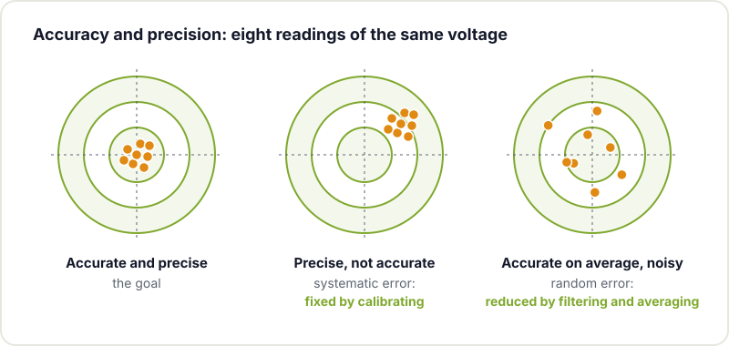
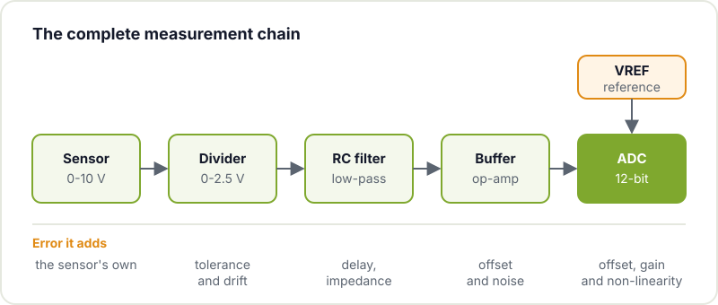
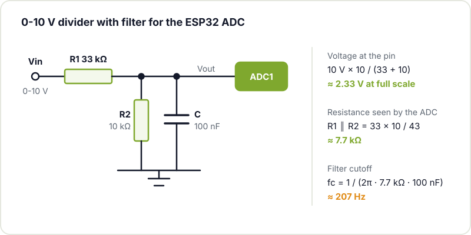
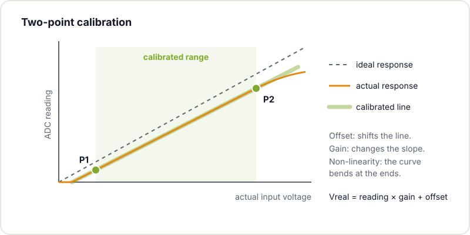

You hook up a potentiometer or a sensor to an analogue input, call `analogRead()` and a number comes out. It looks easy until you look closer: the reading jumps around even when nothing is touched, it does not match what the multimeter says, and it shifts whenever the WiFi or the relay next to it switches on. The temptation is to blame the ADC and go looking for one with more bits. That is almost never the fix: a 16-bit ADC in a poor circuit measures worse than a well-built 12-bit one.

The quality of a measurement is not decided by the converter alone but by the whole chain before and after it. Let's walk through it.

## The basics: what an ADC does

The ADC compares the input voltage with a reference voltage (VREF) and returns an integer. With N bits there are 2^N possible levels, and the code you get is roughly:

```text
code ≈ Vin / VREF × (2^N − 1)
```

The voltage step between two consecutive codes is called an LSB (least significant bit). With a 3.3 V reference:

| Resolution | Levels | 1 LSB at 3.3 V | Where you find it |
|---|---|---|---|
| 8 bits | 256 | 12.9 mV | fast modes on some micros |
| 10 bits | 1024 | 3.22 mV | Arduino Uno and Nano (4.9 mV with a 5 V reference) |
| 12 bits | 4096 | 0.81 mV | ESP32, RP2040, many STM32s |
| 16 bits | 65,536 | 0.05 mV | external ADCs such as the ADS1115 |

The fact that an ESP32 can tell apart 0.8 mV steps does not mean it measures with a 0.8 mV error. That is **resolution**. **Accuracy** is how close you are to the true value, and **precision** (or repeatability) is how little repeated readings of the same voltage vary. They are different things and are fixed in different ways.



## Where the error comes from

A real ADC departs from the ideal one for several reasons:

- **Offset**: the whole response is shifted; with 0 V at the input you do not read 0.
- **Gain**: the slope is wrong; the error grows as the voltage rises.
- **Non-linearity** (INL and DNL in datasheets): the response is not a perfect straight line. The classic ESP32 ADC is known for this: it loses linearity near the ends of its range.
- **Noise**: the reading fluctuates because of interference, digital switching and noisy power supplies.
- **Reference**: if VREF moves, every measurement moves with it.
- **Source impedance, temperature and PCB design**.

And the measurement chain adds its own errors before the signal even reaches the converter:



## A stable reference

Everything the ADC measures is relative to VREF. There are three common options:

- **Internal reference**: convenient, but its exact value varies from chip to chip and with temperature.
- **The supply rail itself** (what an Arduino Uno does by default with its 5 V): if the USB 5 V drops to 4.8 V, all your readings go up by 4 %.
- **External precision reference**: a dedicated IC gives a much more stable voltage. On Arduino boards that support it you select it with `analogReference()`; the [Arduino analogRead reference](https://docs.arduino.cc/language-reference/en/functions/analog-io/analogRead/) summarises the resolution and range of each board.

A good reference helps a lot, but it will not fix a noisy build or a badly chosen input impedance.

## Impedance matters

Inside the ADC there is a sampling capacitor (sample and hold) that has to charge in a very short time. If the source driving it has a lot of resistance, it does not have time to charge and the reading comes out low or drags in part of the previously read channel. That is why the ATmega328P datasheet recommends sources of around 10 kΩ or less. The fixes are to lower the divider impedance, put a capacitor right at the pin to act as a charge reservoir, or add an op-amp buffer.

## Worked example: measuring a 0-10 V signal

Many sensors and workshop instruments have a 0-10 V output. You cannot feed that straight into a 3.3 V pin, so you scale it down with a resistor divider:

```text
Vout = Vin × R2 / (R1 + R2)
```

| Case | R1 | R2 | Vout at 10 V | Equivalent R |
|---|---|---|---|---|
| 3.3 V ADC, tight | 20 kΩ | 10 kΩ | 3.33 V (over the limit) | 6.7 kΩ |
| 3.3 V ADC with headroom | 22 kΩ | 10 kΩ | 3.13 V | 6.9 kΩ |
| ESP32 at maximum attenuation | 33 kΩ | 10 kΩ | 2.33 V | 7.7 kΩ |

The classic 20k/10k leaves the input right at the limit: any small overshoot saturates the reading. On the classic ESP32 you also want to stay away from the top of the range, because that is where the response curves; at maximum attenuation the recommended range is roughly 0.15-2.45 V. That is why in this case it makes sense to aim for about 2.3 V at full scale.



Resistors have tolerance (use 1 % parts) and temperature drift, and the divider loads the signal you are measuring. Most of that is compensated by the calibration we will see later.

## Filter the noise with an RC

A low-pass RC filter removes high-frequency noise before it reaches the ADC. Its cutoff frequency is:

```text
fc = 1 / (2π × R × C)
```

With R = 1 kΩ and C = 100 nF, fc ≈ 1.59 kHz. In the divider example, the R of the filter is the equivalent resistance of the divider itself (7.7 kΩ), so with 100 nF the cutoff lands at about 207 Hz: more than enough for a temperature or a voltage that changes slowly. Espressif recommends exactly a 100 nF capacitor on the ADC pin in its [ADC calibration guide](https://docs.espressif.com/projects/esp-idf/en/stable/esp32/api-reference/peripherals/adc/adc_calibration.html). If you want to brush up on the theory, the Wikipedia page on the [RC circuit](https://en.wikipedia.org/wiki/RC_circuit) explains it well. Do not overdo the filtering: if the signal carries fast information, a cutoff that is too low will eat it.

## Power, ground and PCB

The microcontroller switches currents all the time and the ESP32's WiFi draws hefty spikes. That noise travels along the supply and ground to your measurement. A few rules:

- Decoupling capacitors right next to the power pins.
- Short analogue traces, kept away from switching regulators, relays and the antenna.
- A continuous ground plane, with no cuts that force return currents to take a detour.
- On the ESP32, use ADC1 channels: ADC2 is shared with the WiFi.

A good analogue measurement starts in the layout. If you are designing your own board, go over the [common mistakes in ESP32 PCBs](/en/blog/esp32-pcb-common-mistakes/).

## Average and calibrate in firmware

Averaging N readings reduces random noise by roughly √N: with 64 samples, eight times less. Note that averaging does not turn a 12-bit ADC into a 16-bit one, nor does it correct offset or gain; that is what calibration is for.

**Two-point calibration** corrects offset and gain at once. You apply two known voltages to the input (measured with a good multimeter), one near the low end and one near the high end, write down the average ADC reading for each and calculate the line that passes through them:

```text
Vreal = reading × gain + offset
```



This sketch for Arduino or ESP32 does both:

```cpp
const int PIN_ADC = 34;   // GPIO34 is an ADC1 channel on the ESP32
const int N = 64;         // samples per reading

// Calibration points: actual voltage at the 0-10 V input (multimeter)
// and the average ADC reading at that moment. Replace them with yours.
const float V1 = 1.00, L1 = 270.0;
const float V2 = 9.00, L2 = 2560.0;
const float GANANCIA = (V2 - V1) / (L2 - L1);
const float OFFSET = V1 - GANANCIA * L1;

float lecturaMedia(int pin, int n) {
  uint32_t suma = 0;
  for (int i = 0; i < n; i++) {
    suma += analogRead(pin);
    delayMicroseconds(50);
  }
  return (float)suma / n;
}

void setup() {
  Serial.begin(115200);
  analogReadResolution(12);  // ESP32, RP2040 or SAMD; not available on an Uno
}

void loop() {
  float lectura = lecturaMedia(PIN_ADC, N);
  float vin = lectura * GANANCIA + OFFSET;
  Serial.print("reading=");
  Serial.print(lectura, 1);
  Serial.print("  Vin=");
  Serial.print(vin, 3);
  Serial.println(" V");
  delay(500);
}
```

To calibrate, flash the sketch with some placeholder values, apply 1 V and 9 V from a bench power supply, note the average reading in each case and put them into `L1` and `L2`. If you need more accuracy across the whole range, you can use several points and a correction table.

On the ESP32 you also get help from the factory: each chip ships with calibration data burned into its eFuses. In ESP-IDF, the [oneshot ADC driver](https://docs.espressif.com/projects/esp-idf/en/stable/esp32/api-reference/peripherals/adc/adc_oneshot.html) together with the calibration driver turn the raw reading into millivolts using that data, and in the Arduino core for ESP32 the `analogReadMilliVolts()` function does something similar. It is a good starting point, but if you need accuracy with your divider and your resistors, two-point calibration on the complete circuit still has the final say.

## Buffer and protection

An op-amp wired as a voltage follower has a very high input impedance and a very low output impedance: it isolates the source from the sampling capacitor. In exchange it adds its own offset, noise and drift, and not all op-amps swing all the way to the supply rails, so pick a *rail-to-rail* one that works at your voltage.

If the signal comes from outside the enclosure (a long cable, a piece of workshop equipment), protect it: a series resistor, clamping diodes or a TVS. Make sure the protection does not add more error than it prevents: a large series resistor also slows down the charging of the sampling capacitor.

## Checklist before you switch microcontrollers

- Is the reference stable, or does it depend on USB?
- Is the impedance the ADC sees reasonable, or is there a capacitor at the pin?
- Is there an RC filter suited to the speed of the signal?
- Is the supply well decoupled and the ground continuous?
- Are you averaging enough?
- Have you calibrated with the complete circuit?
- On the ESP32: are you using ADC1 and staying away from the ends of the range?

If all of that is in order and you still lack accuracy, then yes: an external ADC with more bits and its own reference makes sense.

## Come and measure it with us

If you have a measurement that does not add up, bring your circuit to [Hackerspace Valencia](/en/blog/what-is-a-hackerspace/) and we will look at it together with a multimeter and an oscilloscope. If you are powering the sensor from a battery, you will also want to read [how to calculate the real battery life of an IoT node](/en/blog/real-battery-life-iot/), and if the next step is your own board, our [KiCad workshop](/en/workshops/kicad/) is the place to start.

## Image credits

- **Cover** - *Aneng AN870 multimeter 01* - Retired electrician - CC0 - [source](https://commons.wikimedia.org/wiki/File:Aneng_AN870_multimeter_01.jpg)
- Diagrams: created by Hackerspace Valencia.
