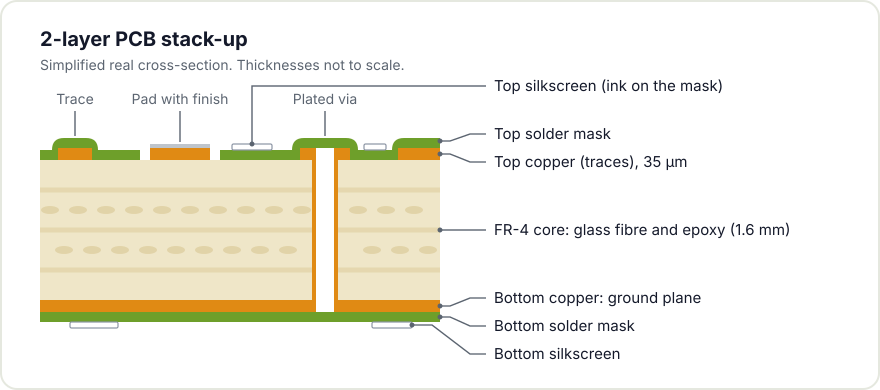
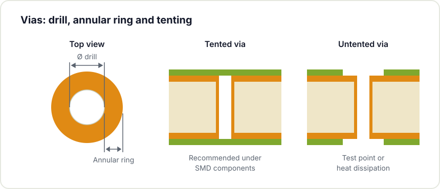

Sending a PCB to fabrication is the final step of the design process and also the point where mistakes become most expensive: they surface once the board has been paid for and assembled. Most of those failures are avoidable with a systematic review before generating the fabrication files. This guide collects the checklist we apply at Hackerspace Valencia before ordering a board.


Manufacturer rules
DRC with no errors
Ground, vias and silkscreen
Mechanics and parameters
Rest and second review
Gerbers and order


## 1. Know your manufacturer's capabilities

Every manufacturer documents its process limits (for example, the [JLCPCB fabrication capabilities](https://jlcpcb.com/capabilities/pcb-capabilities)): minimum trace width, minimum via size, minimum copper spacing, layer count and copper weight. These figures are process specifications, not opinions. Designing below those limits means the order is either rejected or the board is manufactured with defects. Look up these values before you start and set your project's design rules (in KiCad, under Board Setup) to the manufacturer's specifications.

## 2. Run the design rule checker (DRC)

With the manufacturer rules configured, the DRC is the step that enforces them, and yet it is frequently skipped. [Run the DRC](https://docs.kicad.org/10.0/en/pcbnew/pcbnew.html#design-rule-checking) and treat every error or warning as a potential manufacturing failure: traces spaced too closely, unconnected vias or pads too close to the board edge. If your tool supports it, configure [custom rules](/en/blog/kicad-10-whats-new/) with the actual values of your manufacturer instead of the generic defaults.

## 3. Review the ground plane

A continuous ground plane on the bottom layer improves noise, thermal dissipation and signal integrity. Problems appear when the plane is full of cuts: traces that slice it, holes that break it into islands, connections that force return currents onto long detours. Verify that the plane is genuinely continuous where it should be and analyse how return currents flow. This check prevents a large share of the anomalies that are hardest to diagnose later.

## 4. Verify the vias

The drill diameter and the copper ring of each via must respect the manufacturer's minimums. Vias placed under surface mount parts can cause soldering defects if left untented, because solder paste can wick down the hole during reflow. Decide which vias to tent, that is, cover with solder mask, and which to leave open for access or thermal dissipation.

## 5. Check solder mask and silkscreen

The silkscreen, the text layer printed on the board, works as assembly documentation. Include clear references for every component, the polarity of electrolytic capacitors and diodes, pin one of every integrated circuit and the orientation of connectors. Check that no text lands on pads: the ink does not print there and the reference is lost. A well documented board assembles faster and with fewer errors.



## 6. Validate connectors and mechanics

Before generating the files, check that connectors occupy their intended position, that pin pitch is correct and that the board fits its enclosure, mounting holes included. A connector placed backwards or shifted half a millimetre can prevent the board from fitting its case. If you use polarised connectors, mark the pin one position clearly.

## 7. Review the fabrication parameters

When placing the order you define several parameters that affect price and outcome:

- Board thickness, usually 1.6 mm.
- Copper weight, normally 1 oz (35 µm).
- Surface finish: [HASL](https://en.wikipedia.org/wiki/Hot_air_solder_leveling), [ENIG](https://en.wikipedia.org/wiki/Electroless_nickel_immersion_gold) or others, each with its own balance of cost, solderability and durability.
- Solder mask and silkscreen colours.

Select the parameters based on project requirements, not aesthetics.



## 8. Prepare fiducials and panelisation

If components will be assembled by machine, the board needs [fiducials](https://en.wikipedia.org/wiki/Fiducial_marker): reference marks the assembly machine uses to orient itself. If you manufacture several units, panelisation, that is, grouping several boards into a larger panel, reduces unit cost. Ask your manufacturer which panel format it prefers.

## 9. Perform a final review with perspective

When the design looks finished, save it and let it rest for at least a day. Review it afterwards with fresh eyes: the least obvious mistakes surface on that second pass. If possible, ask another person to review the design; an external reader detects flaws the author, after many hours of work, no longer perceives.

## Quick summary

- Rules matched to the manufacturer's actual capabilities.
- DRC run, with no unjustified errors or warnings.
- Continuous ground plane and short return current paths.
- Vias within minimums and a decision made on tenting.
- Complete silkscreen, with no text over pads.
- Connectors and holes validated against the enclosure.
- Fabrication parameters chosen according to project requirements.

If this is your first board and you would like a review before ordering, bring it to Hackerspace Valencia: several of us will go over it and we usually spot details that the author, by proximity to the design, no longer sees.

Want to learn to design one from scratch? Join our [KiCad workshop](/en/workshops/kicad/) or [become a member](/en/pages/alta/) to use the workshop whenever you like.

## Image credits

- **Cover** - *PCB Prototypes* - Mister rf - CC BY-SA 4.0 - [source](https://commons.wikimedia.org/wiki/File:PCB_Prototypes.jpg)
- **Colour samples** - *PCB Color Samples* - Thomas Flummer - CC BY-SA 4.0 - [source](https://commons.wikimedia.org/wiki/File:PCB_Color_Samples.jpg)
- **Fiducials and silkscreen** - *Fiducial Marker PCB* - wdwd - CC BY-SA 3.0 - [source](https://commons.wikimedia.org/wiki/File:Fiducial_Marker_PCB.JPG)
