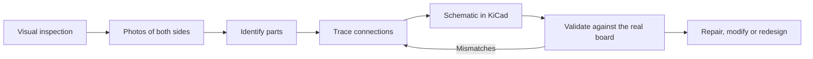
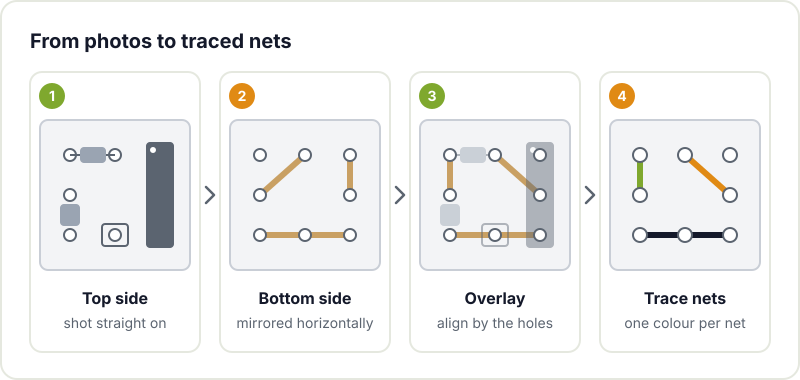

Sooner or later an undocumented board lands on the workbench. An amplifier someone rescued from a skip, the controller from an old printer, a grandparent's radio receiver or a cheap module whose schematic nobody can find. It half works, or doesn't work at all, and there is no service manual and no manufacturer to ask.

PCB reverse engineering means rebuilding the missing information from the board itself: which parts it carries, how they are connected and, with some luck, why it was designed that way. The goal is not to clone a product, but to recover knowledge so you can repair, adapt or learn.

## Why do it at a hackerspace

In the maker world the reasons tend to be very concrete:

- **Repair**: finding the burnt part is much easier when you know what each section of the circuit does.
- **Bring old gear back to life**: with devices like the ones in our [vintage radio restoration](/en/proyectos/radios/) project, the service manual doesn't always turn up and you have to work out the circuit from the board itself.
- **Reuse**: salvaging parts, as in the [plotter built from CD-ROM drives](/en/proyectos/plotter/), starts with understanding how the motors and sensors in each drive are wired.
- **Learn**: a commercial board is an open design textbook. Seeing how others handled the power supply, filtering or input protection teaches more than plenty of tutorials.
- **Replace discontinued parts**: if a chip is no longer made, you need to know what it does to find a substitute.

All of this ties in with the [right to repair](https://en.wikipedia.org/wiki/Right_to_repair) movement: the idea that what you buy should be possible to open, understand and fix.



## What you can recover from a board

With patience and basic tools you can rebuild quite a lot:

- The **schematic**, either complete or just the part you care about.
- The **bill of materials** (BOM), with part numbers and values.
- The **pinout** of connectors and interfaces, which is often all you need.
- The **power architecture**: which regulators there are, which voltages they generate and what they feed.
- If you want to go further, a **new layout** in KiCad, for example to make a spare in a run of five boards.

What you can't easily recover is the firmware of a microcontroller with read protection enabled. That's a different discipline and, for most repairs, you won't need it.

## The process, step by step

### 1. Visual inspection

Before touching anything, look. Count the layers (if you see vias that don't reach any visible trace on either side, there are probably inner layers), and find the power connector, the regulators and the main chip. Look for burnt areas, bulging capacitors or cold joints: sometimes the repair ends right here.

### 2. Photograph both sides

This is the step that saves the most time later on. Photograph the component side and the solder side with the camera as square to the board as possible, under diffuse light and with some scale reference. If you can, take another set of photos with the large parts that hide traces removed, or with raking light to bring out the copper under the solder mask.



### 3. Align, mirror and trace

The classic trick: open both photos in an image editor (GIMP or Inkscape will do), mirror the bottom side horizontally and scale it until the through-hole component holes line up with those on the top side. With both images on layers and the top one semi-transparent, you can see at a glance which trace connects which pad. Then trace over them on a third layer, using one colour per net.

### 4. Identify parts

Passives are read by their colour code or markings; ICs, by their part marking. Look up the datasheet for each one: the pinout of the main chip tells you what to expect around it. On SMD parts the markings are short codes you have to look up in SMD code tables, and sometimes they have been deliberately removed. In that case, work out the function from the surroundings: a three-pin chip with a capacitor on each side right next to the power input is almost certainly a regulator.

### 5. Check continuity

Photos can be misleading: traces running under a part, tented vias, inner layers. Use the multimeter in continuity mode to confirm every doubtful connection, always with the board unpowered. Note what you've checked directly on your trace drawing.



### 6. Redraw the schematic in KiCad

Transfer what you've traced to a schematic in [KiCad](https://www.kicad.org/). Don't try to make the schematic mimic the physical layout: group by function (power, input, processing, output) so it is easy to read. Start with power and ground, which are the nets that touch the most pads, and then go block by block. The [official KiCad documentation](https://docs.kicad.org/) covers the schematic editor if it's your first time, and in our [KiCad workshop](/en/workshops/kicad/) we practise it from scratch.

### 7. Validate

Compare the schematic with the real board: measure voltages at key points with the board powered and check they match what the schematic predicts. Each mismatch usually means a wrongly traced connection. Repeat this loop until everything fits.

## Common difficulties

- **Multilayer boards**: you can't see the inner layers. You can infer them by checking continuity between vias, but on dense boards with four or more layers the effort grows quickly.
- **Unmarked parts**, or parts with the marking sanded off.
- **BGA parts**: the connections are hidden under the package.
- **Protected firmware**: you can understand the whole hardware and still not know what the program does.
- **Obsolete parts**: working out what a chip is doesn't guarantee you can still buy it.

## When it pays off and when it doesn't

It pays off when the board used to work fine and you just want to repair it, document it, swap a discontinued part or make a small modification. You start from a proven design and save a lot of work.

It pays off less when you want something very different: another architecture, another microcontroller, major new features. In that case it's usually better to design from scratch, drawing on what you learned. And if you do end up making a new board, go through our [checklist before sending it to fab](/en/blog/pcb-fabrication-checklist/).

## A note on intellectual property

Analysing a board you own to repair it, understand it or make it work with other things is common practice and, in general, legitimate. Copying a protected design to sell it, bypassing copy protection or redistributing someone else's firmware is a different matter: patents, copyright or licences may come into play. If your project goes beyond personal use or repair, do your homework first. At the hackerspace we stay on the first side: repairing, learning and sharing what we learn.

## Bring your mystery board

If you have a broken device with no schematic, or a salvaged board you want to put to use, bring it to [Hackerspace Valencia](/en/blog/what-is-a-hackerspace/). Between a few people, a magnifier and a multimeter, mystery boards stop being mysterious pretty quickly. If you get hooked, [become a member](/en/pages/alta/) and you'll have a permanent place to keep tinkering.

## Image credits

The diagram is an original by Hackerspace Valencia. The photographs come from [Wikimedia Commons](https://commons.wikimedia.org):

- **Cover** - *HP-35 Main Board solder side* - Mister rf - CC BY-SA 4.0 - [source](https://commons.wikimedia.org/wiki/File:HP-35_Main_Board_solder_side.jpg)
- **Old receiver board** - *Sharp Optonica SA-2121H receiver AM RF-IF board 01* - Retired electrician - CC0 - [source](https://commons.wikimedia.org/wiki/File:Sharp_Optonica_SA-2121H_receiver_AM_RF-IF_board_01.jpg)
- **Board from both sides** (composite of two photos) - *Farb RGB 29504-105.11* and *Farb RGB 29504-105.11 solder side* - Mister rf - CC BY-SA 4.0 - [source 1](https://commons.wikimedia.org/wiki/File:Farb_RGB_29504-105.11.jpg), [source 2](https://commons.wikimedia.org/wiki/File:Farb_RGB_29504-105.11_solder_side.jpg)
- **Multimeter** - *Aneng AN870 multimeter 01* - Retired electrician - CC0 - [source](https://commons.wikimedia.org/wiki/File:Aneng_AN870_multimeter_01.jpg)
