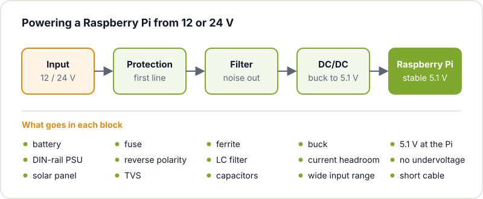
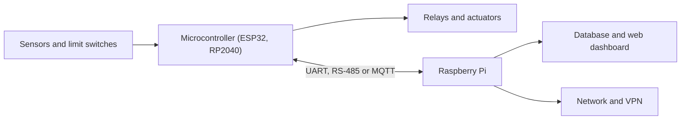

On the bench everything works: the Raspberry Pi boots, the script reads the sensors, Home Assistant responds. Then you put it in a box in the garage, in the greenhouse or in your home's fuse box, and three weeks later it stops answering. When you reboot it, the microSD is corrupted. Or it reboots by itself every time the compressor kicks in. Or in August it runs at half speed.

It is not that the Pi is bad at being always on. It is that the workbench and the final location are very different environments, and what decides whether it survives is how you build the system around the board. This guide goes over the points that fail most often and how to solve them with workshop means.

## Power: the root of almost everything

Most weird hangs come from the power supply. On the bench you use the official charger with a short cable; in the final location you get cheap power supplies, long thin cables, loads that start and stop, and sometimes a 12 V battery or solar panel.

The Pi wants a stable 5.1 V with current headroom: the official Pi 4 power supply delivers 3 A, and the Pi 5 one goes up to 5 A. When the voltage drops below what it needs, the firmware logs it as undervoltage. Check it with:

```bash
vcgencmd get_throttled
```

If it returns anything other than `throttled=0x0`, there has been undervoltage, frequency capping or overheating since boot. A non-zero value on an installation that has been running for days is the first clue when something fails intermittently.

If you have 12 or 24 V on site (a car battery, a DIN-rail power supply, a solar system), do not just plug in a cheap converter. Build a complete chain:



- **Protection**: a fuse, a diode or MOSFET against reverse polarity (someone will end up wiring it backwards) and a TVS diode to soak up the spikes.
- **Filter**: a ferrite or an inductor with capacitors at the input so that noise from motors and relays does not reach the converter.
- **DC/DC**: a buck converter, not a linear regulator. Stepping down from 24 V to 5 V at 3 A with an LDO means dissipating about 57 W as heat, which is simply not workable. We explain it in detail in [LDO vs DC/DC](/en/blog/ldo-vs-dcdc/). Choose one with current headroom and an input range that covers the battery's voltage rise while charging.

And run the 5 V to the board with a short cable of generous gauge: with thin wires, the voltage drop during current peaks is enough to trigger undervoltage.

## The microSD: cut down the writes

microSD cards have a limited number of write cycles, and a Linux system writes constantly: logs, caches, databases, swap. Add power cuts on top: if the power goes while it is writing, the file system can end up corrupted.

Strategies, from least to most effort:

| Measure | What it achieves |
|---|---|
| A quality card, *high endurance* or industrial grade | Withstands many more write cycles |
| [log2ram](https://github.com/azlux/log2ram) | Moves `/var/log` to RAM and flushes it to the card every so often |
| Disable swap and mount `/tmp` in RAM | Removes writes that add nothing |
| Save data in batches rather than every second | Fewer small, repeated writes |
| Read-only overlay | The card is not written; changes live in RAM and are lost on reboot |
| Boot from a USB SSD (or NVMe on the Pi 5) | Much more resilient storage |

The read-only overlay is the most robust option for a device that always does the same thing, such as a dashboard or a sensor gateway. `raspi-config` includes an *Overlay File System* option that turns it on without any fuss; the [Raspberry Pi configuration documentation](https://www.raspberrypi.com/documentation/computers/configuration.html) describes the tool. If you need to store data, send it elsewhere (a server, a network database, a dedicated USB drive) and leave the system untouched.

And always keep an image of the card ready to flash. When it fails, you will spend five minutes restoring it instead of an afternoon.

## Temperature: beware of sealed enclosures

On the bench the Pi can breathe. Inside a sealed box in a sunny greenhouse or a plant room, it cannot. When the SoC gets too hot, the firmware lowers the processor frequency to protect itself: according to the [official Raspberry Pi documentation](https://www.raspberrypi.com/documentation/computers/raspberry-pi.html), between 80 and 85 °C it starts throttling progressively. If your application uses computer vision, local AI or lots of services at once, you will notice.

Measure before you decide:

```bash
vcgencmd measure_temp
```

The typical solutions: an aluminium case that acts as a heatsink (like the one in the cover photo), a temperature-controlled fan, well-planned ventilation holes (intake at the bottom, exhaust at the top) and not placing the box in direct sunlight. If the enclosure has to be sealed, let the heatsink take the heat out through the wall.

## Watchdog: let it recover by itself

Something will hang eventually: the kernel, a driver or your own program. The Pi has a hardware watchdog that reboots the board if nobody gives it a sign of life for a while. With systemd you enable it in `/etc/systemd/system.conf`:

```ini
[Manager]
RuntimeWatchdogSec=10s
```

With this, if the system locks up completely, it reboots by itself. The [Linux kernel watchdog API](https://www.kernel.org/doc/html/latest/watchdog/watchdog-api.html) explains the mechanism. For your application, configure the systemd service with `Restart=always` so it starts again if it crashes. And remember that the Pi boots on its own when power comes back after an outage; make sure your program does too.

## Updates and security

A Pi connected to the network for years is a target. The bare minimum:

- SSH access with keys only, no passwords, and no default user.
- No port forwarding on the router. If you need remote access, use a VPN such as WireGuard.
- Regular security updates. Debian's `unattended-upgrades` package automates them, but on a critical system you may prefer to update by hand and check that everything still works.
- Put home automation devices on their own network or VLAN if your router allows it.

And keep the configuration (scripts, service files, `docker-compose.yml`) in a repository. If you have to set up another Pi from scratch, it will take minutes.

## Connecting 12 and 24 V signals

The Raspberry Pi GPIOs run at 3.3 V and do not tolerate higher voltages. In the workshop, the greenhouse or an irrigation system you will find sensors, limit switches and solenoid valves at 12 or 24 V. Never connect them directly:

- **Digital inputs**: an optocoupler electrically separates the field circuit from the Pi. If the cable is long or runs near motors, galvanic isolation will save you a lot of grief.
- **Outputs**: relays or MOSFETs, with a flyback diode on inductive loads.
- **Analogue signals** (0-10 V, 4-20 mA): the Pi has no ADC, so you need an external one with its signal conditioning. We cover this in [how to improve ADC accuracy](/en/blog/microcontroller-adc-accuracy/).
- **Fieldbuses** such as RS-485 or CAN: with a transceiver, preferably an isolated one.

## Pi to think, microcontroller to act

The Pi takes seconds to boot, Linux does not guarantee exact response times and an update can leave it rebooting at the worst possible moment. For tasks that must always respond instantly (shutting off irrigation, stopping a motor, an alarm), a microcontroller is more reliable. The architecture that works best in many projects combines both:



The microcontroller takes care of real-time control and safe states: if the Pi reboots or loses the network, the irrigation does not stay on. The Pi contributes what it does well: storage, web interface, communications, heavy processing and updates. If the microcontroller is an ESP32, you can update it remotely too, as we explain in [OTA updates on the ESP32](/en/blog/esp32-ota-updates/).

## Checklist before leaving it alone

- A power supply with headroom and `vcgencmd get_throttled` at zero after several days.
- Protection and filtering if you power it from 12 or 24 V.
- Fewer writes to the microSD, or a read-only system.
- Temperature under control on the hottest summer day.
- Watchdog enabled and services with automatic restart.
- SSH with keys, no open ports, planned updates.
- Isolated field inputs and outputs.
- A backup image and the configuration in a repository.

## Bring it to the hackerspace

At Hackerspace Valencia there are several Raspberry Pis built into projects, such as the [RetroBooth](/en/proyectos/retrobooth/) photo booth or the [arcade machine](/en/proyectos/arcade/). If you are getting yours ready to run 24/7, come by one evening and we will review it together: power, enclosure, system and connections. And if you need some Linux basics, start with [our guide to getting started with Linux](/en/blog/getting-started-linux/).

## Image credits

- **Cover** - *Raspberry Pi 4 on a network switch* - RAIL P - CC0 - [source](https://commons.wikimedia.org/wiki/File:Raspberry_Pi_4_on_a_network_switch.jpg)
- Diagrams: created by Hackerspace Valencia.
