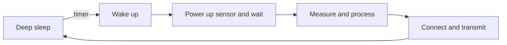
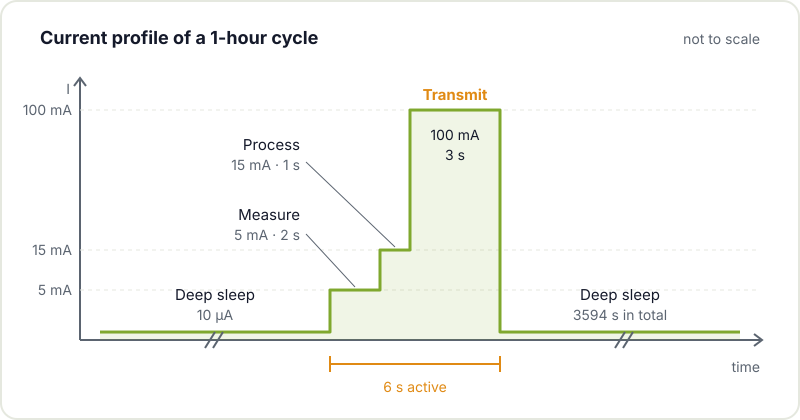
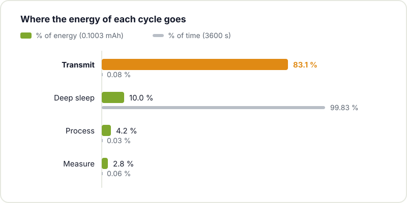

You have a weather station with an ESP32, a 2000 mAh battery and the usual question: how long will it last? The quick calculation, capacity divided by current draw, is almost never right, because an IoT node does not draw a fixed current. It spends most of its time asleep, then wakes up, measures, thinks, transmits and goes back to sleep. Each of those phases has a very different current and duration, and what drains the battery is the combination of the two.

In this article we look at how to make the estimate properly, with a complete example and a small script you can adapt to your project.

## Think in cycles, not currents

The starting point is to describe precisely what your device does in one complete cycle. For a typical environmental sensor, the cycle looks something like this:



For each phase you need two numbers: the current drawn by **the whole product** (not just the microcontroller) and how long it lasts. The energy of each phase is simply:

```text
phase charge (mAh) = current (mA) × time (h)
```

Add up all the phases and you have the charge per cycle. Multiply by the cycles per day and you have the daily consumption. Divide the usable battery capacity by that consumption and you get the days of battery life. Watch the units: mixing µA, mA, seconds and hours is the most common source of error.

## A complete example

Let's assume a node that measures and transmits once an hour, with these phases:

| Phase | Current | Time per cycle | Charge per cycle |
|---|---|---|---|
| Deep sleep | 10 µA | 3594 s | 0.0100 mAh |
| Measure | 5 mA | 2 s | 0.0028 mAh |
| Process | 15 mA | 1 s | 0.0042 mAh |
| Transmit | 100 mA | 3 s | 0.0833 mAh |
| **Total** | | **3600 s** | **0.1003 mAh** |

With 24 cycles a day that comes to **2.41 mAh/day**. If we can use 2000 mAh of the battery, the theoretical battery life is 2000 / 2.41 ≈ **830 days**, a little over two and a quarter years. Put another way, the node's average current is about 100 µA.



Look at what the table is telling you. Transmitting lasts only 3 seconds, but it takes more than 80 % of the cycle's energy. Deep sleep draws 10,000 times less current, but because it fills almost the whole hour it ends up weighing more than measuring and processing combined. Comparing instantaneous currents without looking at time leads you to optimise what does not matter.



## Do the maths with a script

This Python script reproduces the table. Change the phases, the period and the capacity and you have your estimate in seconds:

```python
# Estimated battery life of an IoT node from its duty cycle
CYCLE_S = 3600             # one cycle per hour
USABLE_CAPACITY_MAH = 2000 # usable capacity, not the nominal one

# (name, current in mA, duration in s)
phases = [
    ("measure",       5.0, 2),
    ("process",      15.0, 1),
    ("transmit",    100.0, 3),
]
SLEEP_MA = 0.010           # 10 µA for the whole product asleep

active_s = sum(t for _, _, t in phases)
phases.append(("deep sleep", SLEEP_MA, CYCLE_S - active_s))

total_mah = 0.0
for name, i_ma, t_s in phases:
    mah = i_ma * t_s / 3600   # mA·s -> mAh
    total_mah += mah
    print(f"{name:<12} {i_ma:>8.3f} mA {t_s:>6} s {mah:.5f} mAh")

cycles_per_day = 86400 / CYCLE_S
daily_mah = total_mah * cycles_per_day
days = USABLE_CAPACITY_MAH / daily_mah

print(f"\nPer cycle:    {total_mah:.4f} mAh")
print(f"Per day:      {daily_mah:.2f} mAh")
print(f"Battery life: {days:.0f} days ({days / 365:.1f} years)")
```

With the example values it prints 0.1003 mAh per cycle, 2.41 mAh per day and 831 days. Play with it: if coverage is poor and transmitting goes from 3 to 6 seconds with retries, battery life drops to about 450 days. If the sleeping product draws 100 µA instead of 10 because of an LED or a regulator, it falls to about 440. If you measure every 15 minutes instead of every hour, you are down to about 225 days.

## The sources of consumption, one by one

### Sleep is nearly all of the time

In a long-life design, the device spends more than 99 % of the time asleep. There, a few extra microamps add up mercilessly. The figure you need is not the deep sleep current from the chip's datasheet, but what the whole board draws while asleep: regulator, always-connected voltage dividers, the sensor in standby, the dev board's USB-serial converter and the power LED. On a typical ESP32 DevKit those extras can far exceed the chip itself; we cover this in detail in [how to reduce ESP32 power consumption](/en/blog/esp32-low-power/).

### Sensors and settling time

The sensor does not only draw current during the reading. You have to power it, wait for it to settle, read it and switch it off. A gas sensor with a heater, or one that needs hundreds of milliseconds to start up, can dominate the cycle. Check the actual start-up time in the datasheet and switch it off completely between readings if possible, preferably with a MOSFET that disconnects it rather than relying on its low-power mode.

### Processing fast also saves energy

More current does not always mean shorter battery life. If raising the processor clock makes the task finish sooner and go back to sleep sooner, the total energy can be lower. The same goes for firmware: removing unnecessary `delay()` calls or repeated initialisations cuts active seconds without touching the hardware.

### The radio rules

Wireless communication is usually the highest-current phase, and in the example it takes most of the energy. Its impact depends on how often you transmit, how much data you send and how long the connection takes. With the ESP32's WiFi, associating with the access point and getting an IP over DHCP takes time; using a static IP or sending several accumulated readings at once are among the most cost-effective improvements. Filtering locally and transmitting only when something changes usually beats any other optimisation.

### Peaks and the battery

Average current does not tell the whole story. The ESP32's transmit peaks can be much higher than the phase average, and the battery has internal resistance: if the voltage sags too much during the peak, the chip resets even though there is charge left. This is very common with old alkaline batteries or in the cold. A good bulk capacitor close to the module helps, and the regulator has to cope with those peaks. Espressif's [ESP32 hardware design guidelines](https://docs.espressif.com/projects/esp-hardware-design-guidelines/en/latest/esp32/) detail the recommended decoupling on the chip's power supply.

### The regulator draws current too

Not all the energy leaving the battery reaches the circuit. An LDO wastes the voltage difference as heat and a DC/DC has its own losses. On top of that, both have quiescent current, which can be decisive on a node that is asleep almost all the time. Many converters are excellent at full load and very poor at microamps. We compare them in [LDO vs DC/DC](/en/blog/ldo-vs-dcdc/).

## Nominal capacity versus usable capacity

The 2000 mAh on the label is a reference, not what you will be able to use. Usable capacity depends on temperature, the discharge profile, current peaks, internal resistance and, above all, the minimum voltage at which your circuit stops working. If your ESP32 needs 3.0 V after the regulator and the battery can no longer deliver that during a 300 mA peak, whatever energy is left inside is no use to you. Add ageing to that: after a couple of years the battery does not perform like new. [Peukert's law](https://en.wikipedia.org/wiki/Peukert%27s_law) describes how effective capacity falls as discharge current rises, especially in chemistries such as lead-acid.



That is why the example talks about 2000 mAh usable: if your cell is rated at 2000 nominal, apply a margin and calculate with less. If you want to dig deeper into how cells behave with load, temperature and cycling, the Wikipedia entry on the [lithium-ion battery](https://en.wikipedia.org/wiki/Lithium-ion_battery) is a good starting point.

## Design for a bad but realistic case

The node on your balcony does not live on the workbench. Outside it is cold in winter and very hot in summer, the WiFi coverage is not what you get in the living room and the battery ages. Make the estimate with a reasonable worst-case scenario: the real site temperature, connection retries, a somewhat degraded battery. If you still meet your target with that, you are on track.

## Measure the prototype as early as possible

The maths gives you a direction, but only measurement confirms it. With a multimeter you can check the sleep current, but peaks and short phases need something more: a small shunt resistor in series with the supply read with an oscilloscope, or one of those USB power profilers that log current over time. To understand what stays on in each sleep mode, the reference is Espressif's [ESP32 sleep modes](https://docs.espressif.com/projects/esp-idf/en/stable/esp32/api-reference/system/sleep_modes.html) documentation. Look for:

- The real sleep current, with everything assembled.
- The real duration of each active phase.
- How long transmitting actually takes at the final location.
- Blocks that stay on longer than expected.

Measure early, while you can still change the regulator or the sensor without redoing the PCB.

## How to get more battery life

It almost always pays off more to reduce the energy per cycle than to fit a bigger battery:

- **Shorten the active phases**: remove waits, initialise only what you need.
- **Measure and transmit less**: batch data, match the rate to what you really need.
- **Switch off what you do not use**: fully disconnecting a block is usually better than leaving it in standby.
- **Choose the regulator well**: look at quiescent current and light-load efficiency, not just peak efficiency.
- **Decide on the battery early**: battery, consumption, radio and power supply all depend on each other. Choosing them together before designing the board avoids surprises.
- **Consider energy harvesting**: a small solar panel can make the node practically self-sufficient if consumption is low enough.

## Bring it to the hackerspace

If you have a battery-powered node that does not last as long as it should, bring it to [Hackerspace Valencia](/en/blog/what-is-a-hackerspace/). Together we will measure the real cycle, hunt down the leak and do the maths with your numbers. And if you feel like moving from prototype to your own board, take a look at [from dev kit to your own PCB](/en/blog/from-dev-kit-to-custom-pcb/) and our [KiCad workshop](/en/workshops/kicad/).

## Image credits

- **Cover** - *Meshtastic T-Beam* - Chiffre01 - CC0 - [source](https://commons.wikimedia.org/wiki/File:Meshtastic_T-Beam.jpg)
- **18650 and 21700 cells** - *18650 and 21700 lithium ion battery cell* - Sevenethics - CC0 - [source](https://commons.wikimedia.org/wiki/File:18650_and_21700_lithium_ion_battery_cell.jpg)
- Diagrams: created by Hackerspace Valencia.
