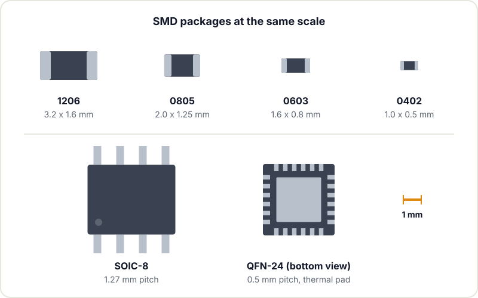
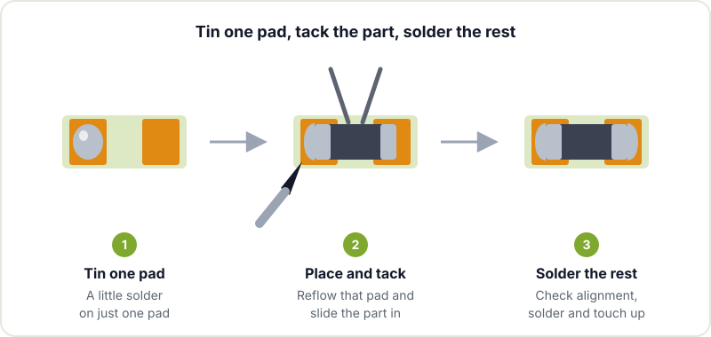

Sooner or later every project runs into a chip that only comes in surface mount (SMD): an I2C sensor, a tiny regulator, the ESP32 module itself. The first reaction is usually to look for a breakout board version, but hand-soldering SMD is far more approachable than it looks. With flux, good light and a bit of patience, an 0805 or a SOIC can be soldered with the same iron you use for through-hole. If you are not yet comfortable with the basics, start with [getting started with soldering](/en/blog/getting-started-soldering/) and come back here afterwards.

## Package sizes

The first thing is to know what you are up against. For passives (resistors, capacitors) the package name tells you the size. Careful: the usual code is imperial (in hundredths of an inch), and there is also a metric code that uses the same digits with a different meaning, so always check both columns.

| Imperial | Metric | Approx. size | By hand |
|---|---|---|---|
| 1206 | 3216 | 3.2 x 1.6 mm | Very easy, ideal to start with |
| 0805 | 2012 | 2.0 x 1.25 mm | Easy, the sensible maker standard |
| 0603 | 1608 | 1.6 x 0.8 mm | Doable with fine tweezers and magnification |
| 0402 | 1005 | 1.0 x 0.5 mm | Hard, better with a microscope |

For ICs, what matters is the lead pitch and whether the leads are visible or hidden under the chip:

- **SOIC**: gull-wing leads on two sides, 1.27 mm pitch. The friendliest one to start with.
- **SSOP / TSSOP**: like SOIC but tighter, typically 0.65 mm. Works well with drag soldering.
- **QFP / LQFP**: leads on all four sides, with pitches from 0.8 to 0.4 mm depending on the chip. The typical package for many microcontrollers.
- **QFN**: no visible leads; the contacts sit on the bottom edge and there is usually a central thermal pad. Calls for hot air or paste and heat from below.

If you design your own board, choosing 0805 and SOIC whenever the project allows will save you plenty of grief at assembly time. Shrinking parts is only worth it when you are genuinely short of space.

## What you need besides the iron

- **Flux, lots of flux.** It is the single most important ingredient in SMD work. A "no clean" gel flux in a syringe stays where you put it and lasts longer than liquid. With flux, the solder spreads by itself and bridges disappear; without it, everything turns into balls.
- **Fine tweezers.** Straight or curved, anti-magnetic if you can. An 0603 pings out of bad tweezers and you never see it again.
- **A suitable tip.** For SMD, a small chisel tip (1 to 2 mm) or a "mini wave" hoof-style tip with a well for drag soldering works very well. A very fine conical tip is worse than it looks.
- **Thin solder.** 0.3 to 0.5 mm wire so you don't drown the pads.
- **Good-quality desoldering wick**, to clean up bridges and excess.
- **Magnification.** A desk magnifier with a light is fine for 1206 and 0805. For 0603 and fine pitch, a binocular magnifier or a stereo microscope completely changes the experience, especially for inspecting afterwards. USB microscopes are fine for checking, but the lack of depth makes soldering while looking at a screen awkward.
- **Isopropyl alcohol** and a brush to clean off flux residue at the end.



## Technique 1: tin one pad, tack the part, solder the rest

This is the most useful method and it works for almost anything with visible leads: resistors, capacitors, SOIC, SOT-23 and even QFP.

1. **Tin a single pad.** Put a small amount of solder on one of the pads (on an IC, on a corner pad).
2. **Place and tack.** Hold the component with the tweezers, bring the iron to that tinned pad and slide the part into position while the solder is molten. Remove the iron and hold the tweezers still for a second.
3. **Check the alignment.** Before going on, make sure the part is flat and centred. On an IC, check that every lead lands on its pad and that pin 1 is where it should be. If not, reheat the tacked pad and correct it. It is still easy at this point.
4. **Solder the rest.** The other end of the resistor, or the opposite corner of the IC to lock it in place, then the remaining leads.
5. **Touch up the first pad.** Add a dab of flux and reheat it, because the tack joint is usually left short of flux.

## Technique 2: drag soldering for fine pitch

For TSSOP or QFP there is no need to solder lead by lead. Once the chip is tacked down by two opposite corners:

1. Cover the whole row of leads with plenty of flux.
2. Load the tip with a drop of solder.
3. Drag the tip slowly along the row, touching the ends of the leads. Surface tension and flux spread the solder onto each lead and leave the gaps clean.

If a bridge is left, no problem: more flux and another pass, or desoldering wick. It is faster and gives more uniform joints than going one at a time.

## Technique 3: hot air

A hot air station is practically essential for QFN, for removing components and for parts with a thermal pad underneath. The process:

1. Lightly tin the pads (or apply a little paste) and add flux.
2. Place the component.
3. Heat in circles with the nozzle a few centimetres away, using low airflow so you don't blow away the neighbouring passives. You will see the moment the solder melts: the chip "floats" and self-aligns through surface tension.
4. Remove the heat and let it cool without touching it.

Protect nearby plastic parts (connectors, buttons) with polyimide (Kapton) tape or aluminium foil. And bear in mind that hot air affects everything around it, not just the part you want to solder.

## Technique 4: solder paste and a hot plate or oven

For whole boards, especially if you are building several, the cleanest way is the same as in industry: solder paste applied through a stencil (a metal template you can order along with the PCB), components placed with tweezers and even heat to reflow everything at once.

- **Hot plate.** Heats the PCB from below. Works very well with single-sided boards and it is easy to see the moment the paste reflows.
- **Reflow oven.** Small commercial ovens or modified toaster ovens with a temperature controller. They follow a controlled temperature profile, something we cover in detail in the article on [BGA soldering](/en/blog/bga-soldering/).

With paste, the stencil decides the amount and the result is usually more uniform than by hand. Without a stencil you can apply paste with a syringe, but it is hard to dose and you get more bridges.

## Clearing bridges and excess solder

Bridges between leads are the most common SMD mistake and the easiest to fix:

1. Add flux over the bridge.
2. Lay the desoldering wick on top and press down with the iron tip.
3. When the wick soaks up the solder, lift wick and iron together, straight up. If you lift only the iron, the wick stays soldered to the board.

Often flux and a pass with a clean tip is enough, no wick needed: the excess solder stays on the tip. When you finish, clean the board with isopropyl alcohol and inspect under magnification. A bridge invisible to the naked eye can cost you an afternoon of debugging.

## Where to go next

If you are preparing your first board with SMD parts, the [PCB fabrication checklist](/en/blog/pcb-fabrication-checklist/) helps you not to forget anything before ordering it, and in [from dev kit to custom PCB](/en/blog/from-dev-kit-to-custom-pcb/) we cover the jump from building kits to designing. The [KiCad documentation](https://docs.kicad.org/) explains how to generate the paste layer to order the stencil, and the Wikipedia page on [surface-mount technology](https://en.wikipedia.org/wiki/Surface-mount_technology) lists the most common packages. More material in [electronics resources for makers](/en/blog/electronics-resources/).

Got a board with SMD parts waiting in a drawer? Bring it to Hackerspace Valencia and we will assemble it together: usually the first resistor takes ten minutes and the tenth, thirty seconds.

## Image credits

- **Cover** - *Surface Mount Devices* - Mister rf - CC BY-SA 4.0 - [source](https://commons.wikimedia.org/wiki/File:Surface_Mount_Devices.jpg)
- **Stereo microscope** - *Soldering Surface-mount components with a Stereo microscope* - Brandon Stafford - CC BY-SA 2.0 - [source](https://commons.wikimedia.org/wiki/File:Soldering_Surface-mount_components_with_a_Stereo_microscope.jpg)
