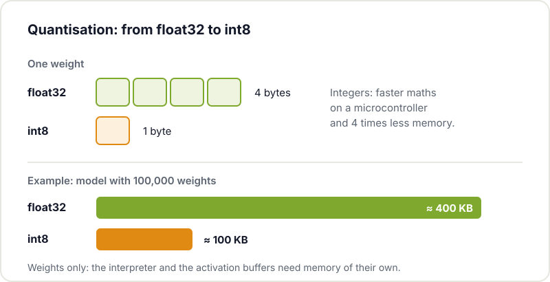

When people talk about artificial intelligence they nearly always think of data centres and huge models like the ones we explain in [what is generative AI](/en/blog/what-is-generative-ai/). But there is another branch heading the opposite way: squeezing small, very specific models into a microcontroller that costs a few euros, with a few hundred kilobytes of RAM and running off a battery. That is called **TinyML**.

For a maker this opens up very practical possibilities: a sensor that doesn't just measure, but decides whether what it measures is normal; a remote that recognises gestures; a device that wakes up when it hears a specific word. All without sending data to any server.

## What TinyML is (and what it isn't)

TinyML is machine learning running on microcontrollers with very limited resources. The key idea is that **the microcontroller doesn't learn**: the model is trained on your computer (or in the cloud) with tools like TensorFlow or PyTorch, shrunk and converted to a lightweight format, and only then loaded into the firmware. The chip only does *inference*: it takes in data and returns a prediction.

Nor is it a way to put a chatbot on an ESP32. TinyML models take up kilobytes, not gigabytes, and solve narrow tasks: classifying, detecting anomalies, recognising a handful of words.

## Why process on the device itself

The classic IoT approach is for the sensor to send everything to a server and analyse it there. It works, but it comes at a cost: the radio is the biggest power hog in a battery-powered device, the connection isn't always there, and sending raw audio or vibration data elsewhere raises privacy concerns. If the microcontroller decides by itself, you only need to transmit the result ("the printer just made a weird noise"), or nothing at all. If the energy side interests you, [how to reduce ESP32 power consumption](/en/blog/esp32-low-power/) covers the basic techniques.

## TinyML vs Edge AI

The two terms often get mixed up. Edge AI is any AI that runs close to where the data is generated; TinyML is the smallest end of that family. All TinyML is Edge AI, but not the other way round.

| | TinyML | Edge AI in general |
|---|---|---|
| Typical hardware | Microcontrollers: ESP32, ESP32-S3, RP2040, STM32 | Also: Raspberry Pi, Jetson, phones, mini PCs with an accelerator |
| Available memory | Hundreds of KB to a few MB | From hundreds of MB to several GB |
| Power draw | Milliamps, can run on a battery for months | Watts, usually on mains power |
| Operating system | None, or an RTOS | Usually Linux |
| Model size | Kilobytes | Megabytes or more |
| Examples | Keyword spotting, gestures, vibration anomalies | Object detection in video, small language models |

## The workflow

A TinyML project almost always goes through the same stages:

1. **Collect real data**, with the same sensor and under the same conditions it will work in. This is the most important stage and the most underestimated one: a model trained on lab data will fail in the workshop.
2. **Train** a small model on your computer.
3. **Shrink it**: quantisation, parameter pruning or a simpler architecture.
4. **Integrate it** into the firmware, usually as a byte array in C.
5. **Validate** on the real board: accuracy, inference time, memory and power draw.

### Quantisation, explained

The technique that helps most is quantisation: converting the model weights from 32-bit floating point numbers to 8-bit integers. Each weight takes a quarter of the space, integer maths is faster on a microcontroller and, done properly, the loss of accuracy is usually small.

## Which hardware to use

- **ESP32**: the entry point. Cheap, with WiFi and Bluetooth, and enough for simple models with accelerometers or slow sensors. If you've never used one, start with [getting started with the ESP32](/en/blog/getting-started-esp32/).
- **ESP32-S3**: adds vector instructions designed to speed up neural networks. It's the usual choice for audio and simple vision.
- **ESP32-P4**: no radio but much more power, plus camera and display interfaces. We look at it in [ESP32-P4: Espressif's big leap](/en/blog/esp32-p4/).
- **Raspberry Pi Pico (RP2040)** and the **STM32** families: good alternatives, with lots of documentation.

## Tools

- **[LiteRT for Microcontrollers](https://developers.google.com/edge/litert/microcontrollers/overview)** (formerly TensorFlow Lite for Microcontrollers): the reference interpreter. It needs neither an operating system nor dynamic memory, and has examples for ESP32 and Arduino. The code lives in the [tflite-micro](https://github.com/tensorflow/tflite-micro) repository.
- **[Edge Impulse](https://docs.edgeimpulse.com/)**: a web platform that covers the whole cycle: you capture data from the board, train, and it generates a library ready for Arduino or ESP-IDF. Highly recommended for your first project.
- **[ESP-DL](https://github.com/espressif/esp-dl)**: Espressif's library, optimised for the ESP32-S3 and ESP32-P4. It quantises PyTorch, TensorFlow or ONNX models with its ESP-PPQ tool.
- **CMSIS-NN**: optimised kernels for Arm Cortex-M, useful if you work with STM32 or RP2040.

## Project ideas for the workshop

### Keyword spotting

The classic *keyword spotting*: an I2S microphone and an ESP32-S3 that recognises "on" or "stop" without an Internet connection. Record a few hundred samples from different voices (having lots of different people around helps here) and some background noise as a "nothing" class.

### Gestures with an accelerometer

An MPU-6050 on your wrist or in a controller, and a model that tells apart three or four gestures: circle, shake, tap. It's probably the best first project, because you can capture the data in minutes and the model is tiny.



### Monitoring a 3D printer by its vibrations

An accelerometer stuck to the printer frame, a few hours of normal prints to learn the pattern, and an anomaly detection model that warns you when something vibrates differently: a bearing starting to fail, a loose belt or a part that has come unstuck. It's predictive maintenance at workshop scale.

### Classifying machine sounds

The same idea with a microphone: telling whether the compressor, the milling machine or the extractor fan sound the way they always do.

## Limitations

- **Memory**: the model, the interpreter and the buffers must fit in the chip's RAM and flash. This is the most limiting constraint.
- **No on-device learning**: if conditions change, you have to retrain and update the firmware. Having [OTA updates](/en/blog/esp32-ota-updates/) ready helps here.
- **Data rules**: a small model with good data beats a clever one with poor data.
- **Not everything fits**: large language models, high-resolution video or complex reasoning are still a job for bigger hardware or the cloud. Many projects combine both worlds: TinyML filters and decides locally, and only the interesting stuff goes up to a server.

## Where it's heading

Manufacturers are adding AI accelerators and vector extensions (many of them on RISC-V) to ever cheaper chips. What needs an ESP32-S3 today will probably be doable on any mid-range microcontroller before long. A good time to learn the workflow.

## Come and train your first model

If you want to try TinyML, bring a board and an idea to [Hackerspace Valencia](/en/blog/what-is-a-hackerspace/). Capturing gesture or voice data is much easier with several people around, and together it's easier to debug why the model mistakes a circle for a shake. And if you want to keep coming, [become a member](/en/pages/alta/).

## Image credits

The diagrams are originals by Hackerspace Valencia. The photographs come from [Wikimedia Commons](https://commons.wikimedia.org):

- **Cover** - *ESP32-S3 on paper* - VectorVoyager - CC BY-SA 4.0 - [source](https://commons.wikimedia.org/wiki/File:ESP32-S3_on_paper.jpg)
- **MPU-6050 module** - *GY-521 MPU-6050 Module 3 Axis Gyroscope + Accelerometer* - Nevit Dilmen - CC BY-SA 3.0 - [source](https://commons.wikimedia.org/wiki/File:GY-521_MPU-6050_Module_3_Axis_Gyroscope_%2B_Accelerometer_0487.jpg)
