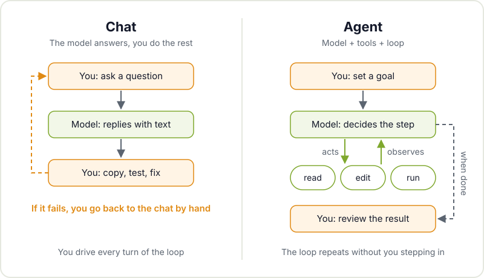
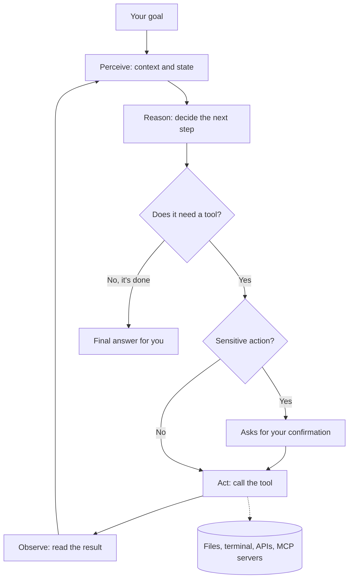
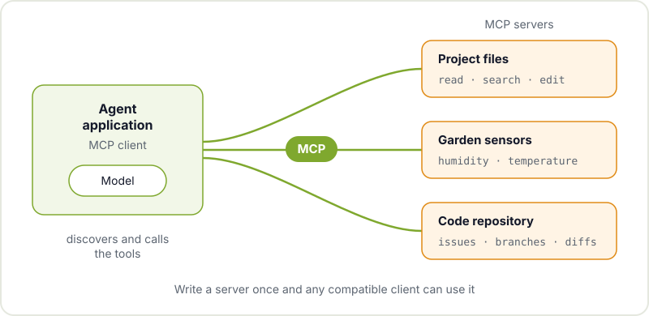

You've been asking an AI chatbot for things for a while now: explain a compiler error, write a function to read a sensor, summarise a datasheet. It works, but you're still doing the real work: you copy the code, paste it into your project, compile, see it fail, go back to the chat with the error and repeat. An AI agent is the next step: a system that doesn't just answer, but acts, looks at the result and decides what to do next.

In this post we explain what sits underneath that word, which has become fashionable and gets used for almost everything, and when an agent is worth using in your projects and when it isn't.

## From chatbot to agent

An AI chatbot is, in essence, a language model you give text to and that returns text. If you're still not clear on what that model actually does, start with [what generative AI really is](/en/blog/what-is-generative-ai/). What matters here is that the chatbot doesn't touch anything: it doesn't open your files, it doesn't run commands, it doesn't know whether what it suggested compiles.

An agent adds two pieces to that model:

- **Tools**: functions the model can ask to have executed. Reading a file, searching a repository, running a command in the terminal, making a request to an API or querying a database.
- **A loop**: the program wrapping the model gives it the goal, runs the tool the model asks for, returns the result and asks it again what to do. This continues until the model considers it has finished or some limit is reached.

In short: **agent = model + tools + loop**. The model is still the same kind of model a chatbot uses. What changes is everything around it.

## The loop: perceive, reason, act, observe

Classic AI literature was talking about [intelligent agents](https://en.wikipedia.org/wiki/Intelligent_agent) long before language models: something that perceives its environment and acts on it. Today's agents follow that pattern with four phases that repeat:

1. **Perceive**: the agent gathers context. Your request, the project instructions, the files it has read and the results of previous steps.
2. **Reason**: the model decides the next step. It might be "I need to see how this pin is defined" or "I have enough, I'll propose the change".
3. **Act**: if the step needs a tool, the model generates a structured call (for example, "run this command") and the program wrapping it executes it.
4. **Observe**: the tool's result, whether it's compiler output or the contents of a file, goes back into the model's context and the cycle starts again.

Note the confirmation node: a good agent doesn't blindly execute just anything. We'll come back to that in the risks section.

## Examples that make sense in a workshop

The most mature agents today are coding agents, because code is text, the tools are clear (read, edit, compile, run tests) and the result can be checked. Some uses that fit maker projects:

- **An agent that reads your repository and proposes changes.** You ask it to "add a low-power mode to the firmware and explain what you touched". The agent finds where the radio is initialised, reads the configuration, edits the files, compiles and, if there are errors, fixes them. You review the diff at the end, as you would a teammate's. If low power is your thing, we have a guide on [how to reduce ESP32 power consumption](/en/blog/esp32-low-power/) that will help you validate whatever the agent proposes.
- **An agent that queries your sensors.** If you have a weather station or a vegetable garden with sensors publishing data, you can expose that data as a tool. You ask "has the soil moisture dropped this week?" and the agent queries the series, compares and answers with real data instead of making it up.
- **An agent that writes documentation.** It goes through the project, reads the code and the exported schematics and drafts a README with assembly instructions. You review and correct it, but it saves you the most tedious part.

In every case the value is the same: the agent can check its own work with tools instead of stopping at a plausible answer.

## Model Context Protocol: a standard plug for tools

If every agent had to hand-roll its own way of talking to your database, your file system or your Home Assistant, it would be chaos. That's what the [Model Context Protocol (MCP)](https://modelcontextprotocol.io/) is for: an open protocol that defines how an agent discovers and uses external tools and data sources.

The idea is similar to a USB port: you write an **MCP server** once, for example one that exposes "read temperature" and "read humidity" from your sensors, and any MCP-compatible application can use it, without depending on a specific vendor. There are ready-made MCP servers for file systems, databases, browsers and code repositories, and writing your own for your project is a good weekend exercise.

Another useful piece is giving the agent persistent instructions about your project. A widespread convention is the [AGENTS.md](https://agents.md/) file, a README written for agents: how to build, how to run the tests, which conventions the code follows and what must not be touched.

## Risks: permissions, confirmations and cost

An agent that can act can also get things wrong while acting. Before giving it access to anything, think about these three fronts.

### Permissions

Give it only what it needs. If the task is editing the firmware, it doesn't need access to your SSH keys or unrestricted internet. Work on a copy or a Git branch so any change can be reverted. Also be careful with the content it reads: a file or a web page can contain malicious instructions the model mistakes for yours. This is the prompt injection problem, which tops the [OWASP Top 10 for LLM Applications](https://genai.owasp.org/llm-top-10/).

### Confirming actions

Separate what the agent can do on its own (read, search, compile) from what needs your sign-off (deleting files, pushing, sending messages, moving a motor or switching a relay). If the agent controls physical hardware, confirmation isn't optional: a software bug that switches on a heating element can't be fixed with a `git revert`.

### Cost

Every turn of the loop is a call to the model with all the accumulated context. A task that would be two messages in a chat can turn into dozens of calls. If you use a paid model, set limits on steps or spending. If you use local models, the cost shifts to time and your machine's power draw. Either way, it pays to pick the most modest model that handles each task well.

## When not to use an agent

An agent isn't always the best tool. It's probably not worth it when:

- **The task is a question.** If you want to understand what a microcontroller register does, a chatbot (or the datasheet) is faster and cheaper.
- **You can't verify the result.** If there are no tests, no compilation and no way to check the change works, the agent has nothing to correct itself against and you won't know whether it got it right either.
- **The action is irreversible or dangerous.** Mains voltage, machinery, personal data or money. That's where a person with good judgement is in charge.
- **You want to learn.** If your goal is to understand how I2C works, letting an agent solve it for you takes away exactly the part you're interested in. Use it to explain, not to do it for you.
- **The process is already deterministic.** If a ten-line script or a `make` rule always solves the problem the same way, don't put a model in the middle.

## Come and try it with us

The best way to understand an agent is to see the same task solved first in a chatbot and then with an agent, and compare. That's exactly what we do in the [from zero to programming with agentic AI workshop](/en/workshops/taller-ia-agentica/), open and free, where we'll cover the loop, tools, MCP and how to work with several agents at once without losing control of either the project or the budget.

If you'd rather tinker at your own pace, drop by Hackerspace Valencia with your laptop and your project. Someone in the community is bound to be wrestling with the same thing. And if you want to know how we work, start with [what a hackerspace is](/en/blog/what-is-a-hackerspace/).

## Image credits

The cover photograph comes from [Wikimedia Commons](https://commons.wikimedia.org) and is used under its licence:

- **Cover** - *Macro laptop coding (Unsplash)* - Marc Mueller - CC0 - [source](https://commons.wikimedia.org/wiki/File:Macro_laptop_coding_(Unsplash).jpg)
