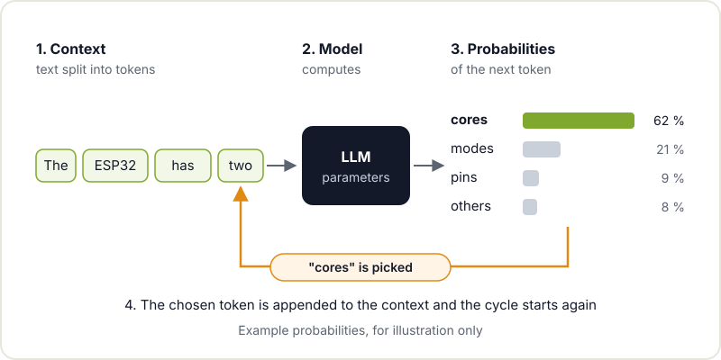
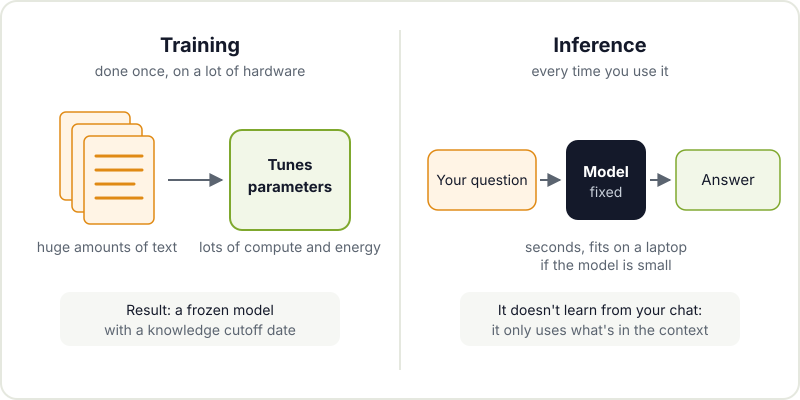
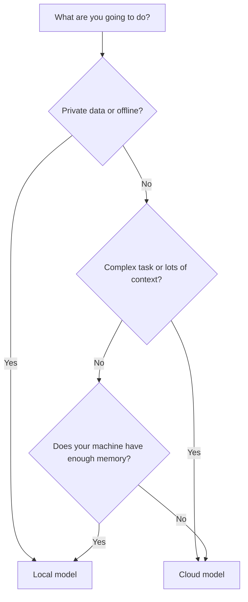

Between headlines promising that AI will do everything and others insisting it's a bubble, it's hard to know what exactly you're using when you ask a chatbot to explain a compiler error. In this post we cut through the hype: what a [generative AI](https://en.wikipedia.org/wiki/Generative_artificial_intelligence) does under the hood, why it sometimes makes things up with total confidence, how text models differ from image models, and what it can genuinely help with in a maker project.

You don't need any maths to follow along. What does help is the same attitude you bring to any tool in the workshop: understand how it works so you know when to use it and when not to.

## A model that predicts the next token

A [large language model](https://en.wikipedia.org/wiki/Large_language_model) (LLM) does, at heart, just one thing: given some text, it works out which fragment is most likely to come next. It picks one, appends it to the text and repeats. Fragment by fragment, that's how it builds the whole answer.

Those fragments are called **tokens**. A token can be a short word, part of a word, a punctuation mark or a space. Common words are usually a single token; rare words, component names or code get split into several. That's why model limits are measured in tokens rather than words.



The key thing about this diagram is what **isn't** in it: there's no database of facts the model looks up, and no step where it checks whether what it says is true. There's a very sophisticated probability calculation, learnt from an enormous amount of text, that happens to produce useful answers very often. But that's what it is: probabilities.

## Training and inference: two very different phases

It's worth separating two moments in a model's life:

- **Training**: the model tunes its parameters (billions of numbers) by reading huge amounts of text and learning to predict the next token. It is extremely expensive in compute and energy, it's done once (plus some later fine-tuning) and it's carried out by organisations with a lot of hardware. When it finishes, the model is frozen: its knowledge of the world stops at that date.
- **Inference**: this is what happens every time you use the model. The parameters no longer change; only the calculation to generate your answer runs. It's much cheaper and, with small models, fits on a laptop.



One practical consequence: the model doesn't learn from what you tell it in a conversation. If it seems to "remember", that's because the application passes it the history again with every message.

## Tokens and the context window

Everything the model takes into account to answer has to fit in its **context window**: your instructions, the conversation history, any files you paste in and the answer it is generating. That window has a maximum size in tokens that depends on the model.

If you go over it, the oldest material gets trimmed or summarised by the application, and the model "forgets" details. And even when it fits, a huge, messy context gives worse answers than a short, relevant one. Pasting the two pages of the datasheet that matter works better than pasting all three hundred.

## Why they hallucinate

A [hallucination](https://en.wikipedia.org/wiki/Hallucination_(artificial_intelligence)) is an answer that sounds convincing but is false: a library function that doesn't exist, a pin that doesn't match your board, a made-up quote. With what we've covered so far, it's easy to see why it happens:

- The model generates what is **plausible**, not what is **verified**. If it has seen lots of libraries with similar functions during training, an invented function in that style is very likely.
- It doesn't know what it doesn't know. It has no reliable mechanism for saying "I'm not sure about this" unless it has been trained or explicitly asked to.
- Its knowledge has a cutoff date. A board or library version released after training simply doesn't exist for it.

The way to reduce them is to give it sources (the datasheet, the actual code, the documentation) and check the result with something other than the model itself: the compiler, the multimeter or the official documentation.

## Text and images: LLMs versus diffusion models

Not all generative AI works the same way. The text models we've looked at generate token by token. The most widespread image generators use another technique, [diffusion models](https://en.wikipedia.org/wiki/Diffusion_model): they start from an image of random noise and "clean it up" over many steps, guided by the description you give them, until a coherent image emerges.

| | LLM (text) | Diffusion (image) |
|---|---|---|
| How it generates | Token by token, left to right | From noise to image, over many refinement steps |
| Typical input | Text, code, sometimes images | Text description, sometimes a base image |
| Typical failure | Confidently invented facts | Impossible details: unreadable text, parts that don't fit together |
| Maker use | Explaining, programming, documenting | Sketches, design ideas, textures |

Be careful with generated images in fabrication projects: a pretty render of an enclosure is not a 3D model with dimensions. It's fine for inspiration, not for sending to the printer.

## Local or cloud models

You can use a model in two ways: through a cloud service or by running it on your own machine. Tools like [Ollama](https://ollama.com/) and [llama.cpp](https://github.com/ggml-org/llama.cpp) let you download open models and run them locally, usually in "quantised" versions that take up less memory in exchange for a bit of accuracy.

```bash
# With Ollama: download a model and open a chat in the terminal
ollama pull model-name
ollama run model-name "Explain what a pull-up does on I2C"

# With llama.cpp: run a model in GGUF format
llama-cli -m model.gguf -p "Summarise this datasheet in five points"
```



The rule of thumb: local models give you privacy, work without internet and have no per-use cost, but the ones that fit on a home machine are more limited. Cloud services offer more capable models, in exchange for sending your data elsewhere and, usually, paying per use. The sensible thing is to try both and choose by task, not out of loyalty to a brand.

## Uses that actually work in the workshop

After all those warnings, the good part: used well, generative AI saves a lot of time on a maker project.

- **Explaining datasheets.** Paste in the relevant section and ask which register sets the low-power mode or what a timing table means. Then check the answer against the datasheet itself.
- **Generating code, and reviewing it.** A first draft of reading a sensor over I2C, a script to process the data from your weather station or a function for an ESP32. Read all of it, compile it and test it before trusting it. If you're just starting to program, ask it to explain the code line by line instead of simply copying it.
- **Documenting projects.** Generating a first README, commenting functions or writing assembly instructions from your notes. It's the part almost nobody does and the one the community appreciates most.
- **Debugging with context.** Pasting in the full error and the relevant code snippet usually gives better leads than searching for the error message blindly.

There's also AI beyond the big models: if you're interested in running small neural networks directly on a microcontroller, have a look at our post on [TinyML on microcontrollers](/en/blog/tinyml-microcontrollers/). And if you want to go from a chatbot that answers to a system that acts on your files, carry on with [what an AI agent is](/en/blog/what-is-an-ai-agent/).

## Limits and good practice

- **Verify everything that matters.** Pins, voltages, component values and any figure that could burn something out or hurt you get checked against the official documentation.
- **Give it sources, not just questions.** The more relevant the context, the less it makes up.
- **Mind what you paste.** Don't put passwords, API keys or personal data into an external service.
- **Don't outsource the learning.** If you want to learn electronics, let the AI explain, but build the circuit yourself.
- **Respect licences.** Generated code may resemble existing code. In a project you're going to publish, check what you're including.

## Come and talk about it at the hackerspace

Generative AI is just another tool in the workshop, like the soldering iron or the 3D printer: useful when you know how it works and dangerous when you don't. If you want to try it on a real project, drop by Hackerspace Valencia with your laptop: someone in the community will be tinkering with local models, programming with AI help or debating exactly where its limits are. And if you want to take the next step, sign up for the [agentic AI workshop](/en/workshops/taller-ia-agentica/). If it's your first time, start with [what a hackerspace is](/en/blog/what-is-a-hackerspace/).

## Image credits

The cover photograph comes from [Wikimedia Commons](https://commons.wikimedia.org) and is used under its licence:

- **Cover** - *Datacenter Server Racks* - Carl Lender - CC BY 2.0 - [source](https://commons.wikimedia.org/wiki/File:Datacenter_Server_Racks_(22370909788).jpg)
