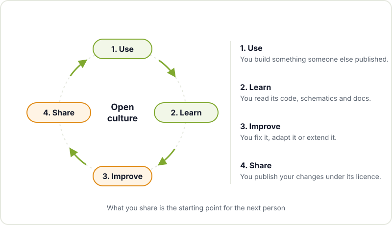
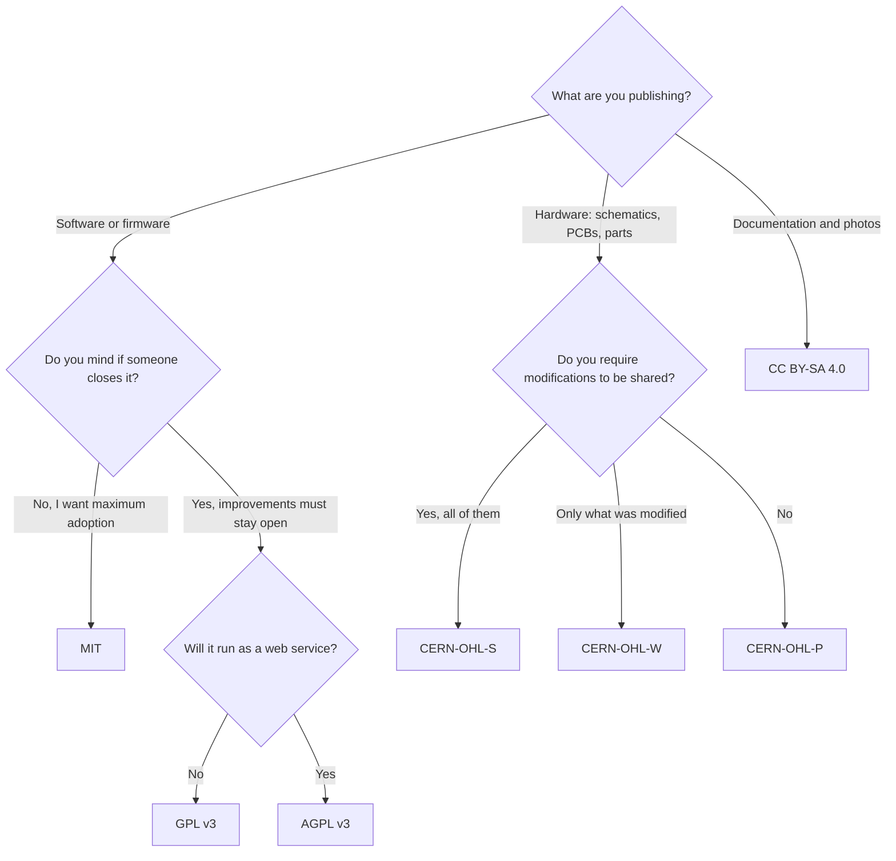
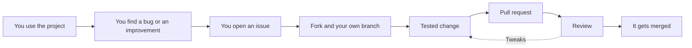

Almost everything you use in the workshop exists because someone decided to share their work. The IDE you program your Arduino with, the library that reads your temperature sensor, the KiCad footprint you used on your last PCB or the design of the 3D printer you have at home. That habit of publishing code, schematics and documentation so that anyone can use, study, modify and redistribute them is what we call open culture.

It isn't just a matter of principle. In this post we explain what free software and open hardware are, which licences you'll come across and, above all, what you specifically gain as a maker, both from using open projects and from publishing your own.

## Free software and open hardware

**Free software** starts from a simple idea: whoever receives a program should be able to run it, study how it works, modify it and share their versions. That requires access to the source code and a licence that allows it. The term "open source" came later with a more pragmatic focus, but in practice it covers almost the same projects.

**Open hardware** takes the same idea to physical objects. Since you can't download a board, what gets shared are its design sources: schematics, PCB files, Gerbers, 3D models, bill of materials and assembly instructions. The [OSHWA Open Source Hardware Definition](https://www.oshwa.org/definition/) (Open Source Hardware Association) sets out what has to be published for a design to count as genuinely open: the files in the format they are edited in, not just a PDF of the schematic.

A few examples you probably know:

- **Arduino.** The reference designs of its boards were published under an open licence. That's why there are hundreds of compatible boards from other manufacturers with the same pinout, and why anyone can design their own variant. The name "Arduino", however, is a registered trademark, which is why the clones go by other names.
- **RepRap and Prusa.** The [RepRap project](https://reprap.org/wiki/RepRap) started at a British university with the aim of creating a 3D printer able to make a good share of its own parts, and released everything under free licences. That community produced designs like the Prusa Mendel and the Prusa i3, which in turn inspired many of today's home printers.
- **KiCad.** The electronics design suite we use in the [KiCad workshop](/en/workshops/kicad/) is free software under the GPL. Its symbol and footprint libraries are largely maintained by the community.





## The cycle that makes it work

Open culture runs on a cycle you probably already practise without naming it: you use something someone else published, you learn from how it's made, you improve it for your use case and you share the result. What you publish becomes the next person's starting point.

## The licences you'll come across

Publishing something without a licence doesn't make it open: by default, all rights are reserved to the author and nobody can legally reuse it. The licence is what turns a public repository into a project people can actually use. These are the most common ones in the maker world:

| Licence | Type | Designed for | What it requires, in short |
|---|---|---|---|
| MIT | Permissive | Software | Keep the copyright notice and the licence text. It can be used in closed products. |
| GPL v3 | Strong copyleft | Software | If you distribute a modified version, it must ship with its source code and under the GPL. |
| AGPL v3 | Network copyleft | Software offered as a web service | The same as the GPL, and also when the program is used over a network without being distributed. |
| CC BY-SA 4.0 | Copyleft (share-alike) | Documentation, photos, illustrations, designs | Credit the author and publish derivative works under the same licence. |
| CERN-OHL v2 | For hardware, in three variants (S, W and P) | Schematics, PCBs, mechanical parts | The S variant requires publishing the sources of the modified design; W only of the parts you modify; P is permissive. |

Two important caveats. Creative Commons licences aren't designed for code, so use a software licence for your firmware. And for hardware, software licences are a poor fit because they talk about "code" and "compiling"; the [CERN-OHL licences](https://cern-ohl.web.cern.ch/) were written precisely for physical designs.

### How to choose a licence for your project

If in doubt, this flowchart is a good starting point. For more detail, the [Choose a License](https://choosealicense.com/) guide compares the most common software licences in plain language.

A complete maker project usually combines several: for example, MIT or GPL for the firmware, CERN-OHL for the PCB and the enclosure, and CC BY-SA for the documentation and photos.

## What you specifically gain

Beyond the philosophy, open culture has very practical benefits for anyone who builds things:

- **You learn from other people's work.** Reading the firmware of a project that works, or the schematic of a dev board, teaches you more than many tutorials. You see how they filter the power supply, how they organise the code or why that capacitor sits right next to that pin.
- **You can repair.** With the schematics and source code at hand, a failing device stops being a black box. You can track down the broken component, update firmware the manufacturer abandoned or adapt a spare part. When there's no documentation, you're left with [reverse engineering the PCB](/en/blog/pcb-reverse-engineering/), which is a lot more work.
- **You reuse instead of starting from scratch.** A verified footprint, a library that handles the sensor or a printable bracket that fits first time saves you hours and mistakes.
- **You build a reputation.** A repository of well-documented projects says more about you than a CV. Plenty of people have found jobs or collaborators thanks to what they published.
- **You find community.** When you publish, people show up who use your project, find bugs you couldn't see and suggest improvements. It's the same thing that happens in a [hackerspace](/en/blog/what-is-a-hackerspace/), but on a global scale.

## How to start contributing

You don't need to be an expert or write code to contribute to an open project. These are the most common ways, from least to most effort:

1. **Open useful issues.** If something breaks, report it properly: which board and version you're using, what you expected, what happened and how to reproduce it. A good bug report is worth a lot.
2. **Improve the documentation.** If an assembly step was hard to understand, someone else will struggle with it too. Clarifying it, adding a photo or fixing a badly documented pinout is a first-class contribution.
3. **Translate.** Many projects only exist in English. Translating the interface or the getting-started guide opens the project up to far more people.
4. **Send changes (pull requests).** Fix a bug, add support for another board or a new footprint. Read the project's contribution guide first and start with small changes.

## This website is open too

We practise what we preach: the code for this website is published under the [AGPL v3](https://www.gnu.org/licenses/agpl-3.0.html) licence, so anyone can study it, reuse it and propose improvements, as long as they keep their changes open. You'll find it, along with material from projects and workshops, on the [Hackerspace Valencia GitHub](https://github.com/HackerspaceVLC/). If you spot a typo in a post or something broken on the site, opening an issue or a pull request there is a great way to make your first contribution.

## Come and share what you make

Open culture is learnt by doing, and it's much easier with people around you. Drop by Hackerspace Valencia with that half-finished project: we'll help you document it, pick a licence and publish it. Have a look at our [projects](/en/proyectos/) to see what we've built as a community and, if you'd like to be part of it, [become a member](/en/pages/alta/).

## Image credits

The photographs come from [Wikimedia Commons](https://commons.wikimedia.org) and are used under their respective licences:

- **Cover** - *Mendel Mini* - jeanbaptisteparis - CC BY-SA 2.0 - [source](https://commons.wikimedia.org/wiki/File:Mendel_Mini.jpg)
- **Arduino Uno compatible board** - *Arduino Uno board* - JrawX - CC0 - [source](https://commons.wikimedia.org/wiki/File:Arduino_Uno_board.jpg)
- **Prusa i3 printer** - *Prusa i3 3D Printer - Reprap - Completed* - John Abella - CC BY 2.0 - [source](https://commons.wikimedia.org/wiki/File:Prusa_i3_3D_Printer_-_Reprap_-_Completed.jpg)
