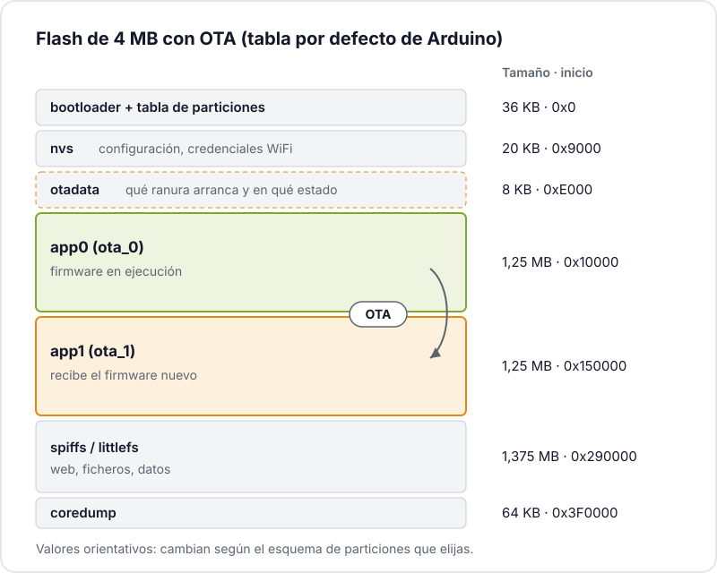
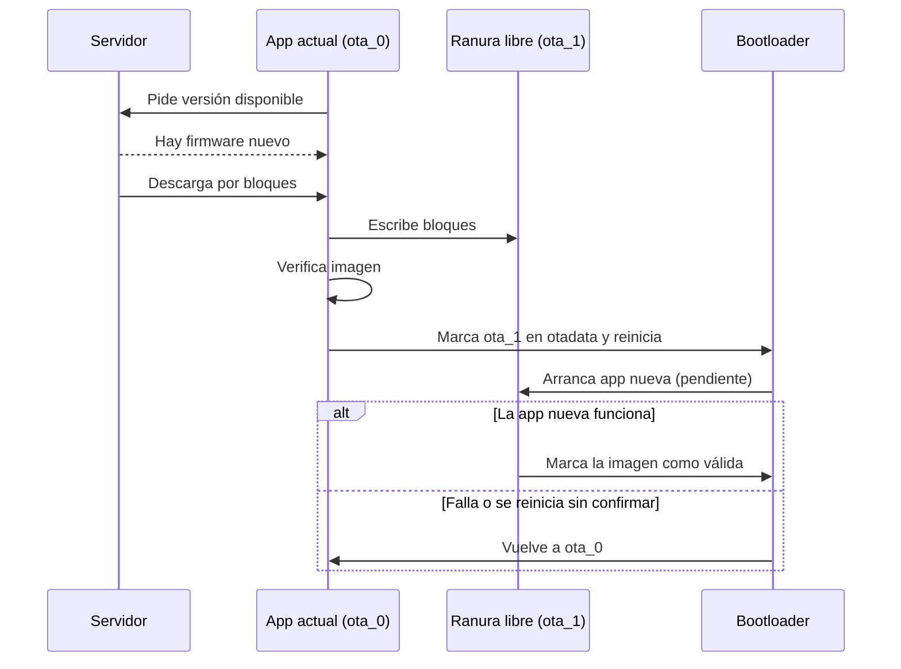

Llega un momento en todo proyecto con ESP32 en el que el cable USB deja de ser cómodo. La placa ya está dentro de su caja, atornillada detrás de un mueble o colgada en el techo del taller, y cada cambio de firmware implica desmontar. Ahí entra la actualización OTA (*Over-The-Air*): cargar un firmware nuevo a través de la red, sin tocar el hardware.

Parece una función de software más, pero no lo es. Que un dispositivo pueda actualizarse de forma segura depende de cómo repartas la memoria flash, de cómo lo alimentes, de la red a la que se conecte y de qué haga si algo sale mal a mitad de proceso. En este artículo repasamos esas piezas con el ESP32 como protagonista.

## Por qué OTA es una decisión de diseño, no un extra

La idea clave es sencilla: para actualizar sin riesgo, el dispositivo tiene que poder guardar el firmware nuevo **sin borrar el que está funcionando**. Solo cuando el nuevo está completo y verificado se cambia de uno a otro. Eso implica reservar espacio para, como mínimo, dos copias de la aplicación.



Si en tu primer prototipo usaste una tabla de particiones sin OTA para aprovechar al máximo la flash, añadirla más tarde obliga a reflashear por cable y a reorganizar todo. Por eso conviene decidirlo al principio, aunque la primera versión aún no use OTA. Lo mismo pasa con el tamaño: el firmware tiende a crecer (más librerías, una interfaz web, TLS) y cada ranura de aplicación debe tener margen para esas versiones futuras.

## El esquema de particiones A/B del ESP32

La flash del ESP32 se divide en particiones descritas en una tabla. Para OTA, las piezas importantes son:

- **nvs**: almacenamiento clave-valor para configuración (credenciales WiFi, calibraciones).
- **otadata**: un área pequeña que indica qué ranura de aplicación debe arrancar y en qué estado está cada una.
- **ota_0 y ota_1** (en Arduino se llaman `app0` y `app1`): las dos ranuras de aplicación. Una ejecuta el firmware actual; la otra recibe el nuevo.
- **spiffs** o **littlefs**: sistema de archivos para páginas web, ficheros de configuración o datos.



En la tabla por defecto del core Arduino para módulos de 4 MB, cada ranura de aplicación ronda 1,25 MB y queda algo más de 1,3 MB para el sistema de archivos. Si tu firmware no cabe, el IDE te deja elegir otros esquemas (por ejemplo, más espacio de aplicación a costa del sistema de archivos), o puedes definir tu propio `partitions.csv` en PlatformIO o ESP-IDF. La [guía de tablas de particiones de ESP-IDF](https://docs.espressif.com/projects/esp-idf/en/stable/esp32/api-guides/partition-tables.html) explica el formato.

Un cálculo rápido para dimensionar: firmware actual + firmware nuevo (del mismo tamaño máximo) + bootloader y tabla de particiones + configuración + datos que deban sobrevivir a la actualización. No hay una cifra universal; reserva margen sin pasarte, porque cada kilobyte que das a las ranuras se lo quitas al sistema de archivos.

## Tres maneras de hacer OTA con un ESP32

### ArduinoOTA: la vía rápida en red local

`ArduinoOTA` abre un servicio en el ESP32 y permite subir firmware desde el IDE de Arduino o PlatformIO como si fuera un puerto más. Es lo más cómodo para iterar en la mesa de trabajo, pero depende de mDNS, de que el puerto esté accesible y de que llames a `ArduinoOTA.handle()` con frecuencia en el `loop()`.

No siempre funciona a la primera. En la [radio por Internet con ESP32](/blog/radio-esp32-internet/) que tenemos en el hackerspace, el ESP32 respondía al ping y mDNS resolvía bien, pero el puerto de ArduinoOTA rechazaba las conexiones. La solución fue cambiar de método.

### Actualización por HTTP con la clase Update

El core Arduino incluye la clase `Update`, que escribe en la ranura libre cualquier flujo de bytes que le pases. Con ella puedes montar un endpoint `/update` en el servidor web del propio ESP32 y subir el `.bin` desde el navegador, o hacer lo contrario: que el ESP32 descargue periódicamente el firmware de un servidor tuyo. Es más fácil de depurar que ArduinoOTA porque todo pasa por HTTP. Espressif lo documenta en la guía de [actualización web OTA para Arduino-ESP32](https://docs.espressif.com/projects/arduino-esp32/en/latest/ota_web_update.html).

Un esqueleto mínimo de descarga desde servidor:

```cpp
#include <HTTPClient.h>
#include <Update.h>

bool actualizarDesde(const char* url) {
  HTTPClient http;
  http.begin(url);
  if (http.GET() != HTTP_CODE_OK) return false;

  int total = http.getSize();
  if (total <= 0 || !Update.begin(total)) return false;

  size_t escritos = Update.writeStream(*http.getStreamPtr());
  if (escritos != (size_t)total || !Update.end()) return false;

  ESP.restart();  // arranca desde la ranura nueva
  return true;
}
```

`Update.end()` comprueba que la imagen es coherente y marca la nueva ranura en `otadata`. Si se corta a mitad, la ranura activa sigue intacta.

### esp_https_ota en ESP-IDF

Si trabajas con ESP-IDF, el componente [esp_https_ota](https://docs.espressif.com/projects/esp-idf/en/stable/esp32/api-reference/system/esp_https_ota.html) hace todo el ciclo sobre HTTPS: conecta, valida el certificado del servidor, descarga por bloques, escribe en la ranura libre y la activa. Es la opción más robusta para dispositivos que vayan a vivir lejos de tu mesa.

## El proceso completo, con rollback

Descargar y escribir es la mitad del trabajo. La otra mitad es qué pasa en el primer arranque del firmware nuevo. ESP-IDF tiene un mecanismo de *rollback* (activable con `CONFIG_BOOTLOADER_APP_ROLLBACK_ENABLE`): la aplicación nueva arranca en estado "pendiente de verificar" y tiene que confirmar por sí misma que funciona. Si se reinicia antes de confirmarlo, el bootloader la descarta y vuelve a la anterior.



Qué significa "funciona" lo decides tú: que conecte a la WiFi, que llegue al servidor, que lea su sensor. Cuando se cumple, llamas a `esp_ota_mark_app_valid_cancel_rollback()`. Si detectas un problema grave, `esp_ota_mark_app_invalid_rollback_and_reboot()` fuerza la vuelta atrás. Todo esto está descrito en la [documentación oficial de OTA de Espressif](https://docs.espressif.com/projects/esp-idf/en/stable/esp32/api-reference/system/ota.html).

## Alimentación: el riesgo que se olvida

Escribir flash con la WiFi activa es de lo que más consume un ESP32. Si el proyecto va con baterías o con un panel solar, una actualización con la batería casi vacía puede provocar caídas de tensión y reinicios a mitad de escritura. El esquema A/B evita que el dispositivo quede inservible, pero lo sensato es no empezar la OTA si la tensión de batería está por debajo de un umbral. Si te interesa el tema, en [cómo reducir el consumo del ESP32](/blog/consumo-esp32/) repasamos cómo medir y gestionar la energía.

## Red y conectividad

En casa o en el taller lo normal es WiFi, pero en un huerto o una estación meteorológica la cobertura puede ser irregular. Algunas recomendaciones:

- Descarga por bloques y comprueba el tamaño total antes de activar la imagen.
- Reintenta con espera creciente en lugar de insistir sin pausa.
- Comprueba la versión antes de descargar para no bajar el mismo firmware una y otra vez.
- Si la red es muy limitada, valora si de verdad necesitas OTA o basta con una visita ocasional con el portátil.

## Seguridad: quién puede actualizar tu dispositivo

Un endpoint `/update` abierto en tu red es cómodo, pero cualquiera que esté en esa red podría cargar el firmware que quiera. Para un proyecto personal en tu LAN puede ser aceptable; para algo expuesto, no. Pasos razonables, de menos a más:

1. Protege el endpoint con usuario y contraseña, o desactívalo salvo cuando lo necesites.
2. Descarga solo por HTTPS y valida el certificado del servidor.
3. Firma las imágenes y verifica la firma antes de arrancarlas (*secure boot*).
4. Activa el *anti-rollback* (`CONFIG_BOOTLOADER_APP_ANTI_ROLLBACK`) para impedir que alguien cargue una versión antigua con fallos conocidos.

Secure boot y cifrado de flash queman eFuses y son irreversibles: pruébalos en una placa de sacrificio antes de aplicarlos a la buena.

## ¿Merece la pena en un proyecto maker?

No siempre. Si la placa está en tu mesa y la reprogramas cada día, el USB es más rápido. OTA compensa cuando el dispositivo es difícil de alcanzar, cuando tienes varias unidades repartidas (los sensores de toda la casa, por ejemplo) o cuando vas a mantenerlo durante años. En esos casos, dedicar una tarde a preparar particiones, rollback y un mínimo de seguridad te ahorra muchas escaleras.

## Ven a probarlo al hackerspace

Si tienes un ESP32 metido en una caja y quieres dejar de abrirla para cada cambio, tráelo al [Hackerspace Valencia](/blog/que-es-un-hackerspace/). Podemos revisar juntos la tabla de particiones, montar el endpoint de actualización y forzar un fallo a propósito para comprobar que el rollback funciona antes de que lo necesites de verdad. Y si te animas a quedarte, puedes [hacerte socio o socia](/pages/alta/).

## Créditos de imágenes

Los diagramas son originales del Hackerspace Valencia. Las fotografías proceden de [Wikimedia Commons](https://commons.wikimedia.org):

- **Portada** - *ESP32-C3 with Traffic Light Module* - DavesCodeMusings - CC0 - [fuente](https://commons.wikimedia.org/wiki/File:ESP32-C3_with_Traffic_Light_Module.jpg)
- **Módulo ESP32-WROOM-32** - *ESP32 Espressif ESP-WROOM-32 Shielded* - Ubahnverleih - CC0 - [fuente](https://commons.wikimedia.org/wiki/File:ESP32_Espressif_ESP-WROOM-32_Shielded.jpg)
