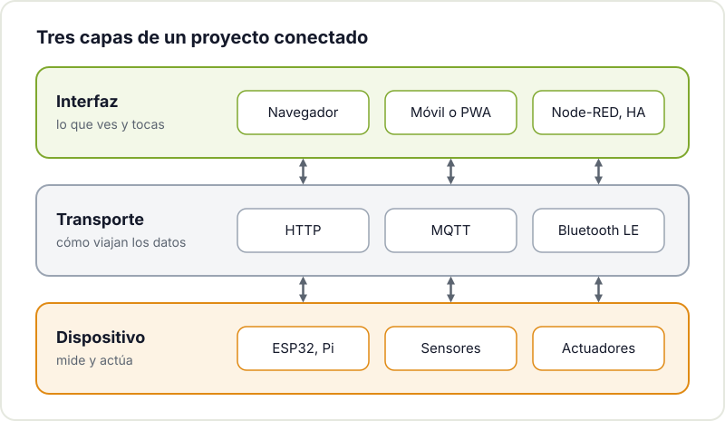
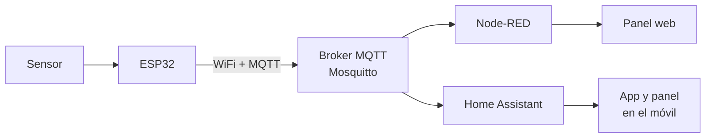

Tu proyecto ya mide la temperatura, cuenta pasos o mueve un servo. Ahora quieres verlo desde el móvil, encenderlo desde el sofá o enseñar una gráfica de la última semana. Es el momento de darle una interfaz, y aquí es donde muchos makers se frenan: parece que hace falta aprender desarrollo web, bases de datos y apps nativas a la vez.

No es así. Hay opciones para todos los niveles, desde una página de cuatro botones que sirve el propio ESP32 hasta un panel completo en Home Assistant sin escribir casi código. Esta guía repasa las más útiles y te ayuda a elegir.

## Piensa en tres capas

Antes de elegir herramienta, separa el problema en tres partes. Casi cualquier proyecto conectado se puede describir así:



- **Dispositivo**: el ESP32, Arduino o Raspberry Pi que lee sensores y mueve actuadores.
- **Transporte**: cómo viajan los datos. HTTP, MQTT o Bluetooth, normalmente.
- **Interfaz**: lo que ves y tocas. Una web, un panel, una app en el móvil.

La ventaja de pensar así es que puedes empezar con lo más simple y cambiar una capa después. Si hoy el ESP32 sirve su propia web y mañana quieres Home Assistant, el sensor y su código de lectura siguen siendo los mismos.

## Las opciones, de menos a más

| Opción | Complejidad | Qué necesitas | Ideal para |
|---|---|---|---|
| Web servida por el ESP32 | Baja | Solo el ESP32 | Controlar un dispositivo desde la red local |
| Web Bluetooth | Baja-media | ESP32 con BLE, Chrome o Edge | Configurar algo sin WiFi, de cerca |
| MQTT + Node-RED | Media | Una Raspberry Pi o servidor | Varios dispositivos, automatizaciones, paneles rápidos |
| Home Assistant | Media | Una Raspberry Pi o servidor | Domótica, integrar con otros aparatos de casa |
| Panel con Flask o FastAPI | Media-alta | Python en un servidor | Interfaces a medida, guardar históricos |
| Web estática con Hugo | Baja-media | Un hosting estático | Documentar y enseñar el proyecto |
| PWA | Media-alta | Conocer HTML, CSS y JavaScript | Una "app" instalable sin pasar por tiendas |

## Web servida por el propio ESP32

El ESP32 puede montar un servidor web pequeño: te conectas a su IP desde el navegador y ves una página con botones y valores. No hace falta nada más que la placa, y es la forma más directa de controlar un relé, una tira de LEDs o leer un sensor desde el móvil.

En el entorno Arduino se usa la librería `WebServer` incluida en el [núcleo Arduino para ESP32](https://docs.espressif.com/projects/arduino-esp32/en/latest/); en ESP-IDF tienes el componente [servidor HTTP](https://docs.espressif.com/projects/esp-idf/en/stable/esp32/api-reference/protocols/esp_http_server.html). El ESP32 puede incluso crear su propia red WiFi (modo punto de acceso) para cuando no hay router.

Sus límites: la página vive dentro del firmware, cada cambio de diseño implica reflashear, y si tienes varios dispositivos acabas con varias webs separadas. Para un dispositivo suelto es perfecta. Si quieres ver un caso real, en la [radio por Internet con ESP32](/blog/radio-esp32-internet/) un miembro del hackerspace le añadió una interfaz web.

## MQTT y Node-RED

Cuando tienes más de un dispositivo, conviene que no hablen directamente con la interfaz, sino con un intermediario. Eso es [MQTT](https://mqtt.org/): un protocolo ligero de publicación y suscripción. Los dispositivos publican mensajes en "temas" (por ejemplo `taller/sensor1/temperatura`) en un servidor llamado broker, y cualquiera interesado se suscribe a ellos. El broker más habitual es [Mosquitto](https://mosquitto.org/), que corre sin problemas en una Raspberry Pi.



Este es el código mínimo para que un ESP32 publique una lectura cada diez segundos con la librería PubSubClient:

```cpp
#include <WiFi.h>
#include <PubSubClient.h>

const char* WIFI_SSID = "tu-red";
const char* WIFI_PASS = "tu-clave";
const char* MQTT_HOST = "192.168.1.50";  // IP de la Raspberry Pi con Mosquitto

WiFiClient wifi;
PubSubClient mqtt(wifi);
unsigned long ultimoEnvio = 0;

void setup() {
  WiFi.begin(WIFI_SSID, WIFI_PASS);
  while (WiFi.status() != WL_CONNECTED) delay(500);
  mqtt.setServer(MQTT_HOST, 1883);
}

void loop() {
  if (!mqtt.connected()) {
    if (!mqtt.connect("esp32-taller")) { delay(2000); return; }
  }
  mqtt.loop();

  if (millis() - ultimoEnvio > 10000) {
    ultimoEnvio = millis();
    int luz = analogRead(34);  // por ejemplo, una LDR en el GPIO34
    mqtt.publish("taller/sensor1/luz", String(luz).c_str());
  }
}
```

Puedes comprobar que llega desde cualquier ordenador con `mosquitto_sub -h 192.168.1.50 -t 'taller/#' -v`.

Con los datos en el broker, [Node-RED](https://nodered.org/docs/) te deja construir la lógica uniendo bloques en el navegador: recibir el mensaje, transformarlo, guardarlo, mandar un aviso si pasa de un umbral. Con el paquete de dashboard añades gráficas, indicadores y botones en minutos. Es una forma estupenda de tener un panel sin escribir HTML.

## Home Assistant

Si tu proyecto vive en casa, [Home Assistant](https://www.home-assistant.io/docs/) probablemente sea la mejor interfaz que no tendrás que programar. Se instala en una Raspberry Pi o un servidor, tiene app para móvil y se integra con MQTT, con bombillas y enchufes comerciales y con muchísimos aparatos más.

Para dispositivos con ESP32 existe además ESPHome, que genera el firmware a partir de un fichero de configuración YAML: describes qué sensor está en qué pin y el dispositivo aparece solo en Home Assistant. Para proyectos de domótica estándar ahorra mucho trabajo; para algo muy a medida, el firmware propio con MQTT te da más control.

## Un panel propio con Python

Cuando quieres algo hecho a tu medida, como guardar el histórico en una base de datos o una página con tu propio diseño, un pequeño servidor en Python es el siguiente paso. [Flask](https://flask.palletsprojects.com/) es mínimo y fácil de entender; [FastAPI](https://fastapi.tiangolo.com/es/) está pensado para APIs y genera documentación automática.

Un ejemplo con Flask que recibe lecturas por HTTP y las muestra:

```python
from flask import Flask, request, jsonify

app = Flask(__name__)
lecturas = []

@app.post("/api/lectura")
def nueva_lectura():
    lecturas.append(request.get_json())  # p. ej. {"sensor": "luz", "valor": 512}
    del lecturas[:-100]                   # guarda solo las 100 últimas
    return {"ok": True}

@app.get("/api/lecturas")
def listar():
    return jsonify(lecturas)

@app.get("/")
def inicio():
    filas = "".join(f"<li>{l['sensor']}: {l['valor']}</li>" for l in reversed(lecturas))
    return f"<h1>Taller</h1><ul>{filas}</ul>"

if __name__ == "__main__":
    app.run(host="0.0.0.0", port=5000)
```

El ESP32 solo tiene que hacer un `POST` con `HTTPClient`, y tú ves los datos en `http://ip-del-servidor:5000`. A partir de ahí puedes añadir SQLite para el histórico o una gráfica con JavaScript. Para dejarlo funcionando de forma permanente en una Raspberry Pi, conviértelo en un servicio de systemd como explicamos en [empezar con Linux](/blog/empezar-con-linux/).

## Una web estática para enseñar el proyecto

No todo es controlar en tiempo real. A veces lo que necesitas es documentar: fotos, esquemas, el código y cómo se montó. Para eso, una web estática generada con [Hugo](https://gohugo.io/documentation/) es rápida, gratuita de alojar y no necesita servidor propio. Esta misma web está hecha con Hugo, y en el hackerspace hicimos un taller para [crear tu portfolio con Hugo y desplegarlo](/workshops/portfolio/). Si buscas inspiración, echa un vistazo a cómo documentamos los [proyectos del hackerspace](/proyectos/).

## Una app en el móvil sin tienda de aplicaciones

Hacer una app nativa para Android o iOS es un proyecto en sí mismo. Para la mayoría de proyectos maker hay dos atajos mejores:

- **Web Bluetooth**: una página web que se conecta directamente a tu ESP32 por Bluetooth Low Energy, sin WiFi ni servidor. Funciona en Chrome y Edge (en escritorio y Android), pero no en Safari ni Firefox. La [documentación de Web Bluetooth en MDN](https://developer.mozilla.org/en-US/docs/Web/API/Web_Bluetooth_API) explica la API y su compatibilidad. Es ideal para configurar un dispositivo o controlarlo de cerca.
- **PWA (aplicación web progresiva)**: una web con un manifiesto y un service worker que el móvil puede instalar en la pantalla de inicio y abrir a pantalla completa, como si fuera una app. MDN tiene una buena [introducción a las PWA](https://developer.mozilla.org/es/docs/Web/Progressive_web_apps). Encaja muy bien como interfaz de tu servidor Flask o de tu API.

## Cómo elegir

Una regla práctica: empieza por la opción más sencilla que resuelva tu problema hoy.

- Un dispositivo, uso en casa o en el taller: web en el ESP32.
- Varios dispositivos o automatizaciones: MQTT con Node-RED o Home Assistant.
- Algo muy a medida o con histórico: Flask o FastAPI.
- Enseñar el proyecto al mundo: web estática.

Si estás empezando con la placa, mira antes nuestras guías para [empezar con el ESP32](/blog/empezar-con-esp32/) y la [introducción a los sistemas embebidos](/blog/introduccion-sistemas-embebidos/). Y si el código todavía te cuesta, empieza por [cómo empezar a programar si eres maker](/blog/empezar-a-programar/).

## Tráelo al hackerspace

La mejor forma de decidir es ver funcionando unas cuantas opciones. Trae tu proyecto al [Hackerspace Valencia](/blog/que-es-un-hackerspace/): seguro que alguien ya tiene un broker montado, un panel de Node-RED a medias o una idea para tu interfaz. Mira los [próximos talleres](/workshops/) y, si quieres formar parte, [hazte socio/a](/pages/alta/).

## Créditos de imágenes

La fotografía procede de [Wikimedia Commons](https://commons.wikimedia.org) y se utiliza bajo su licencia:

- **Portada** - *ESP32 Dev Board* - Edwiyanto - CC BY-SA 4.0 - [fuente](https://commons.wikimedia.org/wiki/File:ESP32_Dev_Board.jpg)
