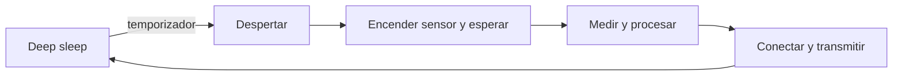
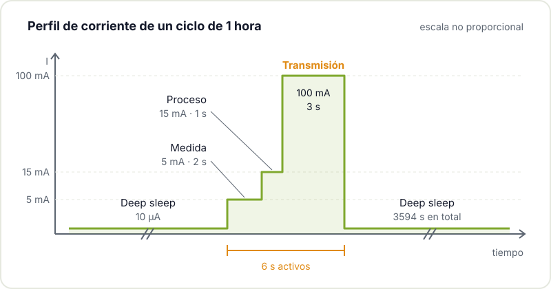
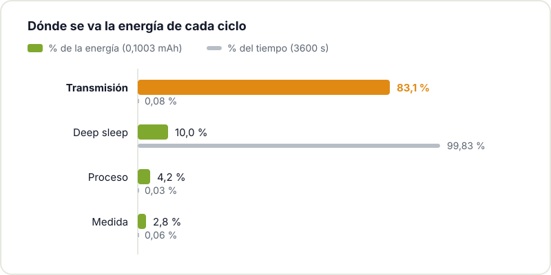

Tienes una estación meteorológica con un ESP32, una batería de 2000 mAh y la pregunta de siempre: ¿cuánto va a durar? La cuenta rápida, capacidad dividida entre consumo, casi nunca acierta, porque un nodo IoT no consume una corriente fija. Pasa la mayor parte del tiempo dormido, se despierta, mide, piensa, transmite y vuelve a dormir. Cada una de esas fases tiene una corriente y una duración muy distintas, y lo que vacía la batería es la combinación de las dos.

En este artículo vemos cómo hacer la estimación bien, con un ejemplo completo y un pequeño script para que lo adaptes a tu proyecto.

## Piensa en ciclos, no en corrientes

El punto de partida es describir con precisión qué hace tu dispositivo en un ciclo completo. Para un sensor ambiental típico, el ciclo es algo así:



Para cada fase necesitas dos números: la corriente que consume **todo el producto** (no solo el microcontrolador) y el tiempo que dura. La energía de cada fase es simplemente:

```text
carga de la fase (mAh) = corriente (mA) × tiempo (h)
```

Sumas todas las fases y tienes la carga por ciclo. Multiplicas por los ciclos al día y tienes el consumo diario. Divides la capacidad útil de la batería entre ese consumo y obtienes los días de autonomía. Ojo con las unidades: mezclar µA, mA, segundos y horas es la fuente de error más habitual.

## Un ejemplo completo

Supongamos un nodo que mide y transmite una vez por hora, con estas fases:

| Fase | Corriente | Tiempo por ciclo | Carga por ciclo |
|---|---|---|---|
| Deep sleep | 10 µA | 3594 s | 0,0100 mAh |
| Medida | 5 mA | 2 s | 0,0028 mAh |
| Proceso | 15 mA | 1 s | 0,0042 mAh |
| Transmisión | 100 mA | 3 s | 0,0833 mAh |
| **Total** | | **3600 s** | **0,1003 mAh** |

Con 24 ciclos al día salen **2,41 mAh/día**. Si de la batería podemos aprovechar 2000 mAh útiles, la autonomía teórica es 2000 / 2,41 ≈ **830 días**, algo más de dos años y cuarto. Dicho de otra forma, la corriente media del nodo es de unos 100 µA.



Fíjate en lo que dice la tabla. La transmisión dura solo 3 segundos, pero se lleva más del 80 % de la energía del ciclo. El deep sleep consume 10.000 veces menos corriente, pero como ocupa casi toda la hora acaba pesando más que la medida y el proceso juntos. Comparar corrientes instantáneas sin mirar el tiempo lleva a optimizar lo que no importa.



## Haz las cuentas con un script

Este script en Python reproduce la tabla. Cambia las fases, el periodo y la capacidad y tienes tu estimación en segundos:

```python
# Autonomía estimada de un nodo IoT a partir de su ciclo de trabajo
CICLO_S = 3600            # un ciclo por hora
CAPACIDAD_UTIL_MAH = 2000 # capacidad útil, no la nominal

# (nombre, corriente en mA, duración en s)
fases = [
    ("medida",        5.0, 2),
    ("proceso",      15.0, 1),
    ("transmisión", 100.0, 3),
]
SLEEP_MA = 0.010          # 10 µA del producto completo dormido

activo_s = sum(t for _, _, t in fases)
fases.append(("deep sleep", SLEEP_MA, CICLO_S - activo_s))

total_mah = 0.0
for nombre, i_ma, t_s in fases:
    mah = i_ma * t_s / 3600   # mA·s -> mAh
    total_mah += mah
    print(f"{nombre:<12} {i_ma:>8.3f} mA {t_s:>6} s {mah:.5f} mAh")

ciclos_dia = 86400 / CICLO_S
dia_mah = total_mah * ciclos_dia
dias = CAPACIDAD_UTIL_MAH / dia_mah

print(f"\nPor ciclo: {total_mah:.4f} mAh")
print(f"Por día:   {dia_mah:.2f} mAh")
print(f"Autonomía: {dias:.0f} días ({dias / 365:.1f} años)")
```

Con los valores del ejemplo imprime 0,1003 mAh por ciclo, 2,41 mAh al día y 831 días. Juega con él: si la cobertura es mala y la transmisión pasa de 3 a 6 segundos con reintentos, la autonomía cae a unos 450 días. Si el producto dormido consume 100 µA en lugar de 10 por culpa de un LED o un regulador, baja a unos 440. Si en vez de cada hora mides cada 15 minutos, te quedas en unos 225 días.

## Las fuentes de consumo, una a una

### El sueño es casi todo el tiempo

En un diseño de larga duración, el dispositivo pasa más del 99 % del tiempo durmiendo. Ahí unos pocos microamperios de más se acumulan sin piedad. El dato que necesitas no es el deep sleep del datasheet del chip, sino lo que consume la placa entera dormida: regulador, divisores de tensión siempre conectados, el sensor en standby, el conversor USB-serie de la placa de desarrollo y el LED de encendido. En una ESP32 DevKit típica esos extras pueden superar con mucho al propio chip; lo contamos con detalle en [cómo reducir el consumo del ESP32](/blog/consumo-esp32/).

### Sensores y tiempo de estabilización

El sensor no consume solo durante la lectura. Hay que alimentarlo, esperar a que se estabilice, leer y apagarlo. Un sensor de gas con calefactor o uno que necesita cientos de milisegundos para arrancar puede dominar el ciclo. Revisa en el datasheet el tiempo de arranque real y apágalo del todo entre medidas si es posible, mejor con un MOSFET que lo desconecte que confiando en su modo de bajo consumo.

### Procesar rápido también ahorra

Más corriente no siempre significa menos autonomía. Si subir la frecuencia del procesador hace que la tarea termine antes y vuelva a dormir antes, la energía total puede ser menor. Lo mismo con el firmware: eliminar esperas con `delay()` innecesarias o inicializaciones repetidas recorta segundos activos sin tocar el hardware.

### La radio manda

La comunicación inalámbrica suele ser la fase de mayor corriente, y en el ejemplo se lleva la mayor parte de la energía. Su impacto depende de cuántas veces transmites, cuántos datos envías y cuánto tarda la conexión. Con la WiFi del ESP32, asociarse al punto de acceso y obtener IP por DHCP lleva su tiempo; usar IP fija o enviar varios datos acumulados de una vez son de las mejoras más rentables. Filtrar en local y transmitir solo cuando algo cambia suele ganar más que cualquier otra optimización.

### Los picos y la batería

La corriente media no cuenta toda la historia. Los picos de transmisión del ESP32 pueden ser bastante más altos que la media de la fase, y la batería tiene resistencia interna: si cae demasiado la tensión durante el pico, el chip se reinicia aunque quede carga. Es muy típico con pilas alcalinas viejas o con frío. Un buen condensador de reserva cerca del módulo ayuda, y el regulador tiene que aguantar esos picos. Las [guías de diseño hardware del ESP32 de Espressif](https://docs.espressif.com/projects/esp-hardware-design-guidelines/en/latest/esp32/) detallan el desacoplo recomendado en la alimentación del chip.

### El regulador también consume

La energía que sale de la batería no llega íntegra al circuito. Un LDO desperdicia la diferencia de tensión en calor y un DC/DC tiene pérdidas propias. Además, ambos tienen corriente de reposo, que en un nodo que duerme casi siempre puede ser decisiva. Muchos convertidores tienen una eficiencia excelente a plena carga y muy pobre con microamperios. Lo comparamos en [LDO vs DC/DC](/blog/ldo-vs-dc-dc/).

## Capacidad nominal frente a capacidad útil

Los 2000 mAh de la etiqueta son una referencia, no lo que vas a poder usar. La capacidad útil depende de la temperatura, del perfil de descarga, de los picos de corriente, de la resistencia interna y, sobre todo, de la tensión mínima a la que tu circuito deja de funcionar. Si tu ESP32 necesita 3,0 V después del regulador y la batería ya no los da con un pico de 300 mA, la energía que quede dentro no te sirve. A eso súmale el envejecimiento: tras un par de años la batería no rinde como nueva. La [ley de Peukert](https://en.wikipedia.org/wiki/Peukert%27s_law) describe cómo la capacidad efectiva cae al aumentar la corriente de descarga, sobre todo en químicas como el plomo-ácido.



Por eso en el ejemplo hablamos de 2000 mAh útiles: si tu celda es de 2000 nominales, aplica un margen y calcula con menos. Si quieres profundizar en cómo se comportan las celdas con la carga, la temperatura y los ciclos, la entrada de Wikipedia sobre la [batería de ion de litio](https://es.wikipedia.org/wiki/Bater%C3%ADa_de_ion_de_litio) es un buen punto de partida.

## Diseña para un caso malo pero realista

El nodo de tu balcón no vive en el banco de trabajo. Fuera hace frío en invierno y mucho calor en verano, la cobertura WiFi no es la del salón y la batería envejece. Haz la estimación con un escenario desfavorable razonable: temperatura del sitio real, reintentos de conexión, batería algo degradada. Si con eso sigues cumpliendo, vas bien.

## Mide el prototipo cuanto antes

Las cuentas orientan, pero solo la medida confirma. Con un multímetro puedes comprobar la corriente en reposo, pero los picos y las fases cortas necesitan algo más: una resistencia shunt pequeña en serie con la alimentación leída con un osciloscopio, o un perfilador de energía USB de los que registran la corriente en el tiempo. Para entender qué queda encendido en cada modo de sueño, la referencia es la documentación de [modos de sueño del ESP32 de Espressif](https://docs.espressif.com/projects/esp-idf/en/stable/esp32/api-reference/system/sleep_modes.html). Busca:

- La corriente real dormido, con todo montado.
- La duración real de cada fase activa.
- Cuánto tarda de verdad la transmisión en el sitio final.
- Bloques que se quedan encendidos más de lo previsto.

Mide pronto, cuando todavía puedes cambiar de regulador o de sensor sin rehacer la PCB.

## Cómo ganar autonomía

Casi siempre sale más a cuenta bajar la energía por ciclo que poner una batería más grande:

- **Acorta las fases activas**: quita esperas, inicializa solo lo necesario.
- **Mide y transmite menos**: agrupa datos, adapta la frecuencia a lo que de verdad necesitas.
- **Apaga lo que no uses**: desconectar del todo un bloque suele ser mejor que dejarlo en standby.
- **Elige bien el regulador**: mira la corriente de reposo y la eficiencia a carga baja, no solo el rendimiento máximo.
- **Decide la batería al principio**: batería, consumo, radio y alimentación dependen unos de otros. Elegirlos juntos antes de diseñar la placa evita sorpresas.
- **Valora la recolección de energía**: un pequeño panel solar puede hacer el nodo prácticamente autónomo si el consumo es lo bastante bajo.

## Tráelo al hackerspace

Si tienes un nodo con batería que no dura lo que debería, tráelo al [Hackerspace Valencia](/blog/que-es-un-hackerspace/). Entre todos medimos el ciclo real, buscamos la fuga y hacemos las cuentas con tus números. Y si te animas a pasar del prototipo a tu propia placa, échale un ojo a [del kit a la PCB propia](/blog/del-kit-a-la-pcb-propia/) y a nuestro [taller de KiCad](/workshops/kicad/).

## Créditos de imágenes

- **Portada** - *Meshtastic T-Beam* - Chiffre01 - CC0 - [fuente](https://commons.wikimedia.org/wiki/File:Meshtastic_T-Beam.jpg)
- **Celdas 18650 y 21700** - *18650 and 21700 lithium ion battery cell* - Sevenethics - CC0 - [fuente](https://commons.wikimedia.org/wiki/File:18650_and_21700_lithium_ion_battery_cell.jpg)
- Diagramas: elaboración propia del Hackerspace Valencia.
