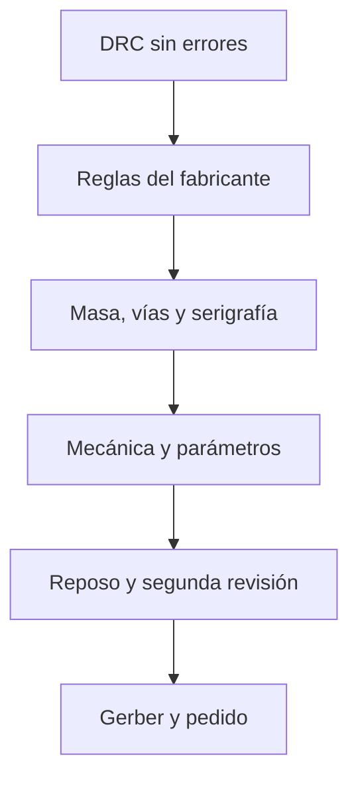
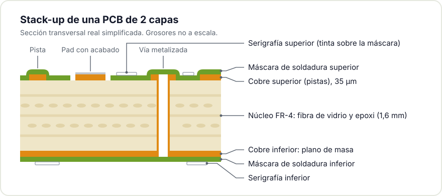
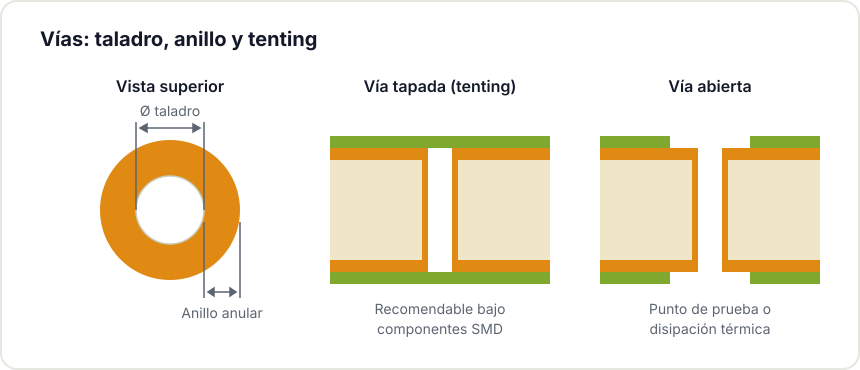

Enviar una PCB a fabricación es el último paso del diseño y también el punto donde los errores resultan más costosos: se detectan cuando la placa ya está pagada y montada. La mayoría de esos fallos se evitan con una revisión sistemática antes de generar los archivos de fabricación. Esta guía recoge la checklist que aplicamos en el Hackerspace Valencia antes de encargar una placa.

## 1. Ejecutar el verificador de reglas de diseño (DRC)

Es el primer paso y, aun así, con frecuencia se omite. [Ejecuta el DRC](https://docs.kicad.org/10.0/es/pcbnew/pcbnew.html#design-rule-checking) y trata cada error o advertencia como un posible fallo de fabricación: pistas con separación insuficiente, vías sin conexión o pads demasiado cerca del borde de la placa. Si tu herramienta lo permite, define [reglas personalizadas](/blog/kicad-10-novedades/) con los valores reales de tu fabricante en lugar de los valores genéricos.

## 2. Conocer las capacidades del fabricante

Cada fabricante documenta sus límites de proceso (por ejemplo, las [capacidades de fabricación de JLCPCB](https://jlcpcb.com/capabilities/pcb-capabilities)): ancho mínimo de pista, tamaño mínimo de vía, separación mínima entre cobre, número de capas y grosor de cobre. Estos valores no son opiniones, son especificaciones del proceso. Diseñar por debajo de esos límites implica que rechacen el pedido o que la placa se fabrique con defectos. Consulta estos valores antes de comenzar el diseño y ajusta el layout a ellos.

## 3. Revisar el plano de masa

Un plano de masa continuo en la capa inferior mejora el ruido, la disipación térmica y la integridad de señal. Los problemas aparecen cuando el plano presenta cortes: pistas que lo dividen, perforaciones que lo fragmentan en islotes o conexiones que fuerzan corrientes de retorno por caminos largos. Verifica que el plano es continuo donde debe serlo y analiza el recorrido de las corrientes de retorno. Esta comprobación evita buena parte de los comportamientos anómalos difíciles de diagnosticar.

## 4. Verificar las vías

El diámetro de perforación y el anillo de cobre de cada vía deben respetar los mínimos del fabricante. Las vías situadas bajo [componentes de montaje superficial](/blog/soldar-smd/) pueden causar defectos de soldadura si no se tapan, porque la pasta puede filtrarse por el interior durante el reflejado. Decide qué vías se tapan con máscara (tenting) y cuáles permanecen abiertas por accesibilidad o disipación térmica.

## 5. Comprobar máscara de soldadura y serigrafiado

El serigrafiado, la capa de texto impresa sobre la placa, funciona como documentación de montaje. Incluye referencias claras para cada componente, la polaridad de condensadores electrolíticos y diodos, el pin 1 de cada integrado y la orientación de los conectores. Comprueba que ningún texto cae sobre los pads: en esas zonas la tinta no se imprime y la referencia se pierde. Una placa bien serigrafiada se monta más rápido y con menos errores.



## 6. Validar conectores y mecánica

Antes de generar los archivos, comprueba que los conectores ocupan la posición prevista, que el paso de pines es correcto y que la placa encaja en su alojamiento, agujeros de fijación incluidos. Un conector invertido o desplazado medio milímetro puede impedir el montaje en la carcasa. Si utilizas conectores polarizados, marca de forma visible la posición del pin 1.

## 7. Revisar los parámetros de fabricación

Al realizar el pedido se definen varios parámetros que afectan al precio y al resultado:

- Grosor de la placa, habitualmente 1,6 mm.
- Peso de cobre, normalmente 1 oz (35 µm).
- Acabado de superficie: estañado plano ([HASL](https://en.wikipedia.org/wiki/Hot_air_solder_leveling)), oro sobre níquel ([ENIG](https://en.wikipedia.org/wiki/Electroless_nickel_immersion_gold)) u otros, cada uno con su equilibrio entre coste, soldabilidad y durabilidad.
- Color de la máscara de soldadura y del serigrafiado.

Selecciona los parámetros según los requisitos del proyecto, no por criterios estéticos.

## 8. Preparar fiduciales y panelización

Si vas a montar componentes de forma automática, la placa necesita [fiduciales](https://en.wikipedia.org/wiki/Fiducial_marker): marcas de referencia que la máquina de ensamblaje utiliza para orientarse. Si fabricas varias unidades, la panelización, es decir, agrupar varias placas en un panel mayor, reduce el coste unitario. Consulta con el fabricante el formato de panel que prefiere.

## 9. Realizar una revisión final con perspectiva

Cuando el diseño parezca terminado, guárdalo y déjalo reposar al menos un día. Revísalo después con una mirada nueva: los errores menos evidentes aparecen en esa segunda pasada. Si es posible, pide a otra persona que revise el diseño; una mirada externa detecta fallos que el autor, tras muchas horas de trabajo, ya no percibe.

## Resumen rápido

- DRC ejecutado, sin errores ni advertencias sin justificar.
- Reglas ajustadas a las capacidades reales del fabricante.
- Plano de masa continuo y corrientes de retorno por caminos cortos.
- Vías dentro de mínimos y decisión tomada sobre tenting.
- Serigrafiado completo, sin texto sobre los pads.
- Conectores y agujeros verificados contra la mecánica del conjunto.
- Parámetros de fabricación elegidos según requisitos del proyecto.

Si es [tu primera placa](/blog/del-kit-a-la-pcb-propia/) y quieres una revisión antes de enviarla, tráela al Hackerspace Valencia: la revisamos entre varios miembros y solemos detectar detalles que el autor, por cercanía al diseño, ya no ve.

¿Quieres aprender a diseñarla desde cero? Pásate por nuestro [taller de KiCad](/workshops/kicad/), repasa la [guía de recursos de electrónica para makers](/blog/recursos-electronica-makers/) o [hazte socio/a](/pages/alta/) para usar el taller cuando quieras.

## Créditos de imágenes

- **Fiduciales y serigrafía** - *Fiducial Marker PCB*, de wdwd - CC BY-SA 3.0 - [fuente](https://commons.wikimedia.org/wiki/File:Fiducial_Marker_PCB.JPG)
