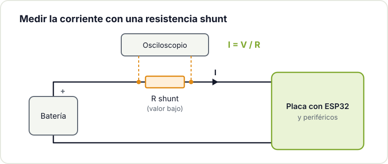
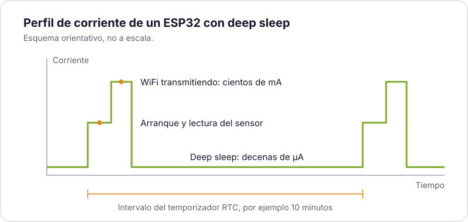
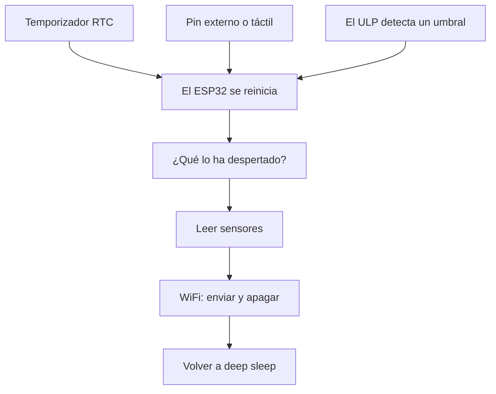

En muchos proyectos no es posible disponer de una alimentación constante: un sensor en el huerto, una estación meteorológica en la terraza o un nodo IoT lejos de cualquier enchufe dependen de baterías o de un panel solar. En esos casos, optimizar el consumo deja de ser un detalle y pasa a decidir cuánto tiempo funciona el dispositivo sin intervención. El [ESP32](/blog/empezar-con-esp32/) es un buen ejemplo: con la WiFi transmitiendo puede demandar varios cientos de miliamperios, lo que con una batería [reduce la autonomía](/blog/autonomia-real-bateria-iot/) a pocos días. Pero también dispone de modos de bajo consumo que lo dejan en microamperios cuando no tiene nada que hacer. En este artículo vemos cómo mejorar su eficiencia energética, desde medir el consumo real hasta el deep sleep y el coprocesador ULP.

## Medir el consumo real

Antes de modificar nada, mide cuánto consume tu montaje. Necesitas un medidor de bajo consumo o, preferiblemente, una [resistencia shunt](https://en.wikipedia.org/wiki/Shunt_%28electrical%29) de bajo valor en serie con la alimentación, leyendo la caída de tensión con un osciloscopio o un multímetro sensible. Sin medición no hay diagnóstico: una placa que se supone en microamperios puede tener un LED de alimentación consumiendo veinte miliamperios de forma permanente.





## Cuánto consume el ESP32 en cada modo

El ESP32 tiene varios modos de funcionamiento, y la diferencia entre ellos es enorme. Estas son las cifras del propio chip según el [datasheet de Espressif](https://documentation.espressif.com/esp32_datasheet_en.pdf) (tablas 4-2 y 5-4):

| Modo | Qué sigue funcionando | Consumo típico |
|---|---|---|
| Activo, WiFi transmitiendo | Todo, con la radio emitiendo | 180 a 240 mA |
| Activo, WiFi recibiendo | Todo, con la radio escuchando | 95 a 100 mA |
| Modem sleep | CPU en marcha, radio apagada | 20 a 68 mA (según frecuencia) |
| Light sleep | CPU en pausa, RAM y periféricos RTC | 0,8 mA |
| Deep sleep | Solo el RTC y su memoria | 10 µA (150 µA con el ULP activo) |
| Hibernación | Solo un temporizador RTC | 5 µA |

Ojo: son cifras **del chip**. Una placa de desarrollo añade su regulador, el conversor USB-serie y el LED de alimentación, y es habitual que una DevKit en deep sleep consuma varios miliamperios en lugar de microamperios. Por eso el primer paso de verdad es el siguiente.

## Desactivar periféricos innecesarios

El consumo bajo empieza por controlar lo que permanece alimentado. El LED de alimentación de muchas placas de desarrollo consume más que el ESP32 en modo de bajo consumo: si es posible, retíralo o corta su pista. Aplica el mismo criterio a los [reguladores auxiliares](/blog/ldo-vs-dc-dc/) (busca uno con corriente de reposo baja), al conversor USB a UART y a cualquier circuito que permanezca activo mientras el ESP32 duerme.

Los sensores también cuentan. Si un sensor no tiene modo de reposo propio, aliméntalo desde un pin del ESP32 o a través de un pequeño MOSFET, de forma que solo reciba tensión mientras lo lees. Lo mismo con los divisores de tensión para medir la batería: con resistencias de 100 kΩ en lugar de 10 kΩ, la fuga es diez veces menor. Si vas a diseñar tu propia placa, repasa los [errores habituales en PCBs con ESP32](/blog/errores-pcb-esp32/): varios tienen que ver con el consumo.

## Modo deep sleep

En deep sleep el ESP32 apaga sus núcleos, la RAM principal y la radio, y mantiene únicamente el RTC (el reloj de bajo consumo), su pequeña memoria y, si lo pides, el coprocesador ULP. El consumo del chip baja a unos 10 µA.

Hay una diferencia importante con un `delay()`: **al despertar, el ESP32 se reinicia**. El programa arranca de nuevo desde `setup()` y todas las variables normales se pierden. Las que deban conservarse entre ciclos se declaran con `RTC_DATA_ATTR`, que las guarda en la memoria del RTC.



Este ejemplo, para el [core de Arduino para ESP32](https://docs.espressif.com/projects/arduino-esp32/en/latest/), mide cada 10 minutos, guarda las lecturas en la memoria RTC y solo enciende la WiFi una vez por hora para enviarlas todas juntas. Así la radio, que es lo que más gasta, se usa seis veces menos:

```cpp
#include <WiFi.h>

const uint64_t SEGUNDOS_DORMIDO = 10 * 60;  // medir cada 10 minutos
const int LECTURAS_POR_ENVIO = 6;           // enviar una vez por hora

// Las variables con RTC_DATA_ATTR sobreviven al deep sleep (no a un reset)
RTC_DATA_ATTR float lecturas[LECTURAS_POR_ENVIO];
RTC_DATA_ATTR int n = 0;

float leerSensor() {
  return analogReadMilliVolts(34) / 1000.0;  // sustituye por tu sensor
}

void enviar() {
  WiFi.begin("mi-red", "mi-clave");
  unsigned long t0 = millis();
  // Límite de 10 s: si la red no responde, no gastes la batería esperando
  while (WiFi.status() != WL_CONNECTED && millis() - t0 < 10000) delay(100);
  if (WiFi.status() == WL_CONNECTED) {
    // ... enviar las lecturas por HTTP o MQTT ...
  }
  WiFi.disconnect(true);  // desconectar y apagar la radio
  WiFi.mode(WIFI_OFF);
}

void setup() {
  lecturas[n++] = leerSensor();
  if (n == LECTURAS_POR_ENVIO) {
    enviar();
    n = 0;
  }
  esp_sleep_enable_timer_wakeup(SEGUNDOS_DORMIDO * 1000000ULL);  // en microsegundos
  esp_deep_sleep_start();  // a partir de aquí no se ejecuta nada más
}

void loop() {}  // nunca se llega aquí
```

Fíjate en que todo ocurre en `setup()`: el ciclo es despertar, medir, enviar si toca y volver a dormir. Para leer el sensor se usa el pin 34, del ADC1; el ADC2 no se puede usar mientras la WiFi está activa. Si te interesa sacar lecturas fiables, mira cómo [mejorar la precisión del ADC](/blog/precision-adc-microcontrolador/).

En ESP-IDF las funciones son las mismas (`esp_sleep_enable_timer_wakeup()`, `esp_deep_sleep_start()`) y están documentadas en la [API de modos de sueño](https://docs.espressif.com/projects/esp-idf/en/stable/esp32/api-reference/system/sleep_modes.html). Espressif publica ejemplos completos para [Arduino](https://github.com/espressif/arduino-esp32/tree/master/libraries/ESP32/examples/DeepSleep) y para [ESP-IDF](https://github.com/espressif/esp-idf/tree/master/examples/system/deep_sleep).

## Cómo salir del deep sleep

Antes de dormir, el programa tiene que decirle al ESP32 qué evento lo va a despertar. Es lo que Espressif llama [fuentes de despertar](https://docs.espressif.com/projects/esp-idf/en/stable/esp32/api-reference/system/sleep_modes.html#wakeup-sources) (wakeup sources).

Puede parecer lo mismo que una interrupción, pero no lo es. Con una interrupción normal (`attachInterrupt()`), el procesador está despierto: cuando cambia el pin, deja lo que estaba haciendo, ejecuta una función y sigue por donde iba. En deep sleep no hay procesador funcionando que pueda atender nada. El evento lo vigila el RTC, que con muy poco consumo solo sabe hacer una cosa: encender el chip, que **arranca desde cero**. Por eso solo sirven ciertos pines y ciertos eventos, los que el RTC es capaz de vigilar.

### Temporizador del RTC

Es la fuente más utilizada, la del ejemplo anterior: el ESP32 duerme un tiempo fijo y despierta solo. Es la base de cualquier sensor que mide de forma periódica, como una estación meteorológica que informa cada diez minutos y se pasa más del 99 % del tiempo dormida.

### Un pin externo: ext0 y ext1

Sirven para despertar cuando ocurre algo fuera: alguien pulsa un botón, un sensor de presencia (PIR) detecta movimiento o un reed switch detecta que se abre una puerta. Hay dos variantes:

- **ext0**: un único pin. Despierta cuando ese pin pasa a nivel alto o bajo, según configures.
- **ext1**: varios pines a la vez. En el ESP32 clásico despierta cuando *cualquiera* de ellos está en alto o cuando *todos* están en bajo.

Solo funcionan los pines conectados al RTC, que en el ESP32 son 0, 2, 4, 12-15, 25-27 y 32-39. Revisa el pinout de tu placa antes de soldar el botón. Y asegúrate de que el pin tiene un nivel definido mientras duerme, con una resistencia de pull-up o pull-down. Si queda al aire, puede despertar al chip con el ruido.

### Pines táctiles

El ESP32 tiene sensores capacitivos en varios pines (T0 a T9) que pueden despertarlo al tocarlos. Permiten hacer un botón sin partes móviles, por ejemplo una zona de cobre detrás de la tapa de una caja [impresa en 3D](/blog/empezar-impresion-3d/). En Arduino se configura con `touchSleepWakeUpEnable(T3, umbral)`.

### El coprocesador ULP

El ULP puede seguir leyendo un sensor mientras el resto duerme y despertar al sistema solo cuando el dato cumple una condición. Lo vemos más abajo.

### Saber qué lo ha despertado

Puedes activar varias fuentes a la vez y, al arrancar, preguntar cuál ha sido con `esp_sleep_get_wakeup_cause()`. Este ejemplo despierta cada 10 minutos para medir, o al momento si alguien pulsa un botón conectado entre el pin 33 y GND:

```cpp
#include "driver/rtc_io.h"

#define BOTON GPIO_NUM_33  // tiene que ser un pin RTC

void setup() {
  Serial.begin(115200);

  switch (esp_sleep_get_wakeup_cause()) {
    case ESP_SLEEP_WAKEUP_TIMER: Serial.println("Temporizador: toca medir"); break;
    case ESP_SLEEP_WAKEUP_EXT0:  Serial.println("Botón: enviar ahora"); break;
    default:                     Serial.println("Arranque normal (alimentación o reset)"); break;
  }

  esp_sleep_enable_timer_wakeup(10 * 60 * 1000000ULL);
  esp_sleep_enable_ext0_wakeup(BOTON, 0);  // despertar cuando el pin pase a nivel bajo
  rtc_gpio_pullup_en(BOTON);               // pull-up interna: el botón cierra a GND
  rtc_gpio_pulldown_dis(BOTON);
  esp_deep_sleep_start();
}

void loop() {}
```



## Modo light sleep

El light sleep pausa la CPU pero mantiene la RAM, así que **el programa continúa justo donde se quedó**, con todas las variables intactas, y despierta mucho más rápido. A cambio consume más (unos 0,8 mA frente a 10 µA). Además de las fuentes del deep sleep, admite despertar con cualquier GPIO o con la UART.

```cpp
esp_sleep_enable_timer_wakeup(500 * 1000);  // 500 ms
esp_light_sleep_start();
// el programa sigue aquí, sin reiniciar
```

Es adecuado cuando el dispositivo debe reaccionar en milisegundos o dormir intervalos cortos, en los que reiniciar y reconectar cada vez costaría más energía de la que ahorra. ESP-IDF también puede entrar en light sleep de forma automática cuando no hay tareas pendientes, mediante la [gestión de energía](https://docs.espressif.com/projects/esp-idf/en/stable/esp32/api-reference/system/power_management.html). Para la mayoría de proyectos con batería que miden cada varios minutos, el deep sleep sigue siendo la opción más eficiente.

## Reducción de frecuencia de reloj y gestión de la radio

Incluso despierto, el consumo puede reducirse. Bajar la frecuencia de la CPU de 240 a 80 MHz reduce el consumo de los núcleos cuando no necesitas toda la potencia de cálculo. Con la WiFi activa no bajes de 80 MHz:

```cpp
setCpuFrequencyMhz(80);  // 240 MHz por defecto
```

Pero lo que más pesa es la radio. Debe estar encendida solo durante la transmisión: actívala, envía los datos y apágala antes de volver a dormir. Mantenerla buscando redes de forma continua es la principal causa de descarga prematura. Algunos trucos para acortar ese tiempo:

- **Agrupa los envíos**, como en el primer ejemplo: medir es barato, transmitir es caro.
- **Pon un límite de tiempo** a la conexión. Si el router no responde, vuelve a dormir y reinténtalo en el siguiente ciclo.
- **Usa IP fija** en lugar de DHCP, porque negociar la dirección alarga cada conexión.
- **Mira alternativas a la WiFi.** Si tienes varios nodos cerca, [ESP-NOW](https://docs.espressif.com/projects/esp-idf/en/stable/esp32/api-reference/network/esp_now.html) envía paquetes entre ESP32 sin conectarse a ningún router, y la transmisión dura mucho menos.

## Coprocesador ULP

El ESP32 incorpora un [coprocesador de ultrabajo consumo (ULP)](https://docs.espressif.com/projects/esp-idf/en/stable/esp32/api-reference/system/ulp.html) que puede seguir operativo mientras los núcleos principales duermen. Es un procesador muy sencillo que accede al ADC, a los pines RTC y a la memoria RTC. Puede, por ejemplo, leer un sensor de humedad cada pocos segundos y despertar al ESP32 solo si el valor pasa de un umbral, en lugar de despertar al sistema completo para cada lectura.

Con el ULP en marcha, el consumo en deep sleep sube a unos 150 µA, aunque si solo trabaja a ratos cortos se queda cerca de 100 µA. En el ESP32 clásico se programa en ensamblador, lo que lo hace la técnica más avanzada de este artículo. Los ESP32-S2 y ESP32-S3 añaden un ULP RISC-V que se programa en C. En proyectos de monitorización autónoma es la herramienta más eficaz para extender la autonomía.

## Resumen

El camino hacia un consumo mínimo tiene cinco pasos:

1. **Medir** el consumo real, en activo y dormido.
2. **Eliminar fugas** de la placa: LED, regulador, USB-serie y sensores siempre encendidos.
3. **Dormir en deep sleep** el mayor tiempo posible y despertar con el temporizador o un pin.
4. **Usar la radio lo mínimo**: agrupar envíos, limitar el tiempo de conexión y apagarla.
5. **Delegar en el ULP** si necesitas vigilar un sensor sin despertar al sistema.

Con estas técnicas, un proyecto con autonomía de días puede alcanzar meses. Para hacer las cuentas con tu batería, consulta cómo [calcular la autonomía real de un nodo IoT](/blog/autonomia-real-bateria-iot/).

## Documentación y librerías

- [Modos de sueño en ESP-IDF](https://docs.espressif.com/projects/esp-idf/en/stable/esp32/api-reference/system/sleep_modes.html): todas las funciones de deep sleep, light sleep y fuentes de despertar.
- [Ejemplos de deep sleep para Arduino](https://github.com/espressif/arduino-esp32/tree/master/libraries/ESP32/examples/DeepSleep): temporizador, pin externo y táctil, listos para cargar.
- [Ejemplo de deep sleep de ESP-IDF](https://github.com/espressif/esp-idf/tree/master/examples/system/deep_sleep).
- [Gestión de energía en ESP-IDF](https://docs.espressif.com/projects/esp-idf/en/stable/esp32/api-reference/system/power_management.html): escalado de frecuencia y light sleep automático.
- [Coprocesador ULP](https://docs.espressif.com/projects/esp-idf/en/stable/esp32/api-reference/system/ulp.html).
- [Datasheet del ESP32](https://documentation.espressif.com/esp32_datasheet_en.pdf): consumos por modo.

Si estás desarrollando un proyecto con baterías y los números no cuadran, tráelo al Hackerspace Valencia: analizamos el consumo con multímetro y osciloscopio y te ayudamos a localizar las fugas. Si vas a venir a menudo, [hazte socio/a](/pages/alta/) y podrás usar el taller cuando quieras.

## Créditos de imágenes

- **Portada** - *ESP32 Espressif ESP-WROOM-32 Dev Board (2)* - Ubahnverleih - CC0 - [fuente](https://commons.wikimedia.org/wiki/File:ESP32_Espressif_ESP-WROOM-32_Dev_Board_%282%29.jpg)
- **Medidor USB** - *ESP32 SH1106 Power-Meter 01* - King of Pwnt - CC0 - [fuente](https://commons.wikimedia.org/wiki/File:ESP32_SH1106_Power-Meter_01.jpg)
