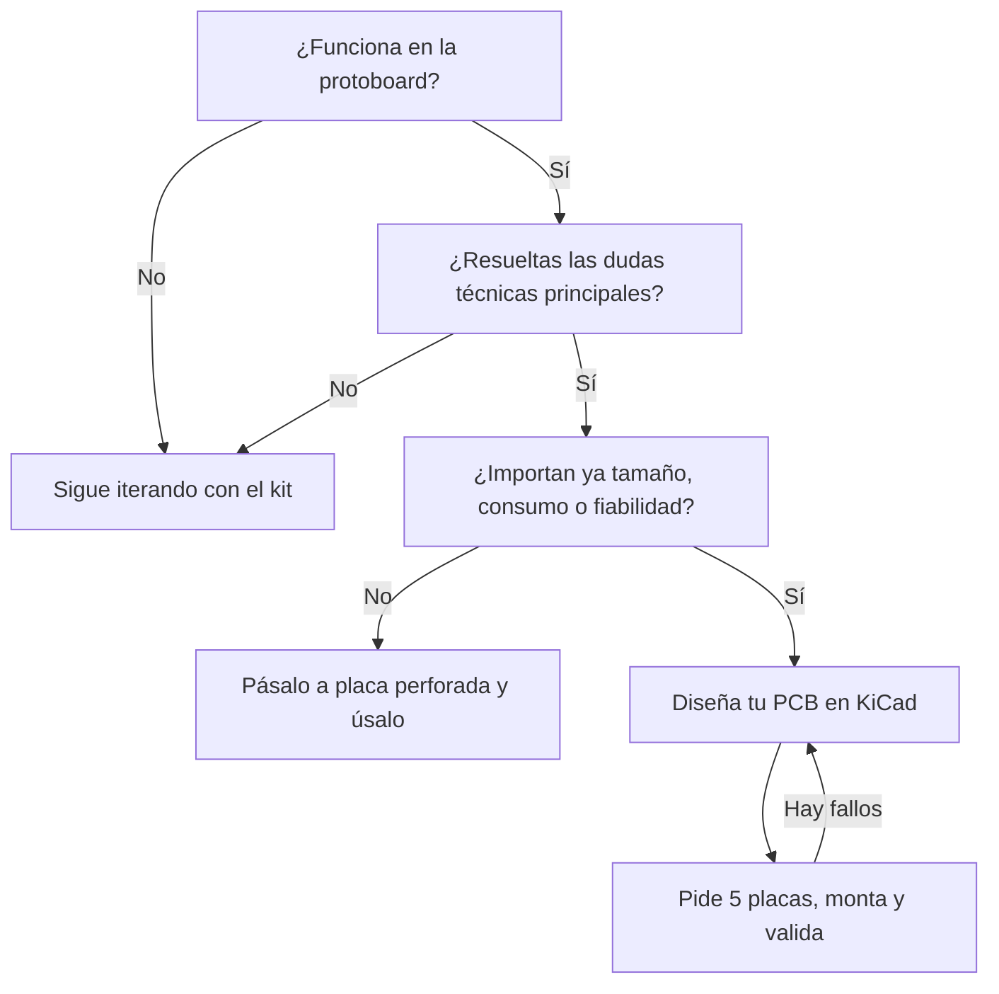

Tu proyecto funciona. La ESP32 DevKit está pinchada en la protoboard, el sensor responde, la pantalla enseña datos y el relé hace clic cuando toca. Ahora quieres meterlo en una caja, dejarlo funcionando o hacer unos cuantos para los amigos, y la maraña de cables ya no sirve. El siguiente paso natural es diseñar tu propia placa.

La tentación es copiar en KiCad exactamente lo que tienes en la protoboard: la DevKit entera, cada cable convertido en pista. A veces vale, pero casi siempre es una oportunidad perdida. La placa de desarrollo y tu PCB tienen objetivos distintos, y entender esa diferencia es lo que hace que la segunda versión funcione mejor que el prototipo.

## Dos objetivos distintos

Una placa de desarrollo está hecha para que pruebes cosas rápido. Trae de todo por si acaso: USB, conversor serie, regulador generoso, botones, LEDs y todos los pines a mano. Su trabajo es quitarte incertidumbre: ¿este sensor habla con este micro?, ¿la idea funciona?

Tu PCB tiene otro trabajo: hacer **una** cosa concreta, de forma fiable, en el sitio donde va a vivir. Que la DevKit funcione en la mesa no significa que su arquitectura sea la adecuada para tu aparato. Es grande, consume más de lo necesario (el LED de encendido y el conversor USB-serie no se apagan nunca) y depende de un cable USB que en el producto final quizá no existe.



## Qué se queda, qué se va y qué llega

### Lo que se queda

Lo que validaste: el microcontrolador (o su módulo, como el ESP32-WROOM), los sensores y periféricos que funcionan, la lógica del firmware y los buses de comunicación (I2C, SPI, UART). Usar el mismo módulo que en la DevKit es una buena decisión para una primera placa: viene certificado, con la antena ajustada y la flash integrada.

### Lo que se va

Todo lo que solo estaba para desarrollar:

- **Conversor USB-serie y conector USB**, si tu aparato no los necesita en uso normal. Para programar puedes dejar un conector de unos pocos pines y usar un adaptador externo.
- **LEDs y botones** que no aporten nada al usuario final.
- **Pines de expansión** que no usas.
- **Reguladores sobredimensionados**, que en un aparato a batería gastan más de lo que deberían. Lo contamos en [LDO vs DC/DC](/blog/ldo-vs-dc-dc/).

Ojo: «se va» no siempre significa eliminarlo. Si quieres reprogramar cómodamente por USB, quizá te interesa conservar el conversor. O elegir un ESP32-S3 o C3, que tienen USB nativo y se programan sin conversor. La clave es que cada componente esté porque lo decides, no porque venía en la DevKit.

### Lo que llega

Cosas que la DevKit te resolvía o que no te hacían falta con una unidad sobre la mesa:

- **Alimentación pensada para tu caso**: batería, 12 V del coche, USB-C, panel solar. Con su protección contra inversión y picos.
- **Conector de programación** con acceso a TX, RX, EN e IO0. La [selección del modo de arranque en la documentación de esptool](https://docs.espressif.com/projects/esptool/en/latest/esp32/advanced-topics/boot-mode-selection.html) explica qué pines intervienen y cómo hacer el reset automático.
- **Puntos de test** en las alimentaciones y señales clave. Cuando algo falle, los agradecerás.
- **Mecánica**: agujeros de fijación, conectores donde la caja los necesita y la antena del módulo fuera de zonas con cobre.
- **Algo para recuperarte** de una actualización fallida, sobre todo si vas a actualizar por WiFi. Lo vemos en [actualizaciones OTA en el ESP32](/blog/actualizaciones-ota-esp32/).

## Lo que cambia al juntarlo todo en una placa

En la protoboard, cada bloque vivía separado: la DevKit por un lado, el sensor en su módulo, la alimentación por USB desde el portátil. Esa separación esconde interacciones. Al meterlo todo en pocos centímetros cuadrados aparecen problemas nuevos:

- El regulador conmutado mete ruido en la medida analógica (lo vemos en [cómo mejorar la precisión del ADC](/blog/precision-adc-microcontrolador/)).
- Los picos de la WiFi hacen caer la tensión si el desacoplo no está bien.
- Una pista que cruza bajo la antena empeora la cobertura.
- Un plano de masa partido crea retornos largos y ruidosos.

Las [guías de diseño hardware del ESP32 de Espressif](https://docs.espressif.com/projects/esp-hardware-design-guidelines/en/latest/esp32/) tienen una checklist de esquema y otra de layout que conviene leer antes de empezar. Y en nuestro blog recogimos los [errores más comunes en PCBs con ESP32](/blog/errores-pcb-esp32/).

## Qué valida cada uno

| Lo valida la DevKit | Lo tiene que validar tu PCB |
|---|---|
| El microcontrolador hace lo que necesitas | Tu alimentación aguanta los picos |
| Los sensores y periféricos responden | El layout no mete ruido ni interferencias |
| La lógica del firmware es correcta | La antena tiene buena cobertura |
| Los protocolos funcionan | Funciona en el sitio real: calor, frío, humedad |
| La arquitectura general tiene sentido | Se puede montar, programar y reparar |

Dicho de otra forma: el prototipo demuestra que la idea funciona; tu placa tiene que demostrar que funciona siempre, no solo una tarde en la mesa.

## El firmware también cambia

El código del prototipo suele estar atado a la DevKit: números de pin repartidos por todo el programa, `Serial.println()` por todas partes, suposiciones sobre el LED integrado. Antes de la placa propia merece la pena ordenarlo:

- Define todos los pines en un único sitio, para que cambiar de placa sea cambiar un fichero.
- Separa la lógica de la aplicación del acceso al hardware.
- Piensa cómo vas a actualizarlo (cable, OTA) y cómo vas a saber qué le pasa (un LED de estado, logs, un modo de diagnóstico).

## Fabricar es otra historia

Hay decisiones que en el prototipo no importaban y en la placa sí:

- **Encapsulados**: ¿vas a soldar a mano? Entonces evita QFN diminutos y componentes 0402. Si lo va a montar el fabricante, elige piezas de su catálogo.
- **Disponibilidad**: comprueba que los componentes se pueden comprar y no están a punto de desaparecer.
- **Reglas del fabricante**: ancho de pista, separaciones, vías. Las [capacidades de fabricación de JLCPCB](https://jlcpcb.com/capabilities/pcb-capabilities) son una buena referencia de lo que se puede pedir en una tirada barata.
- **Repetibilidad**: si haces cinco, que las cinco salgan iguales y se puedan probar rápido.

Antes de enviar los Gerber, pasa nuestra [checklist de fabricación de PCBs](/blog/checklist-fabricacion-pcb/).

## Cuándo dar el salto

Ni demasiado pronto ni demasiado tarde. Si diseñas la placa con dudas importantes sin resolver, acabarás rehaciéndola. Si esperas a tener todo cerrado, habrás tomado en la protoboard decisiones que luego cuestan cambiar.

El momento bueno suele ser cuando la idea ya funciona, las dudas gordas están resueltas y empiezan a importar el tamaño, el consumo o tener más de una unidad. Con tiradas de cinco placas a precio de café en JLCPCB o PCBWay, iterar dos o tres versiones es perfectamente asumible. Para el diseño, la [documentación oficial de KiCad](https://docs.kicad.org/) cubre desde el esquema hasta los Gerber, y si quieres ponerte al día con la última versión, repasa las [novedades de KiCad 10](/blog/kicad-10-novedades/).

## Diseña tu primera placa con nosotros

Si tienes un prototipo en protoboard que pide a gritos su propia PCB, apúntate al [taller de KiCad](/workshops/kicad/) del Hackerspace Valencia o ven una tarde con el esquema a medias. Entre todos revisamos el diseño antes de pedirlo y, cuando lleguen las placas, montamos la primera juntos.

## Créditos de imágenes

- **Portada** - *ESP32 SH1106 Power-Meter 01* - King of Pwnt - CC0 - [fuente](https://commons.wikimedia.org/wiki/File:ESP32_SH1106_Power-Meter_01.jpg)
- **ESP32 DevKit** - *ESP32 Dev Board* (recortada) - Edwiyanto - CC BY-SA 4.0 - [fuente](https://commons.wikimedia.org/wiki/File:ESP32_Dev_Board.jpg)
- Diagramas: elaboración propia del Hackerspace Valencia.
