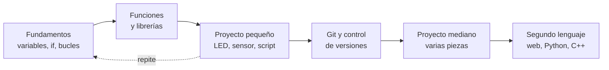
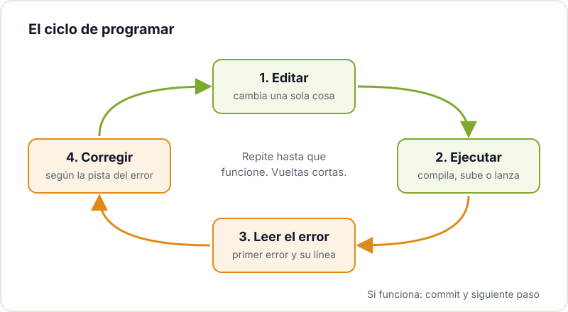
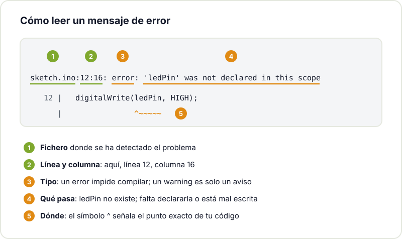

Muchos makers llegan a la programación por la puerta de atrás: quieren que una tira de LEDs haga algo bonito, que un sensor mande datos al móvil o que la impresora 3D avise cuando termina. El código no es el objetivo, es la herramienta que falta para que el proyecto funcione. Y es una buena forma de empezar, porque tienes un motivo concreto para aprender y ves el resultado en algo físico.

Esta guía recoge lo que nos habría gustado saber al principio: qué lenguaje elegir, qué conceptos importan de verdad, qué herramientas instalar y cómo aprender sin quedarte atascado.

## Qué lenguaje aprender primero

No existe un lenguaje "correcto" para empezar. Lo que importa es que encaje con lo que quieres construir, porque así practicarás con ganas. Para un maker, casi siempre la elección está entre tres:

| Si quieres... | Empieza con | Por qué |
|---|---|---|
| Programar un Arduino o un ESP32 desde el primer día | C/C++ de Arduino | Es lo que usa casi toda la documentación y los ejemplos de microcontroladores |
| Automatizar tareas, procesar datos, usar una Raspberry Pi | Python | Sintaxis limpia, muchísimas librerías y resultados rápidos |
| Programar microcontroladores con algo más amable que C | MicroPython | Python reducido que corre en ESP32, RP2040 y otras placas |
| Hacer una interfaz web o un panel para tu proyecto | JavaScript | Es el lenguaje del navegador; imprescindible para webs interactivas |

Si dudas, Python es la opción más suave para aprender los fundamentos, y [MicroPython](https://docs.micropython.org/en/latest/) te deja aplicarlos directamente en placas. Si tu proyecto ya tiene un Arduino encima de la mesa, aprende el C/C++ de Arduino con el [manual de referencia del lenguaje](https://docs.arduino.cc/language-reference/) a mano. Lo bueno es que los conceptos se transfieren: el segundo lenguaje cuesta mucho menos que el primero.

Si te interesa el lado del hardware, tenemos guías para [empezar con Arduino](/blog/empezar-con-arduino/) y [empezar con el ESP32](/blog/empezar-con-esp32/), y una [introducción a los sistemas embebidos](/blog/introduccion-sistemas-embebidos/) que explica qué cambia al programar para un microcontrolador.

## Los conceptos que de verdad necesitas

Da igual el lenguaje: todos se apoyan en las mismas piezas. Si entiendes estas, podrás leer casi cualquier programa sencillo:

- **Variables y tipos**: guardar un valor (una temperatura, un contador, un texto) con un nombre. En C/C++ declaras el tipo (`int`, `float`); en Python se deduce.
- **Condicionales**: `if` / `else`. "Si la temperatura supera 30, enciende el ventilador".
- **Bucles**: repetir algo. En Arduino, `loop()` ya es un bucle infinito; dentro usarás `for` y `while`.
- **Funciones**: empaquetar un trozo de código con un nombre para reutilizarlo. Es la herramienta principal para que un programa no se convierta en un muro de líneas.
- **Estructuras de datos**: listas, arrays y diccionarios para manejar muchos valores juntos.
- **Entrada y salida**: leer un pin, escribir en el puerto serie, leer un fichero, hacer una petición HTTP.

Una vez cómodo con esto, llegarán las librerías, la programación orientada a objetos o la asincronía. Pero no hace falta dominarlo todo para hacer proyectos útiles.

## Herramientas básicas

No necesitas mucho, pero merece la pena instalar desde el principio estas tres:

1. **Un editor de código.** [Visual Studio Code](https://code.visualstudio.com/docs) es gratuito, funciona en Windows, macOS y Linux y tiene extensiones para Python, C/C++, MicroPython o PlatformIO (un entorno para microcontroladores más completo que el IDE de Arduino). El IDE de Arduino sigue siendo perfecto para los primeros sketches.
2. **La terminal.** Al principio intimida, pero muchas herramientas se usan desde ahí: instalar librerías de Python con `pip`, compilar, subir firmware o conectarte a una Raspberry Pi. Si quieres soltarte, lee nuestra guía para [empezar con Linux](/blog/empezar-con-linux/).
3. **Git.** Guarda el historial de tu código para volver atrás cuando algo deja de funcionar, y te permite compartirlo y colaborar. El libro [Pro Git en español](https://git-scm.com/book/es/v2) es gratuito, y en el hackerspace organizamos un [taller de fundamentos de Git](/workshops/git/) centrado en ramas.



## Aprende con proyectos pequeños

El error más común es elegir como primer proyecto algo enorme: un robot autónomo con visión, una estación meteorológica con app y base de datos. Acabas atascado en diez problemas a la vez y no sabes cuál es el culpable.

Funciona mucho mejor encadenar proyectos pequeños que terminas:

- Un LED que parpadea, luego uno que cambia de ritmo con un potenciómetro.
- Un script de Python que renombra las fotos de una carpeta.
- Un sensor de temperatura que imprime lecturas por el puerto serie.
- Esas mismas lecturas guardadas en un fichero CSV y dibujadas en una gráfica.

Cada uno añade una sola pieza nueva. Y cuando llegue el proyecto grande, lo podrás dividir en piezas que ya sabes hacer. Si después quieres darle una interfaz, mira cómo crear [apps y webs sencillas para tus proyectos maker](/blog/apps-y-webs-para-proyectos-maker/).

## Leer los errores (en vez de temerlos)

Programar es, sobre todo, corregir. El código casi nunca funciona a la primera, y eso no significa que lo estés haciendo mal. Lo que marca la diferencia es leer el mensaje de error con calma en lugar de cambiar cosas al azar.

Un mensaje de error tiene siempre las mismas partes. Este es uno típico del compilador de Arduino cuando usas una variable que no has declarado:

Algunas pautas que ahorran horas:

- **Lee el primer error, no el último.** Un fallo al principio suele provocar una cascada de errores después.
- **Fíjate en el fichero y la línea.** El compilador o el intérprete casi siempre te dice dónde ha detectado el problema. A veces la causa está en la línea anterior (un punto y coma o un paréntesis que falta).
- **Distingue el tipo de error.** Un error de compilación o de sintaxis impide que el programa arranque; un error en ejecución aparece mientras corre; y un error lógico no da mensaje, simplemente el programa hace otra cosa de la que esperabas.
- **Imprime lo que pasa.** Un `print()` o un `Serial.println()` con el valor de una variable resuelve muchos misterios.
- **Cambia una cosa cada vez.** Si cambias cinco cosas y funciona, no sabrás cuál era la buena.

## Pedir ayuda bien

Preguntar es parte del oficio. Pero una buena pregunta recibe respuestas mucho mejores. Antes de pedir ayuda en un foro, en el chat de la comunidad o a un compañero del taller, prepara:

- Qué intentas conseguir, en una frase.
- Qué has hecho: el código mínimo que reproduce el problema, no el proyecto entero.
- Qué esperabas que pasara y qué pasa en realidad.
- El mensaje de error completo, copiado como texto (no una foto de la pantalla).
- Qué placa, sistema operativo y versiones de librerías usas.

Muchas veces, al preparar esta lista, encuentras tú mismo el fallo.

## La IA como apoyo, no como piloto automático

Los asistentes de IA son muy útiles para aprender: te explican un error, te sugieren cómo abordar un problema o te muestran un ejemplo de una librería que no conoces. El riesgo es acabar con un programa que funciona pero que no entiendes, y que no sabrás arreglar cuando falle.

Unas reglas sencillas:

- Pide explicaciones, no solo código. "¿Por qué falla esto?" enseña más que "arréglalo".
- No pegues en tu proyecto nada que no puedas explicar línea a línea.
- Comprueba lo que te dice: la IA se equivoca con seguridad, sobre todo con pines, librerías y versiones concretas. Contrasta con la documentación oficial.
- Intenta resolverlo tú primero unos minutos. El esfuerzo es lo que hace que aprendas.

Si quieres profundizar, tenemos posts sobre [qué es la IA generativa](/blog/que-es-la-ia-generativa/) y [qué es un agente de IA](/blog/que-es-un-agente-ia/), y un taller de [IA desde cero hasta programar con IA agéntica](/workshops/taller-ia-agentica/).

## Recursos para seguir

- El [tutorial oficial de Python en español](https://docs.python.org/es/3/tutorial/) es claro y completo.
- Para la parte web, la sección [Aprende desarrollo web de MDN](https://developer.mozilla.org/es/docs/Learn_web_development) cubre HTML, CSS y JavaScript desde cero.
- Recopilamos más material en [recursos para makers](/blog/recursos-para-makers/).

## Ven a programar con nosotros

Aprender solo es posible, pero con gente alrededor es mucho más rápido: alguien que ya se peleó con el mismo error te ahorra una tarde. Trae tu portátil y tu proyecto al [Hackerspace Valencia](/blog/que-es-un-hackerspace/), pásate por el [Merendojo](/workshops/merendojo/) para practicar katas en pareja o echa un ojo a los [próximos talleres](/workshops/). Y si te quedas, [hazte socio/a](/pages/alta/).

## Créditos de imágenes

Las fotografías proceden de [Wikimedia Commons](https://commons.wikimedia.org) y se utilizan bajo sus respectivas licencias:

- **Portada** - *Arduino LCD hacking* - Matt Biddulph - CC BY-SA 2.0 - [fuente](https://commons.wikimedia.org/wiki/File:Arduino_LCD_hacking_-_Flickr_-_Matt_Biddulph.jpg)
- **Editor de código** - *Macro laptop coding (Unsplash)* - Marc Mueller - CC0 - [fuente](https://commons.wikimedia.org/wiki/File:Macro_laptop_coding_(Unsplash).jpg)
