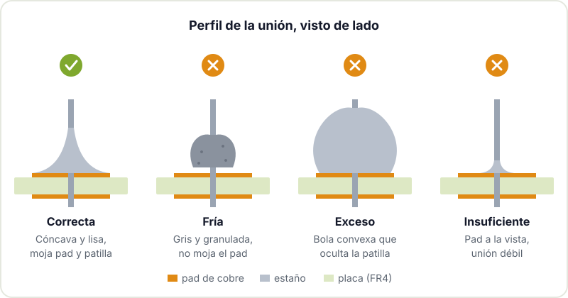

Soldar es la habilidad que separa un prototipo en protoboard de un aparato que puedes meter en una caja y usar todos los días. La buena noticia es que se aprende rápido: con el equipo adecuado y una tarde de práctica, la mayoría de la gente saca uniones decentes. Esta guía se centra en componentes through-hole (los que tienen patillas que atraviesan la placa), que es por donde conviene empezar antes de pasar a [soldar componentes SMD a mano](/blog/soldar-smd/).

## Equipo mínimo

No hace falta una estación cara, pero sí evitar el soldador de lápiz sin regulación que se vende por cuatro euros: o se queda frío o quema los pads, y ninguna de las dos cosas ayuda a aprender.

- **Soldador con control de temperatura.** Una estación o un soldador regulable de gama media. Lo importante es poder fijar la temperatura y que la recupere rápido al tocar la placa.
- **Puntas.** Una punta de cincel o destornillador de 2 a 3 mm sirve para casi todo lo through-hole. Las puntas cónicas finas parecen más precisas, pero transfieren peor el calor.
- **Estaño.** Hilo de 0,6 a 0,8 mm con núcleo de flux. El estaño con plomo (aleación 63/37 o 60/40) funde a menor temperatura y fluye mejor, por eso es más agradecido para aprender. El sin plomo (por ejemplo SAC305) es el estándar en industria por la normativa [RoHS](https://en.wikipedia.org/wiki/Restriction_of_Hazardous_Substances_Directive), pero exige más temperatura y deja uniones más mates.
- **Flux.** Aunque el hilo ya lleva, un rotulador o una jeringa de flux "no clean" ayuda mucho al retocar y al desoldar. El [flux](https://en.wikipedia.org/wiki/Flux_(metallurgy)) limpia los óxidos y permite que el estaño moje el metal.
- **Limpiador de punta.** Malla de latón mejor que esponja húmeda: limpia sin enfriar la punta de golpe.
- **Herramientas para deshacer.** Una bomba desoldadora y malla desoldadora (trenza de cobre). Vas a equivocarte, y saber deshacer es parte del oficio.
- **Pinzas y alicates de corte.** Pinzas para sujetar componentes y un alicate de corte al ras para las patillas sobrantes.
- **Algo que sujete la placa.** Una "tercera mano" o un soporte de PCB. Soldar con la placa bailando es la receta de una unión fría.
- **Extracción de humos.** Un extractor con filtro de carbón o, como mínimo, buena ventilación y no tener la cara encima del humo.
- **Gafas de protección.** Las patillas que cortas salen disparadas y el estaño a veces salpica.

## Temperaturas orientativas

No hay una cifra mágica: depende de la punta, del tamaño del pad y de cuánta masa de cobre haya alrededor. Como punto de partida:

| Estaño | Funde a | Temperatura de punta orientativa |
|---|---|---|
| Sn63/Pb37 (con plomo) | 183 °C | 300 a 340 °C |
| SAC305 (sin plomo) | unos 217 a 220 °C | 340 a 370 °C |

Si el estaño tarda más de 3 o 4 segundos en fluir, no subas la temperatura sin más: primero prueba con una punta más ancha y con un poco de estaño en la punta para mejorar el contacto térmico. Subir mucho la temperatura quema el flux antes de que haga su trabajo, oxida la punta y puede despegar los pads de la placa. Los pads conectados a un plano de masa grande sí piden más calor o más tiempo.

## Técnica paso a paso

La idea clave es que **el estaño va a lo caliente**. No se lleva el estaño en la punta del soldador para "pintar" la unión: se calientan las dos piezas y el estaño fluye solo hacia ellas.

1. **Prepara la punta.** Límpiala en la malla de latón y dale un toque de estaño para que brille. Una punta estañada transmite el calor mucho mejor que una punta seca.
2. **Coloca el componente.** Mete las patillas, dobla ligeramente las de abajo para que no se caiga y apoya la placa en el soporte.
3. **Calienta pad y pin a la vez.** Apoya la punta de forma que toque el pad de cobre y la patilla al mismo tiempo. Uno o dos segundos bastan en la mayoría de pads pequeños.
4. **Aporta el estaño.** Acerca el hilo a la unión, por el lado contrario a la punta, no sobre la punta. Verás cómo el estaño se funde y se extiende por el pad y sube por la patilla.
5. **Retira el estaño y después el soldador.** En ese orden. Si quitas primero el soldador, el hilo se queda pegado.
6. **No muevas nada** hasta que la unión solidifique, apenas un segundo. Si la patilla se mueve mientras se enfría, la unión queda granulada y débil.
7. **Corta la patilla sobrante** justo por encima de la unión, sujetándola con un dedo para que no salga volando.

Todo el proceso dura entre 2 y 5 segundos por unión. Si te pasas mucho de ahí, algo falla: la punta está sucia, la temperatura es baja o la punta es demasiado fina.

## Soldadura buena y soldadura fría

Una unión correcta en through-hole tiene forma de volcán: cóncava, lisa, brillante (más mate si es sin plomo) y cubre todo el pad, subiendo un poco por la patilla. Si la miras de lado, el estaño "moja" ambas superficies con un ángulo suave.

Los fallos más habituales:

- **Soldadura fría.** Aspecto gris, granulado o arrugado, y a menudo el estaño se queda en la patilla sin extenderse por el pad. Pasa cuando el pad no llega a calentarse o cuando algo se mueve al enfriar. Puede funcionar un tiempo y fallar con vibraciones o cambios de temperatura. Solución: añade un poco de flux y recalienta hasta que fluya.
- **Exceso de estaño.** Una bola convexa que oculta la patilla. No sabes si por dentro hay unión o solo una gota encima, y puede hacer puente con el pad vecino. Retira el sobrante con malla desoldadora.
- **Estaño insuficiente.** Se ve el cobre del pad y apenas hay material alrededor de la patilla. Mecánicamente es débil. Añade estaño.
- **Puentes.** Estaño uniendo dos pads que no deberían estar unidos. Pasa la malla o arrastra el sobrante con la punta limpia y un poco de flux.

La [guía de soldadura de Adafruit](https://learn.adafruit.com/adafruit-guide-excellent-soldering) tiene fotos muy buenas de cada caso, y la entrada de Wikipedia sobre [soldadura blanda](https://es.wikipedia.org/wiki/Soldadura_blanda) explica la parte metalúrgica si te pica la curiosidad.

## Tu primer kit

Para practicar, lo mejor es un kit through-hole sencillo con muchas uniones y algo que se ilumine o suene al terminar: un intermitente con un 555, un dado electrónico, un pequeño amplificador o un reloj con displays. Busca kits con:

- Resistencias, condensadores, LEDs y algún integrado en zócalo. Así practicas componentes de varios tamaños y respetas la polaridad.
- Pads generosos y serigrafía clara.
- Un resultado verificable. Saber si ha funcionado motiva mucho más que una placa de práctica sin circuito.

Antes del kit, si tienes una placa vieja de un aparato roto, úsala para practicar desoldar y volver a soldar. Y si ya tienes soltura, el siguiente paso natural es pasar del kit a diseñar tu propia placa: lo contamos en [del kit a la PCB propia](/blog/del-kit-a-la-pcb-propia/).

## Seguridad

Soldar es seguro si se respetan unas pocas normas:

- **El soldador quema.** Déjalo siempre en su soporte, nunca sobre la mesa. Cuenta con que todo lo que acabas de soldar sigue caliente.
- **Plomo.** Si usas estaño con plomo, el riesgo no está en el humo (a estas temperaturas el plomo apenas se evapora) sino en las manos. Lávate las manos al terminar, no comas ni bebas mientras sueldas y no dejes restos de estaño por la mesa. Mantenlo lejos de niños pequeños.
- **Humo del flux.** El humo blanco viene de la resina del flux y es irritante para las vías respiratorias. Extractor o ventilación, y no te pongas encima.
- **Ojos.** Gafas al cortar patillas y al desoldar, que es cuando más salpica.
- **Restos.** Las mallas usadas y los restos de estaño no van a la basura normal: llévalos a un punto limpio.

## Siguientes pasos

Cuando las uniones through-hole te salgan solas, el camino natural es el montaje superficial. Te lo contamos en [soldar componentes SMD a mano](/blog/soldar-smd/), y si un día te cruzas con un chip sin patillas visibles, en [soldar BGA](/blog/soldar-bga/). Para seguir aprendiendo electrónica, tienes una selección de material en [recursos de electrónica para makers](/blog/recursos-electronica-makers/).

Si quieres practicar con alguien al lado que te diga por qué esa unión ha salido gris, pásate por el Hackerspace Valencia con tu kit o con esa placa que llevas tiempo queriendo arreglar. Soldar se aprende mucho más rápido acompañado.
