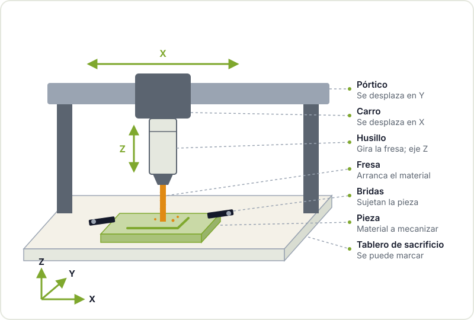
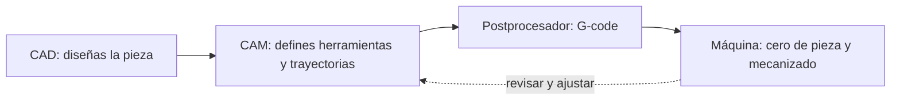

Si la impresora 3D construye piezas añadiendo material y la cortadora láser corta planchas, la fresadora CNC hace lo contrario que la impresora: parte de un bloque y va quitando material con una herramienta que gira a miles de revoluciones por minuto. Eso le permite trabajar madera maciza, plásticos técnicos, aluminio o placas de cobre para circuitos, con una precisión y una resistencia de pieza que las otras máquinas no alcanzan.

También es la máquina con más variables: herramienta, velocidad de giro, avance, profundidad de pasada, sujeción. Esta guía te da el mapa para entender cada una antes de encender el husillo por primera vez.

## Cómo funciona una fresadora CNC

Una fresadora CNC ([control numérico](https://es.wikipedia.org/wiki/Control_num%C3%A9rico)) mueve una herramienta de corte, la **fresa**, en tres ejes:

- **X**: izquierda y derecha.
- **Y**: adelante y atrás.
- **Z**: arriba y abajo, que controla la profundidad.

La fresa va montada en el **husillo** (o en una fresadora de mano adaptada), un motor que la hace girar a alta velocidad. La pieza va sujeta a la **mesa** o al tablero de sacrificio, y unos motores paso a paso o servos mueven el pórtico siguiendo las instrucciones del G-code.



Si quieres ver el principio en pequeño, el [plotter reciclado](/proyectos/plotter/) del hackerspace usa la misma idea de ejes movidos por motores paso a paso con piezas de lectores de CD-ROM. Cambia el bolígrafo por un husillo, añade rigidez y tienes una CNC.

## Del diseño al mecanizado: CAD, CAM y G-code



1. **CAD**: dibujas la pieza en 2D o 3D. Sirven FreeCAD, Fusion, Onshape o incluso Inkscape para trabajos planos.
2. **CAM**: es el paso nuevo respecto a la impresión 3D. Aquí eliges qué fresa usas, qué operaciones haces (contorno, cajera, taladrado, planeado), a qué profundidad por pasada, a qué velocidad y en qué orden. FreeCAD incluye un [banco de trabajo CAM](https://wiki.freecad.org/CAM_Workbench) y Fusion tiene CAM integrado.
3. **Postprocesador**: traduce las trayectorias al dialecto de [G-code](https://es.wikipedia.org/wiki/G-code) que entiende tu controlador (GRBL, LinuxCNC, Mach3 y otros).
4. **Máquina**: sujetas la pieza, colocas la fresa, defines el **cero de pieza** (dónde está el origen X, Y y Z sobre el material) y lanzas el programa.

Un detalle importante: antes de cortar, simula. La mayoría de programas CAM muestran la trayectoria y el material que se quitará. Ahí se ven los errores gordos, como una pasada que atraviesa la mordaza.

## Tipos de fresas

| Fresa | Forma | Para qué |
|---|---|---|
| **Plana (end mill)** | Punta plana | Contornos, cajeras, perfiles: la más usada |
| **Punta redonda (ball nose)** | Punta semiesférica | Superficies 3D, relieves, acabados suaves |
| **En V (V-bit)** | Punta cónica | Grabado, letras, chaflanes y aislamiento de pistas en PCB |
| **Helicoidal ascendente (upcut)** | Saca la viruta hacia arriba | Buena evacuación; puede astillar la cara superior |
| **Helicoidal descendente (downcut)** | Empuja la viruta hacia abajo | Cara superior limpia en madera y contrachapado |
| **Compresión** | Mitad ascendente, mitad descendente | Contrachapado y tableros laminados con ambas caras limpias |
| **De planear (surfacing)** | Gran diámetro, poca altura | Allanar el tablero de sacrificio o la superficie de la pieza |



Además de la forma, cuenta el **número de filos**. Pocos filos (uno o dos) dejan más espacio para evacuar viruta, algo clave en plásticos y aluminio, que tienden a fundirse o empastarse. Más filos dan mejor acabado en materiales duros, pero necesitan más rigidez de máquina.

## Velocidad, avance y carga de viruta

Aquí está la parte que más asusta y la que más importa. Tres conceptos:

- **Velocidad de giro (RPM)**: cuántas vueltas da la fresa por minuto.
- **Avance (mm/min)**: a qué velocidad se mueve la fresa a través del material.
- **Carga de viruta (mm por filo)**: el grosor de material que arranca cada filo en cada vuelta.

Se relacionan con una fórmula sencilla:

```text
avance (mm/min) = RPM × número de filos × carga de viruta (mm/filo)
```

Por ejemplo, con 18 000 RPM, una fresa de 2 filos y una carga de viruta de 0,05 mm, el avance sería 18 000 × 2 × 0,05 = 1800 mm/min. Los valores de carga de viruta dependen del material, del diámetro de la fresa y de la rigidez de la máquina, así que tómalos de las tablas del fabricante de la fresa o de guías de referencia sobre [velocidades y avances](https://en.wikipedia.org/wiki/Speeds_and_feeds), y empieza siempre por lo conservador.

La señal de que vas bien es la propia viruta: **virutas** definidas, no polvo. Si sale polvo fino, la fresa está rozando en lugar de cortar: se calienta, pierde el filo y, en madera, puede llegar a quemar. Lo contrario, demasiado avance, se nota en un sonido forzado, vibraciones y fresas rotas. Con las máquinas de hobby, menos rígidas que las industriales, lo habitual es dar pasadas poco profundas y mantener un avance razonable.

## Sujeción: la pieza no se puede mover

Una pieza mal sujeta es la causa número uno de piezas estropeadas, fresas rotas y sustos. Opciones habituales:

- **Bridas y tornillos** sobre una mesa ranurada o un tablero de sacrificio con insertos roscados.
- **Mordaza**, para piezas pequeñas y metálicas.
- **Cinta de doble cara** de buena calidad con cianoacrilato, muy usada para placas finas y PCB.
- **Tornillos directos** al tablero de sacrificio en zonas de la pieza que luego se descartan.
- **Pestañas (tabs)**: pequeños puentes que el CAM deja sin cortar para que la pieza no se suelte al final del contorno.

Antes de lanzar el programa, comprueba que ninguna trayectoria pasa por encima de una brida o un tornillo. Un recorrido en vacío con el eje Z alto es una buena forma de verificarlo.

## Materiales para empezar

- **Madera y contrachapado**: perdonan mucho y son ideales para aprender. Ojo con el polvo, sobre todo del DM.
- **Espumas técnicas y cera de mecanizado**: blandas, perfectas para probar trayectorias.
- **Plásticos (acrílico colado, POM, HDPE)**: muy buenos resultados con fresas de un filo. El acrílico extruido tiende a fundirse más que el colado.
- **Aluminio**: posible en muchas máquinas de hobby con pasadas finas, fresas adecuadas y lubricación o aire, pero no es para el primer día.
- **Placa de cobre FR-1 o FR-4** para PCB: mira la sección siguiente.

## Caso maker: fresar tus propias PCB

Para un hackerspace con gente de electrónica, una de las aplicaciones más útiles de una CNC pequeña es fabricar prototipos de PCB en una tarde, sin esperar al envío del fabricante.


1. Diseñas la placa en [KiCad](https://www.kicad.org) con pistas y separaciones generosas (las CNC de hobby no son un fabricante industrial).
2. Exportas Gerber y archivo de taladros.
3. Con [FlatCAM](https://www.flatcam.org) generas las trayectorias de **aislamiento**: la fresa en V recorre el contorno de cada pista eliminando el cobre de alrededor.
4. Mecanizas con una fresa en V de punta fina, taladras con brocas de PCB y recortas el contorno.



La clave es la **planitud**: la capa de cobre es finísima, así que una diferencia de altura de unas décimas hace que en una zona no se corte el cobre y en otra se profundice demasiado. Muchos programas de control permiten medir la superficie con una sonda (*autolevel*) y compensar. Para placas finales o con componentes de paso fino, encargar la fabricación sigue siendo mejor opción: repasa nuestra [checklist antes de enviar una PCB a fabricar](/blog/checklist-fabricacion-pcb/) y, si estás empezando con el diseño, el [taller de KiCad](/workshops/kicad/).

La fibra de vidrio del FR-4 genera polvo nocivo al mecanizarla: aspiración, nunca soplar el polvo y mascarilla adecuada. Por eso mucha gente prefiere FR-1 (papel fenólico) para prototipos fresados.

## Seguridad

- **Gafas de protección siempre.** Las fresas se rompen y las virutas salen disparadas.
- **Protección auditiva**: muchos husillos y fresadoras de mano son muy ruidosos.
- **Aspiración de polvo**: el polvo de madera, DM y fibra de vidrio es perjudicial para los pulmones.
- **Nada suelto cerca del husillo**: pelo recogido, sin guantes, sin mangas anchas ni colgantes. Una fresa girando atrapa tela en un instante.
- **Mano en la parada de emergencia** durante la primera pasada de cada programa nuevo.
- **No dejes la máquina sola** mientras trabaja.
- **Nunca toques la fresa ni la pieza** hasta que el husillo se haya detenido por completo.

## Sigue explorando

La CNC encaja con el resto de la fabricación digital: puedes empezar por la [impresión 3D](/blog/empezar-impresion-3d/) para piezas de plástico, usar el [corte láser](/blog/empezar-corte-laser/) para planchas finas y reservar la fresadora para lo que necesita rigidez o materiales que las otras no trabajan. Para el diseño, en [herramientas para impresión 3D](/blog/herramientas-impresion-3d/) comparamos programas de CAD que también te sirven aquí.

## Ven a fresar al hackerspace

Una CNC se aprende mucho mejor con alguien al lado que ya ha roto unas cuantas fresas. Pásate por el [Hackerspace Valencia](/blog/que-es-un-hackerspace/), pregunta en el local qué máquinas hay disponibles y qué formación hace falta para usarlas, y consulta los [talleres](/workshops/) programados. Si tienes una placa o una pieza en mente, tráela: es el mejor punto de partida.

## Créditos de imágenes

Las fotos proceden de [Wikimedia Commons](https://commons.wikimedia.org) y se usan bajo sus respectivas licencias. Los diagramas son de elaboración propia.

- **Portada** - *CNC router in workshop* - Matthew Venn - CC BY-SA 2.0 - [fuente](https://commons.wikimedia.org/wiki/File:CNC_router_in_workshop.jpg)
- **Tipos de fresas** - *MillingCutterSlotEndMillBallnose* - Glenn McKechnie - CC BY-SA 2.0 - [fuente](https://commons.wikimedia.org/wiki/File:MillingCutterSlotEndMillBallnose.jpg)
- **PCB fresada** - *Milled PCB* - Stephen Pithouse - CC BY-SA 3.0 - [fuente](https://commons.wikimedia.org/wiki/File:Milled_PCB.JPG)
