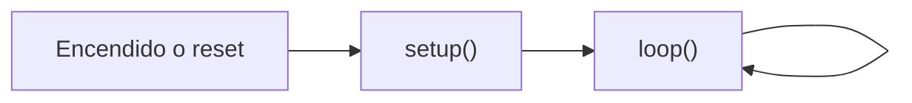
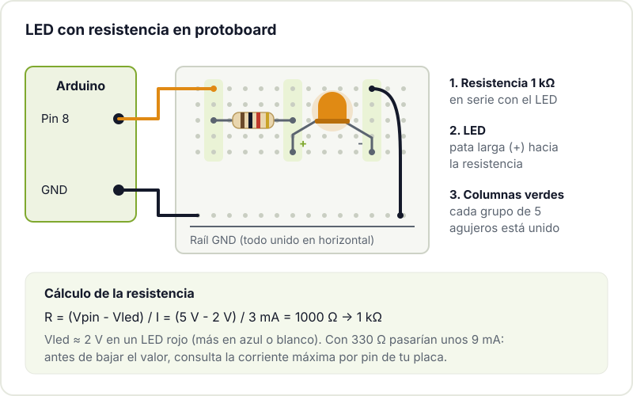
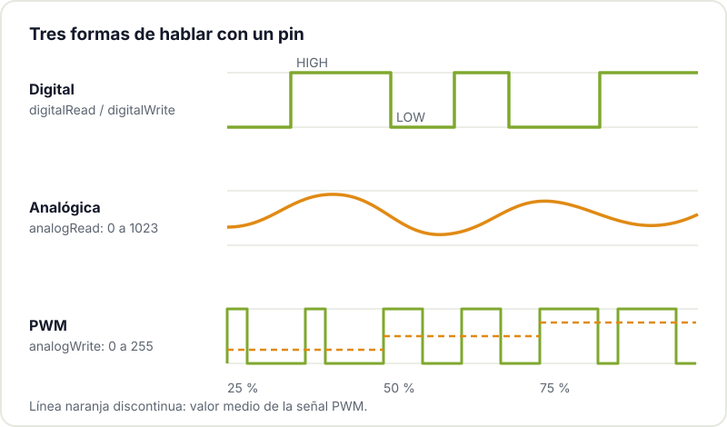

Arduino sigue siendo la forma más directa de pasar de "nunca he programado una placa" a "tengo un LED que hace lo que yo quiero" en una tarde. En el hackerspace es, con diferencia, la plataforma por la que más gente entra a la electrónica, y por buenos motivos: es barata, perdona errores y tiene detrás una comunidad enorme que ya se ha topado con casi cualquier problema que te encuentres.

Este post no es una lista de recursos (para eso tienes nuestra [guía de recursos para aprender electrónica](/blog/recursos-electronica-makers/)), sino el camino práctico: qué comprar, qué instalar y cuáles son los dos primeros montajes que conviene hacer con las manos.

## Qué es Arduino exactamente

Cuando alguien dice "Arduino" puede referirse a tres cosas distintas, y conviene separarlas:

- **La placa**: un microcontrolador montado en una PCB con conector USB, regulador de tensión y pines accesibles. El clásico es el Arduino Uno.
- **El IDE**: el programa con el que escribes el código, lo compilas y lo cargas en la placa por USB.
- **El ecosistema**: el lenguaje (C++ con una capa de funciones sencillas como `digitalWrite()`), miles de librerías para sensores y pantallas, y una cantidad de ejemplos y tutoriales difícil de igualar.

Lo interesante es que el IDE y las librerías no se limitan a las placas oficiales. Con el mismo entorno puedes programar un ESP32 o una Raspberry Pi Pico, así que lo que aprendas aquí te sirve después.

## Qué placa comprar

Para empezar no te compliques. Estas son las opciones razonables:

| Placa | Para quién | A tener en cuenta |
|---|---|---|
| **Arduino Uno R4 Minima** | Quien quiere la placa de referencia | USB-C, microcontrolador Renesas RA4M1 (Arm Cortex-M4 a 48 MHz), lógica a 5 V |
| **Arduino Uno R4 WiFi** | Quien prevé conectar cosas a la red | Igual que la Minima, más un módulo ESP32-S3 para WiFi y Bluetooth y una matriz de LED |
| **Arduino Nano** (y familia) | Montajes pequeños o que van a la protoboard | Hay varias versiones (Nano clásico, Nano Every, Nano ESP32...); revisa cuál compras |
| **Clones del Uno o el Nano** | Presupuesto mínimo o querer varias placas | Funcionan bien en general; algunos usan otro chip USB-serie (como el CH340) que puede necesitar driver |

Las especificaciones del Uno R4 están en la [documentación oficial del Arduino Uno R4 Minima](https://docs.arduino.cc/hardware/uno-r4-minima/). 

Si dudas, un Uno (original o clon) es la apuesta segura: casi todos los tutoriales del mundo lo usan como referencia y su tamaño hace difícil equivocarse al conectar cables.

Los clones son legales (Arduino es hardware abierto) y muy útiles para proyectos que se quedan montados. Comprar una original también financia el desarrollo del IDE y las librerías que usas gratis.

## El kit mínimo

No hace falta un kit de 200 piezas. Con esto haces los primeros veinte experimentos:

- Una **protoboard** de 400 u 830 puntos.
- **Cables dupont** macho-macho (y algunos macho-hembra para módulos).
- **LEDs** de 5 mm de varios colores.
- **Resistencias** surtidas: como mínimo 220 Ω, 330 Ω, 1 kΩ y 10 kΩ.
- Un par de **pulsadores** de 4 patas para protoboard.
- Un **sensor sencillo**: un potenciómetro, una LDR o un sensor de temperatura.
- Un **cable USB** que transmita datos, no solo carga. Este detalle provoca más tardes perdidas de lo que parece.

Si además consigues un multímetro barato, mejor: medir tensiones es la forma más rápida de entender qué está pasando.

## Instalar Arduino IDE 2

Descarga el Arduino IDE 2 para tu sistema operativo siguiendo la [guía oficial de instalación del Arduino IDE 2](https://docs.arduino.cc/software/ide-v2/tutorials/getting-started/ide-v2-downloading-and-installing/). Después:

1. Conecta la placa por USB.
2. En el selector de la parte superior, elige la placa y el puerto. Si es un Uno R4, el IDE te pedirá instalar su paquete de soporte desde el gestor de placas: acepta.
3. En Linux, si el puerto no aparece o da error de permisos, añade tu usuario al grupo `dialout` y vuelve a iniciar sesión.
4. Si usas un clon con chip CH340 y el sistema no lo reconoce, instala el driver correspondiente.

## Primer programa: Blink

Todo programa de Arduino (un *sketch*) tiene dos funciones obligatorias:

- `setup()` se ejecuta **una vez** al encender o reiniciar la placa. Aquí configuras pines y comunicaciones.
- `loop()` se ejecuta **una y otra vez** mientras haya alimentación. Aquí vive la lógica de tu proyecto.



El primer sketch es el clásico [ejemplo Blink](https://docs.arduino.cc/built-in-examples/basics/Blink/), que hace parpadear el LED integrado en la placa:

```cpp
// Blink: enciende y apaga el LED integrado cada medio segundo

void setup() {
  // LED_BUILTIN es el pin del LED que trae la propia placa
  pinMode(LED_BUILTIN, OUTPUT);   // lo configuramos como salida
}

void loop() {
  digitalWrite(LED_BUILTIN, HIGH);  // HIGH = tensión alta = LED encendido
  delay(500);                       // espera 500 milisegundos
  digitalWrite(LED_BUILTIN, LOW);   // LOW = 0 V = LED apagado
  delay(500);
}
```

Pulsa el botón de subir (la flecha). Si el LED parpadea, ya tienes la cadena completa funcionando: editor, compilador, USB y placa. Cambia los `500` por otros valores y vuelve a subir para comprobar que entiendes qué hace cada línea.

## Segundo montaje: pulsador y LED externo

Ahora sacamos el LED a la protoboard. Un LED **nunca** se conecta directo a un pin: necesita una resistencia en serie que limite la corriente, o acabarás dañando el LED, el pin o ambos.



El cálculo es la ley de Ohm aplicada a lo que "sobra" de tensión: la placa da 5 V, un LED rojo se queda con unos 2 V y queremos unos pocos miliamperios. Los LED actuales lucen de sobra con 2-5 mA, y ser conservador protege el pin. Antes de bajar a valores como 220 Ω, consulta en el datasheet de tu placa cuánta corriente admite cada pin.

Añade un pulsador entre el **pin 2** y **GND**. No hace falta resistencia externa para el pulsador porque activaremos la resistencia *pull-up* interna del microcontrolador:

```cpp
const int PIN_LED = 8;
const int PIN_BOTON = 2;

void setup() {
  pinMode(PIN_LED, OUTPUT);
  // INPUT_PULLUP: el pin lee HIGH en reposo y LOW cuando pulsas
  pinMode(PIN_BOTON, INPUT_PULLUP);
}

void loop() {
  bool pulsado = (digitalRead(PIN_BOTON) == LOW);
  digitalWrite(PIN_LED, pulsado ? HIGH : LOW);
}
```

Fíjate en la lógica invertida: con *pull-up*, pulsar lleva el pin a 0 V, así que "pulsado" es `LOW`. Es uno de los primeros "¿por qué hace lo contrario?" de cualquier principiante.

## Digital y analógico

Los pines de Arduino trabajan de dos maneras:

- **Digital**: solo dos estados, `HIGH` o `LOW`. Sirve para LEDs, relés, pulsadores, finales de carrera.
- **Entrada analógica** (pines `A0`, `A1`...): `analogRead()` convierte una tensión entre 0 V y la referencia en un número. En el Uno, por defecto, va de 0 a 1023. Es lo que usas con un potenciómetro, una LDR o muchos sensores.
- **Salida "analógica"** (`analogWrite()`): en realidad es PWM, una señal que conmuta muy rápido y cuyo valor medio varía. Sirve para regular el brillo de un LED o la velocidad de un motor (con su driver). Solo funciona en los pines marcados con `~`.



Si quieres ir más allá con las lecturas analógicas, en [cómo mejorar la precisión del ADC de un microcontrolador](/blog/precision-adc-microcontrolador/) explicamos de dónde salen el ruido y los errores.

## El monitor serie: tu mejor amigo

La placa no tiene pantalla, pero puede enviarte texto por el mismo USB. Es la herramienta de depuración número uno:

```cpp
void setup() {
  Serial.begin(115200);  // la velocidad debe coincidir con la del monitor
}

void loop() {
  int valor = analogRead(A0);
  Serial.print("A0 = ");
  Serial.println(valor);
  delay(200);
}
```

Abre el monitor serie (icono de lupa arriba a la derecha) y elige 115200 baudios. Si ves caracteres raros, casi siempre es que la velocidad no coincide. El IDE 2 incluye además un *serial plotter* que dibuja los valores en tiempo real, perfecto para ver cómo responde un sensor.

## Siguientes pasos

Cuando Blink y el pulsador te salgan sin mirar, hay tres caminos naturales:

1. **Deja de usar `delay()`**. Bloquea la placa y te impide hacer dos cosas a la vez. En [qué es la programación embebida y cómo empezar](/blog/introduccion-sistemas-embebidos/) explicamos cómo sustituirlo por `millis()` y una máquina de estados.
2. **Conecta algo a la red** con un [ESP32](/blog/empezar-con-esp32/): se programa con el mismo IDE y cuesta menos que muchas placas Arduino.
3. **Pasa de la protoboard a una placa propia**. Cuando un montaje funciona y quieres que dure, el siguiente salto es diseñar tu PCB; tenemos una [checklist antes de mandar una PCB a fabricar](/blog/checklist-fabricacion-pcb/).

Y si te atascas (cable que no hace contacto, puerto que no aparece, LED al revés), lo más rápido es que alguien lo vea contigo. Tráete tu placa y tu protoboard al Hackerspace Valencia: siempre hay alguien que ya ha pasado por el mismo error. Mira nuestros [talleres](/workshops/) y, si te engancha, [hazte socio/a](/pages/alta/).

## Créditos de imágenes

- **Portada** - *Arduino Uno board* - JrawX - CC0 - [fuente](https://commons.wikimedia.org/wiki/File:Arduino_Uno_board.jpg)
- **Arduino Uno R4 WiFi** - *Arduino UNO R4 WiFi* - Lomrjyo - CC BY-SA 4.0 - [fuente](https://commons.wikimedia.org/wiki/File:Arduino_UNO_R4_WiFi.jpg)
- Diagramas: Hackerspace Valencia.
