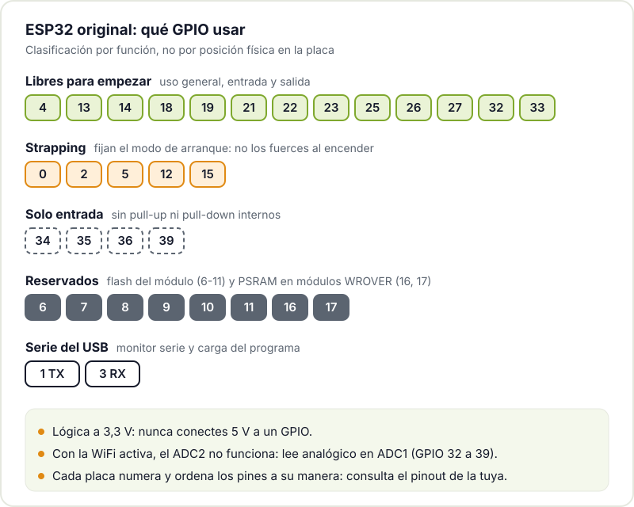
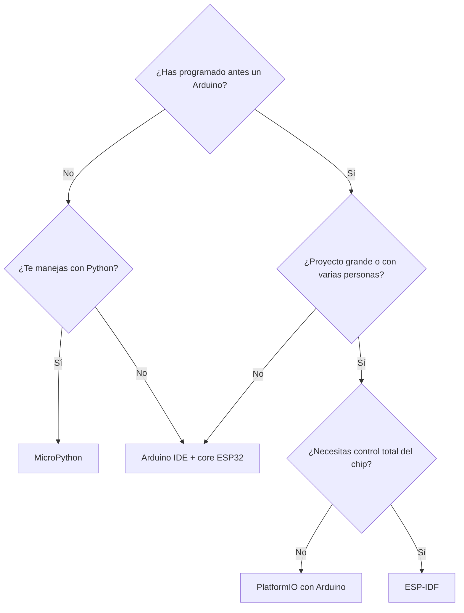
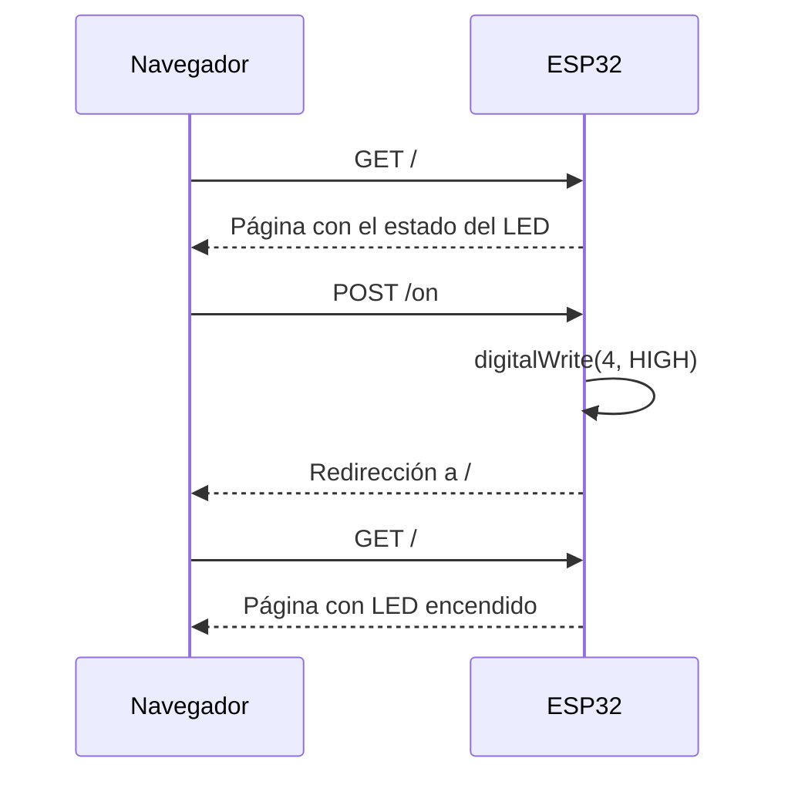

Si Arduino es la puerta de entrada clásica, el ESP32 es la placa con la que la mayoría de makers acaba haciendo proyectos de verdad: sensores que mandan datos a casa, lámparas que se controlan desde el móvil, radios por Internet, estaciones meteorológicas. Tiene WiFi y Bluetooth integrados, mucha más potencia que un Arduino Uno clásico y una placa de desarrollo cuesta unos pocos euros.

Este post es el arranque práctico: qué chip elegir, qué placa comprar, qué cuidados tener con los pines y cómo escribir un primer programa que se conecte a tu WiFi y sirva una página web. Si nunca has programado un microcontrolador, quizá te convenga empezar por [empezar con Arduino](/blog/empezar-con-arduino/): casi todo lo que aprendas allí vale aquí.

## Por qué el ESP32

- **Conectividad integrada**: WiFi y Bluetooth Low Energy en el propio chip, sin módulos adicionales.
- **Precio**: una placa de desarrollo genérica cuesta menos que muchos sensores que le vas a conectar.
- **Potencia**: núcleos de hasta 240 MHz y cientos de KB de RAM, frente a los 2 KB del ATmega328P del Uno clásico.
- **Ecosistema**: se programa desde el Arduino IDE, con ESP-IDF (el framework oficial de Espressif), con MicroPython o con PlatformIO.
- **Documentación**: Espressif publica datasheets, manuales técnicos y guías de programación muy completas.

## Variantes: no hay un solo ESP32

"ESP32" es hoy el nombre de una familia. Estas son las variantes que más vas a encontrar, con datos de la [página de SoCs de Espressif](https://www.espressif.com/en/products/socs):

| Chip | CPU | SRAM | Radio | Detalles útiles |
|---|---|---|---|---|
| **ESP32** (el original) | 2 núcleos Xtensa, hasta 240 MHz | 520 KB | WiFi 4 (802.11 b/g/n), Bluetooth clásico + BLE | El más documentado; 34 GPIO |
| **ESP32-S3** | 2 núcleos Xtensa LX7, hasta 240 MHz | 512 KB | WiFi 4, Bluetooth 5 (LE) | USB OTG nativo, instrucciones vectoriales para IA, 45 GPIO |
| **ESP32-C3** | 1 núcleo RISC-V, hasta 160 MHz | 400 KB | WiFi 4, Bluetooth 5 (LE) | Muy barato, USB serie/JTAG integrado, 22 GPIO |
| **ESP32-C6** | RISC-V a 160 MHz + núcleo de bajo consumo a 20 MHz | 512 KB | WiFi 6 (2,4 GHz), Bluetooth 5 (LE), 802.15.4 | Thread y Zigbee; 30 GPIO (encapsulado QFN40) |

Para empezar, el **ESP32 original** o el **ESP32-S3** son las opciones más cómodas: hay tutoriales de sobra y la mayoría de librerías se prueban primero con ellos. El C3 es ideal para cosas pequeñas y baratas, y el C6 si te interesa la domótica con Thread o Zigbee. Para proyectos con pantalla, cámara o mucho procesamiento hay chips más grandes; hablamos del [ESP32-P4](/blog/esp32-p4/) en otro post.

## Placas de desarrollo (DevKit)

El chip suelto no se puede pinchar en una protoboard. Lo que compras es una **placa de desarrollo** (DevKit): el módulo con el ESP32 y su memoria flash, un regulador a 3,3 V, un conversor USB-serie (o el USB nativo del chip), dos botones (**EN** para reiniciar y **BOOT** para entrar en modo de carga) y los pines en dos filas.



Hay decenas de modelos (DevKitC de Espressif, clones de 30 y 38 pines, placas con pantalla o batería). Funcionan igual, pero **cada una tiene su pinout**: el número impreso junto a un pin no siempre coincide entre fabricantes. Guarda el diagrama de tu placa concreta antes de cablear nada.

## La regla de oro: 3,3 V

El ESP32 trabaja a **3,3 V**. Sus GPIO no toleran 5 V: si conectas la salida de un sensor o un módulo de 5 V directamente a un pin, puedes dañarlo. Con módulos de 5 V usa un divisor resistivo (para entradas lentas) o un adaptador de nivel lógico.

El pin marcado como **5V** o **VIN** de la placa está conectado al USB y sirve para alimentar la placa o sacar 5 V para otros módulos, no para entrar en un GPIO.

## Pines a evitar (o usar con cuidado)

No todos los GPIO son iguales. En el ESP32 original, según la [documentación de GPIO de ESP-IDF](https://docs.espressif.com/projects/esp-idf/en/stable/esp32/api-reference/peripherals/gpio.html):

- **Pines de strapping (0, 2, 5, 12 y 15)**: el chip lee su estado al arrancar para decidir cómo hacerlo. Si tu circuito los fuerza a un nivel concreto, la placa puede no arrancar o no aceptar código. El GPIO12 es especialmente traicionero porque fija la tensión de la flash.
- **GPIO 6 a 11**: están conectados a la flash del módulo. No los toques.
- **GPIO 16 y 17**: en módulos con PSRAM (por ejemplo, los WROVER) también están ocupados.
- **GPIO 34 a 39**: **solo entrada** y sin resistencias pull-up o pull-down internas.
- **GPIO 1 y 3**: son el puerto serie del USB. Si los usas, pierdes el monitor serie.
- **ADC2 con WiFi**: las entradas analógicas del ADC2 no funcionan con la WiFi activa. Para leer sensores analógicos en un proyecto conectado, usa los pines del ADC1 (32 a 39).



## Qué entorno de desarrollo usar

Tienes cuatro opciones serias y todas son gratuitas:

- **Arduino IDE + core ESP32**: el mismo IDE que con Arduino, añadiendo el [core de Arduino para ESP32](https://docs.espressif.com/projects/arduino-esp32/en/latest/). La vía más rápida si ya conoces Arduino y la que usamos en el ejemplo de abajo.
- **ESP-IDF**: el framework oficial de Espressif, en C, basado en FreeRTOS. Acceso completo a todo el chip y la mejor opción para productos serios. Empieza con la [guía de inicio de ESP-IDF](https://docs.espressif.com/projects/esp-idf/en/stable/esp32/get-started/index.html).
- **MicroPython**: Python en el microcontrolador, con una consola interactiva por USB. Perfecto para experimentar rápido; consulta la [referencia rápida de MicroPython para ESP32](https://docs.micropython.org/en/latest/esp32/quickref.html).
- **PlatformIO**: una extensión de VS Code que gestiona placas, librerías y versiones por proyecto. Puede usar tanto el core de Arduino como ESP-IDF por debajo.



No es una decisión para siempre: mucha gente empieza con Arduino, pasa a PlatformIO cuando el proyecto crece y acaba usando ESP-IDF cuando necesita afinar consumo o tiempos.

## Preparar el Arduino IDE

1. En el gestor de placas del Arduino IDE 2, busca **esp32** e instala el paquete de **Espressif Systems**. Si no aparece, sigue los pasos de instalación de la documentación del core.
2. Selecciona tu placa (para la mayoría de DevKit con el ESP32 original sirve **ESP32 Dev Module**) y el puerto.
3. Si al subir el código ves `Connecting...` y acaba fallando, mantén pulsado **BOOT** hasta que empiece la escritura.
4. Si el puerto no aparece, revisa el cable USB (que transmita datos) y el driver del conversor USB-serie de tu placa (CP210x o CH340 son los habituales).

## Primer programa: un LED controlado desde el navegador

Vamos a hacer que el ESP32 se conecte a tu WiFi y sirva una página web que muestra el estado de un LED y permite encenderlo o apagarlo. Conecta un LED con su resistencia (1 kΩ va bien) entre el **GPIO 4** y GND. Usamos el 4 porque no es de strapping ni está reservado; muchas DevKit traen un LED en el GPIO 2, pero ese es un pin de strapping y conviene acostumbrarse a evitarlo.



```cpp
#include <WiFi.h>
#include <WebServer.h>

const char* WIFI_SSID = "TU_RED";
const char* WIFI_PASS = "TU_CONTRASEÑA";
const int LED_PIN = 4;

WebServer server(80);
bool ledOn = false;

void setLed(bool on) {
  ledOn = on;
  digitalWrite(LED_PIN, on ? HIGH : LOW);
}

String page() {
  String html =
    "<!DOCTYPE html><html><head><meta charset='utf-8'>"
    "<meta name='viewport' content='width=device-width,initial-scale=1'>"
    "<title>ESP32</title></head><body style='font-family:sans-serif'>";
  html += "<h1>LED ";
  html += ledOn ? "encendido" : "apagado";
  html += "</h1>";
  html += "<form method='post' action='/on'><button>Encender</button></form>";
  html += "<form method='post' action='/off'><button>Apagar</button></form>";
  html += "</body></html>";
  return html;
}

void redirectHome() {
  server.sendHeader("Location", "/");
  server.send(303);
}

void setup() {
  Serial.begin(115200);
  pinMode(LED_PIN, OUTPUT);
  setLed(false);

  WiFi.mode(WIFI_STA);
  WiFi.begin(WIFI_SSID, WIFI_PASS);
  Serial.print("Conectando a la WiFi");
  while (WiFi.status() != WL_CONNECTED) {
    delay(500);
    Serial.print(".");
  }
  Serial.println();
  Serial.print("Abre en el navegador: http://");
  Serial.println(WiFi.localIP());

  server.on("/", HTTP_GET, []() { server.send(200, "text/html", page()); });
  server.on("/on", HTTP_POST, []() { setLed(true); redirectHome(); });
  server.on("/off", HTTP_POST, []() { setLed(false); redirectHome(); });
  server.begin();
}

void loop() {
  server.handleClient();  // atiende las peticiones pendientes
}
```

Sube el programa, abre el monitor serie a 115200 baudios y copia la IP que aparece en el navegador de un móvil o un ordenador conectado a la misma red. Algunos detalles:

- El ESP32 solo se conecta a redes de **2,4 GHz** (el C6 incluido). Si tu router separa las bandas, usa la de 2,4 GHz.
- Los botones usan **POST** y no enlaces normales: así un navegador que precarga páginas no te enciende el LED por su cuenta.
- La función `loop()` debe volver rápido para que `handleClient()` atienda las peticiones. Si metes `delay()` largos, la web se vuelve lenta.
- No dejes la contraseña de tu WiFi en un repositorio público. Cuando el proyecto crezca, guárdala aparte.

La [documentación de la API WiFi del core Arduino](https://docs.espressif.com/projects/arduino-esp32/en/latest/api/wifi.html) explica el resto de modos (punto de acceso propio, escaneo de redes, reconexión).

## Siguientes pasos

- **Bajo consumo**: con la WiFi activa el ESP32 gasta bastante. Si vas a usar baterías, lee [cómo reducir el consumo del ESP32](/blog/consumo-esp32/).
- **Un proyecto completo**: la [radio por Internet con un ESP32 y un DAC MAX98357](/blog/radio-esp32-internet/) que montó un miembro del hackerspace es un buen ejemplo de todo esto junto.
- **Actualizar sin cable**: en cuanto el ESP32 esté dentro de una caja querrás [actualizaciones OTA](/blog/actualizaciones-ota-esp32/).

Si tienes un ESP32 en un cajón esperando un proyecto, tráelo al Hackerspace Valencia. Montar el primer servidor web entre varias personas lleva una tarde y es mucho más divertido. Echa un ojo a los talleres de la web y, si quieres venir con regularidad, [hazte socio/a](/pages/alta/).

## Créditos de imágenes

- **Portada** - *ESP32 on Lolin32 Lite clone board cropped* - Ubahnverleih - CC0 - [fuente](https://commons.wikimedia.org/wiki/File:ESP32_on_Lolin32_Lite_clone_board_cropped.jpg)
- **Placa de desarrollo ESP32** - *ESP32 Espressif ESP-WROOM-32 Dev Board (2)* - Ubahnverleih - CC0 - [fuente](https://commons.wikimedia.org/wiki/File:ESP32_Espressif_ESP-WROOM-32_Dev_Board_(2).jpg)
- Diagramas: Hackerspace Valencia.
