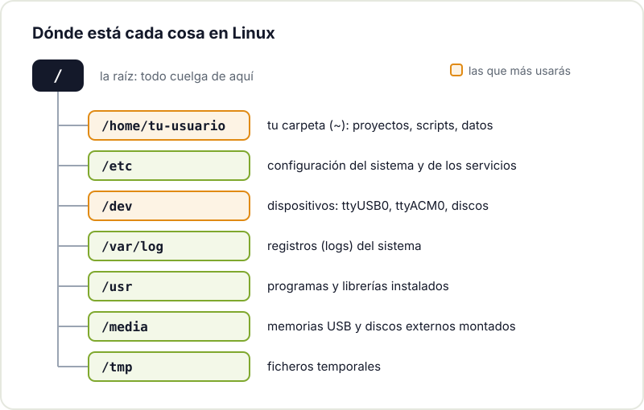
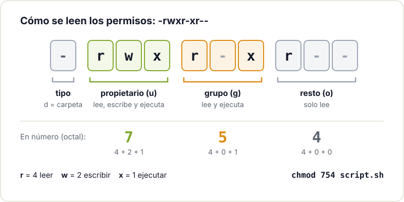

Tarde o temprano, casi todo proyecto maker acaba tocando Linux. A veces es evidente, como al montar una Raspberry Pi que controla una impresora 3D o recoge datos de sensores. Otras veces está escondido: el servidor donde corre tu broker MQTT, el contenedor que compila el firmware o el router que has reciclado como pasarela. No hace falta convertirse en administrador de sistemas, pero sí manejar lo básico sin miedo.

Esta guía reúne lo que de verdad usamos en el taller: elegir una distribución, moverse por la terminal, entender los permisos, instalar paquetes, conectarse por SSH, hablar con un puerto serie y dejar un script arrancando solo.

## Por qué Linux para un maker

- **Raspberry Pi y placas similares** usan Linux de forma nativa. Raspberry Pi OS es una distribución basada en Debian.
- **Servidores y servicios caseros**: Home Assistant, Node-RED, un broker MQTT o un servidor de ficheros funcionan especialmente bien en Linux, y la mayoría de tutoriales lo dan por supuesto.
- **Toolchains de microcontroladores**: compiladores, herramientas de flasheo y entornos como ESP-IDF o PlatformIO se usan desde la terminal y suelen ir más fluidos en Linux.
- **Reutilizar hardware**: un portátil viejo con una distribución ligera vuelve a ser útil como estación de trabajo o servidor.

Y es software libre: puedes ver cómo funciona, modificarlo y compartirlo.

## Qué distribución elegir

Una "distro" es Linux más un conjunto de programas, un gestor de paquetes y unas decisiones por defecto. Para empezar, elige algo popular: tendrás más documentación y más respuestas a tus dudas.

- **Ubuntu o Linux Mint** en un portátil o PC: instalación sencilla y una comunidad enorme. Mint resulta familiar si vienes de Windows.
- **Debian** si quieres algo estable y sobrio, sobre todo para servidores.
- **Raspberry Pi OS** en una Raspberry Pi. Su versión Lite, sin escritorio, es ideal para proyectos que funcionan sin pantalla.

Las tres comparten el gestor de paquetes `apt`, así que lo que aprendas en una vale para las otras. Si no quieres tocar tu disco, prueba antes con un USB arrancable o una máquina virtual.

## La terminal sin miedo

La terminal es la forma más directa de hablar con el sistema. Escribes un comando, pulsas Enter y te responde. Estos son los que usarás a diario:

| Comando | Para qué sirve | Ejemplo |
|---|---|---|
| `pwd` | Muestra en qué carpeta estás | `pwd` |
| `ls` | Lista el contenido de una carpeta | `ls -l /dev` |
| `cd` | Cambia de carpeta | `cd ~/proyectos` |
| `mkdir` | Crea una carpeta | `mkdir sensor-temp` |
| `cp` / `mv` | Copia o mueve (y renombra) | `mv datos.csv datos-viejos.csv` |
| `rm` | Borra ficheros (sin papelera) | `rm prueba.txt` |
| `cat` / `less` | Muestra un fichero | `less /var/log/syslog` |
| `nano` | Edita un fichero de texto | `nano config.yaml` |
| `grep` | Busca texto | `grep -r "WIFI_SSID" .` |
| `sudo` | Ejecuta como administrador | `sudo apt update` |
| `man` | Abre el manual de un comando | `man ls` |

Dos trucos que ahorran mucho tiempo: la tecla **Tab** autocompleta nombres de ficheros y comandos, y la **flecha arriba** recupera los comandos anteriores. Si quieres practicar paso a paso, el tutorial de Ubuntu [La línea de comandos para principiantes](https://ubuntu.com/tutorials/command-line-for-beginners) es un buen punto de partida.

## Dónde está cada cosa

En Linux todo cuelga de una única raíz, `/`. No hay letras de unidad como `C:`: los discos, los USB e incluso los dispositivos de hardware aparecen como carpetas y ficheros dentro de ese árbol.



Tu trabajo vive en `/home/tu-usuario` (abreviado `~`). Las configuraciones del sistema están en `/etc`, los logs en `/var/log` y los dispositivos, como el puerto serie de un Arduino, en `/dev`.

## Permisos: por qué algo dice "Permission denied"

Cada fichero tiene un propietario, un grupo y permisos de lectura (`r`), escritura (`w`) y ejecución (`x`) para tres colectivos: el propietario, el grupo y el resto. Lo ves con `ls -l`:

```bash
$ ls -l lectura.py
-rw-r--r-- 1 maker maker 812 ago 11 10:02 lectura.py
```

Ese fichero lo puede leer cualquiera, pero solo `maker` puede modificarlo, y nadie puede ejecutarlo directamente. Los diez caracteres del principio se leen siempre igual:



Para convertirlo en ejecutable:

```bash
chmod +x lectura.py
./lectura.py
```

Para tareas del sistema (instalar programas, editar `/etc`) se usa `sudo`. Úsalo cuando haga falta, no por costumbre: si un comando te pide `sudo` para tocar ficheros de tu propia carpeta, algo está mal configurado.

## Instalar software con apt

En las distros basadas en Debian, `apt` instala programas desde los repositorios oficiales, con sus dependencias y sus actualizaciones:

```bash
sudo apt update              # actualiza la lista de paquetes
sudo apt upgrade             # instala las actualizaciones
sudo apt install git python3-venv mosquitto-clients
apt search minicom           # busca un paquete
sudo apt remove minicom      # lo desinstala
```

Para proyectos de Python, crea un entorno virtual por proyecto (`python3 -m venv .venv`) e instala ahí las librerías con `pip`, en lugar de mezclarlas con las del sistema. Si quieres entender a fondo cómo funciona una distro Debian, el [Debian Administrator's Handbook](https://www.debian.org/doc/manuals/debian-handbook/) es gratuito.

## SSH: controlar una Raspberry Pi sin pantalla

La mayoría de Raspberry Pi de proyecto no tienen pantalla ni teclado. Te conectas a ellas por SSH desde tu ordenador. Puedes activar el servidor SSH al preparar la tarjeta con Raspberry Pi Imager o desde la propia Pi. La documentación oficial de [acceso remoto de Raspberry Pi](https://www.raspberrypi.com/documentation/computers/remote-access.html) explica todas las opciones.

```bash
ssh maker@raspberrypi.local       # entrar en la Pi
scp lectura.py maker@raspberrypi.local:~/   # copiar un fichero
ssh-keygen -t ed25519             # crear tu par de claves
ssh-copy-id maker@raspberrypi.local         # entrar sin contraseña
```

Con claves en lugar de contraseña es más cómodo y más seguro. Si tu Pi va a estar encendida meses, lee también cómo dejar una [Raspberry Pi funcionando 24/7](/blog/raspberry-pi-24-7/) sin sustos.

## Puertos serie: hablar con Arduino y ESP32

Cuando conectas un Arduino o un ESP32 por USB, aparece como un dispositivo en `/dev`. Normalmente será `/dev/ttyUSB0` (placas con conversor USB-serie tipo CH340 o CP2102) o `/dev/ttyACM0` (placas con USB nativo). Para ver cuál es, desconecta y vuelve a conectar la placa y mira los mensajes del kernel:

```bash
ls /dev/ttyUSB* /dev/ttyACM*
sudo dmesg | tail
```



El error típico es que el IDE no puede abrir el puerto. Casi siempre es un problema de permisos: en Debian, Ubuntu y Raspberry Pi OS esos dispositivos pertenecen al grupo `dialout`. Añade tu usuario una sola vez y cierra sesión para que tenga efecto:

```bash
sudo usermod -aG dialout $USER
```

Para leer el puerto desde la terminal, `screen /dev/ttyUSB0 115200` o `minicom` funcionan bien (con `screen`, sales con Ctrl+A y luego K). Si estás empezando con estas placas, tienes las guías para [empezar con Arduino](/blog/empezar-con-arduino/) y [empezar con el ESP32](/blog/empezar-con-esp32/).

## systemd: que tu script arranque solo

Has escrito un script que lee un sensor y lo publica en MQTT. Funciona, pero se para al cerrar la sesión SSH y no vuelve tras un corte de luz. La solución es convertirlo en un servicio de systemd, el sistema que gestiona el arranque en la mayoría de distros actuales.

Crea el fichero `/etc/systemd/system/sensor.service`:

```ini
[Unit]
Description=Lectura del sensor y envío a MQTT
After=network-online.target
Wants=network-online.target

[Service]
User=maker
WorkingDirectory=/home/maker/sensor
ExecStart=/home/maker/sensor/.venv/bin/python lectura.py
Restart=on-failure
RestartSec=5

[Install]
WantedBy=multi-user.target
```

Y actívalo:

```bash
sudo systemctl daemon-reload
sudo systemctl enable --now sensor.service
systemctl status sensor.service
journalctl -u sensor.service -f    # ver sus logs en directo
```

`Restart=on-failure` hace que systemd lo relance si se cae, y `enable` lo deja configurado para cada arranque. Todas las opciones de un servicio están en la página de manual [systemd.service](https://manpages.debian.org/bookworm/systemd/systemd.service.5.en.html), y la [wiki de Arch sobre systemd](https://wiki.archlinux.org/title/Systemd) es una referencia práctica muy completa aunque uses otra distro.

## Siguientes pasos

Con esto puedes montar casi cualquier proyecto con una Raspberry Pi o un servidor casero. A partir de aquí, merece la pena aprender Git para versionar tus scripts (tenemos un [taller de Git](/workshops/git/)), un poco de programación con nuestra guía para [empezar a programar](/blog/empezar-a-programar/) y, cuando quieras darle una cara a tu proyecto, cómo crear [apps y webs sencillas para tus proyectos maker](/blog/apps-y-webs-para-proyectos-maker/).

Y si te atascas con un permiso, un puerto serie que no aparece o un servicio que no arranca, trae el portátil o la Raspberry Pi al [Hackerspace Valencia](/blog/que-es-un-hackerspace/). Siempre hay alguien que ya se ha peleado con lo mismo. Mira los [próximos talleres](/workshops/) o [hazte socio/a](/pages/alta/).

## Créditos de imágenes

Las fotografías proceden de [Wikimedia Commons](https://commons.wikimedia.org) y se utilizan bajo sus respectivas licencias:

- **Portada** - *Raspberry Pi 4 on a network switch* - RAIL P (RAIL.PHOTOGRAPHY) - CC0 - [fuente](https://commons.wikimedia.org/wiki/File:Raspberry_Pi_4_on_a_network_switch.jpg)
- **Cable USB-serie** - *FTDI Cable* - oomlout - CC BY-SA 2.0 - [fuente](https://commons.wikimedia.org/wiki/File:FTDI_Cable.jpg)
