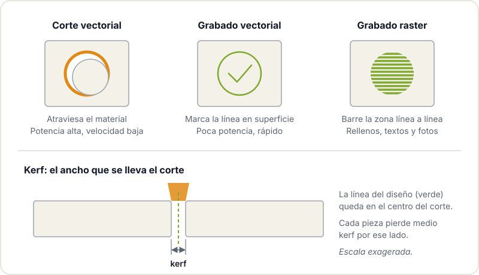

Una cortadora láser es probablemente la máquina más agradecida de un taller maker: dibujas en el ordenador, pulsas un botón y en unos minutos tienes una caja de contrachapado que encaja, un letrero grabado o el panel frontal de tu próximo proyecto con todos los agujeros en su sitio. También es la máquina en la que un descuido tiene consecuencias más serias, porque literalmente trabaja quemando material.

Esta guía explica los tipos de láser que te vas a encontrar, qué materiales se pueden cortar y cuáles **nunca**, qué software se usa, la diferencia entre trabajos vectoriales y raster, qué es el kerf y las normas básicas de seguridad.

## Tipos de láser: CO2, diodo y fibra

No todos los láseres sirven para lo mismo. La longitud de onda determina qué materiales absorben bien la energía y, por tanto, qué puede cortar o grabar cada máquina.

| Tipo | Longitud de onda | Muy bueno para | Limitaciones |
|---|---|---|---|
| **CO2** | Infrarrojo lejano (~10,6 µm) | Cortar y grabar madera, contrachapado, acrílico, cartón, cuero, tela | No marca metal desnudo; tubo con vida útil limitada |
| **Diodo** | Visible o infrarrojo cercano (habitualmente azul) | Grabado de madera y cuero, corte de madera fina | Corta despacio y con poco grosor; no corta acrílico transparente |
| **Fibra** | Infrarrojo cercano (~1 µm) | Marcado y grabado de metales y algunos plásticos | No corta madera ni acrílico como un CO2; máquinas más caras |



Para un taller comunitario, el CO2 es el más versátil. Los láseres de diodo se han popularizado en casa porque son baratos y compactos, y para grabar están muy bien, pero tienen límites claros a la hora de cortar. Los de fibra son otro mundo, orientado a marcar metal.

## Materiales: lo que sí y lo que NO

Esta es la sección más importante del artículo. Cortar el material equivocado puede liberar gases tóxicos o corrosivos, estropear la máquina o provocar un incendio.

| Material | ¿Se puede? | Notas |
|---|---|---|
| Contrachapado y DM | Sí | El DM genera mucho humo; algunos contrachapados llevan colas que cortan mal |
| Madera maciza fina | Sí | Mejor con grosores moderados |
| Acrílico (PMMA, metacrilato) | Sí | Corte con canto pulido en CO2; comprueba que es PMMA y no otro plástico |
| Cartón y papel | Sí | Vigila de cerca: prende con facilidad |
| Cuero natural | Sí | Solo si es de curtido vegetal; el cuero sintético suele ser PVC |
| Tela de algodón, fieltro de lana | Sí | |
| **PVC, vinilo, cuero sintético** | **NO** | Libera cloro y ácido clorhídrico: tóxico y corrosivo para la máquina |
| **Policarbonato (Lexan, Makrolon)** | **NO** | Se funde, amarillea y arde mal en vez de cortarse |
| **ABS** | **NO** | Se funde y desprende humos nocivos |
| **Fibra de vidrio, fibra de carbono** | **NO** | Humos peligrosos y polvo nocivo |
| **Espuma de poliestireno, polipropileno** | **NO** | Se funden, arden y pueden prender |
| **Cualquier cosa que no sepas qué es** | **NO** | Si no conoces el material, no se corta |

> **Nunca cortes ni grabes PVC ni vinilo.** El [policloruro de vinilo](https://es.wikipedia.org/wiki/Policloruro_de_vinilo) contiene cloro: al quemarse libera gas cloro y ácido clorhídrico, que dañan tus pulmones y corroen la óptica y la mecánica de la máquina. Muchos plásticos de aspecto inocente (láminas de "polipiel", algunos imanes flexibles, carpetas, cuero sintético) son PVC. Ante la duda, no se corta.

Un truco habitual para identificar plásticos dudosos es buscar la referencia del fabricante o la ficha del material. Si no hay forma de saberlo, la respuesta es no.

## Software: del dibujo a la máquina

| Programa | Para qué | Licencia |
|---|---|---|
| [Inkscape](https://inkscape.org) | Dibujo vectorial (SVG), preparar diseños | Libre |
| [LightBurn](https://lightburnsoftware.com) | Control de la máquina, capas, potencias, velocidades | De pago, con prueba |
| [LaserGRBL](https://lasergrbl.com) | Control de láseres de diodo con GRBL | Libre, Windows |
| FreeCAD, Fusion, Onshape | Diseñar piezas mecánicas y exportar su contorno | Varias |

El flujo típico es diseñar en Inkscape (o exportar desde tu CAD) y mandar el trabajo a la máquina con el programa de control que use cada láser. Algunas máquinas de CO2 usan software propio del fabricante. Pregunta antes cómo se trabaja con la máquina que vayas a usar. Si quieres generar cajas con uniones dentadas, hay generadores en línea que producen el SVG listo a partir de las medidas.

## Vector y raster: dos formas de trabajar

En el software de control, cada parte del diseño se asigna a un tipo de operación:

- **Corte vectorial**: el láser sigue la línea con potencia alta y velocidad baja hasta atravesar el material.
- **Grabado vectorial (marcado de línea)**: sigue la misma línea con poca potencia, dejando un trazo en superficie sin atravesar.
- **Grabado raster**: el cabezal barre la zona línea a línea, como una impresora de tinta, encendiendo y apagando el láser para rellenar áreas, textos gruesos o fotos.



Una convención muy extendida es usar colores distintos para cada operación (por ejemplo, rojo para cortar y negro para grabar) y asignarles parámetros por capas. El raster es mucho más lento que el vectorial, porque recorre toda la superficie: si solo necesitas un contorno, usa grabado vectorial.

## Kerf: el ancho del corte

El haz láser tiene un ancho y además vaporiza material a su alrededor, así que cada corte se "come" una franja. A esa franja se le llama [kerf](https://en.wikipedia.org/wiki/Kerf). Suele ser de décimas de milímetro y depende del láser, la lente, el material y su grosor.

¿Por qué importa? Si diseñas una caja con uniones dentadas exactamente a medida, después de cortar cada diente habrá perdido la mitad del kerf por cada lado y el encaje quedará flojo. La solución es medirlo: corta un cuadrado de medida conocida, mide con el calibre la pieza y el hueco, y compensa en el diseño o con la opción de desplazamiento (offset) del software. Haz esta prueba con cada material nuevo.

## Seguridad: no negociable

- **Nunca dejes la máquina sola mientras trabaja.** Ni un minuto. Un pequeño fuego en el material se apaga soplando o cerrando la tapa si lo ves a tiempo; si no estás, puede acabar con la máquina y el local. Ten localizado el extintor adecuado.
- **Extracción de humos encendida siempre**, y la asistencia de aire si la máquina la tiene. El humo no solo huele mal: contiene partículas y compuestos que no quieres respirar.
- **Gafas adecuadas para la longitud de onda.** En las máquinas cerradas de CO2 la tapa hace de protección; en los láseres de diodo abiertos, el reflejo del haz azul puede dañar la vista y necesitas gafas certificadas para esa longitud de onda concreta. Las gafas de sol no sirven. La página sobre [seguridad láser](https://en.wikipedia.org/wiki/Laser_safety) explica las clases y riesgos.
- **No anules los interruptores de seguridad** de la tapa.
- **Enfoca y prueba** en un retal antes del trabajo final. Ajustar en material barato ahorra disgustos.
- **Limpia los restos** de la bandeja: los recortes acumulados son combustible.

## Ideas para primeros proyectos

- Una caja con uniones dentadas para tu proyecto con [ESP32](/blog/consumo-esp32/) o Arduino.
- Un panel frontal en acrílico con los agujeros para pantalla, botones y potenciómetros.
- Plantillas de taladrado o de montaje para PCB.
- Llaveros, posavasos y letreros grabados para practicar raster.

Si combinas corte láser con [impresión 3D](/blog/empezar-impresion-3d/), tienes cubierta la mayoría de la mecánica de un prototipo. Y si necesitas mecanizar materiales que el láser no puede trabajar, el siguiente paso es la [fresadora CNC](/blog/empezar-cnc/). Para el diseño, en [herramientas de impresión 3D](/blog/herramientas-impresion-3d/) repasamos programas de CAD que también sirven aquí.

## Aprende a cortar en buena compañía

El corte láser se aprende mejor con alguien que te enseñe la máquina concreta, sus ajustes y sus manías. Pásate por el [Hackerspace Valencia](/blog/que-es-un-hackerspace/), pregunta en el local qué equipos hay y qué hace falta para usarlos, y mira la agenda de [talleres](/workshops/). Trae tu diseño en SVG y un retal del material: lo probamos juntos.

## Créditos de imágenes

Las fotos proceden de [Wikimedia Commons](https://commons.wikimedia.org) y se usan bajo sus respectivas licencias. Los diagramas son de elaboración propia.

- **Portada** - *Laser cutting snowflakes* - Andy Dingley - CC BY-SA 3.0 - [fuente](https://commons.wikimedia.org/wiki/File:Laser_cutting_snowflakes.jpg)
- **Cortadora láser CO2** - *Library laser cutter* - Mbrickn - CC BY-SA 4.0 - [fuente](https://commons.wikimedia.org/wiki/File:Library_laser_cutter.jpg)
- **Grabado raster** - *Cherry wood with binary computer engraving* - Jared Tarbell - CC BY 2.0 - [fuente](https://commons.wikimedia.org/wiki/File:Cherry_wood_with_binary_computer_engraving.jpg)
