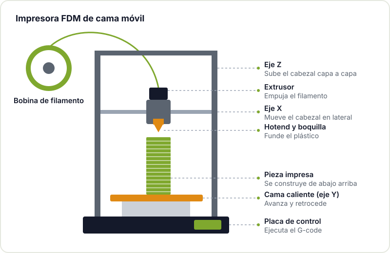

La impresión 3D es, para mucha gente, la puerta de entrada a la fabricación digital. Una carcasa para tu ESP32, un soporte para la cámara, una pieza rota del electrodoméstico que ya no se vende: en pocas horas pasas de una idea a un objeto que puedes tocar. La barrera de entrada es baja, pero hay unos cuantos conceptos que conviene entender bien para no pasar las primeras semanas peleándote con piezas que se despegan o hilos que salen por todas partes.

Esta guía está pensada para quien nunca ha impreso nada. Explica qué tecnología elegir, cómo es el flujo de trabajo, qué ajustes importan al principio, con qué materiales empezar y cómo diagnosticar los fallos más habituales.

## FDM o resina: dos formas de imprimir

Hay muchas tecnologías de impresión 3D, pero en el mundo maker dominan dos:

- **FDM ([modelado por deposición fundida](https://es.wikipedia.org/wiki/Modelado_por_deposici%C3%B3n_fundida))**: la impresora funde un hilo de plástico, el filamento, y lo deposita capa a capa con una boquilla que se mueve en X, Y y Z. Es la más común, la más barata de mantener y la más versátil para piezas funcionales.
- **Resina (SLA, MSLA, DLP)**: una pantalla o un láser endurece capa a capa una resina líquida fotosensible. Consigue un detalle muy superior, ideal para miniaturas, joyería o piezas pequeñas de precisión.

| | FDM | Resina |
|---|---|---|
| Detalle | Medio, las capas se ven | Muy alto |
| Piezas funcionales | Muy buenas | Más frágiles, según la resina |
| Postprocesado | Quitar soportes y poco más | Lavado en alcohol, curado UV, guantes |
| Manipulación | Sencilla y limpia | Resina tóxica antes de curar, requiere ventilación |
| Tamaño de pieza | Medio y grande | Pequeño y medio |



Para empezar, FDM es casi siempre la opción más razonable: el material es fácil de manejar, los errores son baratos y la mayoría de lo que un maker necesita (carcasas, soportes, engranajes, adaptadores) se imprime muy bien así. El resto de esta guía se centra en FDM.

## Las partes de una impresora FDM

Antes de tocar ningún ajuste, conviene saber qué es cada cosa. Aunque hay muchos diseños (cartesianas de cama móvil, CoreXY, delta), todas comparten las mismas piezas básicas.



- **Extrusor**: unos engranajes que empujan el filamento hacia el hotend.
- **Hotend y boquilla**: la zona caliente donde el plástico se funde. La boquilla más habitual es de 0,4 mm.
- **Cama caliente**: la superficie donde se construye la pieza. Calentarla ayuda a que la primera capa se adhiera.
- **Ejes y motores paso a paso**: mueven el cabezal y la cama con precisión.
- **Placa de control**: interpreta el G-code y gobierna motores, temperaturas y ventiladores.

## Del modelo a la pieza: el flujo de trabajo

Imprimir algo siempre sigue la misma cadena. Entenderla te ayuda a saber dónde buscar cuando algo sale mal.


1. **Modelo**: lo diseñas tú en un programa CAD o lo descargas de un repositorio. Suele venir en STL o 3MF.
2. **Slicer (laminador)**: corta el modelo en capas y calcula las trayectorias de la boquilla. Aquí eliges material, altura de capa, relleno, soportes y velocidad.
3. **G-code**: el resultado del slicer, un archivo de texto en el lenguaje de control numérico conocido como [código G](https://es.wikipedia.org/wiki/G-code), con instrucciones de movimiento y temperatura que la impresora entiende.
4. **Impresora**: ejecuta el G-code línea a línea.

Un fragmento de G-code tiene este aspecto. No necesitas escribirlo a mano, pero reconocerlo ayuda a entender qué está haciendo la máquina:

```gcode
M104 S210      ; temperatura del hotend a 210 °C
M140 S60       ; temperatura de la cama a 60 °C
G28            ; llevar todos los ejes a su origen
G1 Z0.2 F3000  ; bajar a la altura de la primera capa
G1 X50 Y20 E5 F1500  ; moverse extruyendo filamento
```

En [Herramientas y recursos para impresión 3D](/blog/herramientas-impresion-3d/) repasamos los programas de diseño y los slicers más usados.

## Primeros ajustes: lo que de verdad importa

### Nivelado de la cama

La boquilla tiene que estar a la misma distancia de la cama en toda su superficie. Muchas impresoras actuales tienen un sensor que mide la cama y compensa las irregularidades automáticamente; otras se nivelan a mano con ruedas bajo la cama y una hoja de papel como galga. Sea cual sea tu caso, una cama mal nivelada provoca que la pieza se pegue bien en una esquina y nada en la contraria.

### La primera capa

Si la primera capa sale bien, la impresión casi siempre sale bien. Lo que buscas es un hilo ligeramente aplastado contra la cama, con las líneas unidas entre sí y sin huecos. Si la boquilla está demasiado alta, el plástico se deposita redondo y se despega; si está demasiado baja, la boquilla raya la superficie o no deja salir plástico. Este ajuste se llama habitualmente *offset Z* o *Live Z*, y la base de conocimiento de Prusa tiene una buena guía de [problemas de primera capa](https://help.prusa3d.com/article/first-layer-issues_1804) con fotos de cada caso.

Además, la superficie tiene que estar limpia. Una huella dactilar basta para que el PLA no se pegue: limpia la cama con alcohol isopropílico o agua con jabón según indique el fabricante de la superficie.

### Temperatura

Cada filamento tiene un rango de temperatura que suele venir impreso en la bobina. Empieza en la mitad del rango y ajusta: si las capas se separan con facilidad, sube un poco; si aparecen muchos hilos entre partes de la pieza, baja un poco. Una *torre de temperatura* (un modelo que imprime tramos a distintas temperaturas) te enseña en una sola impresión cuál funciona mejor con tu bobina.

## Materiales para empezar: PLA, PETG y TPU

Hay decenas de filamentos, pero estos tres cubren la gran mayoría de proyectos de principiante.

| Material | Facilidad | Para qué sirve | A tener en cuenta |
|---|---|---|---|
| **PLA** | Muy fácil | Prototipos, carcasas, piezas decorativas | Se ablanda con calor moderado; no lo dejes en el coche al sol |
| **PETG** | Fácil-media | Piezas funcionales, exteriores, algo de flexibilidad | Más tendencia a hacer hilos; se pega muy fuerte a algunas camas |
| **TPU** | Media-difícil | Piezas flexibles: juntas, topes, fundas | Imprime despacio; los extrusores de tipo bowden lo llevan peor |

Las temperaturas exactas dependen del fabricante del filamento y de la impresora, así que consulta la bobina o una referencia como la [guía de materiales de Prusa](https://help.prusa3d.com/filament-material-guide). Un consejo práctico: guarda los filamentos en una caja o bolsa con desecante. El PETG y sobre todo el TPU absorben humedad del ambiente, y un filamento húmedo chisporrotea, hace burbujas y deja piezas débiles.

## Errores típicos y cómo reconocerlos

- **La pieza se despega de la cama (o se curva en las esquinas, *warping*)**: primera capa alta, cama sucia o temperatura de cama baja. Revisa en ese orden.
- **Hilos finos entre partes (*stringing*)**: temperatura alta, retracción insuficiente o filamento húmedo.
- **Huecos y capas sin material (subextrusión)**: boquilla parcialmente atascada, filamento enredado en la bobina o temperatura baja.
- **Capas desplazadas**: una correa floja, el cabezal chocando con una parte levantada de la pieza o velocidad demasiado alta.
- **"Espagueti"**: la pieza se soltó a mitad y la impresora sigue extruyendo al aire. Casi siempre es un problema de adhesión o de voladizos sin soporte.

La regla de oro: cambia un solo parámetro cada vez y apunta qué has cambiado. Si tocas tres cosas a la vez y mejora, no sabrás cuál fue.

## Dónde encontrar modelos

No hace falta diseñar todo desde cero. Repositorios como Printables, Thingiverse o MakerWorld tienen cientos de miles de modelos, muchos con licencias abiertas que permiten modificarlos y compartir tus versiones. Antes de imprimir, mira las fotos que han subido otras personas (las *makes*): te dicen si el modelo se imprime bien y con qué ajustes. Cuando quieras ir un paso más allá, aprender a diseñar tus propias piezas es lo que de verdad multiplica lo que puedes hacer; en [nuestra guía de herramientas](/blog/herramientas-impresion-3d/) tienes por dónde empezar, y en [recursos para makers](/blog/recursos-para-makers/) más comunidades y webs útiles.

Si te interesa la fabricación digital en general, echa un vistazo también a cómo empezar con el [corte láser](/blog/empezar-corte-laser/) y con la [fresadora CNC](/blog/empezar-cnc/): el flujo de diseño a máquina es sorprendentemente parecido.

## Ven a imprimir con nosotros

La forma más rápida de aprender es imprimir al lado de alguien que ya ha cometido todos los errores. Si quieres empezar, pásate por el [Hackerspace Valencia](/blog/que-es-un-hackerspace/) o mira la agenda de [talleres](/workshops/): pregunta en el local qué impresoras hay disponibles y cómo se usan, trae un modelo que quieras sacar y lo preparamos juntos. Y si te quedas, [hazte socio/a](/pages/alta/).

## Créditos de imágenes

Las fotos proceden de [Wikimedia Commons](https://commons.wikimedia.org) y se usan bajo sus respectivas licencias. Los diagramas son de elaboración propia.

- **Portada** - *Machine product design printer 3D* - autor desconocido (pxhere) - CC0 - [fuente](https://commons.wikimedia.org/wiki/File:Machine-product-design-printer-3d-pressure-605267-pxhere.jpg)
- **Impresora de resina** - *Formlabs Form2 Bild05* - Creative Tools - CC BY 2.0 - [fuente](https://commons.wikimedia.org/wiki/File:Formlabs_Form2_Bild05_5184x2912_(24472439496).jpg)
