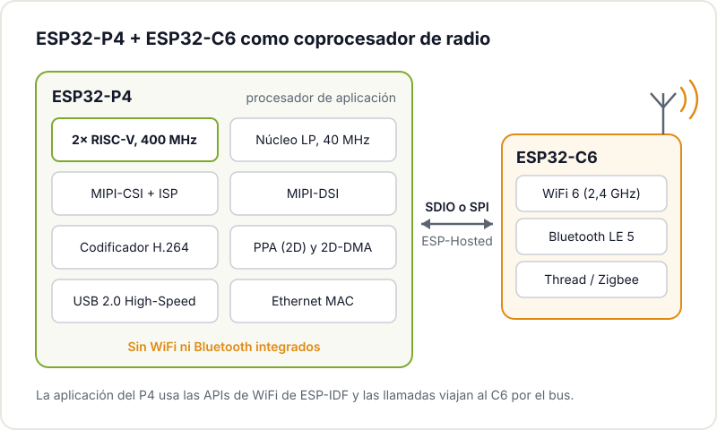
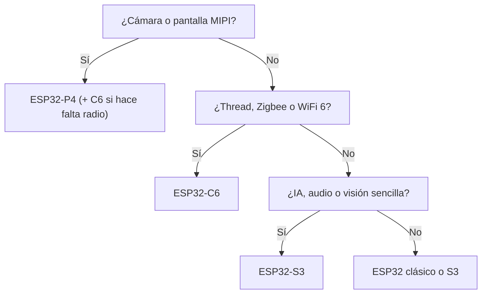

La familia ESP32 se ganó a la comunidad maker por una combinación difícil de batir: WiFi y Bluetooth integrados, precio bajo y un ecosistema enorme. Pero los proyectos han crecido. Ahora queremos pantallas táctiles fluidas, cámaras, procesar audio o imagen en local y ejecutar pequeños modelos de IA. Para eso Espressif ha sacado el **ESP32-P4**, un chip que rompe con la tradición de la casa: es mucho más potente que sus hermanos y, sorprendentemente, **no tiene radio**.

En este artículo vemos qué trae, en qué se diferencia del resto de la familia y cómo se le añade conectividad cuando la necesitas.

## Qué es el ESP32-P4

Según la [página oficial del ESP32-P4](https://www.espressif.com/en/products/socs/esp32-p4), sus puntos clave son:

- **Dos núcleos RISC-V de alto rendimiento hasta 400 MHz**, con unidad de coma flotante y extensiones para IA, más un núcleo de bajo consumo (LP) hasta 40 MHz.
- **768 KB de SRAM interna**, ampliable con PSRAM externa.
- **MIPI-CSI** con ISP integrado para cámaras y **MIPI-DSI** para pantallas, además de interfaces paralelas.
- **Codificación H.264 por hardware** hasta 1080p a 30 fps.
- **PPA** (acelerador de procesado de píxeles) y 2D-DMA para mover y transformar imagen sin cargar a la CPU.
- **USB 2.0 High-Speed**, Ethernet, SDIO 3.0 y **55 GPIO programables**, la cifra más alta de la familia.
- Seguridad completa: secure boot, cifrado de flash, aceleradores criptográficos y gestión de claves.

Un detalle práctico: las primeras revisiones del chip (v1.x) funcionan a 360 MHz y Espressif ya recomienda las revisiones 3.x, que alcanzan los 400 MHz. Si compras una placa de desarrollo, mira qué revisión lleva.

## Comparativa con el resto de la familia

Datos tomados de las páginas de producto y datasheets de Espressif:

| | ESP32 | ESP32-S3 | ESP32-C6 | ESP32-P4 |
|---|---|---|---|---|
| Núcleos | 2× Xtensa LX6 (hay variantes de 1) | 2× Xtensa LX7 | 1× RISC-V + 1× RISC-V LP | 2× RISC-V + 1× RISC-V LP |
| Frecuencia máx. | 240 MHz | 240 MHz | 160 MHz (LP: 20 MHz) | 400 MHz (LP: 40 MHz) |
| SRAM interna | 520 KB | 512 KB | 512 KB | 768 KB |
| WiFi | 802.11 b/g/n, 2,4 GHz | 802.11 b/g/n, 2,4 GHz | WiFi 6 (802.11ax), 2,4 GHz | No |
| Bluetooth | Clásico y LE (v4.2) | LE 5 | LE 5 | No |
| 802.15.4 (Thread, Zigbee) | No | No | Sí | No |
| Extras | DAC, Ethernet MAC, táctil | Instrucciones vectoriales para IA, USB OTG, táctil | Núcleo LP, buen candidato para Matter | MIPI-CSI/DSI, H.264, PPA, USB 2.0 HS, Ethernet |

La lectura rápida: el ESP32 clásico sigue siendo el comodín con más ejemplos en Internet; el S3 es el todoterreno para IA ligera, audio y pantallas pequeñas; el C6 es el especialista en conectividad moderna; y el P4 es el que trabaja con imagen y pantallas grandes.

## Por qué no tiene WiFi (y cómo añadirlo)

Quitar la radio puede parecer un paso atrás, pero tiene lógica: libera silicio y consumo para lo que el P4 hace bien, y permite elegir la conectividad que cada proyecto necesita. Hay muchos diseños donde basta con Ethernet o USB, o que directamente no necesitan red.

Cuando sí hace falta, la solución de Espressif es acompañarlo de otro chip de la familia como coprocesador de radio, normalmente un **ESP32-C6**. Ambos se conectan por SDIO o SPI y se comunican con [ESP-Hosted](https://github.com/espressif/esp-hosted-mcu): el firmware del P4 llama a las APIs de WiFi de siempre en ESP-IDF y esas llamadas se ejecutan en el C6. La propia documentación de ESP-Hosted usa precisamente la pareja ESP32-P4 + ESP32-C6 como ejemplo. Varias placas de desarrollo del P4 ya traen el C6 montado, así que en la práctica no tienes que diseñar nada.



## Para qué usarlo en proyectos maker

Donde el P4 marca la diferencia es en todo lo que tiene que ver con imagen y pantallas:

- **Paneles de control con pantalla táctil**: un cuadro de mandos para la domótica de casa, para el taller o para una máquina, con una interfaz fluida en una pantalla MIPI.
- **Cámaras inteligentes**: una cámara que vigila una impresora 3D o la puerta del taller, procesa en local y solo envía avisos o clips codificados en H.264.
- **Visión artificial ligera**: detectar si hay alguien delante, contar objetos o leer un indicador. Las técnicas de [TinyML en microcontroladores](/blog/tinyml-microcontroladores/) encajan aquí, con ESP-DL como librería de Espressif.
- **Pasarelas**: un P4 con Ethernet hacia la red y un C6 hablando Thread o Zigbee con los sensores.
- **Audio y multimedia**: reproductores, mezcladores o instrumentos digitales que aprovechen la potencia extra.

## ¿Qué chip elijo?

Si es tu primer proyecto con la familia, no empieces por el P4: el ESP32 clásico o el S3 tienen muchos más ejemplos y librerías probadas, y lo que aprendas te sirve igual. En [empezar con el ESP32](/blog/empezar-con-esp32/) tienes el camino de entrada.

## Cómo programarlo

El P4 se programa con [ESP-IDF](https://docs.espressif.com/projects/esp-idf/en/stable/esp32p4/index.html), como el resto de la familia, y también aparece como chip soportado en el core Arduino-ESP32. Para empezar, lo más cómodo es una placa de desarrollo con la pantalla y la cámara ya resueltas, como la [ESP32-P4-Function-EV-Board](https://docs.espressif.com/projects/esp-dev-kits/en/latest/esp32p4/esp32-p4-function-ev-board/index.html) u otras de fabricantes de terceros. Diseñar una PCB propia con el P4 es otro nivel: líneas MIPI de alta velocidad, PSRAM y varias tensiones de alimentación. Si te animas, revisa antes los [errores típicos al diseñar una PCB con ESP32](/blog/errores-pcb-esp32/).

## Conclusión

El ESP32-P4 no sustituye al ESP32 ni al S3: amplía la familia hacia arriba. Cuando un proyecto pide pantalla grande, cámara o procesado de imagen, ofrece capacidades que antes obligaban a saltar a un ordenador de placa con Linux, con el consumo y el arranque de un microcontrolador. Y si necesita radio, un C6 al lado lo resuelve.

## Tráelo al hackerspace

Si tienes un P4 en el cajón esperando proyecto, o estás dudando qué chip de la familia elegir, pásate por el [Hackerspace Valencia](/blog/que-es-un-hackerspace/). Comparar placas sobre la mesa y ver qué ha hecho otra gente con ellas ayuda mucho más que leer datasheets en solitario. Y si te quedas, [hazte socio o socia](/pages/alta/).

## Créditos de imágenes

El diagrama es original del Hackerspace Valencia. Las fotografías proceden de [Wikimedia Commons](https://commons.wikimedia.org):

- **Portada** - *Espressif ESP32-P4* - Pathfinbird - CC BY-SA 4.0 - [fuente](https://commons.wikimedia.org/wiki/File:Espressif_ESP32-P4.jpg)
- **Placa ESP32-C6** - *RISC-V ESP32-C6-WROOM-1.devboard* - Popolon - CC BY-SA 4.0 - [fuente](https://commons.wikimedia.org/wiki/File:RISC-V_ESP32-C6-WROOM-1.devboard.jpg)
