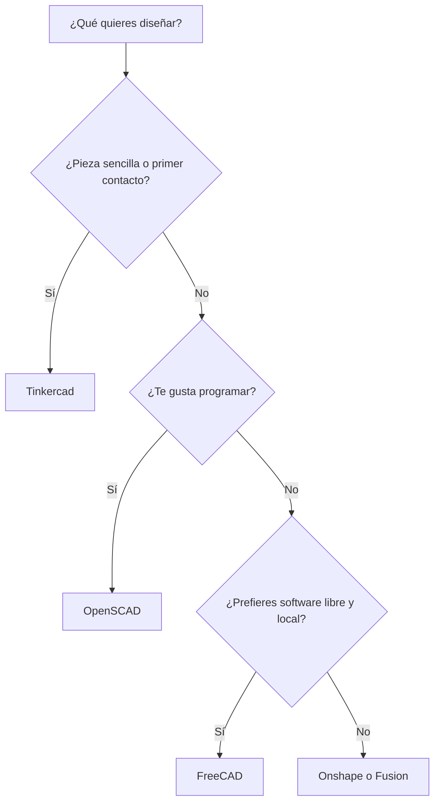
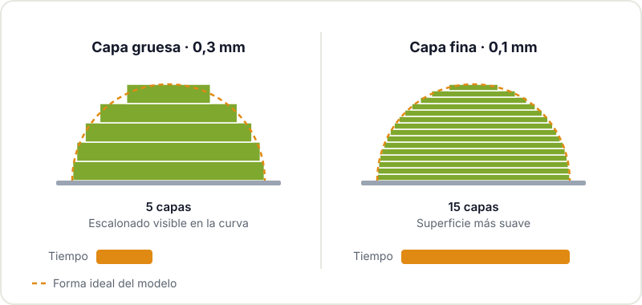

Una impresora 3D por sí sola no hace mucho. Lo que convierte una idea en una pieza útil es la cadena de herramientas que la rodea: el programa con el que diseñas, el slicer que traduce ese diseño a instrucciones, los repositorios donde encuentras (y compartes) modelos y el pequeño kit físico que usas para limpiar, retocar y mantener la máquina.

Esta guía repasa cada eslabón con las opciones más usadas en la comunidad maker, pensando en quien está empezando y quiere saber por dónde tirar sin perderse entre decenas de alternativas. Si todavía no has impreso nada, empieza por [cómo empezar con la impresión 3D](/blog/empezar-impresion-3d/) y vuelve aquí después.

## Software de diseño (CAD)

Hay dos familias de programas de diseño que conviene distinguir:

- **Modelado paramétrico**: dibujas un boceto con cotas y restricciones y lo conviertes en sólido. Si luego cambias una medida, todo el modelo se recalcula. Es lo ideal para piezas funcionales: carcasas, soportes, adaptadores.
- **Modelado por bloques o por código**: combinas formas básicas (cubos, cilindros) sumándolas y restándolas, con ratón o escribiendo código. Más limitado, pero muy rápido de aprender.

| Programa | Tipo | Licencia y plataforma | Para quién |
|---|---|---|---|
| Tinkercad | Bloques, en el navegador | Gratuito, web | Primer contacto, niñas y niños, piezas sencillas |
| [OpenSCAD](https://openscad.org) | Código | Libre, Windows/macOS/Linux | Quien programa y quiere piezas parametrizables por texto |
| [FreeCAD](https://www.freecad.org) | Paramétrico | Libre, Windows/macOS/Linux | Piezas funcionales sin depender de licencias |
| Onshape | Paramétrico, en el navegador | Plan gratuito con documentos públicos | Trabajar desde cualquier equipo y colaborar |
| Fusion (Autodesk) | Paramétrico + CAM | Licencia personal con limitaciones | Quien ya lo conoce o quiere CAM integrado |

Si dudas, este esquema resume cómo elegir:



Nuestra recomendación para empezar: una tarde con Tinkercad para entender el espacio 3D y, en cuanto se quede corto, saltar a un programa paramétrico. FreeCAD tiene una curva de aprendizaje más dura, pero es software libre y tus archivos son tuyos para siempre. Las condiciones de los planes gratuitos de las herramientas comerciales cambian con el tiempo, así que revísalas antes de invertir horas en una de ellas.

OpenSCAD merece una mención especial para quien viene de programar. Una caja con tapa parametrizada cabe en unas líneas:

```openscad
ancho = 60; fondo = 40; alto = 25; pared = 2;

difference() {
    cube([ancho, fondo, alto]);
    translate([pared, pared, pared])
        cube([ancho - 2*pared, fondo - 2*pared, alto]);
}
```

Cambias `ancho` y tienes otra caja. Ideal para carcasas de placas como un ESP32 o un Arduino, donde a menudo solo cambian las medidas.

## Slicers: de la pieza al G-code

El slicer corta el modelo en capas y genera el G-code que ejecuta la impresora. Es donde más influyes en el resultado final, así que merece la pena conocer bien uno.

| Slicer | Licencia | Puntos fuertes |
|---|---|---|
| [PrusaSlicer](https://www.prusa3d.com/page/prusaslicer_424/) | Libre | Perfiles muy cuidados, interfaz clara, soportes orgánicos |
| [OrcaSlicer](https://github.com/SoftFever/OrcaSlicer) | Libre | Muchos perfiles de impresoras, calibraciones integradas |
| [UltiMaker Cura](https://github.com/Ultimaker/Cura) | Libre | Enorme cantidad de ajustes y plugins |

Los tres son buenos. Lo práctico es usar el que tenga un perfil bien afinado para tu impresora y no cambiar de slicer cada semana: es más importante entender qué hace cada ajuste que el programa en sí.

### El ajuste que más se nota: la altura de capa

Si solo vas a entender un parámetro, que sea este. La altura de capa es el grosor de cada pasada de plástico. Capas finas dan superficies más suaves en curvas e inclinaciones, pero multiplican el número de capas y, con ello, el tiempo de impresión.



Con una boquilla de 0,4 mm, 0,2 mm es el punto de partida habitual: buen equilibrio para casi todo. Baja a 0,1-0,15 mm para figuras con detalle y sube a 0,28-0,3 mm para piezas grandes donde el acabado da igual. Una regla general es no superar aproximadamente el 75-80 % del diámetro de la boquilla.

Otros ajustes que conviene conocer desde el principio:

- **Relleno (infill)**: porcentaje y patrón del interior. Para piezas de prueba, un 10-15 % basta; la resistencia depende más del número de perímetros que del relleno.
- **Perímetros o paredes**: las líneas del contorno. Subir de dos a tres o cuatro hace la pieza bastante más robusta.
- **Soportes**: estructuras temporales para los voladizos. Orientar bien la pieza suele ahorrar la mayoría.
- **Brim**: un borde fino alrededor de la primera capa que ayuda a que piezas pequeñas o altas no se despeguen.

## Repositorios de modelos

| Repositorio | Lo bueno | A tener en cuenta |
|---|---|---|
| **Printables** | Comunidad activa, buenas fotos de impresiones reales, licencias claras | Vinculado a un fabricante, pero acepta modelos para cualquier impresora |
| **Thingiverse** | El más antiguo, un archivo inmenso | Calidad muy desigual; muchos modelos antiguos sin mantener |
| **MakerWorld** | Muchos modelos recientes, perfiles de impresión incluidos | Pensado sobre todo para sus impresoras, aunque los modelos sirven para cualquiera |

Antes de descargar, fíjate en la **licencia** del modelo (muchos usan Creative Commons, algunas variantes prohíben el uso comercial o las modificaciones) y en las fotos de otras personas que lo han impreso. Si modificas un modelo, súbelo como remix citando el original: así funciona la cultura abierta. Si buscas archivos editables, prioriza los que incluyen STEP o el fuente de FreeCAD u OpenSCAD en lugar de solo STL, porque un STL es una malla de triángulos difícil de modificar con precisión.

## Herramientas físicas: postprocesado y mantenimiento

La parte menos glamurosa, pero la que marca la diferencia entre una pieza "recién salida" y una pieza terminada.

| Herramienta | Para qué |
|---|---|
| Espátula fina o rascador | Separar piezas de la cama sin dañar la superficie |
| Alicates de corte al ras | Retirar soportes y rebabas |
| Cúter o desbarbador | Limpiar bordes y agujeros |
| Limas y lijas de varios granos | Ajustar encajes y mejorar el acabado |
| Calibre (pie de rey) | Medir piezas reales para diseñar y comprobar tolerancias |
| Alcohol isopropílico y paño | Limpiar la cama antes de imprimir |
| Juego de llaves Allen | Ajustar tornillería, correas y poleas |
| Aguja de limpieza y boquillas de repuesto | Desatascar o cambiar la boquilla |
| Caja estanca con desecante | Mantener el filamento seco |
| Insertos roscados y soldador | Añadir roscas metálicas a piezas impresas |



El calibre es la herramienta que más cambia tu forma de diseñar: mides el agujero real de la placa, el diámetro del tornillo, el grosor del cable, y diseñas con esos números en lugar de a ojo. Y los insertos roscados, colocados con la punta del soldador, convierten una carcasa impresa en algo que se puede abrir y cerrar cientos de veces.

En cuanto al mantenimiento básico: limpia la cama a menudo, revisa de vez en cuando la tensión de las correas, mantén limpios los ejes y sigue las indicaciones de lubricación del fabricante de tu máquina. La mayoría de "fallos misteriosos" vienen de una superficie sucia, un filamento húmedo o una boquilla gastada.

## Para seguir aprendiendo

- La [base de conocimiento de Prusa](https://help.prusa3d.com/) es una de las mejores referencias generales, aunque no uses sus impresoras.
- La documentación de FreeCAD y de OpenSCAD incluye tutoriales paso a paso.
- En [recursos para makers](/blog/recursos-para-makers/) tienes comunidades y webs para todo lo demás.

Si te interesa la fabricación digital más allá del plástico, mira también nuestras guías de [corte láser](/blog/empezar-corte-laser/) y de [fresadora CNC](/blog/empezar-cnc/), que comparten buena parte de este flujo de diseño.

## Ven a diseñar e imprimir

Aprender CAD a solas es posible, pero con alguien al lado que te enseñe un par de atajos se avanza el triple. Ven al [Hackerspace Valencia](/blog/que-es-un-hackerspace/) con la pieza que quieres hacer, pregunta en el local qué máquinas y herramientas hay disponibles y echa un ojo a los [talleres](/workshops/) programados. Si quieres ver qué se ha hecho ya, en [proyectos](/proyectos/) hay unos cuantos con piezas impresas.

## Créditos de imágenes

Las fotos proceden de [Wikimedia Commons](https://commons.wikimedia.org) y se usan bajo sus respectivas licencias. Los diagramas son de elaboración propia.

- **Portada** - *3D printer farm at Hackerspace Wrocław* - Majabojarska - CC BY 4.0 - [fuente](https://commons.wikimedia.org/wiki/File:3D_printer_farm_at_Hackerspace_Wroc%C5%82aw.jpg)
- **Calibre digital** - *2020 Suwmiarka cyfrowa* - Jacek Halicki - CC BY-SA 4.0 - [fuente](https://commons.wikimedia.org/wiki/File:2020_Suwmiarka_cyfrowa.jpg)
