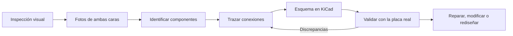
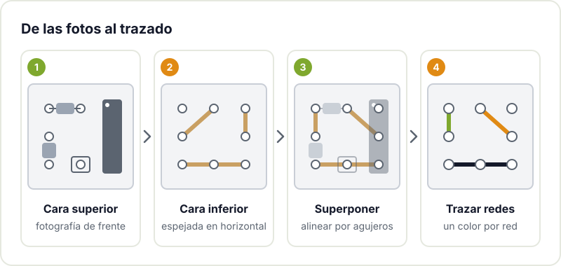

Tarde o temprano llega a la mesa del taller una placa sin documentación. Un amplificador que alguien rescató de un contenedor, la controladora de una impresora vieja, el receptor de radio de un abuelo o un módulo chino del que nadie encuentra el esquema. Funciona a medias, o no funciona, y no hay manual de servicio ni fabricante al que preguntar.

La ingeniería inversa de una PCB consiste en reconstruir la información que falta a partir de la propia placa: qué componentes tiene, cómo están conectados y, con suerte, por qué se diseñó así. No se trata de copiar un producto, sino de recuperar conocimiento para reparar, adaptar o aprender.

## Por qué hacerlo en un hackerspace

En el entorno maker los motivos suelen ser muy concretos:

- **Reparar**: localizar el componente quemado es mucho más fácil cuando sabes qué hace cada parte del circuito.
- **Revivir equipos viejos**: con aparatos como los del proyecto de [restauración de radios antiguas](/proyectos/radios/), el manual de servicio no siempre aparece y toca deducir el circuito de la propia placa.
- **Reutilizar**: aprovechar piezas recicladas, como en el [plotter hecho con lectores de CD-ROM](/proyectos/plotter/), pasa por entender cómo están cableados los motores y sensores que trae cada unidad.
- **Aprender**: una placa comercial es un libro de diseño abierto. Ver cómo otros resolvieron la alimentación, el filtrado o la protección de entradas enseña más que muchos tutoriales.
- **Sustituir piezas descatalogadas**: si un integrado ya no se fabrica, necesitas saber qué función cumple para buscarle un reemplazo.

Todo esto conecta con el movimiento por el [derecho a reparar](https://es.wikipedia.org/wiki/Derecho_a_reparar): la idea de que lo que compras debería poder abrirse, entenderse y arreglarse.



## Qué puedes recuperar de una placa

Con paciencia y herramientas básicas se puede reconstruir bastante:

- El **esquema eléctrico**, total o de la parte que te interesa.
- La **lista de materiales** (BOM), con referencias y valores.
- El **pinout** de conectores e interfaces, que muchas veces es lo único que necesitas.
- La **arquitectura de alimentación**: qué reguladores hay, qué tensiones generan y a quién alimentan.
- Si quieres ir más allá, un **layout nuevo** en KiCad, por ejemplo para fabricar un repuesto en una tirada de cinco placas.

Lo que no se recupera fácilmente es el firmware de un microcontrolador con la lectura protegida. Eso es otra disciplina y, en la mayoría de reparaciones, no hace falta.

## El proceso, fase a fase

### 1. Inspección visual

Antes de tocar nada, mira. Cuenta capas (si ves vías que no llegan a ninguna pista visible en ninguna cara, probablemente hay capas internas), localiza el conector de alimentación, los reguladores y el componente principal. Busca zonas quemadas, condensadores hinchados o soldaduras frías: a veces la reparación termina aquí.

### 2. Fotografía ambas caras

Es el paso que más tiempo ahorra después. Fotografía la cara de componentes y la de soldaduras con la cámara lo más perpendicular posible, con luz difusa y algo de referencia de escala. Si puedes, haz otra tanda de fotos sin componentes grandes que tapen pistas, o con luz rasante para resaltar el cobre bajo la máscara.



### 3. Alinear, espejar y trazar

El truco clásico: abre las dos fotos en un editor de imágenes (GIMP o Inkscape sirven), espeja horizontalmente la de la cara inferior y escálala hasta que los agujeros de los componentes pasantes coincidan con los de la cara superior. Con las dos imágenes en capas y la superior semitransparente, ves de un vistazo qué pista conecta qué pad. Después, traza encima en una tercera capa, con un color por cada red.

### 4. Identificar componentes

Los pasivos se leen por su código de colores o serigrafía; los integrados, por su marcaje. Busca el datasheet de cada uno: el pinout del integrado principal te dice qué esperar alrededor. En SMD los marcajes son códigos cortos que hay que buscar en tablas de códigos SMD, y a veces vienen borrados a propósito. En ese caso, deduce la función por el entorno: un integrado de tres patas con un condensador a cada lado junto a la entrada de alimentación casi seguro es un regulador.

### 5. Comprobar continuidad

Las fotos engañan: pistas que pasan bajo un componente, vías tapadas, capas internas. Usa el multímetro en modo continuidad para confirmar cada conexión dudosa, siempre con la placa sin alimentar. Anota lo que compruebes directamente sobre el trazado.



### 6. Redibujar el esquema en KiCad

Pasa lo trazado a un esquema en [KiCad](https://www.kicad.org/). No intentes que el esquema imite el layout físico: agrupa por función (alimentación, entrada, procesamiento, salida) para que se entienda. Empieza por la alimentación y masa, que son las redes que más pads tocan, y luego ve bloque a bloque. La [documentación oficial de KiCad](https://docs.kicad.org/) explica el editor de esquemas si es tu primera vez, y en el [taller de KiCad](/workshops/kicad/) lo practicamos desde cero.

### 7. Validar

Compara el esquema con la placa real: mide tensiones en puntos clave con la placa alimentada y comprueba que coinciden con lo que el esquema predice. Cada discrepancia suele significar una conexión mal trazada. Este bucle se repite hasta que todo encaja.

## Dificultades habituales

- **Placas multicapa**: las capas internas no se ven. Puedes deducirlas por continuidad entre vías, pero en placas de cuatro o más capas con mucha densidad el esfuerzo crece rápido.
- **Componentes sin marcaje** o con el marcaje lijado.
- **Componentes BGA**: las conexiones quedan ocultas bajo el encapsulado.
- **Firmware protegido**: puedes entender el hardware completo y aun así no saber qué hace el programa.
- **Piezas obsoletas**: descubrir qué es un integrado no garantiza encontrarlo a la venta.

## Cuándo compensa y cuándo no

Compensa cuando la placa funcionaba bien y solo quieres repararla, documentarla, cambiar una pieza descatalogada o hacer una modificación pequeña. Ahí partes de un diseño probado y ahorras mucho trabajo.

No compensa tanto cuando quieres algo muy distinto: otra arquitectura, otro microcontrolador, funciones nuevas importantes. En ese caso suele ser mejor diseñar desde cero inspirándote en lo que aprendiste. Y si acabas haciendo una placa nueva, repasa nuestra [checklist antes de mandar a fabricar](/blog/checklist-fabricacion-pcb/).

## Una nota sobre propiedad intelectual

Analizar una placa que te pertenece para repararla, entenderla o hacerla compatible con otras cosas es una práctica habitual y, en general, legítima. Otra cosa es copiar un diseño protegido para venderlo, saltarse protecciones anticopia o redistribuir firmware ajeno: ahí pueden entrar en juego patentes, derechos de autor o licencias. Si tu proyecto va más allá del uso personal o la reparación, infórmate antes. En el hackerspace nos movemos en el primer terreno: reparar, aprender y compartir lo aprendido.

## Trae tu placa misteriosa

Si tienes un aparato estropeado sin esquema o una placa reciclada que quieres aprovechar, tráela al [Hackerspace Valencia](/blog/que-es-un-hackerspace/). Entre varias personas, una lupa y un multímetro, las placas misteriosas dejan de serlo bastante rápido. Si te engancha, [hazte socio o socia](/pages/alta/) y tendrás un sitio fijo donde seguir trasteando.

## Créditos de imágenes

El diagrama es original del Hackerspace Valencia. Las fotografías proceden de [Wikimedia Commons](https://commons.wikimedia.org):

- **Portada** - *HP-35 Main Board solder side* - Mister rf - CC BY-SA 4.0 - [fuente](https://commons.wikimedia.org/wiki/File:HP-35_Main_Board_solder_side.jpg)
- **Placa de receptor antiguo** - *Sharp Optonica SA-2121H receiver AM RF-IF board 01* - Retired electrician - CC0 - [fuente](https://commons.wikimedia.org/wiki/File:Sharp_Optonica_SA-2121H_receiver_AM_RF-IF_board_01.jpg)
- **Placa por ambas caras** (composición de dos fotos) - *Farb RGB 29504-105.11* y *Farb RGB 29504-105.11 solder side* - Mister rf - CC BY-SA 4.0 - [fuente 1](https://commons.wikimedia.org/wiki/File:Farb_RGB_29504-105.11.jpg), [fuente 2](https://commons.wikimedia.org/wiki/File:Farb_RGB_29504-105.11_solder_side.jpg)
- **Multímetro** - *Aneng AN870 multimeter 01* - Retired electrician - CC0 - [fuente](https://commons.wikimedia.org/wiki/File:Aneng_AN870_multimeter_01.jpg)
