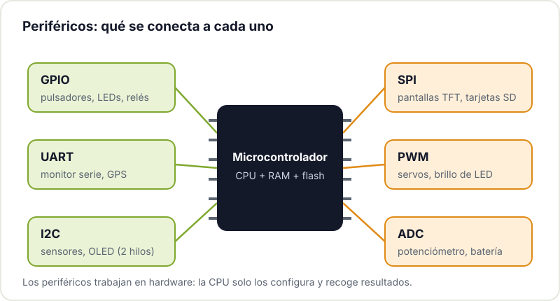
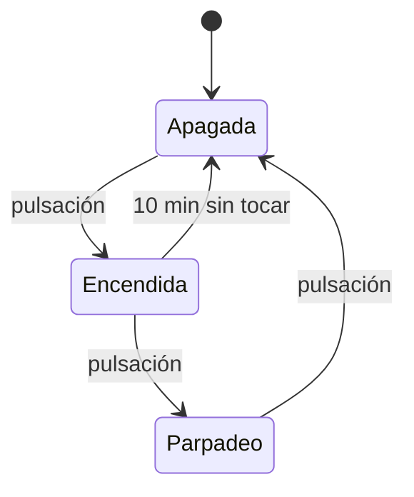

Un sistema embebido es un ordenador metido dentro de otra cosa y dedicado a una tarea concreta: el termostato de casa, la placa de una impresora 3D, el mando del garaje o ese ESP32 que mide la humedad de tus macetas. Programarlos se parece a programar un PC lo justo para que confíes demasiado y luego te lleves sorpresas.

Este post es un mapa para quien ya ha hecho parpadear un LED (si no, empieza por [empezar con Arduino](/blog/empezar-con-arduino/)) y quiere entender qué hay detrás: por qué `delay()` es un problema, qué es una interrupción, cuándo hace falta un sistema operativo y cómo se depura algo que no tiene pantalla.

## Qué cambia respecto a programar para un PC

**Recursos muy limitados.** Un Arduino Uno clásico tiene 2 KB de RAM. Un ESP32, unos cientos de KB. No hay memoria virtual ni disco: si te quedas sin RAM, el programa no avisa con un error amable, simplemente se cuelga o se reinicia. Por eso en embebido se evita reservar memoria dinámica sin control y se vigila el tamaño de cada buffer.

**El tiempo importa.** En un PC da igual que una tarea tarde 10 o 50 ms. En un sistema que controla un motor, lee un encoder o genera una señal, llegar tarde es un fallo, aunque el resultado sea correcto. A esto se le llama **tiempo real**: no significa "rápido", significa "con plazos que se cumplen siempre".

**No hay sistema operativo (o es mínimo).** No hay procesos, ni ficheros, ni terminal. Tu programa es lo único que corre, arranca al dar corriente y no termina nunca: por eso todo programa embebido acaba en un bucle infinito.

**Hablas directamente con el hardware.** Escribir un `1` en un registro enciende un pin. Leer otro te dice si ha llegado un byte por el puerto serie. Las hojas de datos (datasheets) del microcontrolador se convierten en tu documentación principal.

## Bare metal, RTOS o Linux embebido

Hay tres formas de organizar el software, de menos a más complejidad:

| | Bare metal | RTOS (por ejemplo, FreeRTOS) | Linux embebido |
|---|---|---|---|
| **Qué es** | Tu código directamente sobre el hardware, con un bucle principal | Un pequeño núcleo que reparte el procesador entre tareas con prioridades | Un sistema operativo completo en un procesador más potente |
| **Hardware típico** | Arduino Uno, ATtiny, STM32 pequeños | ESP32, STM32, RP2040 | Raspberry Pi, placas con procesadores de aplicación |
| **Tiempo real** | Sí, si lo programas bien | Sí, con prioridades y plazos predecibles | No garantizado de serie |
| **Arranque** | Instantáneo | Instantáneo | Segundos |
| **Ventaja** | Simple, control total, mínimo consumo | Varias tareas a la vez sin perder el control del tiempo | Red, ficheros, Python, cualquier lenguaje |
| **Cuándo** | Proyectos pequeños y de una sola función | Proyectos con WiFi, varias tareas o comunicaciones | Visión, interfaces complejas, servidores |

Lo curioso es que si programas un ESP32 con el entorno de Arduino ya estás usando un RTOS sin saberlo: el core de Arduino para ESP32 corre sobre [FreeRTOS](https://www.freertos.org/), y tu `loop()` es una tarea más. Cuando el proyecto necesita Linux (una Raspberry Pi haciendo de servidor, por ejemplo), aparecen otros problemas; los contamos en [cómo tener una Raspberry Pi funcionando 24/7](/blog/raspberry-pi-24-7/).

## Periféricos: el idioma del microcontrolador

El procesador es solo una parte del chip. Alrededor hay periféricos, bloques de hardware que hacen trabajo por su cuenta mientras tu código hace otra cosa. Estos son los que vas a usar desde el primer mes:



- **GPIO**: pines de entrada y salida digital. Pulsadores, LEDs, relés.
- **UART**: puerto serie asíncrono, dos hilos (TX y RX). El monitor serie, módulos GPS, otros microcontroladores.
- **I2C**: bus de dos hilos (SDA y SCL) compartido por varios dispositivos, cada uno con su dirección. Sensores de temperatura, pantallas OLED pequeñas.
- **SPI**: bus de cuatro hilos, más rápido que I2C. Pantallas TFT, tarjetas SD, memorias.
- **PWM**: genera pulsos de ancho variable. Brillo de LEDs, servos, velocidad de motores (con su driver).
- **ADC**: convierte una tensión analógica en un número. Potenciómetros, sensores analógicos, medir una batería. Tiene más trampas de las que parece; las explicamos en [cómo mejorar la precisión del ADC de un microcontrolador](/blog/precision-adc-microcontrolador/).

## Interrupciones

Imagina que tienes que reaccionar a un pulso de 1 ms en un pin. Si lo compruebas en el bucle principal cada cierto tiempo (*polling*), puedes perdértelo mientras haces otra cosa. Una **interrupción** le pide al hardware que pare lo que esté haciendo el procesador, ejecute una función corta (la rutina de servicio, ISR) y vuelva donde estaba.

```cpp
const int PIN_SENSOR = 2;
volatile unsigned long pulsos = 0;   // volatile: la modifica la ISR

void contarPulso() {                 // ISR: corta y sin delay ni Serial
  pulsos++;
}

void setup() {
  Serial.begin(115200);
  pinMode(PIN_SENSOR, INPUT_PULLUP);
  attachInterrupt(digitalPinToInterrupt(PIN_SENSOR), contarPulso, FALLING);
}

void loop() {
  noInterrupts();                    // copia segura de la variable compartida
  unsigned long copia = pulsos;
  interrupts();
  Serial.println(copia);
  delay(1000);
}
```

Tres reglas que te ahorrarán horas: la ISR debe ser **muy corta** (apunta qué ha pasado y sal), las variables compartidas con ella van marcadas como **`volatile`** y nunca uses `delay()` ni `Serial` dentro de una ISR.

## Deja de usar delay(): millis()

`delay(1000)` detiene el programa un segundo entero. Durante ese segundo la placa no lee botones, no atiende la WiFi y no hace nada más. Con un solo LED no importa; con dos cosas a distinto ritmo, sí.

 la CPU espera sin hacer nada. Con millis() da vueltas rápidas al bucle y actúa solo cuando toca.")

La alternativa es mirar el reloj: `millis()` devuelve los milisegundos desde el arranque, y en cada vuelta del bucle comprobamos si ya ha pasado el tiempo que esperábamos. Es el mismo patrón que el ejemplo oficial [Blink Without Delay](https://docs.arduino.cc/built-in-examples/digital/BlinkWithoutDelay/):

```cpp
const int LED_A = 8, LED_B = 9;
unsigned long ultimoA = 0, ultimoB = 0;
bool estadoA = false, estadoB = false;

void setup() {
  pinMode(LED_A, OUTPUT);
  pinMode(LED_B, OUTPUT);
}

void loop() {
  unsigned long ahora = millis();

  if (ahora - ultimoA >= 500) {      // LED A cada 500 ms
    ultimoA = ahora;
    estadoA = !estadoA;
    digitalWrite(LED_A, estadoA);
  }

  if (ahora - ultimoB >= 130) {      // LED B cada 130 ms, sin bloquear al A
    ultimoB = ahora;
    estadoB = !estadoB;
    digitalWrite(LED_B, estadoB);
  }
}
```

Fíjate en la resta `ahora - ultimoA`: escrita así funciona bien incluso cuando el contador de `millis()` se desborda y vuelve a cero (en un Arduino, tras unos 49 días).

## Máquinas de estados

Cuando el comportamiento depende de lo que ha pasado antes ("si está encendido y pulso, parpadea; si parpadea y pulso, apaga"), los `if` anidados se vuelven ilegibles enseguida. La solución clásica es una **máquina de estados**: el sistema está siempre en un estado concreto y solo cambia de estado ante eventos definidos.

Por ejemplo, una lámpara con un solo pulsador que además se apaga sola si nadie la toca en 10 minutos:



En código se traduce en un `enum` y un `switch`, combinado con `millis()` para el temporizador:

```cpp
enum Estado { APAGADA, ENCENDIDA, PARPADEO };
Estado estado = APAGADA;
unsigned long desde = 0;             // cuándo entramos en el estado actual

void cambiarA(Estado nuevo) {
  estado = nuevo;
  desde = millis();
}

void loop() {
  bool pulsado = leerPulsacion();    // con antirrebote, devuelve true una vez
  unsigned long ahora = millis();

  switch (estado) {
    case APAGADA:
      digitalWrite(LED, LOW);
      if (pulsado) cambiarA(ENCENDIDA);
      break;
    case ENCENDIDA:
      digitalWrite(LED, HIGH);
      if (pulsado) cambiarA(PARPADEO);
      else if (ahora - desde >= 10UL * 60 * 1000) cambiarA(APAGADA);
      break;
    case PARPADEO:
      digitalWrite(LED, ((ahora - desde) / 250) % 2);
      if (pulsado) cambiarA(APAGADA);
      break;
  }
}
```

Añadir un estado nuevo es añadir un `case`, sin tocar el resto. Y el diagrama sirve de documentación: si lo dibujas antes de programar, la mitad de los fallos aparecen en el papel. La [máquina de estados en la Wikipedia](https://es.wikipedia.org/wiki/M%C3%A1quina_de_estados) tiene la teoría completa si te pica la curiosidad.

## Cómo se depura algo sin pantalla

1. **El puerto serie.** `Serial.println()` en los puntos clave sigue siendo la herramienta más usada. Imprime valores, estados y marcas de tiempo; con eso se resuelve la mayoría de problemas.
2. **Un LED de diagnóstico.** Cuando el serie no está disponible (dentro de una ISR, antes de que arranque el USB), encender un pin es instantáneo y se ve con un osciloscopio.
3. **El analizador lógico.** Captura varias señales digitales a la vez y decodifica protocolos como I2C, SPI o UART. Cuando un sensor "no responde", ver qué bytes van y vienen por el bus resuelve la duda en minutos. Los analizadores USB económicos funcionan con software libre como [PulseView, de sigrok](https://sigrok.org/wiki/PulseView).
4. **JTAG o SWD.** Un depurador hardware permite parar el programa, avanzar línea a línea y ver variables, como en un PC. Algunas variantes del ESP32 (C3, C6, S3) traen USB-JTAG integrado; para STM32 se usan sondas como las ST-Link.



## Por dónde seguir

- Reescribe tus sketches sin `delay()`. Es el mejor ejercicio para pensar en embebido.
- Dibuja la máquina de estados de tu próximo proyecto antes de escribir una línea.
- Conecta un sensor por I2C y mira el bus con un analizador lógico, aunque funcione a la primera.
- Cuando necesites WiFi o varias tareas, da el salto al [ESP32](/blog/empezar-con-esp32/) y echa un vistazo a sus tareas de FreeRTOS.

Depurar en compañía es mucho más rápido que hacerlo a solas: en el Hackerspace Valencia siempre hay alguien con ganas de mirar una traza de un bus I2C contigo. Ven con tu proyecto y, si te quedas, [hazte socio/a](/pages/alta/).

## Créditos de imágenes

- **Portada** - *Core Learning Board module Arduino STM32 F103 C8T6* - Popolon - CC BY-SA 4.0 - [fuente](https://commons.wikimedia.org/wiki/File:Core_Learning_Board_module_Arduino_STM32_F103_C8T6.jpg)
- **Analizador lógico** - *Saleae Logic8 IMG 2876* - Myself248 - CC BY-SA 2.0 - [fuente](https://commons.wikimedia.org/wiki/File:Saleae_Logic8_IMG_2876.jpg)
- Diagramas: Hackerspace Valencia.
