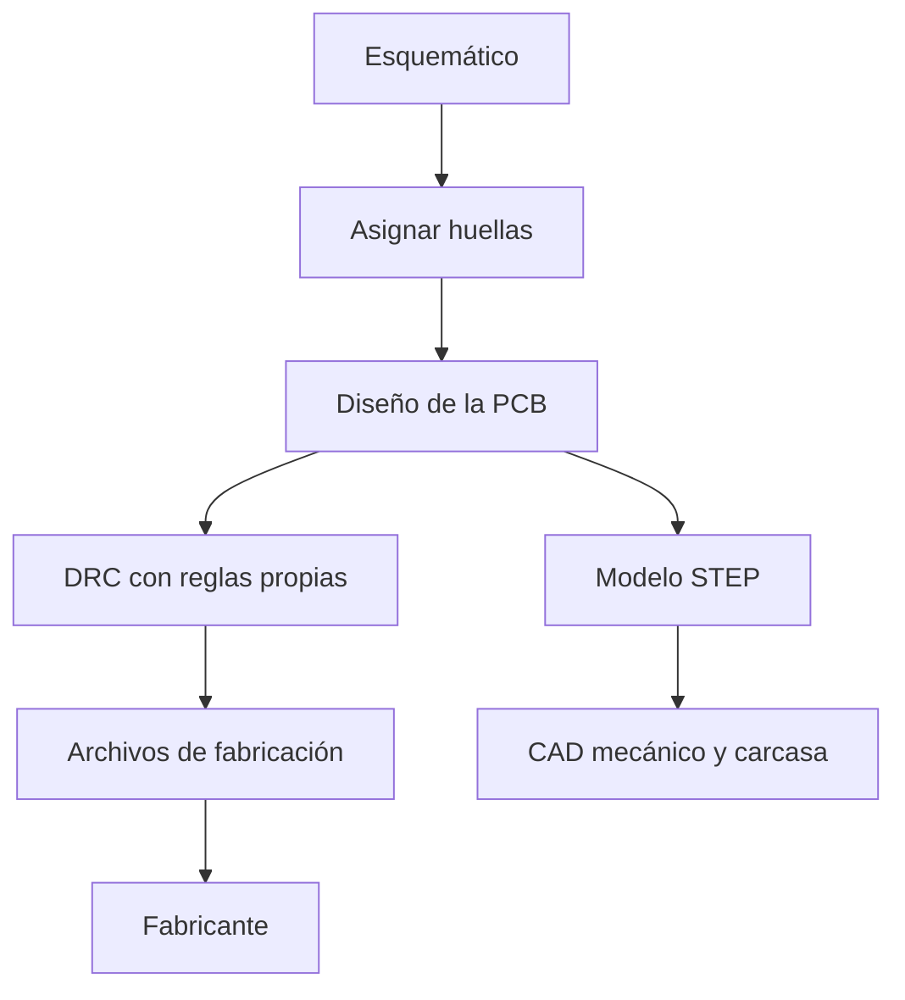
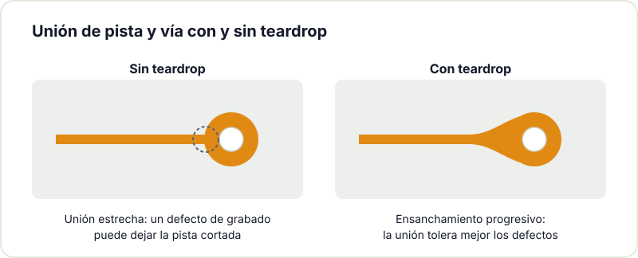

Hace unos años, diseñar una placa de circuito impreso con software libre era una apuesta incierta: KiCad existía, pero aún carecía de madurez. Hoy la situación es distinta: KiCad es una herramienta capaz de llevar un proyecto desde el esquemático inicial hasta los [archivos de fabricación](/blog/checklist-fabricacion-pcb/), sin coste de licencia y con formatos abiertos. La versión 10 continúa esa evolución. Esta guía repasa sus mejoras más relevantes para quienes diseñamos placas en un makerspace.

## Enrutador interactivo

El enrutamiento, la disposición de pistas entre componentes, concentra buena parte del tiempo de diseño. Las últimas versiones han mejorado de forma notable el enrutador interactivo: desplaza las pistas vecinas, respeta anchuras y separaciones y rinde mejor en espacios reducidos. En placas densas, la mejora se traduce en menos intervenciones manuales para rehacer pistas. También gana control el ajuste de longitud (length matching), relevante para memorias rápidas o señales que deben igualar su tiempo de propagación.



## Reglas de diseño personalizadas

Durante mucho tiempo, las reglas de diseño eran una lista fija de valores. Actualmente puedes definir [reglas propias en un lenguaje sencillo](https://docs.kicad.org/10.0/es/pcbnew/pcbnew.html#custom_design_rules), próximo a programar las condiciones que la placa debe cumplir. Por ejemplo: duplicar la separación entre dos redes concretas por motivos de ruido, o fijar un anillo de soldadura determinado en un conector específico. La regla se define una vez y el verificador avisa si se incumple. Para quien aprende, inculca buenas prácticas; para usuarios avanzados, reduce iteraciones de revisión.

## Teardrops integrados

Los teardrops, los engrosamientos en la unión entre una pista y una vía o un pad, se [gestionan ahora de forma integrada](https://docs.kicad.org/10.0/es/pcbnew/pcbnew.html#editing-teardrops). Refuerzan la placa frente a los defectos de fabricación y de grabado que pueden dejar una pista interrumpida en una unión débil.

## Salidas de fabricación más completas

Los Gerber siguen siendo el estándar para fabricación, pero cada vez más fabricantes aceptan formatos modernos como ODB++ o IPC-2581, que empaquetan toda la placa en un único archivo coherente. KiCad ha mejorado [estas exportaciones](https://docs.kicad.org/10.0/es/pcbnew/pcbnew.html#gerber-and-fabrication-output), lo que reduce los errores de interpretación por parte del fabricante. La lista de materiales y la guía de ensamblaje también incorporan opciones nuevas, útiles si la placa se lleva a montaje automático.

## Visor 3D e integración mecánica

El visor 3D permite comprobar la placa antes de fabricarla: colisiones entre componentes, posición de conectores y encaje en la carcasa. La exportación a STEP traslada el modelo al programa de CAD mecánico para verificar el conjunto completo. Para la [impresión 3D](/blog/empezar-impresion-3d/) de carcasas en el makerspace, esta integración entre electrónica y mecánica resulta especialmente valiosa.



## Esquemas jerárquicos y multipágina

Cuando un proyecto crece, una única hoja se vuelve ilegible. Los esquemas jerárquicos y multipágina permiten organizar bloques, reutilizar subsistemas y mantener el orden. La gestión de buses y de etiquetas entre hojas sigue mejorando, un aspecto decisivo cuando un proyecto pasa de prototipo a producto.

## Relevancia en un entorno makerspace

El valor de KiCad en un hackerspace no es solo que sea gratuito: cualquiera puede abrir los archivos, entender la placa y mejorarla. Esa es la [cultura del hardware libre](/blog/por-que-la-cultura-open/) que defendemos. Si siempre has querido [diseñar tu primera placa](/blog/del-kit-a-la-pcb-propia/), KiCad 10 es una buena oportunidad para comenzar.

En el Hackerspace Valencia organizamos [talleres de KiCad](/workshops/kicad/) con periodicidad. Acércate a una sesión de puertas abiertas y trabajaremos sobre un ejemplo sencillo para que salgas con tu primera placa diseñada. Y si quieres venir a diseñar cuando te venga bien, [hazte socio/a](/pages/alta/).

## Créditos de imágenes

- **Portada** - *Multi-Monitor KiCad* - AKK - CC BY 4.0 - [fuente](https://commons.wikimedia.org/wiki/File:Multi-Monitor_KiCad.jpg)
- **Editor de PCB** - *KiCad V6 PCB* - Jon Neal - CC BY-SA 4.0 - [fuente](https://commons.wikimedia.org/wiki/File:KiCad_V6_PCB.png)
- **Visor 3D** - *KiCad 3D Viewer Render Screenshot RP2350 Expansion Card* - VectorVoyager - CC BY-SA 4.0 - [fuente](https://commons.wikimedia.org/wiki/File:KiCad_3D_Viewer_Render_Screenshot_RP2350_Expansion_Card.png)
