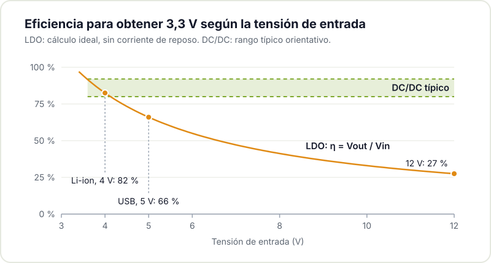
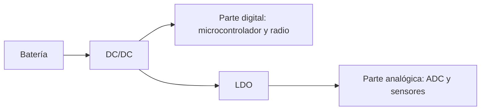

Todo circuito electrónico necesita alimentarse a su tensión de trabajo, y rara vez se dispone de ella de forma directa: la batería entrega una tensión superior a la necesaria, el USB proporciona 5 V y muchos [microcontroladores](/blog/introduccion-sistemas-embebidos/) operan a 3,3 V. Algo debe reducir esa tensión, y para ello existen dos familias de reguladores que conviene conocer: los lineales (LDO) y los conmutados (DC/DC). Una elección incorrecta se traduce en un circuito que se calienta, en una autonomía reducida o en ruido en la alimentación.

## Principio de funcionamiento

Un [LDO](https://en.wikipedia.org/wiki/Low-dropout_regulator) es un regulador lineal: toma la tensión de entrada y disipa el excedente en forma de calor para entregar en la salida la tensión deseada. Es sencillo, económico, compacto y muy limpio: la tensión de salida es prácticamente estable y sin rizado. Su limitación principal es la eficiencia: toda la diferencia entre entrada y salida se convierte en calor, de modo que cuanto mayor sea esa diferencia y la corriente de carga, mayor será la energía desperdiciada.

Un DC/DC es un [convertidor conmutado](https://es.wikipedia.org/wiki/Convertidor_Buck): almacena energía en una bobina y la transfiere en ciclos, lo que permite reducir, elevar o invertir tensiones con eficiencias altas, con frecuencia superiores al 80 o 90 %. A cambio es más complejo: requiere la bobina, un condensador de salida y un diseño de layout cuidadoso, e introduce rizado y ruido en la salida.



## Eficiencia y calor

Si la entrada y la salida están próximas y la corriente es baja, un LDO apenas desaprovecha energía y su simplicidad resulta suficiente. Pero al reducir la tensión de una [batería de litio](/blog/autonomia-real-bateria-iot/), en torno a 4 V, hasta los 3,3 V de un microcontrolador con consumos de varios cientos de miliamperios, un LDO disipa como calor cerca de una quinta parte de la energía (alrededor del 18 % a 4 V y del 21 % con la batería llena a 4,2 V). En ese escenario, un DC/DC extiende la autonomía de forma significativa.

## Ruido y sensibilidad

Al no conmutar, el LDO ofrece una salida muy limpia, condición esencial para alimentar circuitos analógicos sensibles, sensores de precisión o [conversores analógico-digitales](/blog/precision-adc-microcontrolador/). Un DC/DC siempre introduce rizado en la salida y radia cierto nivel de ruido, lo que puede afectar a medidas sensibles o a receptores de radio. En diseños que combinan digital y analógico, la solución habitual es un DC/DC para la etapa principal y un LDO posterior que limpie la línea que alimenta la parte analógica.

## Corriente de reposo

Para dispositivos que permanecen la mayor parte del tiempo en reposo, la [corriente que el propio regulador consume sin carga](https://www.ti.com/lit/an/slva079/slva079.pdf) importa tanto como su eficiencia en carga. Algunos LDO actuales presentan corrientes de reposo muy bajas, adecuadas para circuitos con batería que se activan con poca frecuencia. Un DC/DC puede presentar mayor consumo parásito, aunque existen modelos específicos de bajo consumo. Si tu circuito pasa el 99 % del tiempo [dormido](/blog/consumo-esp32/), compara este parámetro con detenimiento.

## Tamaño, precio y complejidad

El LDO resulta claramente ventajoso en este apartado: componentes diminutos, coste reducido y montaje difícil de errar siempre que se respeten sus condensadores. El DC/DC exige más componentes, una bobina con volumen apreciable y un [layout cuidadoso](/blog/checklist-fabricacion-pcb/), porque las pistas por las que circulan corrientes conmutadas actúan como antenas y son fuente de problemas si no se diseñan con criterio. Para un prototipo o una tirada pequeña, esa simplicidad tiene un valor considerable.

## Cómo decidir en la práctica

Cuatro preguntas orientan la decisión:

- ¿La diferencia entre entrada y salida es grande y la corriente alta? Considera un DC/DC.
- ¿Alimentas circuitos sensibles al ruido? Considera un LDO, en solitario o tras un DC/DC.
- ¿El dispositivo pasa la mayor parte del tiempo en reposo? Compara corrientes de reposo.
- ¿Es un prototipo sencillo con eficiencia no crítica? Un LDO reduce complejidad y coste.

No existe un ganador universal. En muchos proyectos conviven ambos: un DC/DC para el recorrido principal desde la batería y un LDO para limpiar la última etapa. Saber justificar la elección de cada uno es lo que diferencia una alimentación bien diseñada de una deficiente.

Si estás decidiendo cómo alimentar tu proyecto y tienes dudas, acércate al Hackerspace Valencia: revisamos tus requisitos de tensión, corriente y autonomía y te ayudamos a elegir el regulador adecuado. Y si quieres usar el taller cuando te venga bien, [hazte socio/a](/pages/alta/).

## Créditos de imágenes

- **Portada** - *XL4015-based CC-CV buck converter modules 02* - Retired electrician - CC0 - [fuente](https://commons.wikimedia.org/wiki/File:XL4015-based_CC-CV_buck_converter_modules_02.jpg)
- **Regulador 1117** - *Dell Professional P2212H - controller board - N415 1117-33-9917* - Raimond Spekking - CC BY-SA 4.0 - [fuente](https://commons.wikimedia.org/wiki/File:Dell_Professional_P2212H_-_controller_board_-_N415_1117-33-9917.jpg)
